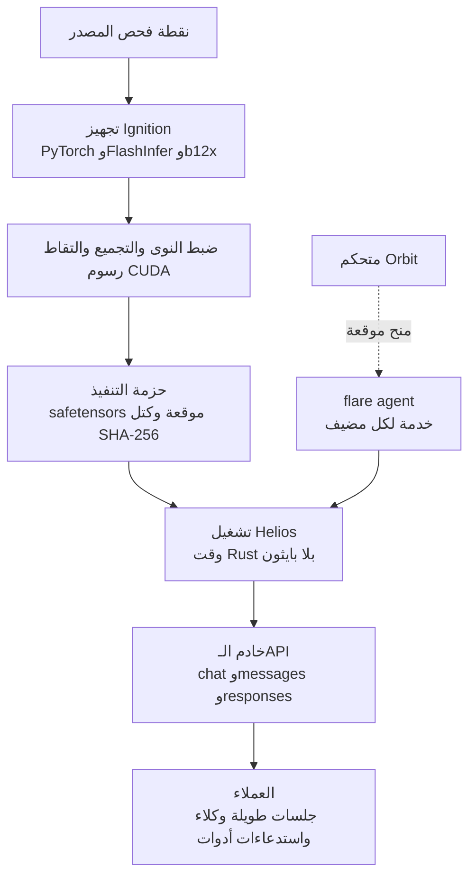

*جوهر فكرة Flare مجسداً: اشتعال يتصاعد من نواة كريستالية داكنة، مع طبقات هندسية هادئة أسفلها.*

## لماذا تقرأ هذا

إذا كنت تُشغّل الاستدلال المحلي على DGX Spark أو RTX PRO 6000 Blackwell، أو تدير جلسات وكلاء طويلة على vLLM، فهذا المقال لك. النتيجة أولاً: NVIDIA Flare ليس "إعادة كتابة vLLM بلغة Rust"، بل تنفيذ مرجعي لتصميم من مرحلتين تجمع فيه بايثون وقت البناء وتُشغّل Rust بدون بايثون وقت التشغيل، وهو نموذج بحثي تقول عنه وثيقته ذاتها إنه "لن يكون بديلاً محركات الإنتاج مثل vLLM أبداً". ومع ذلك، المستودع هو أكثر وثيقة ملموسة لشكل عقد التشغيل لأحمال الوكلاء الطويلة: حزم تنفيذ، تخطيط ذاكرة صريح، توزيع موقّع.

## نظرة عامة

نشرت NVIDIA مستودع `flare-local-inference` تحت منظمة `NVIDIA` على غيت هاب نحو 20 أكتوبر، بدون منشور إطلاق أو إعلان رسمي. وصل إلى منتديات NVIDIA للمطورين والمجتمع فوراً. الرخصة Apache 2.0، والنواة هي واجهة سطر أوامر بلغة Rust (حالياً v0.1.0).

عتاد الهدف ضيق: SM120 وSM121، أي معالج RTX PRO 6000 Blackwell المكتبية ورأس GB10 في DGX Spark. لا معالجات مراكز بيانات مثل H100 أو H200 أو B200، ولا معالجات مستهلكين مثل 5090. Flare خادم صُمم حول سؤال كيف تمضي ذاكرة هذه المعالجات ونطاقها واتصالها أبعد تحت حمل "محادثات طويلة، وكلاء برمجة، استخدام متكرر للأدوات". بكلام وثيقته ذاتها: vLLM يغطي اتساع النماذج والعتاد وأنماط النشر، بينما Flare يبادل هذا الاتساع بعقد تشغيل مركّز حول نماذج محددة وأحمال محلية.

قراءات المجتمع لهذا الإصدار تنظر إليه كتعزيز برمجيات لمنصة الاستدلال المحلي الكاملة التي أعلنتها NVIDIA في GTC Berlin (خطوط RTX Spark وDGX Spark وDGX Station العتادية). إنه NVIDIA يُكمل بنفسه ما يعمل فوق الرقاقة بعد شرائها.

## ما هو

تصميم Flare ينقسم إلى اسمين: Ignition وHelios.

Ignition مرحلة التجهيز في جانب بايثون. باستخدام PyTorch وTransformers وFlashInfer ومكدس نواة b12x لدى NVIDIA، يحمّل نقطة فحص المصدر، وضبط النوى، ثم تجميع الأمامي الكامل عبر torch.compile، وإجراء إحماء و التقاط رسوم CUDA لإنتاج **حزمة تنفيذ**. حزمة التنفيذ تتكون من ملف `.safetensors` أساسي يحمل الميتا بيانات فقط، بالإضافة إلى كتل حمولة غير قابلة للتعديل مسماة بملخصات SHA-256، مختومة بتنسيق Protobuf موقّع (جيل رابع، مع مسجلات رسوم و cubins مشفرة). الحد المنشور لحجم ملف الحمولة هو 64 غيغابايت.

Helios مرحلة التشغيل في جانب Rust. يحمّل الحزمة بدون بايثون ويعيد تشغيل رسوم CUDA الملتقطة بينما يعالج الطلبات. امتداد CPython اسمه `heliopause` يقع بين التجهيز والتشغيل، لكنه يوجد ليُمكّن Ignition من لمس Helios وقت التجهيز؛ مسار التشغيل بلا بايثون.

وثيقة التصميم الأساسية في المستودع تجيب عن سبب هذا الشكل مباشرة. "إعادة كتابة vLLM كاملة بلغة Rust" صفقة رديئة لأنها تقطع الوصول إلى منظومة نماذج بايثون ونواتها. بنية النموذج ودلالاته العددية وتحسينات المجلّعة وتجهيز النوى تبقى فوق العمل المتراكم في منظومة PyTorch، بينما يُفصل حلقة التشغيل فقط (الجدولة، تخزين الكاش، معالجة الطلبات) في وقت تشغيل Rust صغير ومشارك.

وصفات النماذج تبدأ بثماني: Nemotron 3.5 Bolt 74B-A9B 24GB (مخلوط MoE بنمط Mamba-2 مع مُشفّر رؤية C-RADIO ونموذج مسودة متعلم LiLiCorr)، Qwen3.8 27B (كمّية NVFP4، Gated DeltaNet)، Qwen3.8 Flash (خمسة رموز مسودة MTP، TP1/TP2)، DeepSeek V4 Flash وV4.1 Flash، MiMo V2.6 Pro MOPD، Step-5 Preview، وKimi K3. كل وصفة تعتمد تخزين KV بنمط FP8 E4M3 افتراضياً، بما فيها كاش نماذج المسودة المتعلمة.

تصميم توزيع حزم التنفيذ موثق بتفصيل. الحزم النهائية تستخدم ختم format-4 الموقّع، مع تشفير النوى ورسوم CUDA داخلها. حزم التوازي الرتبي تحمل حزمة موارد لكل رتبة، والرتب المتجاورة تشترك في تقسيمات الأوزان ضمن حد حجم الملف. الرسوم والنوى والموارد المساعدة تعيش في تقسيمات منفصلة، فتغير النواة لا يعيد كتابة تقسيمات الأوزان غير المتغيرة. وقت التصدير، تُعاد كتل غير المتغيرة من كاش الحزم عبر روابط صلبة. ما يُوزع ليس "ملف نموذج" بل "حزمة تنفيذ موقعة"، وهي دليل أن هذا التصميم يعامل التشغيل وحدة توزيعية.

معاملة الذاكرة والحالة المحور الآخر. تُخطط المخازن وسعات التنفيذ مقدماً، وتُعامَل حالة المحادثة (كاش KV معاً مع الحالة التكرارية) كائن واحد، فيبقى إعادة استخدام البادئ والفرز وإعادة الاستئناف محفوظة الحالة بشكل صحيح، كما توضح الوثائق.

شكل الـAPI يُظهر هدف هذا الخادم. خادم واحد يحمل أربعة بروتوكولات في آن واحد: OpenAI chat/completions وcompletions، وAnthropic messages وcount_tokens، وOpenAI Responses. أي أن العملاء يربطون كما هم سواء استخدموا مكتبة متوافقة مع OpenAI أو عميلا متوافقاً مع Anthropic. نقطة count_tokens تحديداً تخبرك بعدد رموز المدخل المُجهّز بدقة دون توليد، مما يمكّن عملاء الوكلاء من تخطيط ميزانيات prompts مع الثقة بحالة الخادم المُجهّزة. الأدوات لا ينفذها الخادم: العميل ينفذ الأدوات ويعيد النتائج في طلبات لاحقة، وحالة الجلسة تعيش في كاش الخادم (إعادة استخدام البادئ، الفرز، الاستئناف).

عندما يتوسع العتاد إلى عدة أجهزة، يظهر طبقة التحكم الأسري Orbit. المتحكم يشغّل `flare orbit`، وكل مضيف تشغيل يثبّت `flare agent` كخدمة مستخدم. Orbit يوضع النماذج المُجهزة على المعالجات، ويُوزع بيانات الحزم، ويبدأ ويُشرف مجموعات التشغيل. تشغيل التوازي الرتبي عبر DGX Spark من جهازين إلى أربعة فوق RoCE (b12x RoCEnante عبر منافذ ConnectX-7) يقع هنا.



*خط أنابيب Ignition/Helios من مرحلتين وطبقة التحكم الأسري Orbit.*

## التثبيت والتكامل

الأوامر الحقيقية من وثيقة model-preparation.md في المستودع. بيئة التجهيز وبناء واجهة السطر الأصلية:

```sh
uv sync --locked --extra prepare --extra test
cargo build --release --manifest-path flare/Cargo.toml
```

معتمدات البناء: مُجمّع C/C++، وCMake، وNinja، وpkg-config، وprotoc من Protobuf، ورؤوس OpenSSL، ورؤوس بايثون، ورؤوس liburing. على Ubuntu:

```sh
sudo apt-get install build-essential cmake ninja-build pkg-config protobuf-compiler libssl-dev python3-dev liburing-dev
```

التجهيز يتطلب عدة CUDA (nvcc وCUPTI). FlashInfer مثبّت على إصدار git محدد في pyproject.toml.

تصدير الحزمة (مثال Qwen3.8 27B، معالج واحد):

```sh
.venv/bin/ignition export qwen3.8-27b --gpus 0 --max-concurrency 4 \
  --output /data/flare-runtime/qwen38-27b-tp1-c4.safetensors --verbose
```

التشغيل:

```sh
./flare/target/release/flare run \
  /data/flare-runtime/qwen38-27b-tp1-c4.safetensors \
  --gpus 0 --bind 127.0.0.1:8001
```

وصفة Nemotron التي تستخدم MTP (توقع متعدد الرموز) تحدد رموز المسودة صراحةً:

```sh
.venv/bin/python -m ignition export nemotron-bolt-24gb --gpus 0 \
  --max-concurrency 8 --prefill-chunk-size 4096 --mtp-draft-tokens 7 \
  --speculative-token-capacity 64 \
  --output /data/flare-runtime/nemotron-bolt-images-lilicorr-c8.safetensors
```

ثلاث ملاحظات. أولاً، يجب تجهيز الحزم لكل حجم توازي رتبي (حزمة TP2 لا تُحمّل كـTP1). ثانياً، رأس GB10 في DGX Spark يتشارك DRAM الفيزيائية مع المعالج، فيُخصم هامش المضيف عبر `[memory] reserve` (مثل "4G")، ونظراً لأن NVML لا يبلغ سعة VRAM على GB10 فإن Ignition يخطط من MemAvailable في لينكس. ثالثاً، حزمة SM120 لا تُشغّل جهاز SM121 (فشل فحص المعمارية).

## محاولتنا العملية

حاولنا إعادة الإنتاج في بيئة ThakiCloud. مضيف التنفيذ ماك بوك macOS ARM، ولا يحمل أي من أسطول المعالجات لدينا (H100 وH200 وB200 و5070 Ti) رقائق SM120/SM121.

1. استنساخ المستودع: نجح استنساخ `NVIDIA/flare-local-inference` سطحياً (نحو 23 ميغابايت). البنية: flare (واجهة السطر)، وhelios (وقت Rust)، وheliopause (امتداد CPython)، وignition (تجهيز بايثون)، وpackaging، وqualify، وscripts، وdocs (نحو 12,000 سطر). ملاحظة: مسار منظمة `NVIDIA-AI` يعطي 404؛ المنظمة الحقيقية `NVIDIA`. بعض منشورات المجتمع خلطت بينهما.
2. محاولة البناء (macOS arm64): فشل جلب المعتمدات على اعتماد git خارجي (`deepseek-recipe`، مثبّت على إصدار محدد) عبر git الداخلي في cargo، ونجح بالمحاولة مجدداً عبر جلب git CLI النظامي الذي يقترحه cargo ذاته. ثم فشل تجميع `flare-helios` (وقت Rust) بأربع وعشرين خطأ (عدم توافق أنواع، وأخطاء متعلقة بعرض الأعداد الصحيحة، وغيرها). أهداف البناء الموثقة هي Ubuntu/Debian (مع قائمة اعتمادات apt صريحة) وWindows؛ macOS يبدو خارج النطاق المدعوم.
3. تشغيل الاستدلال: فشل. بدون معالج SM120/SM121 لا يمكن تنفيذ التقاط رسوم CUDA والتشغيل.

لذلك لا تحوي هذه المقالة أرقام مؤشرات أداء. أداء Flare مؤكد فقط عبر الوثائق المنشورة وتحليلات المجتمع (التحسين لمحادثات الحملات وأحمال الوكلاء، ومقابل اتساع vLLM)؛ المقارنات العددية تتطلب إعادة القياس على عتاد SM120/SM121.

## آثار على منتجات ThakiCloud

من منظور ai-platform: SM120/SM121 ليست في أسطولنا الحالي، فأحدث التبني بعيد. لكن النمط ذاته يعيش في نفس فضاء المشكلة الذي يُشغّل عليه مكدس vLLM لدينا اليوم. أولاً، مفهوم حزمة التنفيذ "تجميع وقت البناء، إعادة تشغيل وقت الخدمة" يقع في نفس السياق مع إعدادات Metis الخادمة الافتراضية المضبوطة (وضع التجميع، max_num_seqs)، وFlare يمدد النتيجة إلى وحدة توزيع موقعة (كتل 64 غيغابايت، التحقق من التنسيق، التوزيع الانتقائي لكل رتبة). ثانياً، نموذج الذاكرة الصريح الذي يخطط KV والحالة التكرارية كحالة محادثة واحدة نقطة مرجعية لفهم هيكل التكلفة لجلسات الوكلاء الطويلة التي يزداد سياقها باستمرار. ثالثاً، افتراض KV بنمط FP8 يقدم خط مقابلة مع خيارات كمّية vLLM لرفع الرموز لكل ذاكرة.

من منظور Paxis: الحمل الذي يوجّهه Flare وجهاً هو بالضبط شكل تنفيذ الوكلاء الذي تعالجه Paxis: ملاحق متكررة لنتائج الأدوات، فرز البادئ، استئناف الجلسة. تصميم Orbit القائم على المنح (المحكم/الوكيل) هو سطح تحكم مصغّر لـ"وضع استدلال الوكلاء على معالجات محلية والإشراف عليه"، وحين تمدد Paxis استدلال الوكلاء إلى حافة عميل أو معالج محلي، يعرض Flare شكل ذلك العقد مقدماً.

تمييز واحد يستحق رسمه متعمداً هنا. نموذج الثقة في Flare داخلي لمنظمة واحدة: الحزم الموقعة والمنح تفترض "متحكمنا يضع نماذجنا على أجهزتنا"، دون تعدد مستأجرين أو عزل عملاء خارجيين في التصميم. حين تحل Paxis نفس المشكلة، تُضاف العزل بين العملاء وبوابات السياسة وسجلات التدقيق فوق ذلك. إذا كان عقد Flare هو النواة الصغرى لاستدلال الوكلاء، فإن Paxis هي مشكلة امتداد تلك النواة حتى حد المؤسسة. الاثنان قريبان من علاقة تراتبية، لا تنافسية.

## حدود ومضادات

أولاً، المستودع يسمي نفسه نموذج بحث. الوثيقة ما تزال تحمل الجملة أن حزم Qwen TP4 تحتاج تحقق النموذج.

ثانياً، التغطية ضيقة: ثماني وصفات نماذج، معماريتا معالج. لا تُقارن على نفس المستوى مع آلاف نماذج vLLM وكل معالجات مراكز البيانات. عبارة README أن Flare "لن يكون بديلاً لمحركات الإنتاج مثل vLLM أبداً" تُقرأ أقل كمتواضع وأكثر كإعلان تصميم.

ثالثاً، انتبه لتصادم الأسماء. لدى NVIDIA منذ سنوات FLARE (Federated Learning Application Runtime Environment)، حزمة SDK للتعليم الفيدرالي. السهل الخلط بينهما في البحث؛ ميّز خادم الاستدلال المحلي هذا بمستودع `flare-local-inference` وسياق SM120/SM121.

رابعاً، "بلا بايثون في التشغيل" وحدها ليست جديدة بما يكفي للادعاء. vLLM أيضاً يلتقط ويعيد استخدام رسوم CUDA، ولغة المضيف بذاتها ليست كل الأداء. جديد Flare ليس لغة حلقة التشغيل بل حزمة التنفيذ الموقعة كوحدة توزيع، والتخطيط الصريح للذاكرة المبني على هذا الافتراض، وعقد الـAPI المضبوط لأحمال الوكلاء.

خامساً، تكلفة إعادة الإنتاج. تثبيتات fork لـFlashInfer بإصدارات git محددة، واعتمادات مستودعات وصفات خارجية، واعتمادات نظام مثل عدة CUDA وliburing ترفع عتبة "استنسخ وشغّل". حين يتحول هذا النموذج البحثي نحو بنية إنتاج، تصبح تكلفة صيانة هذه الشبكات المتغيرة الحقيقية.

## الخلاصة

NVIDIA Flare يضمّن مشكلة تشغيل أحمال الوكلاء على معالجات الجرافيك المكتبية المحلية في عقد واحد: جهّز ببايثون، شغّل بـRust، وزّع بحزم موقعة. لمن يُشغّل DGX Spark أو RTX PRO 6000، ثماني وصفات النماذج هي المرشح؛ ولمهندس المنصات، تصميم حد Ignition/Helios وثيقة تستحق القراءة.

الخطوة القادمة واضحة: إعادة قياس أرقام مؤشرات الأداء على عتاد SM120/SM121 ومقارنتها مع vLLM على نفس الحمل. هذه المقالة هي تحليل الحالة بدون أرقام؛ حين تهبط الأرقام، يلزم إعادة كتابتها.

## المصادر

- مستودع غيت هاب: [NVIDIA/flare-local-inference](https://github.com/NVIDIA/flare-local-inference) (Apache 2.0، وثائق، وصفات، وثائق Orbit)
- منتدى مطوري NVIDIA: [Flare - NVIDIA's new inference server in Rust](https://forums.developer.nvidia.com/t/flare-nvidias-new-inference-server-in-rust/386436)
- تحليل المعمارية: [veduis.com، معمارية NVIDIA Flare](https://veduis.com/blog/nvidia-flare-architecture-local-inference/)
- المقارنة مع vLLM: [explainx.ai، NVIDIA Flare مقابل vLLM](https://www.explainx.ai/blog/nvidia-flare-local-inference-rust-server-sm120-dgx-spark-agents-2026)
- نظرة على الأداة: [singularitybyte.com، NVIDIA Flare](https://singularitybyte.com/tools/nvidia-flare-local-inference-server-dgx-spark.html)
- التغريدة الأصلية: [x.com/hjguyhan/status/2113088158032433360](https://x.com/hjguyhan/status/2113088158032433360)
