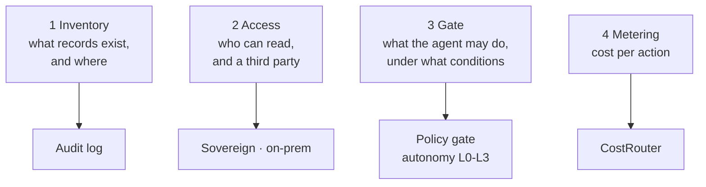

Today, the conversations you have with AI are heading to four places you probably never imagined: a courtroom, a witness stand, bankruptcy papers, and an auditor's desk.

The question is no longer how smart it is. The question is who recorded what, and who can read it.

Let's start with the shortest case.

The US Department of Justice (DOJ) linked a bugging suspect to a chatbot account. The account belonged to Abdulrahman Alfozan, a former OpenAI engineer. That account had asked the chatbot detailed questions about recording devices.

The chatbot did nothing wrong in this case. It simply answered what it was asked. But that conversation is no longer a service log. It became a record that points at a person. The question and the answer, bound to an identity-bearing account, formed a single line that pointed at the suspect. The help the suspect was looking for remains there as a lead the prosecutors picked up. What filled the gap was not the chatbot's answer, but the account holding the answer.

What is worth noting is that this is not a one-off exception. The other news from this morning all points at the same object: usage records.

*A visual metaphor for the article's key idea.*

## Case No. 1: The Crime Scene That Is the Chat Window

Let's first look at why the prosecutors started their investigation from a chatbot. The answer is hidden in the structure of the consumer chatbot. No policy gate, no approval step, no one asking why. You can ask anything, any time, as much as you want. The questions and answers remain in the account log as they are, and the account is tied to an identity. The tool has no friction, but the record points at a person. This asymmetry turned the chat window into a crime scene.

The path of the investigation also stands on this structure. Unlike an anonymous community, a chatbot account is bound to a person, and the prosecutors confirmed exactly that connection. Then, from the query history inside the account, they found interest in bugging equipment. A question about the details of a recording device shows, as is, what the person who asked it is interested in. It is less that the answer was the problem; the question itself became the lead.

There are reasons the chatbot was chosen. It is open day and night, it does not ask about purpose, and it does not separate the user's identity from their intent. The knowledge of what devices exist and how they work is no longer the exclusive property of experts or closed communities. It has moved into a form where you type it into a general assistant and get an answer, and that move became the starting point of the investigation.

For enterprises, the same sentence has to be pushed one step further. If a consumer chatbot's log has already been used as evidence in an investigation, the records of an enterprise agent go without saying. Enterprise agents go one step further here. A consumer chatbot stops at answering, but an enterprise agent acts. It calls APIs, reads and writes files, and executes commands. The question log is its surface, and the action log is beneath it. In a world where conversations become evidence, the action itself becomes the crime scene.

## Case No. 2: The Testimony of 100x

According to the claims of OpenAI's former safety lead, OpenAI's use of agentic compute grew 100x. The evaluation that followed is sharper. He saw OpenAI as building AI with capabilities that greatly exceed readiness for human alignment and control.

What is this testimony measuring?

The answer is the gap itself. Compute usage eventually becomes a proxy for the volume of action. Every action an agent takes is a conversation with the system. API calls, file access, command execution. If the workload is 100x, the records left behind are 100x. But the number of people who read records does not increase. What grows is the record; what does not grow is the people. That is what the number 100x is really pointing at.

Seeing where the testimony comes from changes the weight of the signal. It is the word of a former safety lead who watched the process from the inside. What should be read before the number 100 is the direction: the direction in which capability grows faster than control readiness. As long as that direction continues, the records keep moving beyond the range human hands can read.

From an operations team's point of view, the message is more concrete. If action grows 100x, the budget of human review available per action approaches nearly zero. Review that cannot happen after the fact. Control moves before execution. Deciding before execution which actions, under which conditions, and inside which isolation will be permitted. That is the seat of the policy gate.

Translated into the language of Case No. 1, an unreadable record is an uninvestigable crime scene. In a world where conversations that can become evidence have multiplied a hundredfold, the remaining choice is one: a machine that reads the record first. Not after the fact, but in real time. Testimony that readiness for alignment and control has lagged is, in the end, also testimony that readiness for reading has lagged.

## Case No. 3: The Ledger That Killed the Business

This morning, from the opposite side, a case was confirmed where usage records decided the outcome. AI companion app developer Character.AI applied on Monday to a Delaware court for Chapter 11 protection. The purpose is one: managing the growing debt. The numbers in the bankruptcy papers are concise. $14 million a month in compute costs, $1 million in revenue. For every $1 earned, $14 of compute cost is written into the ledger.

Remember the nature of the companion workload, and the arithmetic comes naturally. The conversation does not end, users talk day and night, and the longer a session runs, the more tokens pile up. Revenue is not paid per conversation, but the cost structure occurs immediately for every token. The ledger grew ahead of the business. The 14-to-1 ratio is less a story that the technology was bad; it is a story that the value the conversation creates and the price that is paid for it drew two different curves.

Seen through this lens, the Chapter 11 filing reads as a legal procedure that puts a brake on the usage ledger. The company is not denying the value of AI conversation; it is trying to change the structure of the debt the conversation produced. Usage records do not only decide the outcome. They are shaping the form of the debt as well.

The ledger the prosecutors summon and the ledger that kills the business are the same ledger. Usage records are being accounted for in two places. The courtroom asks who wrote what, and the profit and loss statement asks how much was spent on what. The questions differ, and the object is one.

Consumer subscription billing is also beginning to acknowledge this. Cursor and Grok users can combine their accounts into a single billing plan, and AI access is redistributed as a 7-day shared allowance. It is a structure that pools usage and allocates it weekly. The pool is also a device that tidies usage behavior. When the allowance is shared and refilled on a cycle, users operate inside that structure. The courtroom, the profit and loss statement, and the billing system are all turning the same lever: the usage ceiling. The moment usage records become a billing unit, they are no longer a byproduct. From the start, they become a design target.

## Case No. 4: The Audit's Request

The US and the UK are negotiating a partnership. The content is formalizing the UK AI regulator in a third-party audit role. The negotiation draft also includes allowing an AI safety research agency employee-like access. In this, the badge comes out of the auditor, not the AI.

The function of reading logs is becoming an institutional role. Regulators are no longer asking what it can do. They ask to see the records. Once third-party audit takes its place as a formal role, whether records exist and whether a third party can read them become the gate of regulatory compliance.

Look one step further at the expression "employee-like access," and it comes close to the meaning that the safety research agency is entering the system at the same level as an insider. Log access is moving from a trust issue between the company and the regulator to a structural clause of the partnership. On the day log access becomes a clause, a company that does not produce records as first-class resources loses the position to answer the regulator's questions.

And the records are getting longer. This morning, alongside it, came the news that Google opened Gemini 4 Argon to subscribers and developers worldwide and launched a paid API. When the model opens, conversations are born, and when conversations are born, the records grow longer. A structure where opening is pulled forward and the audit follows from behind. The two streams meet at the same point.

## The Verdict Is the Company's Job

Tying this morning's four cases into one line: the courtroom, 100x, 14-to-1, the auditor's desk. The object in the middle is the same. Usage records.

Then the question left for the company is one: who, with which AI, on which work, with what authority, and for how much did they execute it? Can you answer that now? If the answer is in a third party's log, or nowhere, that record is not an asset. It is a liability being accounted for on someone else's desk.

The order of the answer comes in four stages. First, inventory. What records exist, and where they are. Next, access. Who can read them, and can a third party read them. Third, the gate. What can the agent do, under what conditions. Finally, metering. How much does one action cost. In the end, what this morning's four cases demand is a structure that runs these four stages at the execution level.

Matching the four stages to their execution-level components, one by one:

ThakiCloud's Paxis is an Agent-Native Cloud that takes this question as its design starting point. It is a formal product (v1.1 GA). In Paxis, Skills, Tools, Policies, and Audit Logs are first-class resources, not options bolted onto a log server. Autonomy is governed step by step from L0 to L3, a pre-execution policy gate checks authority, and every action runs inside an isolated sandbox and is left as an audit log. MCP connectors and the skill marketplace manage the tools the agent uses, and sovereign/on-prem K8s (ai-platform) provides an execution environment where the records themselves do not leave the site. CostRouter's per-task model selection turns the arithmetic of Case No. 3 into an execution-level routing problem.

Dropped in the language of case numbers, the verdict goes like this. The evidence of Case No. 1 is the audit log. The brake on the 100x of Case No. 2 is the policy gate and the autonomy levels. The 14-to-1 arithmetic of Case No. 3 is CostRouter's job. The seat of the audit in Case No. 4 is the sovereign on-prem environment.

Nowhere in today's four cases is there a story where the person who used the AI was punished. What became the problem was not the use, but whether a record exists, who can read it, and who pays the price. A conversation with AI is no longer the cost of convenience. It is evidence. It is an asset. What separates the two is one thing: was it recorded, and can it be read.

## References

This post was written by synthesizing the news below.

- HuggingNews, [DOJ Links OpenAI Bugging Suspect to Chatbot Queries About Recording Devices](https://huggingnews.com/ai/doj-links-openai-bugging-suspect-to-chatbot-queries-about-recording-devi-a11aac3d)
- HuggingNews, [Google Opens Gemini 4 Argon Globally to Pro Subscribers and API Developers](https://huggingnews.com/ai/google-opens-gemini-4-argon-globally-to-pro-subscribers-and-api-develope-0bba3d49)
- HuggingNews, [OpenAI Agentic Compute Use Jumped 100x per Departing Safety Lead](https://huggingnews.com/ai/openai-agentic-compute-use-jumped-100x-per-departing-safety-lead-2ffabab5)
- HuggingNews, [Character.AI Spent $14M a Month on Compute against $1M Revenue](https://huggingnews.com/ai/characterai-spent-14m-a-month-on-compute-against-1m-revenue-60e3fa5f)
- HuggingNews, [SpaceXSI Shifts AI Usage to Weekly Pools in Unified X Subscription](https://huggingnews.com/ai/spacexsi-shifts-ai-usage-to-weekly-pools-in-unified-x-subscription-fb77fa7a)
- HuggingNews, [US and UK Negotiate Employee Like Access for AI Safety Institute](https://huggingnews.com/ai/us-and-uk-negotiate-employee-like-access-for-ai-safety-institute-2dde7b16)
