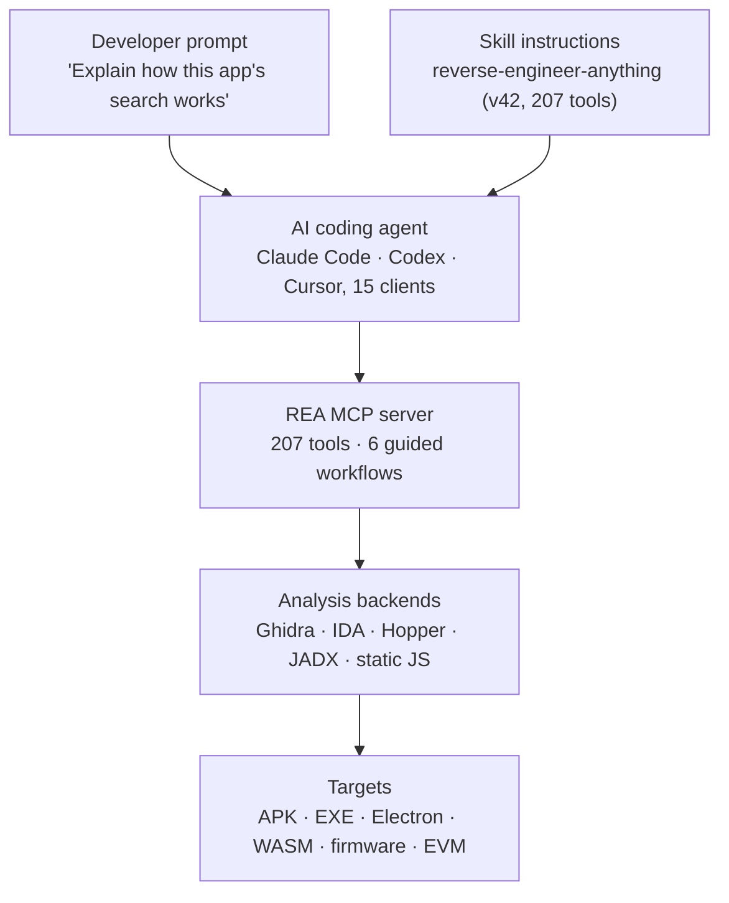

A tool that lets AI coding agents reverse-engineer software went viral in the developer community this week. Point it at an Android APK, a Windows binary, an Electron app, or firmware, and the agent explains how the software works, with evidence, without source code.

I verified what REA actually ships. I pulled the official npm package, cross-checked the repository metadata against the GitHub API, and read the bundled skill manifest and docs. What I found: 207 tools, six guided investigation workflows, registrations for 15 agent clients, and an explicit warning that the tool is not a sandbox. This post contains no executed reverse-engineering results. It documents the design, and the risk that design carries, for anyone building agent execution environments.


*The structure of REA: an agent calls reverse-engineering tools over MCP while backends analyze the binary locally.*

## Why read this

For people designing agent tooling, or weighing the risk of pointing an agent at untrusted targets, this post gives two things. First, a concrete MCP server design: a tool catalog, guided workflows layered on top of it, and an evidence model. Second, a concrete shape of the warning that local execution is not safety.

<!-- nlm-visual -->

*Infographic generated by NotebookLM from the sources.*

## Overview

REA (Reverse Engineer Anything) is an open-source project by morluto. It is MIT-licensed, written in TypeScript, hosted at github.com/morluto/rea, with a site at rea.tools. As of 2026-10-15 the GitHub API reports 257,191 stars and 64,641 forks, and the repository was created on 2026-04-14.

It ships as a single npm package. The latest release, 6.5.0, exposes two commands, rea and rea-agents, and both enter the same script. The project releases fast. The npm registry shows v4.0.0 on October 5 and seven major or minor releases by v6.5.0 on October 14.

## What this tool is

### 207 tools, 6 guided workflows

The surface an agent sees is an MCP (Model Context Protocol) server. The bundled skill manifest (reverse-engineer-anything, v42) records a tool count of 207. Targets span native binaries (PE/ELF), Go and Rust binaries, .NET assemblies, EVM bytecode, Electron and JavaScript apps, Android APKs, Flutter apps, WASM, firmware, macOS bundles, websites, and live process behavior.

Native analysis runs on a separate backend: an existing Hopper, Ghidra, or IDA installation. The Ghidra and IDA bridges ship in the package as Java sources. Android needs JADX and Java. Static JavaScript analysis needs no native engine at all.

Six guided investigation workflows open through the MCP prompts capability: investigate_feature, compare_application_versions, verify_reconstruction, trace_crash, audit_residual_unknowns, and prepare_bounded_process_capture. The prompts do not add or remove tools. They propose an investigation flow, and the agent can always call tools directly.

### The evidence model

The concept REA's docs keep returning to is Evidence. Tool results carry evidence inline, and evidence is referenced by IDs retained in a session ledger. The docs' instruction is short: keep observations, inferences, and unknowns apart. Residual unknowns become first-class audit objects, and the audit_residual_unknowns workflow exists to work through them.

The README's headline example starts like this: "Understand how search works in the Notes app, show me the evidence, and build a similar feature for my project."



*The path from one developer prompt to the target binary, through the agent, the MCP tools, and the analysis backend.*

## Setup and integration

If you have Node.js, it is one line. The commands below are from the official README.

```bash
# Register with your agent (MCP server + skill install, existing config backed up)
npx rea-agents setup

# Install the CLI for regular use
npm install --global rea-agents
rea --help

# Static JS/Electron analysis (no native engine required)
npx -y rea-agents@latest analyze-javascript-application /absolute/path/to/app --json

# Status diagnostics (per client)
npx -y rea-agents@6.5.0 doctor --client codex --json
```

setup walks you through choosing an agent, reviews the proposed changes, and on approval registers the MCP server and installs the matching skill, backing up existing configuration. The skill manifest lists 15 supported clients: claude_code, claude_desktop, codex, cursor, gemini_cli, windsurf, devin, opencode, antigravity, copilot_cli, commandcode, vscode, grok_build, omp, and grok_bot. The Node requirement is 22.19 or newer, 24.11 or newer, or 26 or newer (the local Node used for verification was 22.22.3).

## What I actually verified

### Verification design

The verification in this post is a package dissection, not a reverse-engineering run. Executing downloaded third-party code requires user approval in this environment, and I did not request it, so this post contains no execution numbers. Everything below was actually checked.

### What I saw

- Pulled and inspected the latest package from the official npm registry: a 5.6MB tarball with 1,650 files.
- package.json declares 39 runtime dependencies, including playwright-core (browser observation), evmole (EVM bytecode), the xterm family (terminal sessions), and the Model Context Protocol client/server SDKs.
- The bridge/ directory bundles Java sources for the Ghidra bridge (ReaGhidraBridge.java, ReaGhidraAnalysisOptions.java, and more) and the JADX bridge for Android.
- scripts/ includes hook scripts for observing Electron app runtimes (electron-active-hook.cjs, and more).
- The skill manifest's tool_count=207, version=42, and the 15 supported clients all match what is stated above.
- Repository metadata cross-checked via the GitHub API: 257,191 stars, 64,641 forks, MIT, created 2026-04-14, last push 2026-10-15 (the day of verification).

### What I didn't see

No numbers from actually opening and analyzing a binary. Analysis quality, latency, and crash-trace success rates come only from runs, and I do not claim them here. The star count is the API value at the time of verification (2026-10-15), higher than the 110k to 250k figures reported by various outlets that week.

## Implications for ThakiCloud

First, three patterns the Paxis MCP connector design can reuse: building the tools as a catalog (207), layering guided workflows on the catalog (six prompts), and giving outputs evidence IDs so observations and inferences stay separate (the Evidence model). When a Paxis skill harness bundles domain tools, the difference between handing the agent tools alone and tools with a workflow shows up in success rates.

Second, the risk this tool documents is the reason Paxis sandboxes exist. REA's docs and disclaimer are explicit: it is not a sandbox; opening an untrusted binary parses it with your local privileges; a malicious file can contain strings that look like instructions, and an agent may act on them. On a local machine that happens on your hardware. In an agent execution infrastructure, the same exposure is absorbed by isolated sandboxes, policy gates, and audit logs. That is the structure Paxis uses when it runs agents: isolated execution, with every action through a policy gate.

Third, local execution itself is an on-prem property. The fact that the analysis target never leaves the machine is the same quality Aegis provides in closed networks. Data sovereignty as a feature of a reverse-engineering tool is a case worth remembering.

## Limitations and counterarguments

Two hundred and seven tools are a strength and a risk. The larger the surface an agent can move on, the more trust the agent's behavior must earn. With seven releases in a week, the installed skill can drift from the live server; REA's own skill doc warns that a skill from repo main may describe capabilities an npm release lacks. The legal boundary is drawn explicitly: no DRM circumvention, no cheats, no unauthorized access, no copying proprietary software, and reverse engineering is jurisdiction-dependent. Finally, this post is based on a package dissection, not an evaluation of run quality.

## Summary

Agent reverse engineering has reached the stage where it is a setup. Keep the targets to software you own or are authorized to examine, and start with the README's one-line example. For anyone building agent execution infrastructure, take three things: a workflow on top of a tool catalog, an evidence model that makes outputs auditable, and the warning that local execution is not safety. If you point an agent at a binary, the thing that should carry the risk is an isolated execution environment, not the developer's machine.

<!-- nlm-visual -->

*Infographic generated by NotebookLM from the sources.*

## References

- REA official repository, [morluto/rea](https://github.com/morluto/rea)
- REA official site, [rea.tools](https://rea.tools)
- npm package, [rea-agents](https://www.npmjs.com/package/rea-agents)

Star, fork, and release figures are from the GitHub API and the npm registry as of 2026-10-15.
