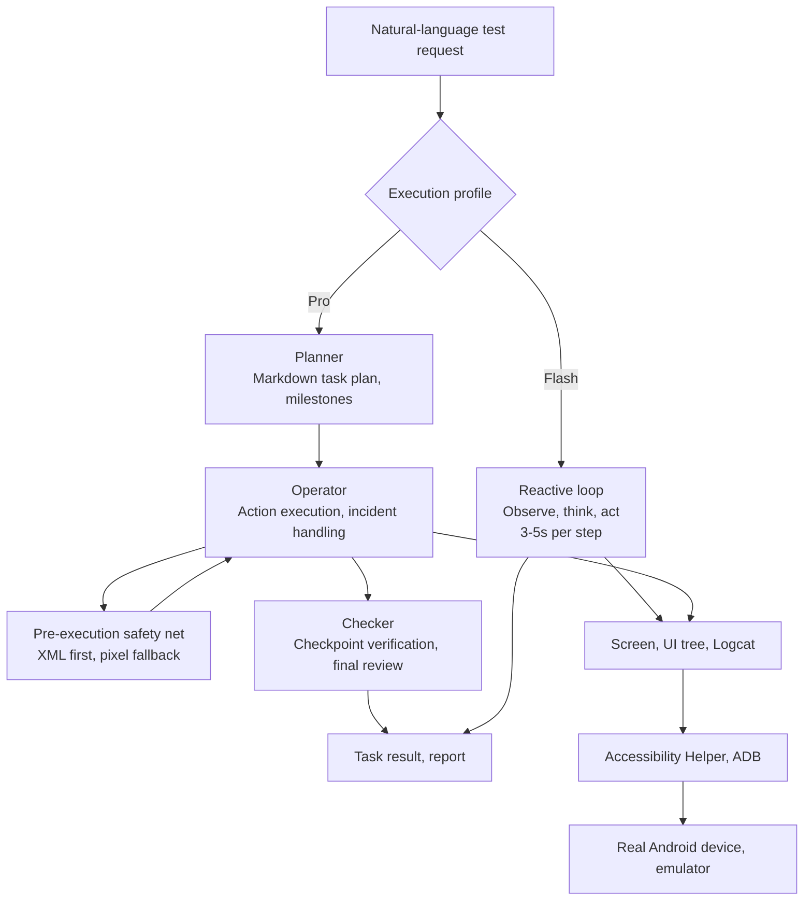

*The phone as a programmable tool: ARTEMIS connecting a coding agent to a real device over MCP, rendered as an abstract scene.*

## Why Read This

This post is for mobile QA engineers, platform engineers who run agents, and anyone watching where AI testing is going. The conclusion first: what Google's open-source ARTEMIS actually ships is not a screen-automation script, but the contract that makes a phone screen a tool of the agent. A USB-debugging phone or an emulator connects to coding agents like Claude Code and Codex through five MCP tools, and the test engineer's job moves from writing click scripts to reviewing the agent's test plan.

## Overview

ARTEMIS is a project Google open-sourced in late October 2026 under the `google` GitHub organization. It is Apache 2.0 licensed and runs on Python 3.12 or later. The README describes it as an "Autonomous Multimodal Android Agent & Testing Framework." In one sentence, it turns natural-language instructions into reliable Android automation.

The demo is a cross-app workflow: set up driving routes in Google Maps, calculate total durations, then open YouTube and play a Coldplay song. The benchmark is AndroidWorld, operated by Google Research, spanning 20+ apps and 100+ multi-step tasks. ARTEMIS reports a 99%+ completion rate, and the README calls it SOTA.

There are four usage interfaces: a web visual test console, an MCP server, a developer CLI, and a Python SDK. The console runs on localhost:8000 and provides live screen mirroring, a prompt sandbox, and execution replays. The SDK's `artemis-client` has zero runtime dependencies; ADB, the agents, and the models stay on the device host.

## What ARTEMIS Is

The design centers on two execution profiles: Flash and Pro.

Flash is a reactive observe-and-act loop. One model watches the live screen, thinks, and acts. The README puts it at roughly 3 to 5 seconds per step. There is no graph orchestration. History is not dropped but compressed: older screenshots fold into visual summaries, completed steps become searchable chunks, and `search_history` and `replay_steps` recall them on demand. Transient UI such as quick-fading toasts is handled by chaining taps into a single `click_sequence`. The limits are stated explicitly: no task plan, no notes, no pre-execution safety net, no checkpoint verification or final report, and no ADB shell.

Pro is the other side. A Planner maintains a living Markdown task plan with milestones and verify/assert items. An Operator executes with the full toolset. Before each action, a safety net checks the target against the live UI tree and the pixels, XML first and pixel fallback. A blocked or failed action opens an execution incident that stays in the Operator's context until a later action succeeds; there is no separate repair agent. A read-only Checker verifies plan checkpoints and runs an exit review against the original goal, tunable from off through final, checkpoints, and strict. Pro steps are listed at roughly 15 to 40 seconds, and it handles 100+ step long-horizon workflows and `[Loop:continuous]` monitoring.

| | Flash | Pro |
|---|---|---|
| Loop | Reactive observe-and-act | Planner/Operator/Checker graph |
| Step time | ~3-5s | ~15-40s |
| Pre-execution safety net | None | XML first, pixel fallback |
| Verification | None | Checkpoints, final review |
| ADB shell | None | Available |

Element locating is multimodal. Accessibility hierarchy and OCR come first, with a visual model as fallback for custom UI such as Canvas, Compose, and Flutter. On the device side, an accessibility service called the Artemis Accessibility Helper reads the screen layout without holding the UiAutomation connection. The README says it listens only on the phone itself and sends nothing elsewhere. If the helper fails mid-task, ARTEMIS falls back to UIAutomator2 and records that in the task timeline.



The MCP server is where the phone meets the coding agent. It is a native server supporting stdio and SSE transports, with five tools. `mobile_run_task` starts a task asynchronously. `mobile_manage_task` covers the lifecycle: status, stop, instruction injection. `mobile_get_device_state` gives real-time observation as a screenshot or an OCR plus XML hierarchy. `mobile_inspect_trace` digs into traces. `mobile_diagnose` acts as an environment doctor, returning a ready, degraded, or blocked verdict with an ordered fix list. With `attempt_fix=true` it performs safe self-heals such as regenerating corrupted ADB keys or restarting the ADB server.

IDE support is wide: Antigravity, Cursor, Claude Code, Codex, Windsurf, VS Code, Cline/Roo, and OpenClaw. `uv run artemis mcp --install all` mounts the MCP config and the rules file in one shot. The rules file `rules.md` is called the Mobile Testing Mindset. It teaches the agent to explore the live app before writing test scripts (the runnable code principle), to route between Flash and Pro, to compensate for latency and timing, and to prefer dynamic UI locators with a coordinate fallback.

The headline usage in the README is an autonomous testing workflow with Antigravity. You enter a test scenario as a prompt, and ARTEMIS turns it into a step-by-step test plan for review. It then drives a real device, navigates the UI, and profiles performance, finally delivering a structured report with audit findings, metric tables, and raw datasets. The example prompt: build the latest changes into an APK, install it on the connected device, open the login screen with a test account, verify there are no unexpected popups after login, and return screenshots of the final page.

There is also a Python SDK path. You put `artemis-client` on the development machine, point it at the device host and a default profile, and dispatch tasks. Results come back as Pydantic structured output, with succeeded, error, and trace_id you can assert on. It plugs into existing automation frameworks like pytest or CI/CD pipelines as a standard library.

## Install and Integration

Clone the repository.

```sh
git clone https://github.com/google/artemis.git && cd artemis
```

On macOS and Linux, start with `./start.sh`; on Windows PowerShell, `.\start.bat`. The startup script auto-installs ADB, scrcpy, FFmpeg, and the Python dependencies via `uv`, then opens the web console on localhost:8000 with a device connection wizard, live screen mirroring, a prompt sandbox, and execution replays.

MCP installation is separate. One command does it.

```sh
uv run artemis mcp --install claude
```

That installs the Claude Code global rules to `~/.claude/rules/artemis.md`. For all IDEs:

```sh
uv run artemis mcp --install all
```

For global use of the `artemis` command, a single `uv tool install -e .` suffices. The web console and server lifecycle are managed from any terminal.

```sh
uv run artemis ui
uv run artemis status
uv run artemis restart
uv run artemis stop
```

CLI execution takes a profile.

```sh
uv run artemis run "Open Settings, find Battery and tell me current level" --profile flash
```

Model configuration lives in `config/artemis.jsonc`. The default is `gemini-3.8-flash` at medium thinking level, with `gemini-3.7-flash` as fallback. Presets include gemini-flagship, gemini-flash (2.5 to 2.0), openai-gpt4o (gpt-4o to 4o-mini), cost-saving (a flash-lite pair), and local-ollama (llama3.2-vision). A local Ollama stack is inside the support surface.

ARTEMIS installs a helper APK on the device for its first task. Pre-installing it avoids a ~3s first-task delay; its status is visible through doctor, and it can be removed at any time.

```sh
uv run artemis helper install
uv run artemis helper status
uv run artemis helper uninstall
```

To use UIAutomator2 as the hierarchy backend, set `ARTEMIS_HIERARCHY_BACKEND=uiautomator` in `.env`; to prevent automatic helper installation, set `ARTEMIS_HELPER_AUTO_INSTALL=false`.

## Hands-On Results

We attempted a reproduction in the ThakiCloud environment. The run environment is macOS ARM (MacBook), Python 3.12.8, with no Android device connected, so the full automation loop was outside the verification scope.

1. **venv provisioning**: the first `uv run artemis --help` built the `artemis` and `artemis-client` packages from local source. 191 packages installed in 477ms. It pulled in heavy dependencies such as opencv-python (46.1 MiB), pyarrow (32.6 MiB), imageio-ffmpeg (20.1 MiB), and scipy (19.5 MiB), and activated the local ADB server endpoint at 127.0.0.1:5037.
2. **CLI surface**: the banner reads "Autonomous Multimodal Android Agent & Testing Framework." Twelve commands: ui, restart, stop, status, run, init, doctor, batch, mcp, server, trace, helper. The `server` command is a Cloud Run proxy and web dashboard server.
3. **doctor**: the Python runtime, system configuration, and MCP/IDE integration host all came back OK. The system configuration line confirmed the default planner model is `gemini-3.8-flash`. Two blocking issues were reported: a missing multimodal LLM API key (GEMINI_API_KEY, OPENAI_API_KEY, etc.) and an Android ADB probe that timed out at 30 seconds. doctor's recommendation is to fill in the key and device with `artemis init`, then re-run doctor.
4. **MCP config generation**: `uv run artemis mcp --generate-config claude` emitted real JSON. `command` points at the project's `.venv` python, `args` is `-m mcp_server`, `env` carries PYTHONUNBUFFERED, PYTHONPATH, and ARTEMIS_DESKTOP_NOTIFY, and `type` is stdio.
5. **Full automation**: reproduction failed. Without an Android device and an API key, the task execution loop could not be verified. The 99%+ AndroidWorld number is Google's self-measured result, and independent reproduction has not happened yet.
6. **Source structure**: the repository contains mcp_server, apps, packages, playground, scripts, and tests directories, and the third_party folder carries portions of Minitap's mobile-use code under its original Apache 2.0 license.

## ThakiCloud Product Implications

From the Paxis lens, ARTEMIS's MCP server is a reference for connector design. First, the tool surface is small: five tools cover the task lifecycle, observation, traces, and diagnostics, with no verb sprawl. Second, the `mobile_diagnose` contract is worth borrowing. It returns a verdict and an ordered fix list; the agent executes the Run lines itself and hands the Guidance lines to a human. The agent self-heals within a safe scope, and that scope is kept by policy gates and audit logs. This shape transfers directly to Paxis device and resource diagnostics. Third, async execution and notification channels. `mobile_run_task` runs as a detached background process, and completion fans out across AgentAPI reactive wakeup, desktop toast, webhook, and script hooks. For long-running agent tasks in Paxis, this is the reference contract: the agent does not block, and the human is reliably reached.

From the ai-platform lens, ARTEMIS is the "device as a tool" pattern lifted onto a K8s AI/ML platform. The `server` command runs a Cloud Run proxy, and the SDK separates the zero-dependency client from the device host. Putting a test device farm behind such a gateway makes agent mobile testing manageable as a platform workload, where quota, observability, and multi-tenant isolation are the same lineage of problems as GPU workloads. The Flash/Pro split also maps onto inference serving economics: the 3-5 second reactive loop is cheap inference, and the 15-40 second planning graph is expensive inference. Picking a profile per task sits on the same axis as queue priority and model tier routing.

## Limits and Counterarguments

First, the 99%+ number is self-reported. AndroidWorld is also a Google Research benchmark, and its task set is public. Independent reproduction on our own devices and task set is needed before the number can be trusted.

Second, the on-device helper presumes consent to an accessibility service. The first task installs an APK on the test device, which is inside device-policy territory in an enterprise. On shared or personal phones, set `ARTEMIS_HELPER_AUTO_INSTALL=false` first.

Third, the dependency footprint is heavy. 191 packages including opencv, pyarrow, scipy, and matplotlib is a lot for a tool whose core is UI automation. That is the price of on-device video analysis, screen mirroring, and the web console.

Fourth, the center of gravity is the Google stack. The default model is `gemini-3.8-flash`; presets for GPT-4o, cost-saving, and local-ollama exist, but how deeply each is tested is not documented. The README badge listing Gemini, Claude, GPT-4o, and Qwen-VL is a support statement, not an equivalence statement.

Fifth, it is Android-only. iOS is on the roadmap, as are Android Studio integration, on-device lightweight VLMs, and real-time duplex voice. All future tense.

## Wrap-up

ARTEMIS compresses the question of how an agent touches a real device into five MCP tools and two execution profiles. A phone screen becoming a tool of the coding agent is a contract, not a demo. Two reference points for ThakiCloud: the diagnostic contract where the agent self-heals within a safe scope and executes the fix list, and the profile routing that separates the reactive loop from the planning graph. The next step is clear: connect a real device, fill in the API key, and independently reproduce an AndroidWorld subset. Until then, we keep the 99%+ number as a claim, not a fact.

## Sources

- GitHub repository: [google/artemis](https://github.com/google/artemis) (Apache 2.0, README, mcp_server/README.md, config/artemis.jsonc)
- AndroidWorld benchmark: [google-research/android_world](https://github.com/google-research/android_world)
- Model Context Protocol: [modelcontextprotocol.io](https://modelcontextprotocol.io)
