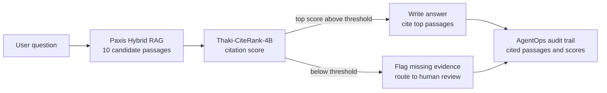

If you run a RAG agent over internal documents, you have probably noticed that trust erodes less from retrieval missing a document than from the agent **citing the wrong one**. Thaki-CiteRank-4B is a 4B reranker for exactly that step: choosing which candidate passage to cite. On contract data it never saw during training, it ranked evidence better than the base Qwen3-Reranker-4B.

This post is more about use than scores. It shows where the model sits behind Paxis Hybrid RAG, where it should hand off to a person, and what it should not be trusted with.

## In plain terms

Say an agent is asked, "What is the default restart policy of a Pod?" The retriever returns ten passages that look related. One states the answer, some only share the topic, and one comes from an older version with a different value. To the retriever they are all "relevant."

CiteRank rereads those ten passages and scores each one on a narrower question: can this passage be cited as evidence? It was trained to score low on passages that only share the topic, support only part of the claim, or contradict it. If even the top score falls below a threshold, the agent can conclude there is nothing safe to cite.

## Results


*Left: ranking quality (y-axis starts at 0.75). Right: how often the cited passage was not labeled as evidence.*

We evaluated on three kinds of data. On scientific-paper QA (QASPER), nDCG@10 rose from 0.863 to 0.919. The more important number comes from contract clauses (CUAD), which were used for neither training nor model selection: 0.838 to 0.905, with a 95% confidence interval of +0.058 to +0.078. The ranking gain carries over to a different kind of document, not just the one it was trained on.

Unsupported citations also fell, from 23.6% to 12.6% on QASPER and from 50.9% to 33.1% on CUAD. All five pass/fail criteria were fixed before the test data was opened, and all five passed. Training was a single run of about three hours on one B200. Inference costs 11.1 ms per candidate, essentially the same as the base model.

## What it looks like inside Paxis

Paxis builds multi-agent workflows over internal data without external APIs, and provides Hybrid RAG, an MCP Tool Hub and AgentOps audit trails. CiteRank fits most naturally right after Hybrid RAG gathers candidates and right before the answer is written.


*Where CiteRank sits in a Paxis workflow. Retrieval stays as it is; only the citation decision changes.*

There are three reasons for this placement. First, the retriever does not change: keyword and vector search stay as they are, and only their output order is redone. Second, the threshold becomes a way to say "I don't know." With 33.1% unsupported citations still left on CUAD, routing low-score questions to a reviewer is a requirement, not an option. Third, the scores become part of the audit record. When a wrong answer turns up later, logged scores tell you whether retrieval or citation was at fault.

Because it is a 4B model (peak memory 12.3 GiB in our runs), it can run in the same on-premises environment as Paxis. Citation quality improves without breaking the Paxis premise that documents never leave the boundary.

That said, **we have not yet measured this model inside Paxis.** The numbers above come from public datasets, and there is no guarantee the same gain appears on customer documents. If you adopt it, compare it against the base reranker on a few hundred real questions and re-tune the threshold on that data.

## This is not a fact checker

CiteRank also has an auxiliary output that labels each passage SUPPORTS, PARTIAL, CONTRADICTS or IRRELEVANT. It scored a Macro-F1 of 0.976 on technical docs, but do not read that as "this model catches contradictions."

The technical-docs claims and labels were generated by an in-house language model, and training and test data came from the same generator. PARTIAL examples were built by joining two claims with ", and", so the claim sentence alone gives the type away. The held-out contract data only has relevant and not-relevant labels, so we could not check whether contradiction detection transfers to other domains. The four output values are uncalibrated scores, not probabilities.

The bundled example shows the limit directly. For the claim "the default is Always", the correct passage scores +3.500 and a passage with the value changed to Never scores -1.562. The ranking is right, but the contradicting passage clears the -1.6875 threshold by a hair, so a threshold-only rule would cite it too. The auxiliary head marks that passage CONTRADICTS (0.90).

In a Paxis workflow, use the CONTRADICTS output only as a "worth a second look" flag, and do not surface it in answers as a factual verdict.

## Limitations

An unsupported citation rate of 33.1% on contracts is lower than the base model's but not low enough to cite automatically. Paper QA is a relatively easy retrieval task because answer sentences share many words with the questions. The model is English only, and passages longer than 1,024 tokens (prompt included) are truncated. There is no evidence that it increases citations in live AI search products such as ChatGPT or Perplexity. It helps your own agent choose evidence; it does not get you cited by someone else's search engine.

## Try it

Use the `example_inference.py` that ships with the repository. Pass a question, a claim and candidate passages, and it returns a citation score and auxiliary label scores for each passage.

```python
from example_inference import load, score

model, tok, head = load("ThakiCloud/Thaki-CiteRank-4B")
relevance, head_scores = score(
    model, tok, head,
    question="What is the default restart policy of a Pod?",
    claim="The default restartPolicy of a Pod is Always.",
    docs=["...passage 1...", "...passage 2...", "...passage 3..."],
)
```

`relevance` is a ranking score, not a probability. The threshold used in evaluation, -1.6875, was chosen on dev data, so re-tune it on your own. Keep the instruction from the example; changing it shifts the score distribution.

## What we released

`ThakiCloud/Thaki-CiteRank-4B` on Hugging Face contains the merged weights, the auxiliary classification head, the tokenizer, an evaluation manifest and example code under Apache-2.0. No training or evaluation text is included. Training used QASPER (CC BY 4.0), Kubernetes documentation (CC BY 4.0) and Python documentation (PSF License v2); CUAD (CC BY 4.0) was used for evaluation only.

ThakiCloud's open ranking models now have distinct roles. The EditRank models choose how to rewrite a document; CiteRank chooses which existing passage to cite. Both are designed so that a person can do the final check more easily when a Paxis agent works with internal knowledge.
