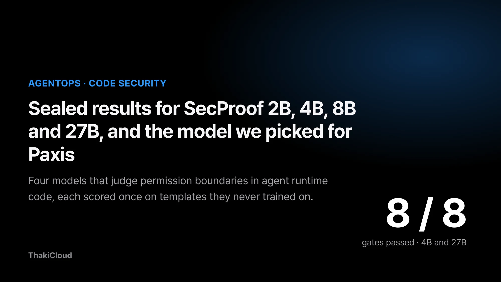
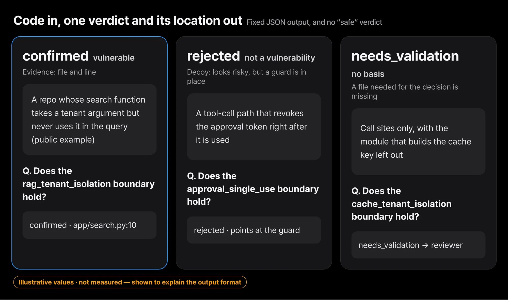
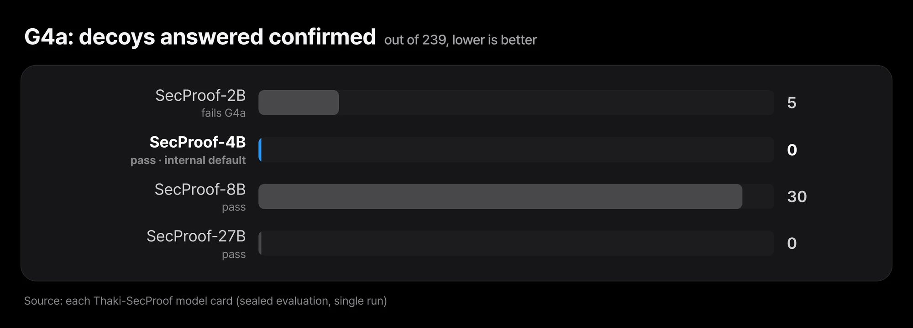
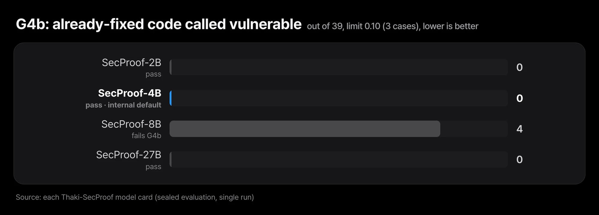
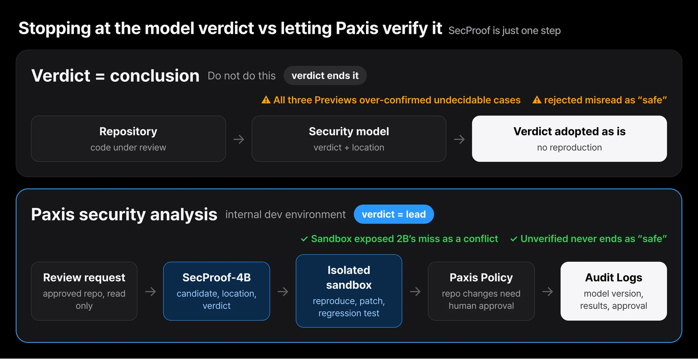
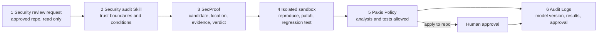

Code that lets an agent call tools is full of boundaries people miss. Is an approval token used once and thrown away? Does retrieval mix in another tenant's documents? Does a secret leak into a response? This post is for development and security teams thinking about putting an LLM into that kind of review.

We scored four SecProof models once each on template families they never saw in training. 4B and 27B cleared all eight gates we had fixed in advance, and 2B and 8B each missed one. Based on that and a small Paxis test, we decided to make 4B the default model of the Paxis security analysis tool in our internal development environment.

That is a decision for an internal environment, not a product release, and a later section separates what is done from what is still planned. Either way, the model's answer is something to verify, and execution rights stay with the Paxis sandbox, policy and human approval.

All four models are public LoRA adapters on Qwen-family base models:

- [Thaki-SecProof-2B-Preview](https://huggingface.co/ThakiCloud/Thaki-SecProof-2B-Preview) (Research Preview, base Qwen3.5-2B)
- [Thaki-SecProof-4B-Preview](https://huggingface.co/ThakiCloud/Thaki-SecProof-4B-Preview) (keeps its Preview name, passed V1; base Qwen3.5-4B)
- [Thaki-SecProof-8B-Preview](https://huggingface.co/ThakiCloud/Thaki-SecProof-8B-Preview) (Research Preview, base Qwen3-8B)
- [Thaki-SecProof-27B-V1](https://huggingface.co/ThakiCloud/Thaki-SecProof-27B-V1) (passed V1, base Qwen3.8-27B; public since 2026-10-26)

## The X-ray officer speaks; someone else opens the bag

Think of an airport security checkpoint. SecProof is the officer reading the X-ray screen. It says "open this bag" or "this one is fine" and points at the part of the image it looked at. But when the officer says "fine", the bag does not go straight onto the plane. If something looks off, a second officer opens the bag (the sandbox test), and the checkpoint rules and a supervisor decide whether it passes (Paxis policy and human approval).

This evaluation tested the X-ray officer on bag types they had never seen. The test bags still came from the same factory, though, so there is no guarantee the scores carry over to real bags at a real airport.

## It judges 12 named boundaries and never answers "safe"

SecProof does not look for SQL injection or general CVEs. It was trained on small synthetic Python AI-agent runtime repositories to judge only 12 named boundaries.

- approval_single_use, approval_tool_binding, tool_action_approval_binding (is an approval token used once, and only for that tool and that action)
- cache_tenant_isolation, rag_tenant_isolation, rag_write_tenant_binding, tool_tenant_binding (do tenant boundaries hold in caching, retrieval, writes and tool calls)
- memory_trust_promotion, principal_confusion, tool_identity, tool_authorization_scope (trust promotion, principal confusion, tool identity and authorization scope)
- secret_exposure_output (does a secret leak into the output)

The output is one fixed JSON object. The verdict is `confirmed`, `needs_validation` or `rejected`, with file and line evidence. There is no "safe" output. In this post a "false confirm" means answering `confirmed` on safe code. The cards list general CVE hunting, memory-safety bugs, non-Python code, large real-world repositories and any other boundary as out of scope.


*The left card is the expected answer for the hand-written example in every public repository. The middle and right inputs are made up to show the format and are not measured.*

## On unseen templates, 4B and 27B cleared all eight gates

The development set (DEV) comes from the same templates as the training data, so a high score there only means the model learned this task family. A sealed evaluation is a test set locked away until the end and scored only once. We therefore held 6 of the generator's 60 template families out of training and DEV from the start, and opened them once, on 2026-10-26, after every model had been selected. The pass criteria were also fixed before any result was seen: eight gates, G1 to G7, with G4 split into G4a and G4b. The test mixes vulnerable code, already-fixed code, code with no basis for a decision, and decoys. A decoy is code that looks risky but actually has a guard in place, so it is safe.

| Gate | What it checks | 2B | 4B | 8B | 27B |
|---|---|---|---|---|---|
| G1 | T1 verdict balanced accuracy, better than the base model | pass (0.966) | pass (1.000) | pass (0.957) | pass (1.000) |
| G2 | Location of the vulnerability (39 cases) | pass (0.923) | pass (1.000) | pass (1.000) | pass (1.000) |
| G3 | Evidence pointing at code that does not exist | pass (0.000) | pass (0.000) | pass (0.002) | pass (0.000) |
| G4a | Decoys answered `confirmed` (239 cases), and lower than the base model | **FAIL** (5/239) | pass (0/239) | pass (30/239) | pass (0/239) |
| G4b | Already-fixed code called vulnerable (39 cases, limit 0.10) | pass (0/39) | pass (0/39) | **FAIL** (4/39) | pass (0/39) |
| G5 | Undecidable cases answered `needs_validation` (10 cases) | pass (10/10) | pass (10/10) | pass (10/10) | pass (10/10) |
| G6 | Patch passes sandbox security and functional tests (39 cases) | pass (1.000) | pass (1.000) | pass (1.000) | pass (1.000) |
| G7 | Output format (sealed T1 / T4) | pass (1.0 / 1.0) | pass (1.0 / 1.0) | pass (1.0 / 1.0) | pass (1.0 / 1.0) |

*Every result is a single run: one training run, scored once. Numbers are from each model card.*


*8B confirmed 30 decoys and still passed G4a; 2B confirmed only 5 and failed, because it could not be shown better than its base model. The gate looks at the comparison with the base model, not just the count.*

### What the two Previews did not pass

2B passed seven of the eight gates and failed G4a on one condition only. Its decoy false-confirm rate was low (5 of 239, 0.021, Wilson upper bound 0.048) and within the absolute limits. But the base Qwen3.5-2B itself rarely confirms decoys (0.050), and the gate also requires the adapter to be shown better than the base. The upper end of the confidence interval for the difference came out at +0.004, above zero, so that part failed. 2B also answered `rejected` on the hand-written example that ships with every repository, where the correct answer is `confirmed`; its rationale claimed the search filters by tenant, which the code does not do.


*The 0.10 limit allows 3 of 39. Only 8B went over, with 4.*

8B passed seven of the eight gates and failed G4b. It called 4 of 39 already-fixed cases vulnerable (0.103), over the limit of 0.10, which allows 3. It had already called safe code vulnerable in 4 of 141 DEV cases, and the same weakness came out larger on the held-out families. 8B also sits on a different base family from the others: Qwen3-8B with dense attention, while 2B, 4B and 27B use the Qwen3.5-style hybrid architecture. So 8B is not "a larger 4B", and its results say nothing about size alone.

Neither model will be retrained. Both stay as Research Previews, not production-ready and not validated for operational security use, and the failure is stated on their model cards. If you try one, treat it as a research artifact, not as a default.

### What the two passes do and do not mean

4B and 27B passed all eight gates. They also sit at the ceiling on almost every sealed and DEV metric, which means this test cannot tell them apart; the 27B card says to choose between them on your own code. On DEV, 5 of 27B's 6 checkpoints scored perfectly, so step 300 was picked by the pre-registered "earliest step wins a tie" rule. A pass means the pre-registered numeric bar was met on synthetic code, nothing more.

## In Paxis, 2B missed a vulnerability and all three over-confirmed

Separately from the scores, we plugged the three Preview models into the Paxis security analysis tool under identical conditions: the same input, the same prompt, the same Docker sandbox with networking disabled, and the same reconciliation table. Each model ran three times, and all three runs gave the same verdicts. 27B was not part of this test.

| Case | 2B | 4B | 8B |
|---|---|---|---|
| Search code that does not filter by tenant | Missed, then the sandbox flagged the conflict | Found, confirmed by the sandbox | Found, confirmed by the sandbox |
| Code that cannot be judged because the needed file is missing | Over-confirmed, stopped as unverified | Same | Same |

*On the safe-code case all three ended as not reproduced, and the broken-output case was marked invalid for all three.*

In the first case 2B answered `rejected` on vulnerable code. That answer did not pass through, though. The sandbox security test failed, and Paxis recorded a conflict state meaning "the model probably missed this". The second officer opened the bag the X-ray reader had cleared and found the problem.

All three models got the second case wrong. They answered `confirmed` even though the file needed to decide was missing. No test could run, so Paxis stopped at "model judgment only, unverified", and no path ended in "safe". 4B carries this weakness too, so this handling and the approval step for code changes stay as they are whatever the default model is. 27B's behaviour on this case has not been reported.

An earlier version of this post also quoted rough model call latencies for the three Previews. They were measured with the three models sharing one GPU, without the conditions needed to repeat them, and no model card reports latency, so we removed them. Measure latency on the hardware you will actually use.

## Three rules for matching the model card results

This is the quick start from the [4B card](https://huggingface.co/ThakiCloud/Thaki-SecProof-4B-Preview). The 2B, 8B and 27B cards give the same commands with the repository name changed.

```bash
pip install "transformers>=5.0" "peft>=0.19" torch accelerate
git clone https://huggingface.co/ThakiCloud/Thaki-SecProof-4B-Preview && cd Thaki-SecProof-4B-Preview
python inference.py examples/t1_rag_tenant_isolation.json
```

For 27B the card adds an optional install that is much faster on the linear-attention layers: `pip install flash-linear-attention causal-conv1d`. The bf16 27B base needs roughly 55 GB of GPU memory (batch-4 generation peaked at 59.8 GiB), and the 8B bf16 weights roughly 17 GB. The 2B and 4B cards give no serving memory figure.

Three details decide whether your results look like the cards'.

1. Build the prompt with the bundled `secproof_prompt.py` (format v2). The adapters were trained on this layout only, and the file is byte-identical across all four releases.
2. Decode the way the cards did: greedy, thinking off, `max_new_tokens=2048`.
3. Do not repair the JSON. The cards score schema-invalid outputs as wrong and never fix keys after generation.

The bundled example is a hand-written repository whose search ignores the tenant argument. The expected answer is `confirmed` with evidence at `app/search.py:10`. 4B, 8B and 27B gave that answer in the release checks on their cards; 2B answered `rejected`. Use it as a smoke test after you load a model, not as proof that the model works on your code.

## SecProof is one of six steps in Paxis security analysis


*Top: the verdict is the conclusion. Bottom: Paxis treats the verdict as a lead. The sandbox is an isolated execution environment that reproduces the flagged vulnerability and tests the patch.*


*SecProof is step 3. The other five steps are all controls outside the model.*

Each part of the model's answer maps onto one of those controls.

| Model output | What the next step does |
|---|---|
| Output that breaks the schema | Marked invalid; not repaired |
| `confirmed` | Sent to the isolated sandbox to reproduce; a verdict alone is a lead |
| `rejected` | Still not "safe"; in the test above the sandbox exposed 2B's miss as a conflict |
| `needs_validation`, or no runnable test | Stops as "model judgment only, unverified" and goes to a reviewer |
| Patch | Runs the sandbox security and functional tests; applying it to the repository needs human approval through Paxis Policy |
| Every step | Model version, results and approval go to the Audit Logs |

Where things stand as of 2026-11-01:

- **Done:** the sealed evaluation of all four models, the public release of all four, and the three-Preview comparison in the Paxis security analysis tool above, run in the internal development environment.
- **Decided, not yet reported as complete:** changing that tool's default model from 2B to 4B in the internal development environment, then rerunning the regression tests through the real chat path. Only the analysis tool's model setting changes; the LLM behind the Paxis agents, the Skills, Tools, Policy, sandbox and Audit Logs stay the same. We will add the result here once the rerun is done.
- **Planned:** comparing 27B with 4B on the same inputs. Until that is done, 4B stays the choice, and 27B is used only if it actually does better.
- **Not done:** any production deployment. The tool runs the tests of the code under review directly in a sandbox, and until we harden the isolation settings of the shared sandbox further it is for internal validation only. No SecProof model ships today as a feature of Paxis or of Metis, our inference platform. Serving an adapter on Metis would mean loading its own base model, so the smallest size that passed its gates is the sensible starting point; that is a possible later step, not something in place.

For the wider background, see [the agent control plane post](https://www.thakicloud.com/tech-blog/en/agentops/enterprise-agents-need-control-plane/) and the [Paxis docs](https://docs.thakicloud.com/ko/paxis/).

## Five things these numbers do not tell you

- **The sealed test is synthetic code too.** It uses template families the models never trained on, but the same generator. 4B and 27B passing means they cleared pre-set numeric criteria. It does not show how they perform on real enterprise code or whether they are safe in operation.
- **Everything is a single run.** One training run and one sealed scoring per model. Seed variance was not measured.
- **There is one deviation from the pre-registration.** The first sealed submission of every model stopped before writing any output, because of a bug in our job. The 2B job then needed one more rerun, and that rerun's outputs were not byte-identical to the interrupted run. The pre-registration required reruns to reproduce identical outputs, so that condition was not met (`retry_output_sha_mismatch`). The trained 2B model's parsed verdicts matched on all 366 cases; the base-model runs differed more. Only complete runs were scored, each once. The deviation was accepted on 2026-10-27, and the original rule is kept as written, not marked as met.
- **T4 and T5 verdicts carry a task-type cue.** Every T4 gold verdict is `confirmed` and every T5 gold verdict is `rejected`, so for patches the meaningful number is the sandbox pass rate.
- **The Paxis comparison covers two cases and three models.** That is not enough to rank model sizes or to claim production safety.

## Data stays private; the adapters are Apache-2.0

The training and evaluation data are not released. The repositories come from an in-house deterministic generator with no third-party source code and no personal data, and every secret-looking value is a fake `FAKE-TENANT-*` token. Labels come from the generator's ground truth and sandbox execution, not from a model. The adapters and their code are Apache-2.0, and so are the base models.

## Closing

Of the four SecProof models, 4B and 27B cleared all eight pre-set gates on templates they never trained on. 2B and 8B each failed one gate and stay as Research Previews. In a Paxis test, 4B found the tenant isolation bug that 2B missed, so we decided to make it the default of the internal analysis tool. All three Previews still over-confirmed code they could not actually judge, which is why the sandbox, policy and human approval stay in place.

If you want to try it, start with 4B: run the quick start above, check the bundled example comes back `confirmed` at `app/search.py:10`, then score it on a sample of your own code before relying on any verdict.

*First published on 2026-10-25 with the SecProof-2B release, and rewritten on 2026-10-27 with the sealed results for all four models and the Paxis comparison.*

## Update log

- **2026-11-09:** Added figures for the verdict format, the path comparison and the G4a and G4b counts, and rewrote headings as claims. No numbers changed.
- **2026-11-01:** 27B is public as Thaki-SecProof-27B-V1 (since 2026-10-26); removed "being prepared for release" and added the link.
- **2026-11-01:** Gate count corrected to eight (G1 to G7, with G4 split into G4a and G4b), and a per-gate table for all four models added.
- **2026-11-01:** Described the pre-registration deviation as the model cards do: the first sealed submission of every model stopped without output, and only the 2B job needed one more rerun. The earlier text said the jobs "failed to finish twice".
- **2026-11-01:** Removed the model call latency figures, which had no reproducible measurement conditions and do not appear on any model card.
- **2026-11-01:** Restated the 2B to 4B default change as a decision for the internal development environment that is not yet reported as complete, and separated done, planned and not-done items, including Metis.
- **2026-11-01:** Added that 27B was not part of the Paxis test, that 8B uses a different base family, what the 2B and 8B Previews did not pass, a usage section and the data and licence notes.
