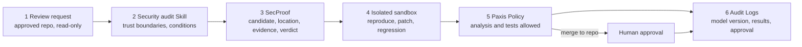
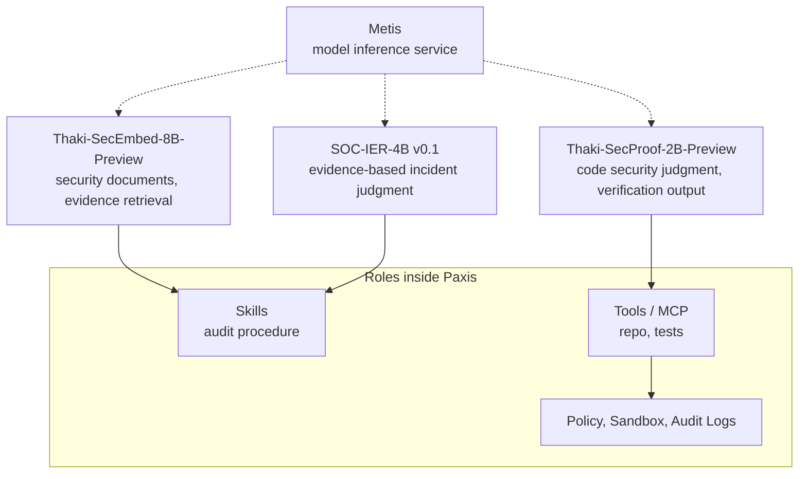

If you are putting an LLM into code security review, you have probably found that the model explaining a vulnerability convincingly is the easy part; deciding **how far you can act on its judgment** is the hard part. Thaki-SecProof-2B is a 2B model that judges permission boundaries in agent-runtime code in a structured format, and the conclusion of this post is that however good the model gets, its answer is something to verify, while execution rights must be held separately by a control layer such as Paxis.

The model is on Hugging Face: [ThakiCloud/Thaki-SecProof-2B-Preview](https://huggingface.co/ThakiCloud/Thaki-SecProof-2B-Preview). It is a LoRA adapter on Qwen3.5-2B, the seed 20261025 checkpoint at step 750. It is a Research Preview and not ready for production.

## What the model does, and what it does not

First, the scope. SecProof is not a SQL injection or general CVE detector. It was trained on small synthetic Python AI-agent-runtime repositories and on 12 named boundaries only:

- approval_single_use, approval_tool_binding, tool_action_approval_binding (is an approval token used once, for that tool and that action only)
- cache_tenant_isolation, rag_tenant_isolation, rag_write_tenant_binding, tool_tenant_binding (is the tenant boundary kept in caches, retrieval, writes and tool calls)
- memory_trust_promotion, principal_confusion, tool_identity, tool_authorization_scope (trust promotion, principal confusion, tool identity and authorization scope)
- secret_exposure_output (do secrets leak into output)

There are four tasks. T1 discovers candidate defects in a repository, T2 verifies one candidate, T4 writes a full-file patch, and T5 judges whether a candidate patch regresses. Verdicts are `confirmed`, `needs_validation` or `rejected`, each with file and line evidence. There is no "safe" output. In this post, a "false confirm" means calling safe code `confirmed`.

## 1. A well-formed answer that was wrong

After training, the first thing we tried was one example outside the training distribution. In a hand-written four-file repository, `search.find(tenant, query)` returns documents without filtering by tenant (`app/search.py`, line 10). The correct answer is `confirmed`.

The preview model answered `rejected`. It pointed at exactly line 10 and the JSON was valid. But its rationale said the search filters by tenant, and the code does not.

This single case is the thesis in miniature. An answer can have valid format, correct location and a confident tone and still reach the wrong conclusion. One case says nothing about general performance, but for agent design one is enough: if that answer turned into "no vulnerability, skip the check", code with a broken tenant boundary would pass straight through.

Judgment, verification and control are three different jobs.

- Judgment: tell whether a permission boundary is actually broken. SecProof's part.
- Verification: confirm with an executable test. The isolated sandbox's part.
- Control: decide and record what to execute based on verified results. Paxis policy and audit logs.

A "vulnerable" verdict must not grant fix permission automatically, and `rejected` must not become grounds for skipping a security check.

## 2. What 900 steps of training showed

Training is SFT on structured security-audit tasks with sandbox-confirmed outcomes as targets. It ran 900 steps on one H200, and step 750 was chosen by a rule fixed beforehand. Training took 1.195 GPU-hours and dev generation 1.354, about 2.55 GPU-hours in total.

Dev has 356 cases (T1 124, T2 92, T4 68, T5 72). Compared with stock Qwen3.5-2B:

| Metric (356 dev cases) | Stock | SecProof-2B |
|---|---|---|
| T1 discovery balanced accuracy | 0.258 | 0.992 |
| T2 verification balanced accuracy | 0.806 | 1.000 |
| T4 sandbox both-pass (security test and functional test) | 0.000 | 1.000 (68/68) |
| False-confirm rate (safe code called `confirmed`) | 0.078 | 0.000 |
| Location accuracy | 0.000 | 0.975 |
| Composite score S | 0.355 | 0.997 |

Much of the gap is format. The stock model matched the per-task output format only 0.12, 0.00, 0.06 and 0.11 of the time, and 51 of 356 answers hit the length limit; the trained model is at 1.000 on all four tasks. Format-independent judgment shows in T1 balanced accuracy (0.258 to 0.992) and location accuracy (0 to 0.975). The format gain still matters: a component inside an agent has to produce output the next tool can parse, every time.

### How to read these numbers

0.997 is a result on the **same distribution** as training. The generated repositories (worlds) are disjoint between train and dev (train 487, dev 44, shared 0), and exact and skeleton duplicates are 0. But all 14 bug templates and all 12 boundaries are shared, so dev is an in-distribution test. On top of that, T4 gold is always `confirmed` and T5 gold is always `rejected`, so the task type itself is a cue.

The sealed held-out test has not been run yet, and there is a single training run (seed 20261025). Rather than repeating the same recipe, we will judge quality by independent evaluation, and 4B, 8B and 27B training is in progress.

What we can say is that a 2B model can learn structured judgment and verification-ready output. As the out-of-distribution example shows, real-world performance is unknown.

## 3. Using it in Paxis: the target architecture

For a security agent to work in an enterprise it needs repository access rights, a safe place to run verification, and an approval procedure. Paxis treats Skills, Tools, Policies and Audit Logs as resources the platform manages directly, along with MCP tool connections, autonomy policies, isolated sandboxes and on-premises operation. We wrote about the same concern in [our control plane post](https://www.thakicloud.com/tech-blog/en/agentops/enterprise-agents-need-control-plane/), and the product is described in the [Paxis docs](https://docs.thakicloud.com/ko/paxis/) (Korean).

*The six-step target flow. The model sits in step 3 only; the other five steps are all control outside the model.*

1. A developer requests a security review of a PR or change. The agent confirms the approved repository and change scope and starts read-only.
2. A security audit Skill defines trust boundaries and security conditions. SecProof's data-generation code references Cloudflare's public [security-audit-skill](https://github.com/cloudflare/security-audit-skill) at a pinned commit, with an adapter that maps the synthetic repositories onto that procedure's hunter and verifier roles. That is as far as the repository record goes; the training record format is separate from Cloudflare's report schema. In Paxis, such procedures are managed as reusable Skills.
3. SecProof emits a structured result: candidate defect, code location, evidence, and whether more verification is needed. The output alone is never the final verdict, and weak evidence or failed verification goes to a human.
4. An isolated sandbox runs only permitted tests: does it reproduce, does the patch pass, is there a regression. Failures are not hidden.
5. Paxis Policy sets the execution scope. Read-only analysis and isolated tests are allowed; merging into the repository requires human approval. Model confidence is not grounds to widen permissions.
6. Repository and commit, model version, code location, sandbox result, policy decision and approval are linked in Audit Logs so the process can be reconstructed later.

Put the out-of-distribution example through this flow. If the model says `rejected`, step 4 runs an isolated test that searches as tenant A and checks whether tenant B documents come back. If they do, the model's verdict and the sandbox result conflict, and that conflict is itself the signal for a human, recorded in step 6. The point of the structure is that a wrong model answer does not pass through unchallenged.

These six steps are the **target architecture**. We have not measured a real Paxis and SecProof integration, latency, cost savings or agent success rate, and this post does not claim any.

## 4. Role-specific models instead of one big model

Searching security documents, judging an incident and judging code are different jobs, so ThakiCloud uses a model per role.

*The three models are called by role, Metis serves inference, and execution control lives on the Paxis side, not in any model.*

The three are [Thaki-SecEmbed-8B-Preview](https://huggingface.co/ThakiCloud/Thaki-SecEmbed-8B-Preview), [SOC-IER-4B v0.1](https://huggingface.co/ThakiCloud/SOC-IER-4B-v0.1) and [Thaki-SecProof-2B-Preview](https://huggingface.co/ThakiCloud/Thaki-SecProof-2B-Preview). After 2B we are preparing 4B, 8B and 27B variants (4B and 8B are training, 27B is in a format check), and we may later route by task size. We have not compared speed, cost or success rate across sizes, so we make no cost-saving claim.

## 5. What stays when the model changes

Running a job needs much more than a model.

| Component | Responsibility |
|---|---|
| SecProof model | Code security judgment and structured verification output |
| Paxis Skills | Audit procedure and work steps |
| Paxis Tools, MCP | Repository and test tool connections |
| Paxis Policy | Analysis, fix and approval permissions |
| Paxis Sandbox | Isolated test execution |
| Paxis Audit Logs | Record of judgments and executions |
| Metis | Model inference service |

The benefit is that nothing is tied to one model. If SecProof is retrained or swapped for the 4B, the policies, tools and evaluation setup are reused as they are. That is why model building and the operating platform are kept separate.

## 6. What we check next

The order is fixed. First the sealed held-out test. After that we configure a read-only security code review agent in Paxis and measure the false-positive rate on clean code, the miss rate on defects, how often an unverified patch is treated as a success, and developer review time. We also check whether the policy gate really blocks unpermitted execution and whether audit logs can reconstruct the process. Out-of-distribution failures, like the tenant filter example here, become the next training data.

## Wrapping up

The point of this post is to turn explanation into verification and verification into controlled execution. SecProof is a model specialized for code security judgment, and Paxis manages what that judgment is allowed to lead to. A good security agent separates what is confirmed from what is not and leaves verifiable results within the scope it is allowed.
