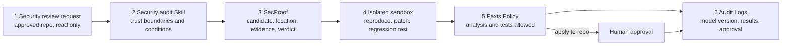

This post is for development and security teams thinking about putting an LLM into code security review. The short version: we scored four SecProof models once each on template families they never saw in training. 4B and 27B cleared every gate we had fixed in advance, and 2B and 8B each missed one. So the Paxis security analysis tool is switching its default model from 2B to 4B in the internal development environment. The model's answer is still something to verify, though, and execution rights stay with the Paxis sandbox, policy and human approval.

The released models are LoRA adapters on Qwen-family base models:

- [Thaki-SecProof-2B-Preview](https://huggingface.co/ThakiCloud/Thaki-SecProof-2B-Preview)
- [Thaki-SecProof-4B-Preview](https://huggingface.co/ThakiCloud/Thaki-SecProof-4B-Preview)
- [Thaki-SecProof-8B-Preview](https://huggingface.co/ThakiCloud/Thaki-SecProof-8B-Preview)
- 27B passed the same evaluation and is being prepared for release.

## In plain terms

Think of an airport security checkpoint. SecProof is the officer reading the X-ray screen. It says "open this bag" or "this one is fine" and points at the part of the image it looked at. But when the officer says "fine", the bag does not go straight onto the plane. If something looks off, a second officer opens the bag (the sandbox test), and the checkpoint rules and a supervisor decide whether it passes (Paxis policy and human approval).

This evaluation was like testing the X-ray officer on bag types they had never seen. 4B and 27B passed every item, and 2B and 8B each failed one. The test bags still came from the same factory, though, so there is no guarantee the scores carry over to unfamiliar bags at a real airport.

## What the model does and does not do

SecProof does not look for SQL injection or general CVEs. It was trained on small synthetic Python AI-agent runtime repositories to judge only 12 named boundaries.

- approval_single_use, approval_tool_binding, tool_action_approval_binding (is an approval token used once, and only for that tool and that action)
- cache_tenant_isolation, rag_tenant_isolation, rag_write_tenant_binding, tool_tenant_binding (do tenant boundaries hold in caching, retrieval, writes and tool calls)
- memory_trust_promotion, principal_confusion, tool_identity, tool_authorization_scope (trust promotion, principal confusion, tool identity and authorization scope)
- secret_exposure_output (does a secret leak into the output)

The output is one fixed JSON object. The verdict is `confirmed`, `needs_validation` or `rejected`, with file and line evidence. There is no "safe" output. In this post a "false confirm" means answering `confirmed` on safe code.

## Sealed evaluation: 4B and 27B pass, 2B and 8B fall short

The development set (DEV) comes from the same templates as the training data, so a high score there only means the model learned this task family. We therefore held 6 of the generator's 60 template families out of training and DEV from the start, and opened them once, after every model had been selected. The pass criteria (G1 to G7) were also fixed before any result was seen. The test mixes vulnerable code, already-fixed code, code with no basis for a decision, and decoys. A decoy is code that looks risky but actually has a guard in place, so it is safe.

| Model | Result | Gate missed |
|---|---|---|
| 2B | Fail | G4a: decoy false confirms were low at 5 of 239 (2.1%), but there was not enough statistical evidence that it beats the same-size base model |
| 4B | Pass | none |
| 8B | Fail | G4b: it called 4 of 39 already-fixed cases vulnerable, over the limit of 3 |
| 27B | Pass | none |
*Every result is a single run: one training run, scored once.*

2B did not fail because it confirmed too many decoys. The base Qwen3.5-2B itself rarely confirms decoys, so the trained model could not show it was clearly better than the base. 8B had already called safe code vulnerable in 4 of 141 DEV cases, and the same weakness came out larger on the held-out families. Neither model will be retrained. Both stay as Research Previews, and the failure is stated on their model cards.

4B and 27B scored perfectly on every gate. That also means this test cannot tell them apart. On DEV, 5 of 27B's 6 checkpoints scored perfectly as well, so step 300 was picked by the pre-registered "earliest step wins a tie" rule.

## In Paxis: a missed vulnerability and an over-confident answer

Separately from the scores, we plugged all three Preview models into the Paxis security analysis tool (secproof_analyze) under identical conditions: the same input, the same prompt, the same Docker sandbox with networking disabled, and the same reconciliation table. Each model ran three times, and all three runs gave the same verdicts.

| Case | 2B | 4B | 8B |
|---|---|---|---|
| Search code that does not filter by tenant | Missed, then the sandbox flagged the conflict | Found, confirmed by the sandbox | Found, confirmed by the sandbox |
| Code that cannot be judged because the needed file is missing | Over-confirmed, stopped as unverified | Same | Same |
*On the safe-code case all three ended as not reproduced, and the broken-output case was marked invalid for all three.*

In the first case 2B answered `rejected` on vulnerable code. That answer did not pass through, though. The sandbox security test failed, and Paxis recorded a conflict state meaning "the model probably missed this". The second officer opened the bag the X-ray reader had cleared and found the problem.

All three models got the second case wrong. They answered `confirmed` even though the file needed to decide was missing. No test could run, so Paxis stopped at "model judgment only, unverified", and no path ended in "safe". 4B carries this weakness too, so this handling and the approval step for code changes stay as they are after the default model changes.

Median model call latency was about 250 ms for 2B, 480 ms for 4B and 610 ms for 8B. The three models shared one GPU while we measured, so these are not serving numbers. Since a single Web Chat run takes tens of seconds, we judged that paying about 230 ms more to catch the missed vulnerability is the better trade.

## Next steps in Paxis

*SecProof is step 3. The other five steps are all controls outside the model.*

In the internal development environment, the default model for secproof_analyze moves from 2B to 4B. Only this security analysis tool changes its model; the LLM behind the Paxis agents stays the same. After the switch we rerun the regression tests through the real Web Chat path. Once 27B is released we will compare it with 4B on the same inputs and use it as the higher-tier option only if it actually does better.

There is no production deployment yet. This tool runs the tests of the code under review directly in a sandbox, and until we harden the isolation settings of the shared sandbox further it is for internal validation only.

Because the model and the platform are kept separate, this switch is a single model setting. The Skills, Tools, Policy, sandbox and Audit Logs are the same ones we used with 2B. For the wider background, see [the agent control plane post](https://www.thakicloud.com/tech-blog/en/agentops/enterprise-agents-need-control-plane/) and the [Paxis docs](https://docs.thakicloud.com/ko/paxis/).

## What these numbers do not tell you

- **The sealed test is synthetic code too.** It uses template families the models never trained on, but the same generator. 4B and 27B passing means they cleared pre-set numeric criteria. It does not show how they perform on real enterprise code or whether they are safe in operation.
- **Everything is a single run.** One training run and one sealed scoring per model. Seed variance was not measured.
- **There is one deviation from the pre-registration.** The sealed generation jobs failed to finish twice for infrastructure reasons and were rerun, and the rerun outputs were not byte-identical to the earlier ones. The pre-registration required reruns to reproduce the same artifacts, so that condition was not met (retry_output_sha_mismatch). The trained 2B model's verdicts matched on all 366 cases across the two runs, and only the one completed run was scored. The deviation is on record and was accepted as is.
- **The Paxis comparison covers two cases.** That is not enough to rank model sizes or to claim production safety.

## Summary

Of the four SecProof models, 4B and 27B cleared the pre-set criteria on templates they never trained on, and 2B and 8B each failed one item. In Paxis, 4B found the tenant isolation bug that 2B missed, so it becomes the default. All three still over-confirmed code they could not actually judge. Changing the X-ray officer does not remove the officer who opens the bag, or the rules for letting it through.

What is left is not building more models. It is showing how useful the models we already have are in real enterprise security code review.

*First published on 2026-10-25 with the SecProof-2B release, and rewritten on 2026-10-27 with the sealed results for all four models and the Paxis comparison.*
