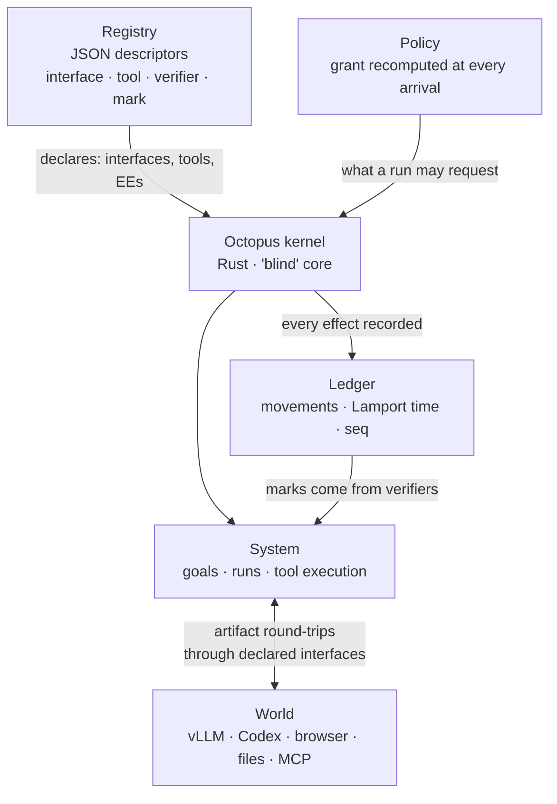

"Attach memory to the agent loop, then skills, then sub-agents." That sentence describes most agent harnesses today. Octopus OS inverts the premise: neither the model nor the loop is at the center. Both are applications attached on top of a kernel.


*The structure of a small kernel with capabilities spreading out as descriptors.*

## Why Read This

This post is for developers and platform engineers who build long-running agent platforms, or who need to judge how far "self-modification" design has actually come.

The core point: **Octopus OS implements self-modification not as a feature bolted onto the agent loop, but as an OS-grade harness where the kernel is a small "blind" core, every capability is a JSON descriptor, and the agent grows by rewriting those descriptors under policy.** This post is a verification, not a press release: we cloned the repo and measured each claim (45k-line kernel, 12 execution environments, 156 interfaces, Codex source) against the actual tree.

## Overview

Octopus OS, a personal project by Aleksandr Vechenkov (vechen), pitches itself as "an operating system for work that outlives the chat." Development started in February 2026, ran for about eight months, entered the Research Preview phase on October 10, 2026, and the official announcement tweet went out on October 24. The license is MIT; at the time of writing it had 482 stars and 53 forks.

The announcement tweet emphasizes that "unlike Harness² and similar projects, self-improvement isn't a separate stage bolted onto the agent. The whole architecture is just the environment they work in." It also says the usual agent loop was dropped entirely. The README's full name is "Octopus Superintelligence OS," a self-evolving agentic OS.

Four core claims in the tweet.

- A 45k-line Rust kernel
- System state lives in JSON files
- Goals act as real environments where agents work, with inputs, outputs, and custom triggers
- Built on top of the Codex source. Agents can edit their own harness mid-task

It also stresses that the project "was built as a product from day one." A macOS 14+ Electron/React desktop client and a terminal client are provided.

Before taking those claims at face value, we opened the repo.

## What Is This Technology

The most important design declaration sits in the first paragraph of the architecture doc. "The usual agent is a loop around a model: act, observe, accumulate context, repeat. Memory, skills, sub-agents, and schedules are then bolted onto that loop, and everything the agent can do has to fit inside it. Octopus is built the other way around. Neither the model nor the loop is at the center. There is a small kernel and a set of primitives, and the loop is one of the things those primitives express."

The kernel's "blindness" is deliberate. Core principle 1, in the repo's own words: "About 45,000 lines of Rust in `crates/`. It knows no provider, channel, tool, model, or artifact by name. Keeping it small is the point of the research." Every capability added by declaring something instead of coding a branch gives the system one more thing it can inspect, replay, and change about itself.

The structure reads as three layers.

**1) The kernel (crates/, 19 Rust crates).** `octopus-runtime` is the kernel proper, with `octopus-policy`, `octopus-ledger(-store/-index)`, `octopus-marks`, `octopus-verifiers`, `octopus-interfaces`, and `octopus-worker-env` guarding the boundary contract. Dependencies are the standard fare: tokio, serde, schemars, blake3, ed25519-dalek.

**2) The registry (registry/, thousands of JSON descriptors).** Capabilities are organized into seven class types: interface, tool, verifier, mark, artifact, ee_template, worker_environment_kind. Each capability is one folder. The README's line "an agent is not a program but two JSON files" is accurate: the actual `system_worker_coder/` folder contains exactly two files, `interface.json` and `policy.json`. It declares the model, role, and what it may touch. It does not write code.

**3) The System/World boundary.** System is the set of all environments and capabilities the system can act on (goals, runs, tool execution). World is everything outside that framework. The boundary is defined by control, not by location. To send a message from a calendar event, the system receives the event from World, processes it in a run, and emits an artifact through the messaging interface. World → System → World. The calendar and messaging services never become Octopus workers.



**The actual path of self-modification** is also a descriptor. "Under policy, an agent can create and revise goals, change interfaces (triggers), add tools, organize workers." These changes persist across tasks and runs. A representative trigger is `world_file_observer`, an inbound sensor interface whose `life.json` declares a python3 process that reads its own movements and hands artifacts to the runtime's single intake over stdin/stdout. "What it cannot do, it can write" is the architectural meaning: a coding worker uses granted tools to write a device-driver package, installs and binds it, and later work reuses it without rebuilding.

**The security model** stands out too. In the trust-boundary table, the model is "Not trusted. Its output is a request, never an authority," and artifacts from World (web pages, messages, files, MCP results) are "Not trusted. A web page, a message, a file, or an MCP result may carry instructions aimed at the model." The runtime "never reads a payload and never takes a model's word for anything." Policy recomputes each run's grant at every arrival from its worker ceiling, environment chain, and authored bindings. Requests outside the grant are refused and recorded as a `DeliveryRefused` movement. Nothing a model writes into a run record becomes a right.

**The ledger is the memory of this structure.** In `schemas/movement.schema.json`, a movement's required fields are `from·kind·lamport·seq·to·trace·recorded_at_unix_ms`, with Lamport time and sequence number together. A standard distributed-ordering primitive, baked straight into the ledger. The architecture doc notes that "indexes are caches, not a second source of truth" and that the kernel keeps an in-memory index, seeing only three things per movement: the route, the caller, and the movement itself. Same grammar as the security model: the payload is never read by the kernel.

**The breadth of World** is verifiable in descriptors. `world_*` interfaces include MCP servers (github, firecrawl, unity), Slack, terminal, image generation, cron, file observer, even hand-gesture control. Model providers run about 30: anthropic, openai, gemini, vllm, ollama, codex, claude_cli, huggingface, together, groq, and more. The design that "any model, any channel, attaches with a single descriptor" doesn't stay on paper. The folders are lined up exactly that way.

## Install and Integration

The README states the requirements: macOS 14+, Node 24, stable Rust, and a ChatGPT account. The actual commands.

```bash
git clone https://github.com/miuuyy/Octopus-SI-OS.git
cd Octopus-SI-OS
npm ci --prefix app
```

Then package the app (the native build needs headers for Node 24.15.0), open it, sign in with ChatGPT, and press Enter in the embedded terminal to start the system.

The repo layout makes the client/kernel split clear. `app/` is the Electron (`main: electron/main.cjs`) + React 19 desktop client. `crates/` is the kernel. `registry/` is the capability list. `schemas/` holds eight JSON Schemas. `docs/` carries architecture, security-model, contracts, glossary, cli, and client guides. The README organizes the product surface into six items: Home (one continuous conversation with the system), Projects (a goal with its own context and permissions), Agents (two JSON files), Tasks (work you can leave running and pick up later), Applications (channels, MCP servers, providers), Drivers (where work physically happens: a folder, a git worktree, a browser, your desktop, a container, a remote machine).

We cloned the repo at depth 1 (4,219 files) in a sandbox and ran the terminal client. The root `octopus` is a 152-byte POSIX shell script that execs `node app/cli/index.cjs`. It runs on node built-ins alone, so `--help` works without `npm ci`:

```text
$ node app/cli/index.cjs --help
Octopus — your agentic operating system, in the terminal

  octopus [prompt]                 Open the interactive client
  octopus resume [task|last|home]  Continue an existing task
  octopus exec <prompt>            Start a task and wait for its result
  octopus send <task> <prompt>     Send a follow-up and wait
  octopus watch <task>             Follow work already in progress
  octopus tasks                    Show tasks from this Home
  octopus history <task>           Read its transcript
  octopus inspect <run-id>         Inspect recorded checkpoint and transfer evidence
  octopus projects                 Show Projects and Agents
  ...
```

With no `cargo` available, we could not verify the Rust workspace build or tests (exit 127). The desktop app's native build needs Node 24.15.0 headers, so we didn't attempt it in the sandbox either. The experiment is therefore bounded to a **source audit**.

## Actual Experiment Results

We measured the claims against the tree.

| Claim | Source | Measured (HEAD 1b5f7e4, 2026-10-26) |
|---|---|---|
| Kernel "about 45,000 lines of Rust" | README·docs·AGENTS.md | **58,749** .rs lines in `crates/` (tests included) |
| "860k+ source snapshot" | project page (10-10) | **~999k** lines in rs+ts+js+json+md+toml (tests·snapshots·generated files included, .git·target·node_modules excluded) |
| "12 execution environment kinds" | project page | **12 exact match** in `worker_environment_kind/` |
| "156 declared interfaces" | project page (10-10) | **86** `interface/` directories (10-26 HEAD) |
| "Built on Codex source" | tweet | `world_provider_codex/` packages (codex-cli, codex-core, etc.) + `interface_driver_ref: codex_app_server` on providers like vLLM |
| "Open source" | tweet | **MIT** (LICENSE file verified) |
| "Over 8 months" | tweet | Page: dev started 2026-02 → 10-10 preview = **8 months, matches** |
| "Agent = two JSON files" | README | `system_worker_coder/` = interface.json + policy.json **confirmed** |

Four findings stand out.

**First, the numbers grew within two weeks.** The Oct 10 announcement said "43k+ kernel lines, 860k+ snapshot." At the Oct 26 HEAD, we measured 58.7k and ~999k. The docs' "about 45,000 lines" phrasing appears to exclude tests and part of the crates. Either way, the direction is growth. The gap between "156 interfaces" and 86 measured interface directories may reflect a counting basis (interface directories vs declared interface entries) that is not documented, so we can't pin it down. The full registry keeps growing: 191 tools, 36 artifacts, 9 ee_templates, 13 verifiers, 13 marks.

**Second, all 12 execution environment kinds really exist.** `audio_device_session·browser_session·code_mode·container_session·desktop_session·filesystem_workspace·git_worktree·mcp_stdio_session·process_session·remote_exec_server·system_room·web_search`. That "a git worktree is a first-class execution environment" has direct implications for running agent platforms.

**Third, it is actively developed.** The HEAD commit (1b5f7e4) at audit time is dated 2026-10-26: "Restore verifier launchers after macOS sandbox regression." Within two weeks of the preview, a commit is restoring verifier launchers broken by a macOS sandbox regression. The Rust workspace requires rust-version 1.91. With no cargo in the sandbox we could not build or test it, and we only measured the test stack's scale (618 `.snap` snapshot files).

**Fourth, vLLM is a first-class provider interface.** The `world_provider_vllm` descriptor reuses the Codex app-server protocol via `interface_driver_ref: codex_app_server`, with policy variables `max_attempts` (default 5), `max_in_flight` (default 1), `web_search_modes` (default disabled), and `models`. Here model serving is one provider among many, not something the kernel knows by name. Provider interfaces number around 30: vllm, ollama, anthropic, openai, gemini, codex, claude_cli, huggingface, together, groq, and so on. Any model attaching via descriptor is the design goal.

## Implications for ThakiCloud Products

**Paxis lens.** If Paxis is the Agent-Native Cloud that treats Skills, Tools, Policies, and Audit Logs as first-class resources, Octopus is one extreme of pushing that resource concept out of the kernel and into data. One step beyond Paxis' Skill Harness picking among 960+ skills via BM25 is the problem of the agent itself declaring and modifying which skill it picks, under policy. Octopus' three principles, "a capability is a descriptor, an effect remains as a movement, a mark comes only from a verifier," point the same direction as Paxis' policy gates, audit logs, and verification stages. The principle that the verifier, not the model, grants marks overlaps exactly with our verify_fanout and quality-gate philosophy.

**ai-platform lens.** The `world_provider_vllm` descriptor shows a concrete early form of the contract by which ai-platform can expose serving endpoints to agent harnesses: model serving attached as an interface alongside policy variables (max_in_flight, max_attempts). Treating a client-side concurrency cap like `max_in_flight: 1` as part of the provider contract is striking. It means quota problems of shared serving endpoints can be handled at the contract level.

## Limitations and Counterarguments

The most honest limitation is the one the project itself writes in the README. "In our runs so far, today's models - GPT-6 included - do not take initiative on their own, and for an ordinary coding task Octopus gives you nothing that Codex CLI does not already give you." In short: **the structure is in place, but the answer to the research question of self-directed, self-improving behavior is not.** Whether self-modification actually makes the system better is a "research aim," not a demonstrated capability.

Other counterarguments.

- **The surface area is large.** The fact that agents can rewrite descriptors means the untrusted artifacts from World (web pages, MCP results) have a large surface for steering that rewrite. Policy, sandbox, and verifier layers stand between them by design, but the safety proof of "an agent that edits its own security settings" remains open.
- **The adoption bar is high.** macOS 14+, a Node 24.15.0 native build, a ChatGPT account. There is no story about running it headless on a Linux server. The desktop-product premise is strong.
- **It is a one-person project.** Eight months, most of the 304 commits by a single author. MIT means the code can be taken, but "an OS-grade harness built by one person" is a weight that must stay in any adoption decision.
- **"Small kernel" is relative.** 45k lines (measured 58.7k) is not small in absolute terms. The basis for "blind" holding is not size but the structural promise that no provider, channel, tool, model, or artifact name appears in the code. Whether that promise survives as the ~999k lines of descriptors and ported code keep growing is a question this audit cannot answer.
- **Does growth outpace governance?** Kernel 45k → 58.7k and source 860k → 999k in two weeks. Governance of the descriptor-rewriting ability (who approves which interface) remains an open question as the system matures.

## Summary

Octopus OS is a case that turns "what do we bolt onto the agent loop" into "where do we take the loop out of." The verification shows the structure stands as announced: a blind kernel, a JSON registry, 12 execution environments, a movement ledger, verifier-based marks, and vLLM attached as one provider interface among many. Yet on top of that structure, agents do not actually take initiative to steer their own long-term development. The author himself writes "not yet."

The next action is one thing. Read `docs/contracts/` (POLICY.md, INTERFACES.md, EXTENSION_SURFACES.md) and `world_provider_vllm/interface.json` in the repo directly. If you are designing a policy, audit, or verification layer for an agent platform, this is the most concrete public implementation of the boundary contract where "the kernel is blind and capabilities are data."

**In one line: the next battlefield of self-modifying agents is not model capability. It is the boundary contract.**

## References

- [Octopus OS project page](https://vechenkov.info/projects/octopus)
- [GitHub: miuuyy/Octopus-SI-OS (MIT)](https://github.com/miuuyy/Octopus-SI-OS)
- [Announcement tweet (@miu21590, 2026-10-24)](https://x.com/miu21590/status/2114095879632375944)
