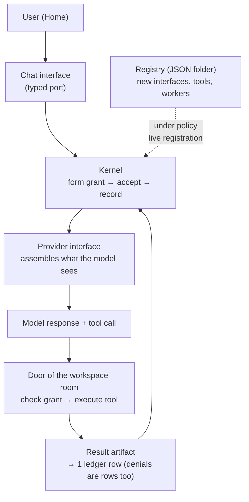

*Illustration of the idea that agents redesign the zone in which they run.*

## Why You Should Read This

Developers who have built an agent harness or agent platform from scratch, and teams designing "skill self-evolution" who are facing the decision of how far to automate and where to gate with human approval, should read this. Let me state the conclusion first. Octopus-SI-OS does not tack the claim that "agents modify their own harness" on as a feature. It designs it as a contract of OS-level primitives, interface, artifact, run, policy, mark, and by pulling the actual repository I verified down to the kernel's 58.7k lines, the agent-definition JSON's two files, and the ledger schema that uses rows for denials. That said, this is a research preview, and the README of the same repository itself admits that "today's models (including GPT-6) do not take spontaneous initiative."

## Overview

The X account miu21590 announced this project around October 23 with the tweet "Octopus OS, a reinvented agent harness." The core sentence: "Agents can edit their own harness in the middle of a task, on their own." An agent fixing its own harness by itself, mid-task. The repository is github.com/miuuyy/Octopus-SI-OS, MIT-licensed, with 436 stars, 46 forks, and 294 commits as of the time of checking.

"The agent that fixes its own harness" has surfaced several times in recent months. Most approaches attached a self-improvement stage at the learning or deployment phase, but Octopus claims that self-improvement is the premise of the architecture itself. In the README's own words, "self-evolution is shaping the conditions of future work," and "whether self-improvement actually holds" is the research goal. Taking the difference between those two words as the axis of the system design is the project's identity.

The README introduces itself as "A self-evolving agentic OS." It is a project that rebuilds agent execution on top of operating-system principles, mapping project, permission, task, and driver onto OS concepts. It has also ported Codex as the system's first interface: log in with a ChatGPT account and the Codex CLI operates as one interface of the system.

## What Is This Technology

Octopus's architecture starts from two words. System (everything Octopus can act on) and World (everything else). The two meet only at declared interfaces. Below that there is no orchestrator, just a handful of primitives.

- **Interface**: A typed port. Providers, channels, sensors, tool rooms, workers, all of them are interfaces.
- **Artifact**: The only thing that crosses boundaries. Messages, diffs, tool calls, memory.
- **Run**: A persistent execution record that parks on artifact arrival and wakes when needed. Not a process, but data.
- **Execution environment**: goal + policy. Environments nest, getting narrower toward the inside.
- **Worker**: What we call an agent. Here a worker is not a program but a description. A definition carrying the role and the "ceiling of what can be reached forever."
- **Policy**: Not stored. It is formed on the spot, each time an artifact arrives, from the worker, the environment, and the binding.
- **Mark**: Evidence that something happened. Recorded only after a verifier has passed it.

One turn flows like this. You type a message at Home, the Chat interface passes an artifact to the kernel, and the kernel forms a grant, accepts it, and records it. The provider interface assembles what the model sees, and the door of the workspace room checks tools against the grant before executing. Every "movement recorded" line is one row of the ledger, and denials are rows too. They are typed rows, not silently dropped.



Expanding two of the primitives a bit further shows what this design is aiming at. A Run being "not a process but data" means that an execution is not state held in a process's memory, but state recorded in the ledger. When an artifact arrives, the run parks; when needed, it wakes. If the process dies, the run survives, and the next run continues on the same record. The policy being "not stored" is a stronger statement. A stored policy file can drift at any time, and the moment execution is allowed under a drifted policy, auditing becomes meaningless. Octopus forms policy instead of storing it: at the moment an artifact arrives, it forms a grant from that worker, that environment, and that binding, and opens doors only with that grant.

The extension method is the same. Everything plugs in as "a JSON folder + a script or binary if execution is needed." One provider, one channel, one sensor, one worker, one tool, one verifier. None of them touch the kernel. The README's self-modification example goes like this: ask the system to see something it cannot currently see (e.g., the user's face), and it creates a run for the coder worker and hangs off the artifact that run must prove. The coder writes a small camera driver and makes a new interface folder, the verifier passes it, and the narrator picks it up live. The first one costs the coder's time; the second and beyond cost nothing to build.

## Installation and Integration

The official requirements are macOS 14+, Node 24, a stable Rust toolchain, and a ChatGPT account. The install commands are verbatim from the README.

```bash
git clone https://github.com/miuuyy/Octopus-SI-OS.git
cd Octopus-SI-OS
npm ci --prefix app
```

The native build requires the Node 24.15.0 headers. The README gives commands for downloading them and verifying sha256.

```bash
mkdir -p app/build
curl -fL https://nodejs.org/download/release/v24.15.0/node-v24.15.0-headers.tar.gz \
  -o app/build/node-v24.15.0-headers.tar.gz
printf '%s %s\n' \
  9a9250039fef572d0bcc110ac5e78055faf5604421211d2d5f578ebc5a34e703 \
  app/build/node-v24.15.0-headers.tar.gz | shasum -a 256 -c -
tar -xzf app/build/node-v24.15.0-headers.tar.gz -C app/build
```

Then packaging and running.

```bash
OCTOPUS_NATIVE_NODE_HEADERS="$PWD/app/build/node-v24.15.0/include/node" \
npm --prefix app run package:mac
open -n ./app/build/Octopus.app
```

First run is five steps. (1) Log in to ChatGPT. It opens in a browser; there is no terminal login. (2) Set a local password protecting this machine's client. (3) Start the system with the `octopus up` command in the built-in terminal, then wait for the ready state. (4) Pick the starting structure (project, name, capabilities) with 'Set up Octopus'. (5) Say one word at Home. A reply proves the connection, and a task that uses tools proves the installation for that task. To create a new task you first create an Agent: choose a Project and a model, review the capabilities, then select it in the task composer. Model availability and usage limits belong to the provider account, and voice or some Applications require their own credentials and macOS permissions. The terminal client is used with `./octopus` after `npm --prefix app run build:cli`. Packaging builds and bundles the client, the relight runtime, the capability executables, and the provider bridge, along with a managed Codex distribution. The output is `app/build/Octopus.app`, ad-hoc-signed for that machine and not notarized.

## Actual Experiment Results

Instead of running the GUI, I pulled the repository and verified its structure. The experiment ran in an isolated sandbox (impl_sandbox), and every output is preserved in run-N.log under outputs/blog-impl/octopus-os-self-evolving-harness/.

**Kernel size verification.** The README says "the kernel is roughly 45,000 lines of Rust." I measured. The Rust code in `crates/` totals 58,749 lines across 19 packages, not 1,500 files. The largest packages, in order, are octopus-app-server (11,315 lines), octopus-app (8,935 lines), and octopus-interface-transport (7,685 lines). The 45k figure is the value at the time of the announcement, and the repository has since grown to 58.7k.

**Registry size.** `registry/` holds 651,166 lines of Rust. The workspace member composition is `crates/*` + `registry/interface/*/packages/*` (57 packages) + `registry/worker_environment_kind/*/packages/*` (41 packages), with the interface side accounting for 474,412 lines and the worker_environment_kind side for 176,754 lines. In other words, extension sources bundled beyond the kernel are more than 10x its size and sit in the repo; only the "managed Codex distribution" (`registry/interface/world_provider_codex/packages/bin`) is excluded from the workspace as a "distribution input".

**Verification of agent = two JSON files.** The README says "an agent is not a program but two JSON files." Opening `registry/interface/system_worker_coder_max/` for real shows exactly two files: `interface.json` and `policy.json`.

```json
{
  "id": "system_worker_coder_max",
  "interface_type": "system",
  "role": "worker",
  "direction": "bidirectional",
  "source_names": ["coder_max"]
}
```

The core of policy.json is `ceiling`. It is the list of interfaces this worker can reach forever (some 30 providers such as anthropic, chatgpt, codex, ollama, openai, vllm, + terminal + browser + mcp_github, etc.) and the tools (coder.apply_patch, coder.write_file, coder.build, coder.exec, and so on). The README's phrase "role and ceiling" exists in reality as this data structure.

**Tools and ledger schema.** `registry/tool/exec.run/tool.json` is a tool definition. The interface (system_exec_env), the handler configuration, and the actual process (`bin: target/debug/octopus-process-room-tool`, PATH in inherit_env, authority information) are all declared as data. The movement in `schemas/movement.schema.json` has from, kind, lamport, recorded_at_unix_ms, seq, to, trace as required fields. A Lamport timestamp inside a ledger row is a trace of the design intent to logically order events among distributed interface processes. The same folder holds schemas for grant_projection, mark, mark_descriptor, run_record, verifier_descriptor, delivery_verdict, required_verified_artifact.

**Compile attempt.** I ran `cargo check` against 10 kernel packages. It failed on the reproduction attempt, with two failure causes recorded. First, cargo tried to fetch a git source dependency (helix-editor/nucleo) over SSH and authentication failed, and I had to switch to `CARGO_NET_GIT_FETCH_WITH_CLI=true`. Second, even after the switch, the workspace requires `rust-version = 1.91` while this machine's rustc is 1.88.0, so all 10 kernel packages were rejected with "rustc 1.91 required." In other words, on this machine today I could not complete the kernel compile. Verification of the repository's structure, schemas, and counts is complete, and the compile verification must be retried in a 1.91 toolchain environment.

## ThakiCloud Product Application Implications

From the perspective of Paxis (Agent-Native Cloud), Octopus's design is directly comparable in three places. First, where policy is formed. Paxis routes all agent actions through a policy gate and an audit log, while Octopus does not store policy and forms it at artifact arrival from the worker, the environment, and the binding. "Stored policy" and "grants formed at arrival" are different choices that trade audit difficulty against flexibility. Octopus leaves even denials as ledger rows, and this "denials are logged" principle can be referenced as-is when Paxis's audit log must distinguish actions intentionally denied from actions the system could not process.

Second, the data-ification of agent definitions. A worker being two JSON files (description + ceiling) points the same direction as Paxis treating skills, tools, and policies as first-class resources. If an agent is defined as data rather than code, "creating a new agent" becomes schema validation plus verifier passage, not a code review.

Third, the boundary of self-modification. Octopus's self-modification is not unlimited; it happens under policy. Even if an agent creates and registers an interface, it enters the system only after the verifier passes it and the ledger records it. One answer to the question most often asked when designing "skill self-evolution" (where do you stop letting an agent grow its own capabilities) actually exists in this repo as the combination of verifier + mark + lamport ledger.

Put the two systems side by side and the differences become concrete.

| Design decision | Paxis | Octopus |
|---|---|---|
| Storage of policy | Stored as a first-class resource, passes through a gate | Not stored, formed at arrival (grant) |
| Agent definition | Combination of skill, tool, and policy resources | Two JSONs (description + ceiling) |
| Unit of audit | Per-action policy gate + audit log | movement row (denials included, lamport+seq+trace) |
| Extension path | Skill self-evolution (verification loop) | interface folder + verifier passage + live registration |
| Location of self-modification | Skill layer | Architectural primitives (interfaces, triggers, worker organization) |

This table is an axis of comparison, not an answer. Paxis has the organization declare "how far to automate" via stored policy and first-class resources; Octopus declares "how far the agent itself can reach" as a ceiling, via grants that are not stored and workers that are data. In the end both are terminated by a verifier/gate that ends self-modification, but the declaring subject and its location differ.

From the ai-platform (serving infrastructure) perspective, note that world_provider_vllm, world_provider_ollama, and world_provider_lmstudio are enumerated in the worker policy ceiling. Making multi-provider routing part of the agent policy data shows that a serving catalog can become a first-class component of an agent execution environment.

## Limitations and Counterarguments

First, the README's own stated limitation. "Today's models, including GPT-6, do not take spontaneous initiative. In a typical coding task, Octopus gives nothing that the Codex CLI does not already give." The research question is "does an architecture that reconfigures the agent's execution environment help the agent take initiative and steer its own long-term development?" In other words, what this project proves is the "mechanism" of self-modification; the "motivation" for self-modification is still not in the model.

There are practical limits as well. It targets macOS 14+ desktops, ships as an ad-hoc-signed, non-notarized app, and requires ChatGPT account login plus a local password. A near-700k-line repository (kernel 58.7k + registry 651k) is not a small experiment but a substantial codebase, and on this machine today I could not even complete the kernel compile without the toolchain (rustc 1.91). The gap between the announced "45,000 lines" figure and the measured 58,749 lines can also be read as meaning the numbers are changing quickly.

## Summary

Octopus-SI-OS is a case that translated the sentence "the agent fixes its own harness" into an architectural contract. What I verified today is three things. The kernel is 58.7k lines of Rust across 19 packages, the agent is two JSON files carrying role and ceiling, and every boundary crossing and denial is recorded as a ledger row with a Lamport timestamp. And that this machine is finished, the team itself writes "the model does not take initiative yet." The next action is clear. Teams designing agent platforms should reference the verifier + policy ceiling + ledger structure that treats denials as rows, and from Octopus they can learn that before calling "self-evolution" a product feature, the machine that verifies evolution (verifier, mark) should come first. When I retry the kernel compile and the GUI first run in a 1.91 toolchain environment, I will append those results to this article.

---

## Sources

- [miuuyy/Octopus-SI-OS (GitHub, MIT)](https://github.com/miuuyy/Octopus-SI-OS)
- [Announcement tweet (@miu21590)](https://x.com/miu21590/status/2114095879632375944)
- [AGI Hunt: Octopus OS, a 45k-line Rust agent harness](https://agihunt.info/en/p/1a171f99b42125c17b7c357dbdc)

*Experiment logs: `outputs/blog-impl/octopus-os-self-evolving-harness/run-1.log` through `run-10.log` (including clone, LoC, contract checks, compile attempt)*
