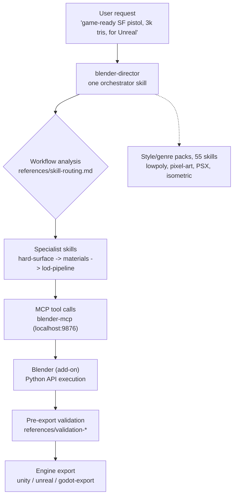

*The central orchestrator skill surrounded by specialist skills. We visualized the "1 + 94" structure of Blender Skills.*

## Why read this

If you have designed a Claude Code skill system or an MCP integration yourself, or if your team is about to decide whether to bring a coding agent into a creative production pipeline, read this for one decision: should we adopt the 94-skill pack as-is? Here is the conclusion up front. The skill-pack + MCP-bridge pattern ports cleanly into non-code territory, into DCC tools like Blender, and the structure holds. But after cloning the repo and measuring it, three structural weaknesses deserve a check before adoption: the flat 94-skill taxonomy, the single execution bridge through blender-mcp, and a 3.5-month maintenance gap as of writing.

## Overview

The starting point is a tweet by @_guillecasaus on October 26 (UTC). It introduces a collection of 94 skills that let agents like Claude Code and Cursor drive Blender: modeling, materials, and animation, plus low-poly, pixel-art, PSX, and isometric styles, game-ready optimization, and direct export to Unity, Unreal, and Godot. It includes a blender-director skill that coordinates the whole process automatically, and it is free and open source.

The repo is [arjun988/blender-skills](https://github.com/arjun988/blender-skills). MIT license, v1.3.0 per version.json (2026-07-10). It even carries a site/ directory, so the source for its documentation site (blender-skills.vercel.app) ships inside. As of writing (2026-10-28), the GitHub API reports 1,177 stars, 94 forks, and 2 open issues. The repo was created 2026-07-05; the last push is 2026-07-10. GitHub topics include 3d-models, agent, agent-skills, blender-mcp, claude-code, cursor-ai, game-development, and mcp. Rather than trust the project's claim of "94 skills, 175+ reference files," we counted the directories ourselves. `.claude/skills/` contains exactly 94 skill directories with a SKILL.md, and a 94-skill mirror sits in `.cursor/skills/`, so 188 SKILL.md files in total. The `.claude/` tree holds 269 markdown files altogether.

## What is this technology

The Blender Skills architecture splits into two components. First, the agent skill pack. Second, the MCP-based execution pipeline.



The heart of the skill pack is blender-director. Its SKILL.md is 19.7KB, the largest in the pack, and its opening line reads "Senior Technical Director orchestrating AAA Blender production." The frontmatter declares role as both specialist and orchestrator, and related-skills names nine: blender-modeler, hard-surface, prop-artist, vehicle-artist, environment-artist, character-artist, asset-optimization, export-pipeline, qa-review. Routing rules live in references/skill-routing.md (4.2KB); complex work is read here first, then fanned out to specialist skills. The director also spells out its own invocation points.

- New Blender asset requests (props, environments, characters, creatures)
- Multi-discipline tasks spanning modeling, UVs, materials, rigging, and export
- Ambiguous requests that need workflow analysis
- Production planning with polycount targets and export format decisions
- Style direction coordination (horror, lowpoly, stylized, realistic)

The repo's CLAUDE.md backs the structure with six agent instructions. Read blender-director first for complex work. If a reference image is attached, complete Reference Analysis before executing via MCP. If MCP is connected, execute through MCP instead of narrating UI steps. Read the MCP tool schemas before calling them. Follow the universal pipeline in references/asset-pipeline.md. Validate against the validation references before export. The "read the schemas first" instruction stands out: it stops the agent from trusting the tool list written in the skill body, and makes it call against the schemas the MCP server actually exposes. A small governance device.

On the MCP side, a single `.mcp.json` file is everything. It launches `uvx --python 3.11 blender-mcp` with BLENDER_HOST=localhost, BLENDER_PORT=9876, and DISABLE_TELEMETRY=true. The PyPI package blender-mcp 2.0.0 is effectively a rename shim; the real package is ahujasid's mcp-for-blender (38 releases, last uploaded 2026-09-16, requires Python 3.10+). Inside Blender, a companion add-on opens port 9876, and the MCP server steers the Blender Python API through it. From the agent's side, UI observation disappears and only Python writing remains. The skill pack is doubly staged for two ecosystems as well: 94 skills sit mirrored in `.claude/skills/` and `.cursor/skills/`, with installation docs like QUICKSTART.md and docs/BLENDER_MCP_SETUP.md, plus ROADMAP.md, CHANGELOG.md, and SKILLS_GUIDE.md alongside.

We measured the composition of the 94 skills.


*Style/genre packs are 55, more than half. The pack's identity is that taste skills outnumber technical skills by a wide margin.*

Fifty-five style/genre packs (lowpoly-style, pixel-art-style, psx-horror-style, isometric-style, genre-shooter, genre-rpg, and so on), 14 modeling/sculpting, 11 pipeline/export (export-pipeline, lod-pipeline, collision-proxy, unity-export, unreal-export, godot-export, qa-review, and others), 6 shading/rendering, 6 animation/simulation, 1 technique (geometry-nodes), and 1 orchestrator. The skill table in the README backs this grouping. Its Pipeline row lists twelve: procedural-modeling, scene-assembly, set-dressing, asset-optimization, lod-pipeline, collision-proxy, export-pipeline, unity-export, unreal-export, godot-export, qa-review, archviz. The anatomy of a single skill is also simple. export-pipeline is just SKILL.md (4.2KB) and references/engine-import.md (753B).

## Installation and integration

The install path is three steps.

```bash
# 1. Clone the repo
git clone https://github.com/arjun988/blender-skills.git

# 2. Copy the skill pack into the agent skills directory (Claude Code)
cp -r blender-skills/.claude/skills/* ~/.claude/skills/

# 3. Wire the MCP server: the repo .mcp.json is in Windows form
#    "command": "cmd", "args": ["/c", "uvx", "--python", "3.11", "blender-mcp"]
#    On macOS/Linux you must set command to "uvx"
```

A `.mcp.json` that works on macOS/Linux out of the box looks like this (the measured original, adjusted for the OS).

```json
{
  "mcpServers": {
    "blender": {
      "command": "uvx",
      "args": ["--python", "3.11", "blender-mcp"],
      "env": {
        "BLENDER_HOST": "localhost",
        "BLENDER_PORT": "9876",
        "DISABLE_TELEMETRY": "true"
      }
    }
  }
}
```

The `.mcp.json` also pins `--python 3.11`. mcp-for-blender itself requires Python 3.10+, so the pack narrows the pin one step further. uvx resolves a managed Python each time, so there is no separate install procedure, but on a 3.10-only environment this pin bites first. QUICKSTART.md keeps the Kiro, Codex, and Cursor install paths separate, and the community site blender-skills.vercel.app carries the guides. `.claude-plugin/` holds plugin.json and marketplace.json, so a Claude Code plugin marketplace distribution path is also open.

Let me be honest about the reproduction scope. This session's machine has no Blender installed, so we could not run the live asset pipeline (modeling to materials to engine export). Reproduction attempt failed: no local Blender. The measurement in this post is therefore limited to the repo structure, the skill counts, and the dependency chain (PyPI shim to mcp-for-blender to the add-on port).

## Actual experiment results

The captured numbers in one table.

| Item | README claim | Measured (2026-10-28) |
|---|---|---|
| Skill count | 94 | 94 (direct count of SKILL.md dirs under `.claude/skills/`) |
| Reference files | 175+ | 175 (version.json), 269 total md under `.claude/` |
| Stars | - | 1,177 (GitHub API) |
| Forks / open issues | - | 94 / 2 |
| Version | - | 1.3.0 (2026-07-10) |
| MCP server | blender-mcp | PyPI shim to mcp-for-blender 2.0.0 (last uploaded 2026-09-16) |

The dependency chain check remains. Opening the PyPI page for blender-mcp shows "Renamed to mcp-for-blender. Installing this package installs it for you." Installing the shim pulls in the real package. The version.json original, for the record:

```json
{
  "version": "1.3.0",
  "date": "2026-07-10",
  "skills": 94,
  "references": 175,
  "changelog": "CHANGELOG.md"
}
```

Two observations remain. First, the README numbers are exact. A repo whose marketing number matches the actual directory count is rare. The fork count of 94 overlapping the skill count of 94 also caught our eye during the audit. There is no way to tell whether that is coincidence or the number spreading. Second, the last push stopped at July 10. At the point the tweet flew out on October 26, the project had been quiet for 3.5 months, with 2 open issues as they were. 1,177 stars measure "interest"; they cannot prove the pipeline works.

## Implications for ThakiCloud products

Read through a Paxis lens, the pack shows the same pattern at a different scale. Paxis's Skill Harness retrieves from 960+ skills via BM25, while Blender Skills leaves the model to read and choose among 94 SKILL.md descriptions every turn. The scale is small enough to hold for now, but the limit of a flat taxonomy with a single description as the routing signal matches exactly why Paxis keeps its retrieval layer code-owned.

The single-entry orchestrator (blender-director) sits in the same place as Paxis's entry-skill routing, and the difference is who does the routing. This pack: model judgment. Paxis: deterministic code. The metadata approach of declaring role as both specialist and orchestrator points in the same direction as Paxis's practice of stating a skill's intent, triggers, and boundaries in the frontmatter.

One more contrast: the blender-director prompt wears a "15-year AAA technical director" persona. Role metadata steering routing versus persona narrative steering quality. The former aims at deterministic control, the latter at model-dependent quality. The references/ anatomy is also worth noting. Keeping skill bodies short and splitting detailed knowledge into references/ files mirrors Paxis's separation of skill bodies from external knowledge. The execution plane is the same story. Steering a non-code tool through MCP is a small instance of how Paxis extends an agent's reach via sandboxes and MCP connectors. Carving the taste layer (55 style packs) into independent skills, separating "technique" from "taste," is a decomposition method to reference when designing domain packs.

## Limitations and counterarguments

Three weaknesses stand out.

First, the flat taxonomy. 94 skills sit level in one directory, and the only routing signal is each SKILL.md's description. Push from 94 to 940 and this structure becomes a model selection-quality problem. What this pack proves is the pattern, not the scaling.

Second, the single MCP bridge. All 94 skills funnel through one blender-mcp. If the add-on dies, the whole pack turns into paper. The measured `.mcp.json` being in `cmd /c` Windows form also means users on other OSes must rewire it.

Third, the maintenance gap. Last push 2026-07-10, 2 open issues, and a "15-year AAA technical director" prompt persona. The persona is marketing. Output quality is decided by model capability and references quality, and if both have gone unrefreshed for 3.5 months, the real quality drifts at model-upgrade speed regardless of the star count.

## Wrap-up

What Blender Skills shows is that the "skill pack + MCP bridge" pattern can move outside code. One orchestrator, N specialists, per-skill references/, and one MCP that steers the tool. The structure holds, and the numbers match the README. But the adoption decision should rest on three criteria: does the routing scale (flat 94), is the execution bridge a single point of failure, and is the repo alive. For developers building a skill system, this pack is a case to take "the separation of orchestrator and references," not the number 94. For teams extending a coding agent into a new domain tool, the order this repo leaves as evidence is: wire the MCP first, fix a single entry point, and split knowledge into references rather than the body.

---

*Sources: [@_guillecasaus tweet (2026-10-26)](https://x.com/_guillecasaus/status/2114684358153908569) · [arjun988/blender-skills](https://github.com/arjun988/blender-skills) · [PyPI blender-mcp](https://pypi.org/project/blender-mcp/) · [ahujasid/mcp-for-blender](https://github.com/ahujasid/mcp-for-blender)*
