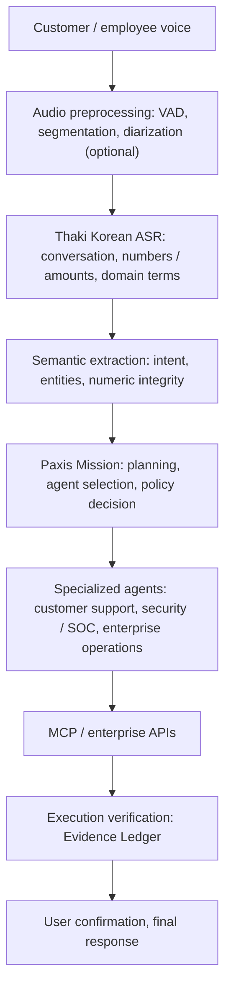

*A sovereign agentic AI architecture: we train our own Korean speech-recognition model and connect it to enterprise work judgment and execution.*

## Why Read This

This post is for engineers and leaders who want to use voice AI as part of work automation inside their enterprise, and it matters most in domains such as customer service, finance, and security, where numbers and evidence carry weight. If you want to secure Korean speech recognition in-house, the headline is this: a [Korean ASR model](https://huggingface.co/ThakiCloud/Thaki-ASR-KO-1.7B) fine-tuned on top of Qwen3-ASR-1.7B for call-center speech and numeric recognition passed all five pre-registered release gates in an independent evaluation. This model is not a transcription tool. It is the starting point of a Voice-to-Mission architecture that connects to the Perception layer which kicks off Paxis work execution.

The moment speech recognition becomes text, the next step is the real question. If a customer asks to cancel a payment during a call, the work does not end with logging that sentence. The system has to understand the request, look up the order, review the refund policy, obtain the necessary approval, and then process it in the actual system. Different AI capabilities are involved at each stage.

- **Perception:** recognize speech accurately.
- **Understanding:** understand the intent and key information in the utterance.
- **Decision:** decide the next action based on work policy and evidence.
- **Action:** execute the enterprise system's APIs and tools.
- **Verification:** confirm the execution result and record the evidence.

The Paxis Agent Platform aims to be an agent execution environment that connects these five capabilities. We started by building and validating the first link in this chain, Korean speech recognition, ourselves. This post first shows the performance and development process of the Korean ASR we actually trained, then walks through application cases that connect it to Paxis's autonomous agent architecture.

## Why We Trained an Enterprise Korean ASR Model Ourselves

Better general-purpose ASR does not guarantee the same quality in every enterprise voice environment. In a Korean customer-service setting, beyond raw sentence accuracy, the model must correctly handle numbers, amounts, dates, product names, and colloquial expressions. "Refund three hundred thousand won" and "Refund thirty thousand won" look like a one-character difference, but in a business context they can mean completely different things. Even with a low CER, if the amount is misrecognized, the result cannot be passed as-is to a finance or customer-support agent.

To solve this, we trained a model specialized for Korean call-center and general conversation on top of Qwen3-ASR-1.7B. Three things were central.

First, we tuned the training distribution to match real enterprise conversation. Rather than leaning on generic speech data, we balanced call-center speech, everyday conversation, and general Korean utterances.

Second, we preserved numeric meaning. "Three hundred thousand won" and "300,000 won" are different expressions of the same value, while "300,000 won" and "30,000 won" are entirely different values. To evaluate this distinction, we built a separate numeric evaluator that interprets Korean numerals and unit expressions instead of relying on simple string equality.

Third, we preserved existing general recognition. A model that improves on call-center speech but degrades on general conversation is hard to use as an enterprise model. So we independently verified that there is no regression against the original model on general conversation, not just call-center speech.

## Independent Evaluation: Improvements on Conversation, General Speech, and Numbers

For the final evaluation, we compared the original Qwen3-ASR-1.7B against the Korean-specialized checkpoint `ckpt-1200`. We composed three new test sets, TEST-C/D/E, that were not used in earlier evaluations, and applied the same decoding conditions to both models.

The released model is available on [Hugging Face](https://huggingface.co/ThakiCloud/Thaki-ASR-KO-1.7B). The evaluation code and reproduction scripts are published on [GitHub](https://github.com/ThakiCloud/thaki-asr-ko-1.7b).

*Independent evaluation results for the original model and the Korean-specialized model. All figures were measured on the sealed TEST-C/D/E sets.*

| Evaluation item | Original model | Thaki Korean-specialized model | Change |
|---|---:|---:|---|
| General conversation CER (TEST-C, 456 items) | 3.46% | **1.95%** | ~43.6% relative improvement |
| Call-center CER (TEST-D, 900 items) | 6.88% | **6.07%** | ~11.8% relative improvement |
| Call-center CER (TEST-E, 250 items) | 6.83% | **6.35%** | ~7.0% relative improvement |
| Numeric Robust accuracy (981 items) | 66.36% | **88.69%** | +22.33%p |
| Plausible-but-wrong numbers | 12 | **6** | 50% reduction |
| Runaway detections | 0 | **0** | Criterion met |

*Numeric Robust accuracy is measured over 981 evaluation items contained in TEST-C/E; it is not an utterance count.*

All five pre-registered release gates passed. This is not a result of lowering a single CER figure. It reflects a joint check across call-center recognition, general conversation, numeric meaning, wrong-number generation, and inference stability.

### Evaluation data is part of product quality

The development was not smooth from the start. An early evaluation showed degraded numeric recognition. Looking at the errors, the problem was the evaluator: Korean numeral and digit notations were not being compared correctly. We then fixed the evaluator to compare numeric values. In another evaluation, trailing conversation that actually exists in the audio was missing from the reference transcript, so sentences the model recognized normally were misjudged as over-generation.

The key lesson here: **you must distinguish whether the model is wrong, whether the reference data is wrong, or whether the metric is wrong.** Instead of retroactively changing past failure verdicts, we recorded the cause and re-ran a separate independent evaluation. The same verification approach applies to ASR and to evaluating judgment models and autonomous agents alike.

## Voice-to-Mission: Connecting to Paxis

An ASR model alone cannot handle a customer's request. When combined with Paxis, the important point is using the speech-recognition model not as a mere input API but as a **Perception layer that starts work execution**. The diagram below is the reference architecture for that combination.

In this architecture, a single general-purpose LLM does not have to do everything. The ASR handles speech recognition, specialized models or a policy engine handle work-specific decisions, and Paxis agents with MCP tools perform the actual execution. Each component can be evaluated and improved independently.

Equally central is **separating the model's language understanding from its authority to act on work**. A payment cancellation, account change, or security-policy modification must never be executed on the basis of a speech-recognition result alone. Such actions separately require authentication, policy validation, user confirmation, and verification of the execution result.

## Application Cases

### Customer support: handling a refund request with evidence

A customer says, "I cancelled the 350,000-won service I paid for last week, but the refund still hasn't come through. Could you check on it?" A general chatbot would explain the refund policy or offer to connect the customer to a human agent. A Paxis-based agent processes the request step by step.

The ASR transcribes the utterance and extracts the key information: `350,000 won`, `last week`, `payment cancelled`, `refund status check`. The amount is treated as numeric information that must be verified semantically. Paxis then structures the request as a work mission: confirm the customer's authentication status, look up recent payment and cancellation records, check refund progress, judge whether the delay is policy-compliant, and report the result.

The payment-lookup agent calls the enterprise payment API, and the policy-decision agent compares the transaction details against the refund rules. If the evidence is insufficient, it does not draw an arbitrary conclusion and requests additional confirmation. Finally, the transaction ID, API result, applied policy, and processing time returned by the system are recorded in the Evidence Ledger. The customer is told only the verified result, and state-changing actions like executing the refund go through separate authority checks and approval.

Where the traditional flow is Voice-to-Text-to-Answer, the Paxis goal is **Voice-to-Mission-to-Verified-Action**.

### Security operations: a SOC investigation that starts by voice

A security analyst can say, "Show me the three high-severity authentication anomalies detected today, and check the correlation between the related IPs and accounts." Paxis decomposes this request into a multi-stage investigation.

Through MCP, it gathers related events from the SIEM, logs, and event stores, and binds detection rules, IPs, accounts, and timestamps into an evidence set. A security-domain decision model assesses the sufficiency of the evidence and the likelihood of an attack. Unlike a plain LLM summary, it is designed so that each judgment can be traced back to the evidence it is based on. For high-severity cases with sufficient evidence, it proposes account lockdown, IP blocking, or additional investigation, and actual blocking or permission changes are performed only after passing policy and approval procedures. The original events, analysis, evidence, approval history, and execution results are linked in the Evidence Ledger.

In this structure, the analyst starts the investigation by voice, but the AI is not allowed to execute security actions without evidence. Autonomy is raised, while the basis for decisions and execution authority remain controlled.

### Meetings: turning agreements into actual work

Meeting automation usually stops at transcription, summarization, and action-item extraction. Combined with Paxis, content agreed on in a meeting can be carried into the actual work flow. For example, if someone says in a meeting, "Finish the GPU cost analysis by next Wednesday and summarize the savings compared to the existing inference server," the system transcribes the utterance, optionally separates speakers with a diarization model, and extracts the schedule and work directive. Paxis composes a cost-analysis Mission, queries infrastructure cost and inference performance data, writes the report, and reflects it in the work system after the owner confirms.

One caveat: the single-utterance evaluation results of the current Korean ASR do not guarantee performance over entire multi-speaker meetings. Long-audio segmentation, overlapping speech, and speaker identification require separate development and validation. Even so, the direction is clear: the system can move from summarizing what was said in a meeting to executing what was agreed on and confirming the results.

## Why Modular Instead of One Big Model

A general-purpose multimodal model could handle speech understanding, work judgment, tool calling, and result generation all by itself. In enterprise settings, however, a modular specialized-model architecture is often the better fit.

**Independent performance improvement** comes first. Raising the recognition rate of the Korean call-center ASR does not require retraining the security decision model or the work-execution agents. If only numeric meaning is the problem, the evaluation and processing layer for numbers can be fixed in isolation.

**Model selection by work risk** is also possible. Simple FAQ traffic goes to a relatively small model, while policy judgment or complex case analysis goes to a specialized model. Model routing considers accuracy together with cost, latency, and risk.

**Data sovereignty and deployment flexibility** is another axis. In finance, government, and security, passing raw voice and work data to an external AI is often not an option. Placing the ASR, specialized models, and agent execution environment on infrastructure the customer controls makes data movement and access control easier to design. Self-hosting alone does not complete data sovereignty, though: tenant isolation, storage policy, access auditing, and de-identification have to come with it.

**Automation that leaves a trail** is the last piece. A single final answer from a general-purpose model makes it hard to judge whether the work was done correctly. The Paxis Evidence Ledger approach aims to connect inputs, decisions, tool executions, and verification results, so you can confirm not just the final answer but what the decision was based on and what was executed.

## Metrics to Watch in Productization

A better ASR CER does not lift the whole agent's work success rate by the same proportion. ASR standalone performance and work quality after wiring into Paxis must be evaluated separately.

| Evaluation layer | Key metrics |
|---|---|
| ASR | CER, numeric-semantic accuracy, omission / hallucination, RTF |
| Semantic understanding | Intent accuracy, entity-extraction accuracy |
| Decision model | Policy compliance rate, evidence sufficiency, wrong-judgment rate |
| Agent execution | Mission success rate, tool-call accuracy |
| Operational safety | Unauthorized-execution count, tenant isolation, auditability |
| User experience | End-to-end completion time, re-confirmation request rate |

Information that is costly to misrecognize, such as amounts, account numbers, phone numbers, and dates, is handled more strictly than ordinary CER, with optional original-audio re-verification or a user-confirmation step. In future Paxis integration validation, we plan to measure not transcription performance but **the rate at which a voice request leads to completed work, and the safety of that process**.

## Direction: Domain Models x Agent Platform

What this development showed is not just that fine-tuning lowers error rates. More important is that we can build a model fitted to a specific domain, pass it through trustworthy evaluation, and use that model as part of a real work-execution system.

The development flow we are aiming for is **Domain Data, Model Training, Independent Evaluation, Model Registry, Paxis Agent Integration, Verified Execution**. Specialized models trained per domain become independent AI capabilities that Paxis agents use. The Korean ASR handles voice input, the security-specialized model analyzes cases and evidence, and the work-decision model reviews policy and execution conditions. Paxis connects these as Missions and manages tool execution and result verification.

One distinction to make clearly: what has completed public validation is the ASR model, while the Paxis application architecture and the customer-support, SOC, and meeting scenarios described here are technical application examples, not measured results of an integrated product. A real service needs its own end-to-end validation.

## Summary

The next step of speech recognition is not text, it is work. A Korean ASR fine-tuned for call-center speech and numeric recognition passed all five gates in an independent evaluation, and the Voice-to-Mission architecture that connects that model to the Paxis Perception layer is the reference design that closes the chain. Securing a specialized model for each domain, confirming trust through independent evaluation, and connecting it to safely complete real work while leaving an evidence trail: that is the direction we see for AI platforms.

We encourage you to redefine your own voice problem along the same axis. Do not stop at a single CER number; look at numeric meaning, evidence, and execution verification under one standard. What we are building goes beyond an AI that hears well, toward an AI that understands a user's request and safely completes the enterprise's work.

---

*ThakiCloud AI Engineering, Korean ASR & Agentic AI*

*Source of ASR performance: ASR-NG-R2 Step 5b independent evaluation, October 29, 2026. The model weights are published on [Hugging Face](https://huggingface.co/ThakiCloud/Thaki-ASR-KO-1.7B). The release status of the Paxis-integrated service must be confirmed separately.*
