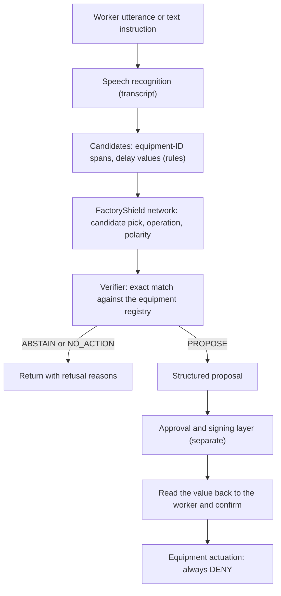

## Summary

When a worker on a factory floor says "stop molding machine P-31", letting an agent execute that sentence directly is dangerous. One misheard equipment number, or a negation such as "don't stop it", can move the wrong machine. So we put one more step in front of execution. That step turns a spoken command into a **proposal** made of an operation, a target equipment ID and a delay, or refuses when it cannot be sure.

We released the Korean model that handles this step, [Thaki-FactoryShield-KO-7M](https://huggingface.co/ThakiCloud/Thaki-FactoryShield-KO-7M), on Hugging Face. It has 7,352,909 parameters. The model controls nothing. Its `safe_to_actuate` output is always `false`, and the repository contains no equipment control code.

These results have to be read in two parts. The model **passed a synthetic sealed test** against preregistered gates. It has **never been validated for safety in a real equipment environment.** Every number was measured on synthetic data, and the model has never been evaluated on real field speech. Its status is research preview.

## Why it selects instead of generating

The most dangerous failure for an equipment command is a model inventing a plausible equipment ID. If the transcript says "P-39" and the model "corrects" it to the similar "P-31", a machine the worker never meant becomes the target. FactoryShield blocks this failure by construction.

The model does not generate text. Deterministic rules first cut out the spans in the input that look like equipment IDs and delay values. The network only picks one of those candidates or picks "none". As a result, the model cannot output a string that is not in the input.

A decision takes three steps.

1. **Candidates**: rules cut equipment-ID spans and delay values out of the input.
2. **Selection**: the network picks one candidate or "none" per field, and predicts the operation, the polarity (affirmative, negated, uncertain) and an abstain score.
3. **Verification**: a rule-based verifier, which is not learned, checks the pick again.

The network is a MicroBrain encoder with candidate-selection heads. The encoder was initialised from [Thaki-InputGuard-KO-9M](https://huggingface.co/ThakiCloud/Thaki-InputGuard-KO-9M), which we released earlier.

The supported operations are `STOP`, `START` and `RESET`, and utterances that are not commands are `NONE`. The only supported constraint is a delay such as "3분 뒤에" (in 3 minutes). Conditional commands are deliberately refused.

## The core: exact matching against the equipment registry

The safety boundary of this system is not the network. It is the **registry of equipment IDs**. The caller must pass the list of equipment IDs that actually exist on site. The verifier checks that the ID the model picked is an exact member of that list. If it is not, the verifier does not repair or guess the ID. It returns `ABSTAIN`.

If no registry is given at all, every operation request is `ABSTAIN`. That is the intended fail-closed behaviour, not a usable mode. Without a registry, this model proposes nothing.

The verifier returns `ABSTAIN` if any of the following holds.

- The equipment ID is not an exact registry member, or no registry was given.
- Negation, uncertainty, reported speech, past tense or a condition is present.
- The operation verb is missing, or there are two.
- A number in the sentence is unaccounted for.
- Another registered ID appears in a way that makes the target ambiguous.
- Confidence is below fixed thresholds.

Here are the actual outputs of the six `inference.py` examples published in the model card. The registry is fictional.

| input | registry | decision | reasons |
|---|---|---|---|
| 성형기 P-31 멈춰 | yes | `PROPOSE` STOP 성형기 P-31 | |
| 냉각탑 B 다시 켜줘 | yes | `PROPOSE` START 냉각탑 B | |
| 3분 뒤에 포장라인 K-4 정지해 | yes | `PROPOSE` STOP 포장라인 K-4, delay 3분 | |
| 성형기 P-31 멈추지 마 (negated) | yes | `ABSTAIN` | MODEL_ABSTAIN, MODEL_NEGATED, NEGATION_MARKER |
| 성형기 P-39 멈춰 (not registered) | yes | `ABSTAIN` | LOW_CONFIDENCE_MACHINE, UNKNOWN_MACHINE |
| 성형기 P-31 멈춰 | **none** | `ABSTAIN` | LOW_CONFIDENCE_MACHINE, NO_REGISTRY_MACHINE |

The first and last rows are the same sentence. The only difference is the registry. With a registry the system proposes, and without one it refuses. `safe_to_actuate` is `False` in all six rows.

## Model-alone performance is not system performance

This is the most important distinction when reading the numbers. The low risk figures are not what the model achieves alone. They are **system** figures for the model, the verifier and the registry together. The model alone is wrong on 2.6% to 3.9% of the requests it would act on.

The evaluation was a synthetic sealed test. Gates G1 to G4 were preregistered, the checkpoint was chosen on validation only, and the sealed test was opened once. The test set is a new synthetic family. Its six equipment-ID patterns, six equipment nouns, sentence frames and endings do not occur in training or validation. There are 0 equipment strings shared with training. At test time the registry held the real IDs plus 3,475 sealed decoy IDs.

Here, risk is the share of requests the system acted on (`PROPOSE`) whose action was wrong. Coverage is the share of should-act requests that got a correct `PROPOSE`.

| split (n) | candidate recall | ID selection acc. | **model alone** risk / coverage | verifier, no registry | **system** risk / coverage |
|---|---|---|---|---|---|
| template (6,000) | 1.000 | 0.948 | **2.57%** / 0.845 | 0 / 0.000 | **0.00%** / 0.823 |
| ASR-noised (3,000) | 0.978 | 0.948 | **3.90%** / 0.793 | 0 / 0.000 | **0.33%** / 0.722 |
| paraphrase (1,546) | 1.000 | 0.966 | **3.17%** / 0.875 | 0 / 0.000 | **0.00%** / 0.857 |

Model-alone risk is 2.57%, 3.90% and 3.17%. Adding the verifier and the registry brings it to 0.00%, 0.33% and 0.00%. In exchange, coverage drops somewhat. Refusing requests it is unsure about means the system proposes less often.

The remaining results come from the same test.

- Delay-value selection accuracy is 1.000 on all three splits, and negated commands executed: 0.
- In a stress test with the correct equipment removed from the registry, `PROPOSE` was 0 / 2,419, 0 / 1,226 and 0 / 962.
- Effective-operation accuracy on the same template split is 0.929. ThakiCloud's earlier rule-only command inspector scored 0.597.
- All four preregistered gates passed. G1 is system risk ≤ 0.5% on every split, G2 is no negated execution, G3 is template coverage ≥ 0.70, and G4 is beating the baseline.

### What the 10 errors on the ASR split tell us

The 10 system errors on the ASR split (0.33%) are all in the delay value. Every time, the model selected the number that was actually in the transcript. The transcript was what went wrong. It carried a different number than the speaker said.

That is an ASR fidelity error, not an extraction error, and no component of this model can detect it. Any deployment that takes numbers from speech needs a step that reads the value back to the operator for confirmation. When the number in the transcript is itself wrong, a decision model that only sees the transcript cannot fix it.

## Where this model sits in Paxis

Paxis is a platform where agents carry out work instructions that arrive as speech or text. FactoryShield sits just before execution in that flow, turning an instruction into a structured proposal. The diagram below is a reference design for attaching this step to Paxis. It is not a measurement of an integrated product.



In this design the boundary between judgment and execution is explicit. The network only proposes. It does not sign, approve or execute anything. Approval and signing belong to a separate layer. At this stage, permission to actuate equipment is always denied (DENY). There is no path by which FactoryShield's output reaches equipment directly.

Splitting it this way lets each layer be evaluated on its own. The proposal step is measured by risk and coverage, and the approval layer by permissions and audit records. This applies to equipment commands the same principle we described for our [Korean ASR and the Voice-to-Mission architecture](/tech-blog/en/agentops/thaki-asr-paxis-voice-to-mission/): language understanding is kept separate from the authority to execute.

## The Metis angle: on the edge without a large LLM

Equipment commands are naturally handled inside the factory. Calling a large LLM to interpret one command is overkill. With a parameter count in the millions, FactoryShield is a candidate for running on factory edge hardware without a large LLM. From the Metis point of view, this is a deployment where a small purpose-built model sits close to the site instead of a large LLM endpoint.

We will not claim what we have not measured, though. This model has never been run on a target device. Latency and memory on edge hardware are unmeasured. "It can run on the edge" is an expectation based on its size, not a measured result.

## The Aegis angle: air-gapped sites

Factories are often air-gapped from external networks. FactoryShield's decision is completed by a small network and a rule verifier, so there is no need to call an external API. The equipment registry and workers' utterances can stay on site while the decision is made. For sites where data sovereignty matters, this is a structure that fits well inside customer-controlled infrastructure such as Aegis. Operational controls such as access control and auditing still have to be put in place separately.

## How to use it

The repository contains only weights, configuration and the minimum inference code. It has no training data and no evaluation sentences. Run it from the downloaded repository as follows.

```bash
pip install -r requirements.txt
python inference.py                                        # built-in examples
python inference.py --registry "성형기 P-31,냉각탑 B" "냉각탑 B 다시 켜줘"
```

When calling it directly from Python, always pass the equipment registry.

```python
from factoryshield_min import load_shield

shield = load_shield(".")                      # the downloaded repo directory
registry = ["성형기 P-31", "냉각탑 B", "포장라인 K-4"]   # IDs that exist on YOUR site
r = shield.propose("3분 뒤에 포장라인 K-4 정지해", registry)
r["decision"]          # "PROPOSE" | "ABSTAIN" | "NO_ACTION"
r["action"]            # {"operation": "equipment.stop", "resource": "포장라인 K-4",
                       #  "constraint": {"value": 3, "unit": "분", "text": "3분", "comparator": "delay"}}
                       # or None
r["reasons"]           # why it abstained, e.g. ["UNKNOWN_MACHINE"], ["NEGATION_MARKER"]
r["safe_to_actuate"]   # always False
```

Even when `decision` is `PROPOSE`, it is only a proposal. Approval and confirmation must be handled separately by the calling system.

## Limitations and next steps

Please check these limitations before using the model.

**Synthetic only.** Training and test sentences come from a grammar plus paraphrases written by an LLM. Paraphrases were kept only when a deterministic checker agreed. Real operators' speech, site jargon, real ASR engines and noise are untested. Passing the synthetic sealed test means the gates held within that scope. It is not evidence of field performance or of real-world generalisation.

**Not validated in the field.** ThakiCloud will not connect this model to equipment before 300 to 500 real field utterances have been collected and evaluated. You should not either. The licence also forbids connecting the output to equipment without your own industrial safety assessment.

**Registry quality is your safety boundary.** The verifier trusts the registry exactly. A wrong or stale registry produces wrong proposals. When equipment changes, an operating procedure that updates the registry with it is required.

**Narrow scope.** Three operations, delay-only constraints, Korean only.

**Never run on a target device.** Latency and memory on edge hardware are unmeasured.

The next step is to shrink these limitations in order. The first thing needed is to collect and evaluate 300 to 500 real field utterances. Until those results exist, FactoryShield stays a research preview that is not connected to equipment control.

## Wrap-up

Instead of executing a spoken equipment command directly, we had a small model turn it into a structured proposal or refuse. The equipment ID is picked only from the input, and a proposal is made only on an exact registry match. Without a registry, everything is refused. The model alone is wrong on 2.6% to 3.9%. With the verifier and the registry, system risk is 0.00%, 0.33% and 0.00%.

These numbers come from a synthetic sealed test. They are not a safety validation in a real equipment environment. Closing that gap is the next job. In Paxis the network only proposes, approval belongs to a separate layer, and equipment actuation is denied. That boundary between judgment and execution is what we most wanted to show with this release.

---

*ThakiCloud AI Engineering, Korean Voice Command & Agentic AI*

*Source of the numbers: Thaki-FactoryShield-KO-7M model card (synthetic sealed evaluation). The model is published on [Hugging Face](https://huggingface.co/ThakiCloud/Thaki-FactoryShield-KO-7M) as a research preview and is not connected to real equipment control.*
