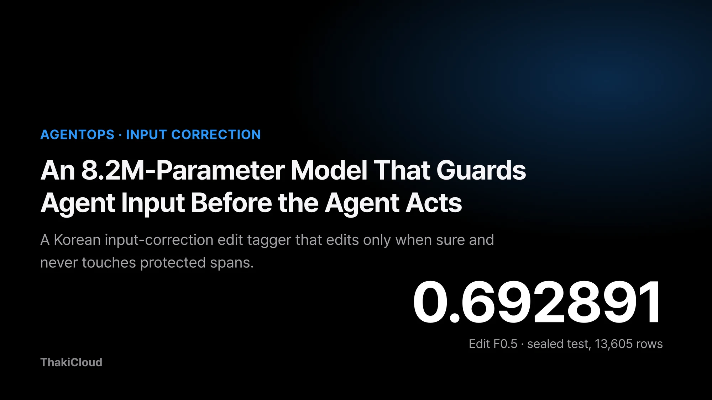
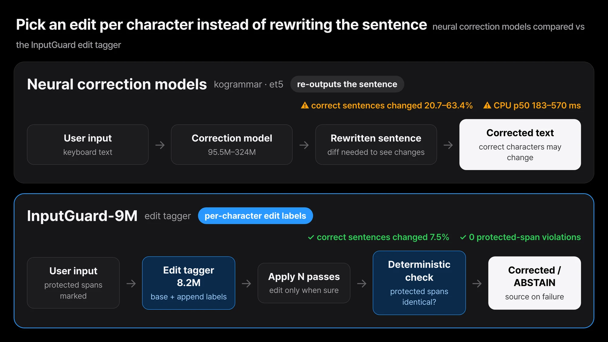
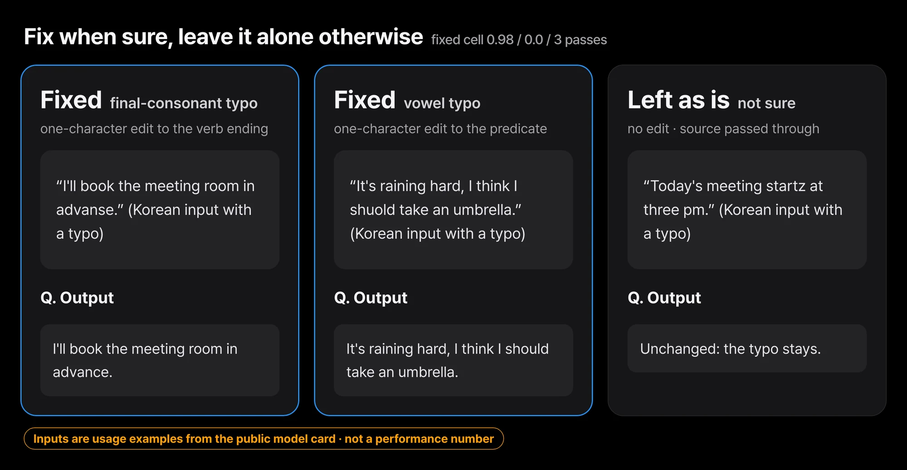
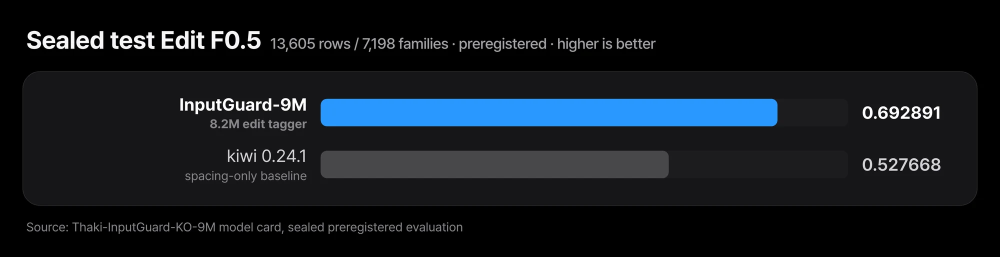
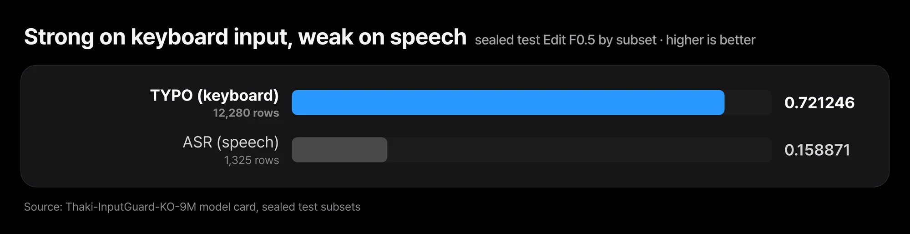
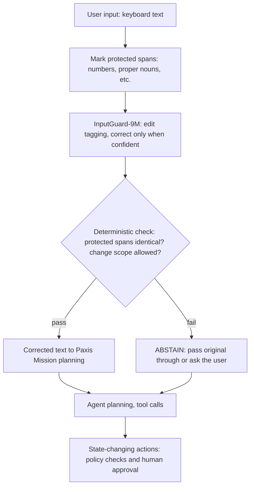

The sentence that hands work to an agent is usually typed in a hurry on a phone keyboard. It picks up typos and loses spaces, and then it flows straight into planning and tool calls.

We have released a small model for this input stage on [Hugging Face](https://huggingface.co/ThakiCloud/Thaki-InputGuard-KO-9M). **Thaki-InputGuard-KO-9M** is a Korean input-correction model with 8.2M parameters (8,219,115). On a preregistered, sealed test (13,605 rows) it scored an Edit F0.5 of 0.692891, above a spacing baseline. Edit F0.5 is a correction score that weighs whether the edits made were right (precision) more heavily than whether any were missed (recall).

Its strength is narrow, though: keyboard typos and spacing. It is weak on speech-recognition semantic errors. So we do not use it to make decisions for a Paxis agent. It sits in front as a cautious input cleaner, and deterministic checks plus ABSTAIN hold the boundary. ABSTAIN means giving up on a correction when unsure and passing the original text through. This post covers the model's design, the sealed results, where it is strong and weak, and what it should and should not do at the Paxis input stage.

## At the input stage, a wrong fix costs more than a missed typo

A person reads a Korean sentence like "the meeting startz at three" (a typo in the verb ending) and still gets the meaning. An agent pipeline is different. One typo can shift intent classification, change a search query, and add another round trip in which a large LLM asks the user what they meant.

Letting a corrector rewrite input freely is worse. If it changes a correct sentence, inserts a space inside a proper noun, or touches a number, the agent ends up doing something the user never asked for. In input correction, a wrong fix costs more than a missed typo.

So we asked two things of an input-stage model. Correct only when confident, and never touch spans marked as protected.

## It picks an edit per character instead of rewriting the sentence

InputGuard does not rewrite sentences. It is an **edit tagger** that predicts a per-character edit label (base + append) and applies those labels for N passes to produce the corrected text. It can only replace, delete, or append from a fixed 1,659-character vocabulary, so it cannot invent a clause or drift off topic. Spans it is told to protect pass through untouched.


*The compared models re-output the whole sentence, so a correct sentence can change. InputGuard only picks substitute, delete or append labels within a 1,659-character vocabulary and passes protected spans through. Change rates and latency come from the exploratory validation comparison.*

The public card's examples show the "no edit without confidence" behaviour directly.


*Three usage examples from the public model card, shown in English translation of the Korean input and output. As in the third, a typo is left alone when the model is not sure.*

| Item | Value |
|---|---|
| Parameters | 8,219,115 |
| Architecture | `MicroBrain-multihead`: char/jamo embeddings, encoder stack, edit heads |
| Output | per-character edit labels (base + append), applied for N passes |
| Input length | up to 192 characters |
| Output vocabulary | 1,659 characters |
| Device measured on | CPU and single GPU (server), not a phone |

The design has a cost. A gold character outside the 1,659-character vocabulary is structurally unreachable, and 0.037% of test rows contain one. We accepted that ceiling in exchange for a model that does not hallucinate.

The model was trained on the AI-Hub dataset **high-frequency error correction data by interface (keyboard/speech)** (dataSetSn 71560), a project result of the National Information Society Agency (NIA). The repository holds only the weights, configuration, and minimal inference code. No training or evaluation sentences are included.

## On the sealed test it beat the spacing baseline

The threshold and the primary baseline were frozen on validation and committed, and only **then** was the test split opened. The verdict is CORRECTION_GO. The metric is Edit F0.5 over character-level edit sets. F0.5 weights precision twice as heavily as recall, which matches the rule of input correction that a wrong fix is worse than a missed one.

| System (sealed test, 13,605 rows / 7,198 families) | Precision | Recall | Edit F0.5 | Sentence EM |
|---|---:|---:|---:|---:|
| **InputGuard-9M** | 0.870502 | 0.381521 | **0.692891** | 0.150092 |
| kiwi 0.24.1 (spacing only) | 0.579450 | 0.388719 | 0.527668 | 0.063359 |

The difference between the two systems is +0.165223. A family-grouped paired bootstrap (2000 draws) gives CI95 [0.140917, 0.189578], with the lower bound above zero. A family is a group of near-duplicate variants of one real sentence. Rows within a family are not independent samples, so we resampled by family. Protected-span violations: 0 across all 13,605 rows.


*InputGuard-9M 0.692891, spacing-only baseline kiwi 0.527668. Difference +0.165223, family-level paired bootstrap CI95 [0.140917, 0.189578].*

Do not read too much into this. kiwi is a spacing-only baseline, not the state of the art in Korean grammatical error correction. Beating it is a floor result, not a ranking against the field. A sentence EM of 0.150 means most sentences were improved, not perfected.

## Strong on keyboard typos, weak on speech-recognition errors

Splitting by noise type shows what kind of model this is.

| Subset | Rows | Recall | Edit F0.5 | Sentence EM |
|---|---:|---:|---:|---:|
| TYPO (keyboard) | 12,280 | 0.422356 | **0.721246** | 0.166287 |
| ASR (speech) | 1,325 | 0.041173 | **0.158871** | 0.0 |

On keyboard noise it is well ahead of the spacing baseline. On speech-recognition errors its recall is 0.041 and it gets no sentence fully right. A 12.3M-parameter sibling trained on the same data did no better on this subset (the paired CI95 of the difference includes zero). We read this as a data and supervision problem, not something a bigger model fixes. **Do not deploy this model as an ASR post-corrector.**


*0.721246 on 12,280 keyboard (TYPO) rows, 0.158871 on 1,325 speech (ASR) rows. On ASR, recall is 0.041 and sentence EM 0.0, so do not deploy it as an ASR post-corrector.*

We also measured it on AI-Hub 71477, an independent Korean document-correction corpus never used for training, threshold selection, or decoding. The share of clean sentences that needed no change but were changed ranged from 13.0% to 19.4% across subsets. That is far below the neural correctors we compared, but on a typing path where most input is already correct it is not negligible. It recovered only 6 to 17% of the needed edits, and its Edit F0.5 fell well below the KoGrammar models. It is strong inside the error distribution it learned and weak outside it.

We checked with sentences we wrote ourselves, too. We wrote 20 everyday sentences and built 84 variants, each with one typo. The model fixed 15 of 84 and changed nothing wrongly, and it left all 20 clean sentences untouched. It fixed missing spaces 11 of 20 times, but neighbouring-key consonant typos 0 of 20. Expect it to skip typos it does not know.

## At the Paxis input stage it only proposes, and code holds the boundary

Paxis is a platform that automates enterprise digital work with agents. A user request becomes a Mission, agents plan and call tools, and any action that changes state goes through policy and approval. InputGuard belongs at the very front of that chain, just before the request text reaches planning. Below is the reference design we have in mind.



The division of roles is clear in this design.

**The network only proposes.** InputGuard offers an edit, "change this character to that," and nothing more. It does not approve or sign anything, and it is never the basis for hard-to-reverse actions such as payments or permission changes. Those decisions belong to the policy checks and human approval further down.

**Deterministic code holds the boundary.** Code compares the text before and after correction and checks whether any protected span changed by even one character, or whether any disallowed kind of edit appeared. The verdict comes from string comparison, not model probability, so the same input always gets the same result. The sealed test had 0 protected-span violations, but this layer exists so that we do not rely on that result and check every time.

**When unsure, it abstains.** The model is already conservative by design. The default decoding cell (0.98 / 0.0 / 3) was frozen on validation before the sealed test, and at that setting the model leaves typos it does not know alone. If the deterministic check fails, the corrected text is discarded and the original goes through, or the user is asked. An LLM downstream can cope with an uncorrected typo, but not with a wrongly corrected number.

Negation and numbers call for extra care. The architecture carries Intent, Entity, and Negation heads, but the training corpus has no labels for them, so they were not trained. They are not part of the model's function and their outputs should not be read.

So do not expect InputGuard to understand the negation in "don't cancel it" or the digits of an amount. Numbers should be wrapped as protected spans so the model cannot touch them, and the meaning of negations and amounts should be left to deterministic rules and policy checks downstream.

Speech input follows the same principle. The current numbers give no basis for correcting ASR output with this model, so the safe design passes speech input through without correction.

## In Metis it is a small front end in front of large-LLM calls

Metis is the inference layer that handles model serving and token economics. The large LLMs that agents use run on Metis endpoints. If a model with a few million parameters cleans up input in front of them, the heavy model can spend its effort on the decision itself.

The gap in size and latency is large. Below is an **exploratory comparison** we ran ourselves on the same validation split (10,789 rows). The 9M decoding cell was chosen on this split, which biases the comparison in its favour, and the other models were never fitted to this data. Latency is server CPU, 4 threads, batch 1, not a phone.

| System | Edit F0.5 | Gold sentences changed | Params / weights | CPU latency p50 / p95 |
|---|---:|---:|---|---|
| **InputGuard-9M** | **0.732** | **7.5%** | 8.2M / 32.9 MB | 6.6 / 10.1 ms |
| `theSOL1/kogrammar-distil` | 0.661 | 29.5% | 95.5M / 382 MB | 183 / 267 ms |
| `theSOL1/kogrammar-base` | 0.632 | 20.7% | 124M / 496 MB | 303 / 445 ms |
| `j5ng/et5-typos-corrector` | 0.622 | 63.4% | 324M / 1.30 GB | 570 / 958 ms |

Even in this table, on the speech-recognition rows (1,345) 9M scores 0.169, below ET5-typos (0.301) and KoGrammar-distil (0.262). It is small and fast, and the range of work it can take on is narrow.

<figure class="fig-video"><video src="/assets/images/thaki-inputguard-ko-9m-paxis-fig-race-en.mp4" poster="/assets/images/thaki-inputguard-ko-9m-paxis-fig-race-en.webp" autoplay muted loop playsinline preload="metadata" aria-label="Animation replaying the CPU p50 latency of four correction models in real time"></video><figcaption>InputGuard-9M 6.6 ms, kogrammar-distil 183 ms, kogrammar-base 303 ms and et5-typos-corrector 570 ms (p50), replayed at real speed for 8 seconds. Server CPU, 4 threads, batch 1; not phone numbers.</figcaption></figure>

The token-economics argument goes like this. Catching typos at the input stage may reduce how often a large LLM has to ask the user to clarify, or take an extra lap because of a bad search. With 32.9 MB of weights, it is also worth considering placing the model on the user's device or an edge node, so input is handled before it reaches a server. This is a design direction, not a measured result. We have not measured token savings or cost savings.

On-device performance is unmeasured as well. No Android or iOS device has run this model, and server CPU numbers are no substitute. An INT8 dynamic-quantised variant scored Edit F0.5 0.731338 on a server CPU (FP32 0.731709; paired CI95 of the difference [−0.001381, +0.000612]), but it is not in the repository yet. Runtime compatibility, model export, operator coverage, and execution on a real device are four separate checks, and none of them has been done.

## Wrap it in a deterministic check

These examples follow the public [model card](https://huggingface.co/ThakiCloud/Thaki-InputGuard-KO-9M). The model reads Korean only, so the example sentences are in Korean.

```bash
pip install -r requirements.txt
python inference.py "회의실 예약은 제가 미리 해 두겟습니다."
# out: 회의실 예약은 제가 미리 해 두겠습니다.
```

```python
from inputguard_min import load_guard

guard = load_guard(".")                  # frozen cell: 0.98 / 0.0 / 3 passes
print(guard.correct("비가 많이 와서 우산을 챙겨야 할 것 가아요.")["corrected"])
# 비가 많이 와서 우산을 챙겨야 할 것 같아요.
print(guard.correct("오늘 회의는 오후 세시에 시작합니가.")["corrected"])
# 오늘 회의는 오후 세시에 시작합니가.   <- left as is
```

In the second call the typo is left in place. That is the design at work: no edit without confidence. `load_guard` takes `min_prob`, `min_margin`, and `passes`. The defaults are the frozen cell every published number was measured at. Lowering `min_prob` corrects more and errs more, and the numbers in this post stop describing that setting.

When you put it at an input stage, we recommend wrapping it in a deterministic check. Below is a minimal example that discards the correction and keeps the original whenever any number changes. In a real service you need to decide which spans to protect for your own workload.

```python
import re

def guarded_correct(guard, text: str) -> str:
    corrected = guard.correct(text)["corrected"]
    if re.findall(r"\d+", corrected) != re.findall(r"\d+", text):
        return text  # ABSTAIN: if a number changed, pass the original through
    return corrected
```

## A sibling model built from the same encoder

Its sibling, [Thaki-FactoryShield-KO-7M](https://huggingface.co/ThakiCloud/Thaki-FactoryShield-KO-7M), was initialised from this model's encoder.

## Six things to know before using it

These are the limitations stated in the model card.

- **Weak on ASR semantic errors.** Test F0.5 0.159, recall 0.041, sentence EM 0.0.
- **Overcorrection of clean text is not small.** On the independent 71477 corpus it changed 13.0% to 19.4% of clean sentences. Even on its own training distribution it changed 7.5% of gold sentences, and some of those changes are real damage, such as a space inserted inside a proper noun or a wrong character substitution.
- **Weak generalisation.** Correction recall drops to 6 to 17% on 71477.
- **On-device performance is unmeasured.** It has never run on a phone.
- **The Intent, Entity, and Negation heads were not trained.** Do not read their outputs.
- **Narrow domain.** It covers interface-typing and speech-interface Korean only. It was not evaluated on legal, medical, or code text, or on dialects.

This is a research and evaluation checkpoint, not an approved product. Clean-text overcorrection is measured but not low enough to waive, and the on-device gate is still open. The Paxis input-stage design and the Metis front-end placement described here are directions for technical application, not results measured on an integrated product.

The next problems to solve come from those same limitations. Clean-text overcorrection has to come down further, and a real device has to pass the four checks in order, from runtime compatibility to execution. The speech path calls for another look at data and supervision rather than model size.

## Closing

InputGuard is a small, conservative input corrector. It fixes keyboard typos and spacing better than the spacing baseline, leaves what it does not know alone, and did not break a protected span once in the sealed test. It is weak on speech-recognition errors and on documents it has not seen.

At the Paxis input stage, the job of a model like this is to propose, not to decide. The network proposes an edit, deterministic code checks the boundary, and when there is doubt the original text goes through. Approval of any action stays with policy and people to the end. That is the principle we hold to when we put a small model in front of an agent.

The cheapest first experiment: download the [model](https://huggingface.co/ThakiCloud/Thaki-InputGuard-KO-9M), wrap it in `guarded_correct` above, run it on a few hundred real keyboard inputs from your service, and start by looking at how many sentences were corrected and how many fell back to the original.

---

*ThakiCloud AI Engineering, Korean Input Correction & Agentic AI*

*Source of performance figures: the preregistered sealed evaluation (AI-Hub 71560 test split, 13,605 rows) and the exploratory comparison in the [Thaki-InputGuard-KO-9M model card](https://huggingface.co/ThakiCloud/Thaki-InputGuard-KO-9M). Training data: AI-Hub high-frequency error correction data by interface (keyboard/speech), dataSetSn 71560, a project result of the National Information Society Agency (NIA).*
