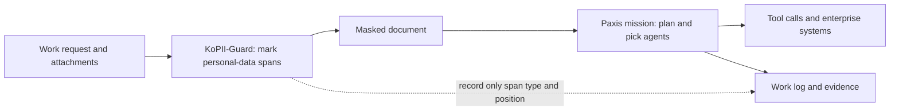

## Why Read This

If you plan to hand customer documents or call records to an agent, your first worry is probably where the personal data ends up. This post introduces a small model that takes the first step: it finds Korean personal information and marks it for masking.

The short version: on synthetic test documents, the model we released found 99 of every 100 pieces of personal information, and 97% of what it flagged was correct. It has not been validated on real documents, and it does not guarantee that no personal data leaks. We built it as the masking step a Paxis agent passes through before it starts work.

## Plain Terms

Picture the clerk at the outgoing-mail desk who blacks out personal details before a company document leaves the building. The clerk does not judge what the document says. The clerk only finds names, contact numbers and addresses, and covers them.

KoPII-Guard is that clerk. Before an agent reads a document or calls a tool, the model scans the text and marks every character span that looks like personal information. The systems that come after it then continue the work with those spans masked.

A good clerk misses nothing but also does not cover too much. Read the results below with those two tests in mind.

## What We Built

[KoPII-Guard v1](https://huggingface.co/ThakiCloud/Thaki-KoPII-Guard-v1) finds the character-level location of 18 types of Korean personal information. It is a fine-tune of KLUE RoBERTa (klue/roberta-base), a Korean base model.

The 18 types fall into three groups. Some point at a person, such as names and usernames. Some are formatted numbers, such as phone, resident registration and bank account numbers. Others need context, such as addresses and organization names. For a few strictly formatted numbers, fixed rules double-check the model.

Training and evaluation used only K-PII-Bench, a public synthetic dataset. No records of real people are in the training data. The model is released under CC-BY-SA-4.0, following its base model. We downloaded it without logging in and confirmed by checksum that the files match our original.

## Results

The scoring is strict. A prediction counts only if its start, end and type all match. We picked settings on the development split, then ran the sealed test split of about 28,000 documents exactly once.

| Metric (K-PII-Bench test split) | Rules only (regex) | KoPII-Guard v1 |
|---|---:|---:|
| Share of personal data found (recall) | 19.3% | **99.4%** |
| Share of flags that were correct (precision) | 99.95% | 97.5% |
| Overall score (F1) | 0.3232 | **0.9840** |
| Documents with at least one miss | 100% | **2.7%** |
| Documents with at least one wrong mask | 0.04% | 10.9% |

*All numbers come from a synthetic benchmark. We did not re-tune on the test split. Development F1 was 0.9853.*

Rules alone are almost never wrong about clear-cut numbers, but they miss four of every five items. KoPII-Guard finds nearly everything. In return, about one document in ten gets something masked that is not personal data. In plain words, this clerk leans toward covering a little too much rather than missing things.

The split by type makes this clearer. Formatted items such as resident registration numbers, card numbers and email addresses were near perfect on the test split. Wrong masks clustered in context-heavy types: person names, organizations and addresses. Person names also made up more than seven in ten of the missed items.

## Why We Did Not Release a Faster Version

When a model is served on Metis, speed matters too. So we also tested an 8-bit version and a mixed version that kept a few layers at full precision. Both ran more than twice as fast as the original on CPU.

But the release bar was masking quality, not speed. The lighter versions sometimes found a username but left its last few characters uncovered. They also missed more short organization names, or labeled them as addresses. Our pre-set condition was "no type gets worse than the original model", and both versions failed it.

In terms of the clerk, a new hire who works twice as fast sometimes skipped the last line of a page. In PII masking, a small gap like that is a leak. So this release contains only the full-precision model.

## Where It Sits in Paxis Work

Paxis is the work platform where agents read documents, plan, and run tools against enterprise systems. Personal data usually escapes at three points in that flow. It leaks through the input sent to a large language model, through calls to outside tools, and through the logs left behind.

The goal is to put KoPII-Guard in front of those three points, like the outgoing-mail desk. The figure below is a reference design.

The point of this design is that the language model can move the work forward without ever seeing raw personal data. The log records only the type and position of each masked span, not the original value. If a task truly needs the raw value, it is handled only at a step that has passed permission checks and approval.

Where the model runs also matters. If you call a masking model as an outside service, the unmasked text leaves your environment first. So it makes more sense to run this model on Metis, inside an environment the customer controls. Its small size, which lets it run on CPU without a GPU, helps with that placement.

What we released is the model. The figure is a reference design for connecting it to Paxis. We have no measurements from an integrated Paxis service yet, and any real integration needs its own end-to-end validation.

## Limitations

First, every number here comes from synthetic data. Scores may drop on scanned documents with recognition noise, mixed Korean and English text, rare name forms, or very long documents.

A short check after release showed this. In a synthetic sentence, the model did not tag a common Korean name as personal data. It did catch the address, phone number and email in the same sentence. Missed names are the first weakness to check outside the benchmark.

There is also the opposite problem. About one document in ten gets a wrong mask, so a person should review the output before using it for anything beyond masking. We also could not compute a confidence interval against the rules baseline. Still, the gap in correct finds is large, about 120,000 against 23,000.

Finally, this model does not prove that it never learned personal information. The training data is synthetic, but we have not yet run an extraction audit on the model. KoPII-Guard is one layer of privacy protection. It does not replace access control, retention policy or audit logs.

## Summary

Once an agent takes on a task, personal data can spread through model inputs, tool calls and logs. KoPII-Guard v1 is the outgoing-mail clerk that marks personal-data spans before any of that happens. On the synthetic benchmark it found almost everything, while missed names and a tendency to over-mask remain open work.

We suggest trying it on your own documents first. Start by checking what it misses in text full of person names. Please share results and cases in the Community tab of the [Hugging Face model page](https://huggingface.co/ThakiCloud/Thaki-KoPII-Guard-v1), and we will fold them into the next version.

---

*ThakiCloud AI Engineering · Paxis & Metis*

*Source of results: a single sealed evaluation on K-PII-Bench test_track_a (October 2026), FP32 model. The model and an evaluation summary are public on [Hugging Face](https://huggingface.co/ThakiCloud/Thaki-KoPII-Guard-v1).*
