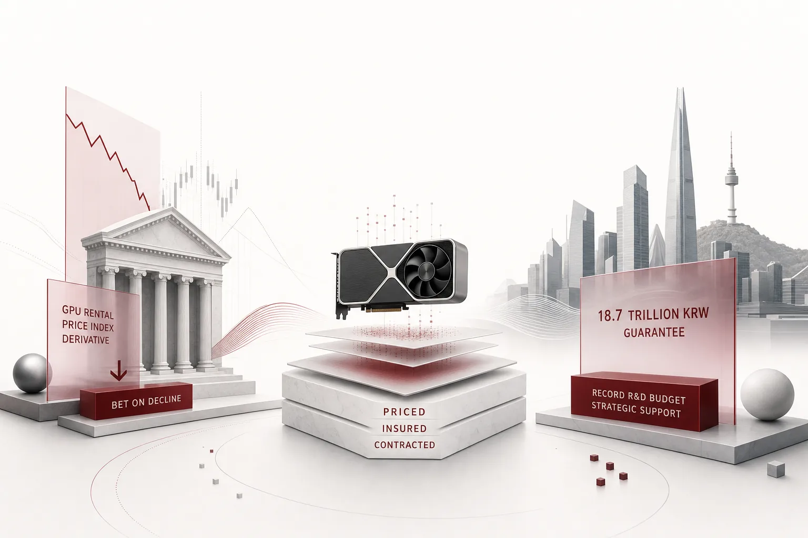

*An illustration of the core concept of this post.*

## New products in the derivatives market

In early November, something rare happened in US financial markets. Reports (SBS Biz) said two large derivatives firms, Jump Trading and Susquehanna, had quietly started taking orders for new products. The subject was not stock prices. Not interest rates, not commodities either. It was the rental price of AI GPUs. A derivative that pays out when GPU usage rates fall, built on a price that had never been a trading subject before.

The rental price for GPU capacity is, in the end, close to the wholesale price of compute. Derivatives on the wholesale price also mean the retail price, that is the per-token unit price for enterprises, can swing wider. The numbers that follow make it hard to read this as a one-off event.

This is not an isolated move. According to the same report, trading in CoreWeave's 2028-maturity put options with a strike of $35, a product that lets investors bet on the stock falling, hit an all-time high last month and has held that level. The stock was trading around $55 at the time. Money flowing into put options whose strike sits roughly a third below the current price means a game has been created where, in plain terms, you win if the GPU price drops. The report also carried the fact that CoreWeave's GPU-collateralized loan rate had spiked to 16%. GPUs are moving from assets you buy and use to assets that serve as collateral, insurance, and hedge.

## The order in which risk attaches to price

The order in which these numbers appeared shows the market's risk perception rising step by step. First, stock prices moved. Intel's stock plunged 28.6% in a single day on October 30, and Alphabet fell more than 12% on the 31st, its largest daily drop on record.

Next, the credit markets reacted. According to S&P data, the CDS, credit default swap, spreads of Amazon, Alphabet, Microsoft, Meta, and Oracle rose simultaneously to their highest levels since 2021. S&P co-founder Eugene Greenberg's diagnosis was blunt. "It suggests market concern about the industry as a whole, rather than a problem specific to individual companies." To unpack CDS, think of it as insurance that trades the possibility of a company failing to repay what it borrowed. The insurance premiums of five AI-related companies rising at once means the market is worried not about individual companies but about the debt structure of the industry itself.

Those five companies are precisely the ones with the largest AI investment. According to reports, the 2026 AI infrastructure capex outlook is up to $205 billion for Google and $145 billion for Meta (Newsian). The core of the problem is not that demand has fallen, but that the debt backing this demand has grown. For reference, Alphabet's cloud revenue in the same period was $31 billion, up more than 100% year over year. Growth itself is intact. It is the balance sheet that is wobbling.

Then, financing conditions stiffened. CoreWeave's 16% GPU-collateralized loan rate is the evidence. Finally, the price of the commodity itself became a trading subject. The derivative betting on falling GPU rental prices appeared. In other words, the question the market asks changed from "is AI growing?" to "who pays to run AI?" This is the week in which GPUs, the fuel of compute, entered the domain of insurance.

## Seoul's ledger is written in the opposite direction

In the same week, Korea's ledger is being filled in the opposite direction. The 2027 national R&D budget proposal is 39.5 trillion won, up 4 trillion won (11.2%) from the previous year, the largest on record (Money Today). Of that, 9.5 trillion won is allocated to the three mega projects (Physical AI, semiconductors, AIDC) and seven SEED projects, and the Ministry of Science and ICT AI budget is 9.4 trillion won, 57% of the government's total AI budget. It has grown more than sixfold from 1.5 trillion won in 2025 in just three years. Within that, 3.85 trillion won is earmarked for GPU purchases alone for the Frontier AI model program, and the National Assembly begins budget review on the 4th. In the national audit, the recurring fiscal burden of GPU rental and leasing, and low utilization rates, have already been raised.

Corporate ledgers are even more eye-catching. Nvidia acquired 4.54% of Naver through a $1 billion (about 1.4809 trillion won) third-party allotment of new shares, overtaking Chairman Lee Hoi (about 3.84%) to become the third-largest shareholder (NewsWho Plus). The payment date is the 6th of this month, alongside a $9 billion AI computing infrastructure contract with Brookfield. The AI factory GAK Sejong goes from a 55MW start in the first half of 2027 to 100MW by the end of 2027 and 200MW in 2028, aiming for 1GW in the long term. And the most striking number is Naver Cloud's 18.74 trillion won debt guarantee for GPU service supply payments. It is the projected nominal total through 2034, equivalent to 64.73% of its capital. The operator collateralizes the next eight years of compute payments with almost two-thirds of its own capital. Please judge the weight of that burden for yourself. The three-way burden sharing of chip maker, global capital, and operator is called the Korean sovereign AI model.

What closes the ledger is law. Representative Kim Dong-ah and 11 other lawmakers from both parties jointly introduced an amendment to the SME Promotion Act. It requires the Minister of the Ministry of SMEs and Startups to draw up a three-year master plan for AI adoption by small and medium enterprises, designate a dedicated agency, and designate AI diffusion hubs for each city and province (E-Daily). The 2026 government AI transition budget began at about 423 billion won, and now SMEs are being folded into the institutional ledger. That is one more institutional ledger. Once the dedicated agency is designated, procurement for diagnostics, consulting, field trials, and data processing is expected to get going. The state, large corporations, and SMEs are all writing their own ledgers in the same week.

The chip itself is a front line. At a recent roundtable, DeepX CEO Kim Nok-won said, "The last line of defense for Physical AI is the chip, and the last link for sovereign AI is the semiconductor." The supply side is a variable too. With President Trump saying he would "closely examine" suspicions of China-related information leaks involving Nvidia CEO Jensen Huang, another layer of supply uncertainty has been added to the GPU supply chain (Jemin Ilbo).

## The price of AI power is no longer a fixed tariff

With the two ledgers side by side, it becomes clear that in the same week, the same commodity, compute, is being priced, insured, and contracted. Wall Street buys bets on the price falling, and Seoul buys the asset itself and guarantees even the operating payments. It is a signal that the market is moving from "growth betting" to "asset management."

So what should companies that actually run AI do? A hedge fund can buy put options, and a government can allocate 3.85 trillion won for GPU purchases. But a company running agents inside its finance, HR, supply chain, and customer service processes is not given a market in which to put a derivative on its own token costs. Even so, that company's AI "electricity bill" can no longer remain a stable, regulated rate. It has become a variable that swings with interest rates, financing conditions, and geopolitics.

There is a paradox here worth pointing out. The "falling GPU rental prices" that Wall Street is betting on can sound like welcome news for companies. Compute becomes cheaper. But rental prices falling also means the asset value and profitability of the infrastructure companies that bet on those rentals are wobbling at the same time. When the supplier is unstable, the continuity of supply itself becomes a question. Whether the price goes up or down, the structure in which corporate balance sheets absorb the volatility itself does not change. The risk does not stay only overseas. In Korea, KB Kookmin Bank led its first GPU financing at 12.6 trillion won, and points have been raised that if GPU asset values fall, collateral revaluation risk could transmit into the domestic financial sector (SBS Biz report). If the price of fuel moves, the rate follows. The danger is not that AI's value is shrinking, but that execution costs are becoming unpredictable.

The answer is not a financial product but the design of the execution layer. Which model to use for which task, in which environment to execute, who approved it, and which logs prove it. These decisions determine the volatility of enterprise AI costs. In an era when fuel prices wobble, what is needed is not a hedge but a route.

## Lens: where execution risk is hedged

ThakiCloud's Paxis is a launched agent-native cloud and a product designed to answer exactly this question. It is not a model, and not a GPU cluster. It is the layer that handles where and how an agent executes.

Imagine a day for a company running agents on Paxis. The small batch jobs that pile up every morning, data cleansing and report summaries, are routed to small, cheap models. High-intensity judgment tasks like customer service and approvals go to higher-tier models. MCP connectors and the skill marketplace link existing business systems and knowledge, and the policy layer decides which systems an agent can reach. Within the same cost budget, it selects fuel by the importance of the task. When the month ends, which model was used for which task remains with the cost, so the finance team can answer the "electricity bill" question with numbers, not guesses.

The second layer is authority and record. Who executed what with which permissions remains alongside first-class resources: Skills, Tools, Policies, and Audit Logs. Autonomy is differentiated by governance levels L0 through L3, which distinguish what an agent may act on by itself, and policy gates stop what must stop before execution. If an agent attempts an out-of-authority fund transfer, execution halts and the fact that it halted is recorded. The moment AI execution cost becomes a financial issue, "what was it spent on, and who decided?" becomes a profitability question, not a compliance one.

The third layer is the execution environment. Isolated sandboxes prevent agent execution from spreading as an incident. Sovereign or on-prem K8s deployment options mean a company does not need to tie its business processes to a specific chip maker's capital structure, the kind that required an 18.7 trillion won guarantee.

What to watch are three things. The National Assembly budget review that began on the 4th and, within it, the outcome of the 3.85 trillion won GPU purchase item. Whether Nvidia's payment on the 6th proceeds as scheduled. And whether the GPU rental derivative settles into a standard product. Where these three point will tell us how fast the commoditization of compute is moving. The same question will come to companies' execution layers at that speed.

Wall Street hedges GPU prices in the derivatives market. And where enterprise AI execution risk is hedged is the agent execution layer. The two ledgers, written in opposite directions this week, converge into a single question from a company's seat. "Whose rules does my AI execute under?"

## References

This post synthesizes the news items below.

- Money Today, ["K-Manufacturing in the AI era: The last defense line of Physical AI is semiconductors"](https://www.mt.co.kr/industry/2026/11/02/2026110109382212444)
- NewsWho Plus, [Nvidia becomes Naver's 3rd largest shareholder... AI factory payment guarantee 18.7 trillion won](https://www.newswhoplus.com/news/articleView.html?idxno=73152)
- Newsian, [[AI supremacy war] Chatbot-decided light and dark of 'Big Tech ads'... soaring Meta vs the one being chased...](https://www.newsian.co.kr/news/articleView.html?idxno=100390)
- Money Today, ['40 trillion' largest-ever R&D budget proposal by the government... top-tier AI and 7 SEED projects under review](https://www.mt.co.kr/tech/2026/11/02/2026110114501590470)
- E-Daily, [SME AI adoption supported by a three-year master plan... Kim Dong-ah introduces bill amendment](https://www.edaily.co.kr/News/Read?newsId=01997526645641784&mediaCodeNo=257)
- SBS Biz, [Wall Street's 'insurance hunt' for Big Tech AI credit risk](https://biz.sbs.co.kr/article_hub/20000343522?division=NAVER)
- Jemin Ilbo, [Trump watching China information leak suspicions involving Jensen Huang... Nvidia technology security controversy rises](https://www.jemin.com/news/articleView.html?idxno=845891)
