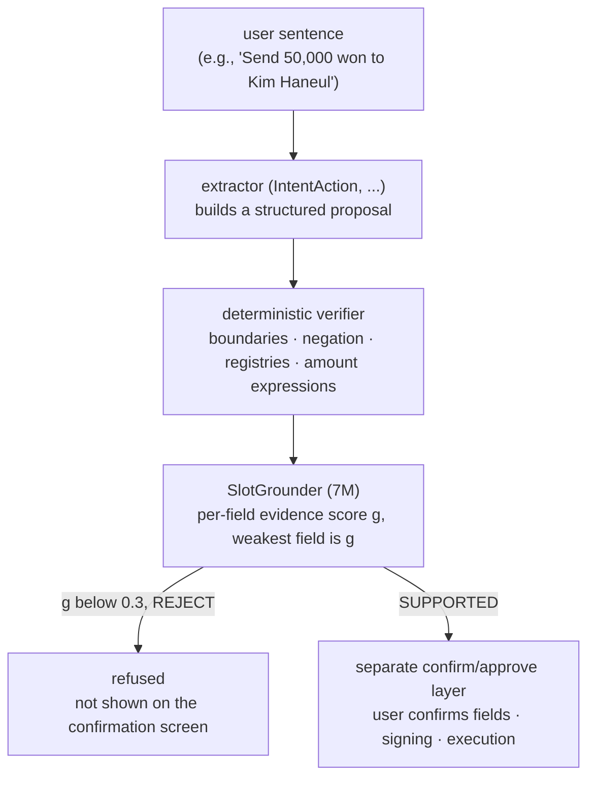

*A visual metaphor for the article's key idea.*

## Summary

When a user says "김하늘한테 5만원 보내줘" ("Send 50,000 won to Kim Haneul"), an agent turns it into a structure such as `send · payee 김하늘 · amount 5만원`. The trouble starts when that conversion is wrong. An extraction model can be highly confident even when the operation has become `delete` or the target file is the wrong one. Being confident and being supported by the source sentence are two different things.

So we added a verification step after extraction. We released the Korean model for that step, [Thaki-SlotGrounder-KO-7M](https://huggingface.co/ThakiCloud/Thaki-SlotGrounder-KO-7M), on Hugging Face. It has 7,461,060 parameters. It does not create, approve or execute commands. It scores the evidence for each proposed field and rejects proposals with weak support.

Placed behind our existing extraction model on synthetic sealed tests, it cut wrong proposals that got through from 28 to 2. In exchange it also blocked 11 to 16 percentage points more correct proposals. Every number here was measured on synthetic data, never on real user input. The status is research preview.

## Extraction and verification are different jobs

The IntentAction models in the [TrustEdge series](/tech-blog/en/agentops/thaki-inputguard-ko-9m-paxis/) are extractors: they pull the operation and its fields out of a sentence. SlotGrounder looks from the other side. It takes one finished proposal and asks, field by field, "does this sentence actually say this value?"



The model outputs a support probability for the operation and for the payee (PAYEE), target (RESOURCE) and amount (MONEY) fields. The lowest of them is the score `g`, and a proposal with `g` below 0.3 is rejected. A proposal that passes is labeled `SUPPORTED`. That is not an approval. User confirmation and signing happen in a separate layer afterwards.

With this split, the verifier can stay the same when the extractor changes. And because the verifier cannot create anything, a malfunction never adds a wrong command. The worst case is blocking a correct one.

## How it was trained

The encoder comes from Thaki-InputGuard-KO-9M, which we released earlier: a 6-layer transformer over character and jamo hash features. The proposed field spans are marked on the input sentence with role tags, the operation is added as an embedding, and each field gets a small judgment head.

The training set has 413,971 pairs, built from the existing TrustEdge synthetic command corpus in three parts. 114,569 are correct proposals. 206,274 are perturbations that change exactly one field of a correct proposal: a swapped operation, a different candidate span, or a dropped field. The remaining 93,128 are proposals an IntentAction checkpoint actually produced, 657 of them wrong. Training used one B200 GPU.

The point of this design is to teach the model to tell apart "values that contradict the source," not "values that look plausible." The examples below show the difference.

| Input | Proposal | g | Verdict |
|---|---|---|---|
| 김하늘한테 5만원 보내줘 (send 50k won to Kim Haneul) | send · 김하늘 · 5만원 | 0.974 | SUPPORTED |
| same | **delete** · 김하늘 · 5만원 | 0.000 | REJECT |
| 김하늘한테 5만원 보내지 마 (do not send) | send · 김하늘 · 5만원 | 0.000 | REJECT |
| 견적서 말고 계약서 파일 지워줘 (delete the contract file, not the quote) | delete · target **견적서** (quote) | 0.0003 | REJECT |
| same | delete · target 계약서 파일 (contract file) | 0.957 | SUPPORTED |

These are real outputs of the released files run in a clean environment. The example sentences were written fresh and do not appear in the training or evaluation data.

## Model score and system result are reported separately

We measured the model on its own with AUROC: how well `g` separates wrong from correct proposals produced by the IntentAction S9 checkpoint. It is 0.977 on the sealed template split and 0.980 on the ASR-noise split. That is the model's separating power, not a guarantee that the system is safe.

For the system, we fixed IntentAction S9 and its verifier thresholds and compared results before and after adding SlotGrounder. Thresholds were set once on development splits, and the sealed splits were opened once afterwards.

| Split | Wrong proposals passed (before → after) | Coverage (before → after) |
|---|---|---|
| template (5,992 inputs) | 21 → 2 | 91.5% → 80.1% |
| ASR noise (2,997 inputs) | 7 → 0 | 84.9% → 73.2% |
| paraphrase (1,444 inputs) | 0 → 0 | 89.8% → 74.4% |

Across the template and ASR-noise splits, wrong proposals that got through fell from 28 to 2, a 92.9% reduction. The cost is just as clear. Coverage fell by a little over 11 points on template and ASR noise and by 15.5 points on paraphrase, which means some correct commands get sent back to the user. The trade only makes sense where one risky execution costs more than several extra confirmation prompts.

The ASR-noise split is not real speech recognizer output. It is synthetic text with fillers such as "어" and "음" added and spaces removed, so it should not be read as evidence of robustness to real recognition errors. Both remaining errors were on the RESOURCE field. The model is weakest when one sentence contains two plausible targets.

## Rules catch what the model misses

While verifying the release package we found a case the model misses. For "김하늘한테 5만원 보내줘," a proposal that truncated the amount to `5` got `g` 0.976 and was SUPPORTED, with a MONEY score of 1.000. Our guess is that the training negatives only used other candidate spans or dropped fields, so the model never learned "an amount with its front part cut off."

We did not fix this by retraining. An amount and unit boundary is not something a neural network should judge; a rule can settle it. Our money-transfer verification layer already had a check that passes an amount span only if it matches the entire amount expression in the input. The general command verifier lacked that check, which left a hole: from "15만원" (150,000 won) it would accept a proposal that took only "5만" as 50,000 won. We added the same check to the general verifier and pinned seven truncated-amount cases as regression tests.

This check has a cost too. Of 3,094 synthetic gold proposals, 5 are now rejected. They are cases where an amount follows an item number that ends in a digit. In "스터디룸 F-16 900엔" (study room F-16, 900 yen), even a human cannot tell whether the price is 16,900 yen or 900 yen, so we judged rejection to be correct. The combined-system numbers in the previous section were measured with the verifier as it was before this fix.

The principle is simple. Properties that a rule can settle go to rules. The neural network is for meaning that is hard to write as a rule, such as which file is the target in "the contract, not the quote."

## Where it fits in Paxis, Metis and Maxis

What follows is an application design. SlotGrounder is not integrated into any product today, and its performance has not been measured inside one.

**Paxis.** Paxis is the platform where agents carry out work instructions given by voice or text. SlotGrounder belongs right after tool-call arguments are fixed and right before the user confirmation screen. A weakly supported proposal is not put on the confirmation screen; the agent asks again instead. For voice instructions it sits after the transcription step of our [Korean ASR and Voice-to-Mission design](/tech-blog/en/agentops/thaki-asr-paxis-voice-to-mission/). It cannot, however, recover the original utterance when transcription is wrong. If the transcript says "5만원" where the speaker said "15만원," the proposal matches the transcript and passes.

**Metis.** The model file is 29.9MB and inference runs deterministically on CPU. Instead of calling a large LLM for every check, a small dedicated model can sit next to the extraction endpoint. We have not yet measured CPU latency or memory.

**Maxis.** The reusable part of this work is the training recipe: start from an existing encoder, generate negatives by perturbing one field of a correct answer at a time, and mix in the real errors of an actual extractor. Instead of growing one large model, we shrink the job into a small model that makes one kind of judgment. As the amount case shows, though, the model cannot learn errors that the perturbation list does not contain. Designing that list is designing the model's limits.

## How to use it

```bash
pip install -r requirements.txt
python inference.py --op send --payee 김하늘 --money 5만원 "김하늘한테 5만원 보내줘"
```

```python
from slotgrounder import load_slotgrounder
m = load_slotgrounder(".")
m.check("김하늘한테 5만원 보내줘", "send", payee="김하늘", money="5만원")
# {'scores': {...}, 'verdict': 'SUPPORTED' | 'REJECT', 'weakest_field': ...}
```

Field values are passed as substrings of the input sentence. The operation is one of `NONE read search draft purchase reserve send delete`. The repository holds only weights, config and minimal inference code; it contains no training data.

## Limitations

All numbers come from synthetic data. We have not evaluated the model on real user speech or text, real financial transactions, or real operations. The metrics were measured with a single proposer, IntentAction S9; behind a different extractor, the error mix and the right threshold change, so you need to recalibrate on your own data. The model was not trained on equipment commands and must not be used on equipment paths such as [FactoryShield](/tech-blog/en/agentops/thaki-factoryshield-ko-7m-paxis/). It does not check whether an amount was read correctly; that is the deterministic verifier's job.

## Takeaway

Raising confidence alone does not make an agent trustworthy. What we wanted to show with this release is a design that splits the roles. The extractor makes proposals, the deterministic verifier settles what rules can settle, and SlotGrounder rejects weakly supported proposals among the remaining semantic judgments. Approval and execution belong to a separate layer after that. The amount-boundary case we found is a good illustration of why that split matters.
