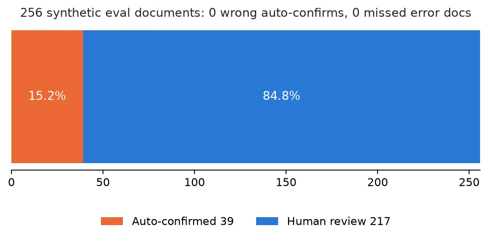
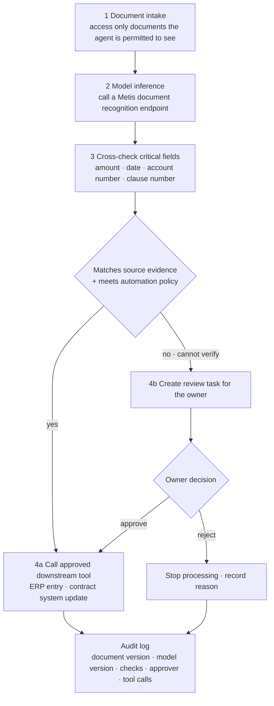

In a financial document, one misread character may not end as a typo. The won sign ₩ can turn into the yen sign ￥, the `*` that masks an account number can disappear, or a contract clause can lose its number. If an agent writes such a result straight into an ERP or a contract management system, a recognition error grows into a business error.

This post is for workflow designers and engineers who want to automate document processing with agents. It covers a problem ThakiCloud actually ran into in its OCR research, the cross-check layer we tested to stop it, and a design for connecting that layer to Paxis workflows. The final design is a proposal, not a shipped feature.

## In plain terms

It works like the double check at a bank counter. One clerk keys in the amount and a second clerk compares it with the original slip. If the two disagree, processing stops and a supervisor looks at it.

A double check slows things down. In exchange, a wrong amount never reaches the ledger. This post is about where to strike that balance.

## A model that got more accurate deleted symbols

To improve Korean document recognition, ThakiDocTrust fine-tuned OvisOCR3, a general document VLM, on Korean documents. Korean word recognition improved, but on our own synthetic financial documents the fine-tuned model deleted symbols that the original model had kept.

Across documents from the 25 test series, the original model kept all 128 circled clause numbers (①, ② and so on), while the fine-tuned model kept only 8. It also dropped the won sign 52 times, dropped spaces inside dates 38 times, and deleted every `*` masking character 27 times. This was not a display problem; the model never generated those symbols in the first place.

The external model Xiaomi-OCR-0 turned the won sign into W or ￥. Details are in the [Metis tiered inference post](/tech-blog/en/llmops/thakiocr-metis-tiered-document-inference/). Errors like these barely show up if you look only at average accuracy.

## VER-001: never confirm a value you could not check

So we built VER-001, a layer that cross-checks critical characters separately. It treats the won sign, circled clause numbers, raw date strings, masking characters, amounts, account numbers, document numbers and look-alike Unicode characters as risk tokens, and compares the results of different OCR paths.

The rule is simple. A field is marked verified only when the two results agree and there is positional evidence for that line in the source image. If they disagree or the field cannot be checked, it goes to human review. The text is never corrected: ￥ is not rewritten as won, and missing digits are not filled in from context.

Comparisons are also recorded two ways: whether the strings are identical as written, and whether they mean the same currency even when they look different, as with ₩ and ￦.

## Result: zero missed errors, but 85% sent to review

On 256 synthetic evaluation documents (clean and mildly degraded), the results were:

| Item | Result |
|---|---|
| Auto-confirmed (verified) | 39, 15.2% |
| Sent to human review | 217, 84.8% |
| Documents containing errors | 168 |
| Error documents that leaked through auto-confirm | 0 |

None of the 168 error documents passed through auto-confirm. The one-sided 95% upper bound on the miss rate computed from this sample is about 1.8%.

That is a good safety result. The automation limit is just as clear. Even among documents with no errors, 55.7% went to review, and six Korean form types had 0% auto-confirm. Auto-confirmation happened only on English forms. If people still have to look at 85% of documents, the economics of automatic processing are not there yet.

This result must not be read as evidence of safety on real customer documents. The evaluation documents are synthetic ones we generated, and independent real-document validation has not been done. So VER-001 is judged SAFE on safety, and not GO as a product.

## What Paxis takes on: the step after OCR

Paxis is ThakiCloud's Agent-Native Cloud, a platform for designing and running workflows in which agents connect to a company's internal systems. It manages skills, tools, policies and audit logs as first-class resources, and puts a policy gate in front of every tool execution.

If OCR verification were connected to a Paxis business agent, the flow could look like this.

Step 1 is intake. When someone uploads a contract or supporting document to the business system, the agent accesses only documents it is permitted to see.

Step 2 is inference. The agent calls a Metis document recognition endpoint or an approved OCR service to extract text and structure.

Step 3 is critical-field verification. Amounts, dates, account numbers and clause numbers are compared with the source image. As-written and currency-meaning comparisons are recorded separately, and values are never changed on the agent's own judgment.

Step 4 is human approval or the next task. Only when critical fields match the source evidence and satisfy the automation policy for that task does the flow move on. Fields that do not match or could not be checked become a review task for the person responsible. Based on that review, approved tools such as an ERP entry or a contract system update are called.

At every step, the document version, OCR model version, verification results, approver and tool calls are written to an audit log. When a wrong value surfaces later, you need to be able to trace which step let it through and on what evidence.

## An agent that can stop, not just a smarter one

If the goal of document AI is only to process every document automatically, wrong results get pushed through. In finance and contracts, knowing which documents should not be processed automatically matters just as much.

Paxis does not replace OCR. It is a platform that connects recognition results to business procedures and controls tool permissions and human approval steps. Maxis trains the next generation of OCR that preserves characters better ([training post](/tech-blog/en/research/thakiocr-maxis-same-size-fewer-errors/)), Metis runs validated models as inference services, and Paxis ties those results to the owner's approval and processing steps.

Seen together, the value of a more accurate model does not stop at a benchmark number. A more accurate model reduces the documents that need review, and that effect can be measured in processing time and review workload.

## Summary

A good document agent is not one that processes every document automatically. It is one that never commits an unverified value to a business system. The next task for ThakiDocTrust is to raise the auto-confirm rate while keeping zero missed errors, and that first requires an independent evaluation that resembles real customer documents.

## References

- The workflow above is a design example of applying ThakiDocTrust verification results to Paxis. The 256-document validation is a synthetic evaluation, and it has not shipped as an automatic approval system for financial work.
- Public models: [ThakiOCR-KOEN-V1-Dense (A)](https://huggingface.co/ThakiCloud/ThakiOCR-KOEN-V1-Dense), [ThakiOCR-KOEN-G2M-Preview](https://huggingface.co/ThakiCloud/ThakiOCR-KOEN-G2M-Preview)
