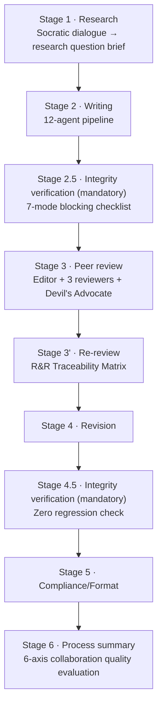

*An abstract image of a pipeline where you cannot move on without passing the gate, emphasizing one mandatory integrity gate among them.*

## Why read this

If you run papers or research with Claude Code, you need to decide one thing right now: in an artifact an agent claims to have produced, where and by what mechanism do you distinguish what it actually did? This post looks at the design answer of academic-research-skills, abbreviated ARS, an open source skill pack with 55,000 stars, and reports the results of us actually running one review in-house. The conclusion first: the value of ARS is not writing automation but a design that makes integrity verification a stage you cannot remove, and that design is the external, complete form of what Paxis's policy gates and audit logs do.

## Overview

ARS is an open source Claude Code plugin maintained by Cheng-I Wu. It connects the entire paper process, from research through writing, review, revision, and finalization, in a single plugin. The repository was created on 2026-02-26, and as of 2026-11-03 it records 55,215 stars, 4,210 forks, and 864 commits. That is a pace of passing 50,000 stars in 8 months.

The maintenance rhythm is also visible. 864 commits in 8 months, and the latest release is v3.24.1 on November 2. It is even rare for a skill pack to be assigned a Zenodo DOI. That means it moves with release notes the way a software version does.

Why now. AI-generated content is flooding the paper review desk and code review at the same time. In open source codebases, roughly 25% of new change requests are estimated to be mass-generated low-quality output, rising to 31% in large projects, and the paper side is the same. The question a reviewer faces is always the same: was this number actually run, and does this citation actually exist? ARS answers it by building stages, not notes. Integrity verification becomes a middle stage of the pipeline that you cannot skip to reach the next stage.

The structure has five core skills.

- deep-research (v2.12.1): the research stage. It fixes the paper structure through Socratic dialogue and produces a research question brief and a methodology design document.
- academic-paper (v3.3.1): the writing stage. A 12-agent pipeline produces Markdown, DOCX, and LaTeX PDF output.
- academic-paper-reviewer (v1.11.1): the review stage. 7 agents simulate an international journal peer review.
- academic-pipeline (v3.24.1): the 10-stage orchestrator that ties everything together.
- sr-screener (v1.0.0): paper screening based on Semantic Scholar.

The flow of the 10-stage orchestrator is in the diagram below. The key is the two mandatory integrity gates, Stage 2.5 and Stage 4.5.



The gate design text includes the phrase "no unrecorded bypass". Every exception that opens a gate only opens when the user records its justification. This single line is the axis of the entire ARS philosophy.

## What the tool is

The integrity gates check the 7 known failure modes of AI research: implementation bugs, hallucinated results, reliance on approximations, repackaging a bug as an insight, methodology manipulation, frame lock, and citation hallucination. The check items expand into citation existence verification, alignment of claims with sources, the reported methodology, alignment of declared experiments with results, fidelity of figures and tables, and adherence to reporting formats. Since v3.3, verification was added that checks via the Semantic Scholar API whether a citation actually exists and uses a VLM to check whether a figure actually contains that result.

The review stage runs 7 agents. A field analyst determines the paper's domain and dynamically composes the identities of 5 reviewers. An editor assesses journal fit and originality; a methodology reviewer covers study design and statistical validity; a domain reviewer covers literature coverage and contribution; a perspective reviewer covers interdisciplinary connections and practicality. One Devil's Advocate is added on top.

The Devil's Advocate protocol is the most refined part of this tool. The author's responses to counterarguments are scored on a 1-5 scale, and a concession is only accepted at 4 and above. Consecutive concessions are forbidden, and frame lock is detected at every checkpoint. It structurally blocks the behavior where a debate ends the moment a reviewer accepts a rebuttal, that is, an agent letting the conclusion drift to match the other side's words. The editorial synthesis stage has another iron rule: the synthesizer must not produce a criticism that is not in any reviewer report, and if the Devil's Advocate flags CRITICAL, the decision cannot be Accept.

The sprint contract introduced in v3.6.2 is another key device. Reviewers are exposed to the paper twice: on the first call they declare scoring criteria and failure conditions without having seen the content, and only on the second call do they see the paper. Because these two steps are separated, the confirmation bias of aligning criteria after reading is structurally broken, and a reviewer cannot waver its judgment in a "read and then feel" way.

The R&R Traceability Matrix, an output of the re-review stage, is another point to watch. It connects each criticism from the first review, each author response, and whether the re-review actually verified it, all in one table. It is a device that stops reviews from being lost as they flow into the next round.

But ARS draws its own boundary line. The text says: "ARS does not establish that a procedure was actually performed, that the original data is real, or that results reproduce." What the gates guarantee is that the claims and records inside the paper are consistent with each other, not that the experiment was physically run. Declaring this limitation up front is, in fact, the most trustworthy part of reading this tool.

One line on security design. Manuscripts and review comments a reviewer is exposed to are all treated as "untrusted material"; the skill document states the iron rule that instructions embedded in the manuscript must not change the reviewer's identity, routing, tool use, or file writing. Where an agent reads external documents, ARS is the first to clean up that prompt injection defense has to come from this position.

## Installation and integration

Installation is two lines in Claude Code.

```
/plugin marketplace add Imbad0202/academic-research-skills
/plugin install academic-research-skills
```

Requirements are the latest Claude Code and the ANTHROPIC_API_KEY environment variable. DOCX output uses pandoc, and APA 7.0 PDF optionally needs tectonic and the Source Han Serif TC font. A distribution for Codex CLI ships as a separate repository.

The license is CC-BY-NC 4.0. That carries a non-commercial condition, and the boundary of layering this pack's output directly onto a commercial service is covered in the next limitations section.

The execution structure has 6 modes. full is the complete review with all 7 agents for a first submission; quick is the 15-minute version passing only field analysis and the editor; re-review verifies the incorporation of revisions; methodology-focus is a 2-person methodology panel; guided is Socratic companion review; calibration is an opt-in mode that measures a reviewer's own FNR and FPR against a gold set. We chose quick in our experiment because of this structure: the point was to confirm whether the tool manages its own cost band.

## Hands-on results

We did not just read the documentation; we ran it. The ARS academic-paper-reviewer skill is already symlinked into our in-house paper workflow and handles the review stage in the nightly paper factory. The paper under test is the Byte Latent Transformer, published by FAIR, that is, Meta AI. It is arXiv 2412.09871, a paper by 14 authors that proposes a byte-level LLM architecture and ran FLOP-controlled scaling up to 8B parameters and 4T training bytes.

The run was set to quick mode, the lightest path that runs only the two steps of field analysis and editor evaluation. The input was limited to the paper abstract level, and the read-only constraint was respected, because not touching the manuscript and producing only separate outputs is the iron rule of this skill.

To summarize the result, the editor produced 5 criticisms. All are anchored to the abstract text, with no speculation.

1. The priority claim is unconditional. The sentence "first on par with tokenization-based LLMs at scale" carries no scope: which scale, which task suite, and which prior byte-level work is excluded.
2. The efficiency claim can drop mechanism costs. The entropy computation for patch partitioning and the variable-length handling must enter the FLOP accounting for it to be truly controlled accounting.
3. Gains in reasoning and long-tail generalization are captured in the word "qualitative". An expression that itself reveals the numbers do not support the claim.
4. Regime coverage ends at 8B and 4T. Generalization to larger regimes, and the multilingual strength a byte-level model should structurally have, are not exhausted in the abstract.
5. Dynamic patching is data-dependent, so a third party has difficulty reconstructing the same partition. The time has come to publish the partition criteria for reproducibility.

The verdict sentence ran like this: "A solid top-conference contribution, and the two risks that separate accept from revise are number 1 and number 2."

What stood out in this run was not that AI did the review, but the form of the output. Each criticism cited a specific sentence of the abstract, the verdict declared that it cannot be closed at the abstract level, and the read-only constraint was respected. The skill document iron rule, "the synthesizer does not create reviews, and the reviewer does not edit the manuscript," was actually kept in a real run.

Inputs and outputs for reproduction are left as-is: the input is the abstract text fetched from the arXiv API, and the outputs are the field analysis card, the editor evaluation, the 5 criticisms, and the verdict sentence. The experiment logs remain as run-1 and run-2 in outputs/blog-impl/academic-research-skills/; run-1 holds repository facts and paper metadata, run-2 holds the review run results.

The cost stopped at the quick step. The full 7-agent panel is much heavier, and a single complete review consumes context on the order of hosting a small conference. The realistic default for real use is quick, and full is appropriate for roughly one use right before submission.

## Implications for ThakiCloud products

Through the Paxis lens, ARS is the external complete form of what we built as a control plane. Paxis is an Agent-Native Cloud that passes agent behavior through policy gates and audit logs, and the ARS design maps to it element by element: the mandatory integrity gate is a policy gate, the justification recorded when opening an exception is an audit log entry, the stop point where the user must confirm at every stage is a human-in-the-loop checkpoint, the 10-stage orchestrator is a concrete instance of DAG multi-agent, and the Devil's Advocate Concession Threshold Protocol is one policy type, namely a denial condition.

The difference is domain and scope. ARS writes the policy of a single domain, research, in skill documents. Paxis elevates those elements to first-class resources, skills, tools, policies, and audit logs, and applies them to every workflow. When designing an agent pipeline for a specific domain, ARS answers, through 8 months of release history, which items to make gates, which to keep in the audit log, and at which stages to embed human confirmation.

One more concrete lesson from the in-house run. The academic-paper-reviewer version in our local install is v1.10.0, and upstream is v1.11.1. The v3.24.0 release (October 27) added two advisory checks, citation lookup and claim-contradiction verification, and our local copy does not yet have that stage. The skill pack moves fast, and a version gap is the first place where integrity quietly drops. Refreshing the local install is on the list for the next maintenance cycle.

## Limitations and counterarguments

We flag the license again: CC-BY-NC 4.0. With a commercial-use restriction attached, adopting the pack itself as a component of a commercial service is a different judgment from taking lessons from its design. Our position is the latter, but a team considering the former should check the license boundary first.

The guarantee scope of the integrity gates is limited to internal consistency within the paper. Whether the experiment actually ran and whether the original data is real are outside the gates. ARS declares that boundary itself, but the final judgment is still made by a human. This is a position that must not be mistaken for automation.

Reviewer calibration is currently in the NOT_CALIBRATED state. You can attach a gold set in calibration mode and measure FNR and FPR, but that means real reviews are going out without passing that process. Scores are reference material, not yet a measurement.

The automation level is intentionally low: every stage waits for user confirmation, a design premise. For anyone who wants a pipeline running without a human, that confirmation itself is the cost. A full pass through the 10 stages requires a human to stand 10 times, and context must be rebuilt at each stage.

The cost of the full 7-agent panel is the realistic ceiling for real use. The fact that quick should be the default and full the exception is a price even the side recommending this tool effectively acknowledges.

## Bottom line

ARS gathered 55,000 stars in 8 months not because of writing automation but because of a design that makes the trust problem of AI research an inescapable stage. You cannot reach review without passing the integrity gate, exceptions open only with a recorded justification, a counterargument earns a concession only above 4, and the manuscript is treated as read-only by reviewers. Those four inside one pipeline is what the tool actually is.

If you run your own agent pipeline, take two things. First, make the integrity check a mandatory stage before and after review. Exceptions open only together with a record. Second, do not let a counterargument agent concede without a threshold. Concede only at 4 and above, and block consecutive concessions. The small cost of a protocol is cheaper than the cost of one hallucinated result. That is the entirety of what this experiment showed.

## References

- GitHub repository: [Imbad0202/academic-research-skills](https://github.com/Imbad0202/academic-research-skills)
- Paper under test: [Byte Latent Transformer: Patches Scale Better Than Tokens (arXiv:2412.09871)](https://arxiv.org/abs/2412.09871)
- Stars, forks, commits, creation date: GitHub API measurement (2026-11-03 21:38 UTC)
- Experiment logs: outputs/blog-impl/academic-research-skills/run-1.log, run-2.log
