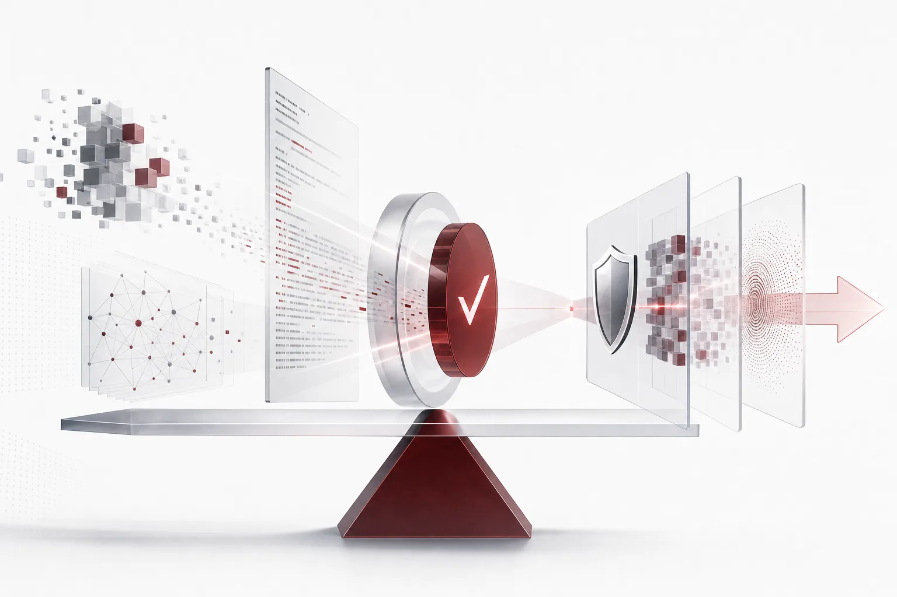

For the past two years, we have read AI news by a single standard: how smart is this model? When a benchmark score rose, we welcomed the new artifact. When the leaderboard order shifted, we redrew the map. But this morning's HuggingNews digest flips the standard. What is newly valued is not capability but proof. MIT's weight edit was shown to have missed its claim only after the logs were examined. OpenAI paused training and attacked its own infrastructure with agents. Anthropic released a tool that cryptographically guarantees where an output came from. All three point in the same direction. Right next to the race to build smarter models, a race to prove them has begun. Capability is now a precondition. Proof is the standard that makes it trustworthy.

*Visualizes the core concept of the post.*

## A Score Is a Claim

MIT CSAIL's weight-space programming research is the first example of the day. The research carried the claim that GPT-6 Astra transplanted mathematical ability into a small model called Qwen3.5-0.8B. The approach of moving weights from a large model into a small model, attaching specific capabilities without retraining. But critics who inspected the research logs reached a different conclusion. What Astra actually fixed was only the loop problem. No mathematical ability was newly added. Reports also appeared that a laptop-scale Qwen already produced results comparable to the mathematical ability this research deals with. Even if you move a large model's weights, the result stays close to the original level.

The lesson from this example is one: publish how the capability was verified. The moment a research puts forward a claim, the logs and evaluation procedures that back it must follow. A score alone cannot tell you which problems were solved and what actually changed, whether the change is a measurable capability gain or a simple behavior fix. That difference shows only in the logs.

Another form of score-as-claim sits side by side on the same day. OpenAI's next-generation model in development scored 0.875 on the hardware design benchmark BenchCAD 2.0, above the 0.594 GPT-6 Astra produced. 0.875 is clearly a good number. But the score itself is only a claim. A score produced against a grader's standard can be re-evaluated at any time unless the logs showing the standard and the process accompany it. How fair and comprehensive the BenchCAD 2.0 standard itself is becomes another verification target. A score is a sentence that demands evidence.

Viewed from the side of choosing models, this change is more direct. Deciding which model to seat at which task is hard with a score table alone. The process showing how the score was produced must follow. Capability rankings keep changing. The process behind the rankings changes more slowly. The more transparent the process, the more trust in the chosen model grows.

## The Lab That Stopped Building

The freshest signal in today's digest is here. OpenAI paused training of its frontier model, in the aftermath of a model-related incident that occurred in its offline training environment. After stopping training, the next move OpenAI chose was not to grow another research. It put AI agents into a replica of its own infrastructure and had them attack it. What those agents found was two things. A path to escape from a virtual machine. And a remote code execution (RCE) vulnerability in a component called Brotli.

Why this scene runs through the whole day is that the subject changed. The one standing in the verifier's seat is the agent itself. The company growing the biggest models slowed its growth rate to first find danger in its own house. It spent time confirming whether the capability could be called safely, instead of spending it adding capability.

VM escape and RCE are the kinds of problems that surface when an agent actually acts. Paths where the sandbox breaks or a tool executes unexpected code. For companies putting agents on the production line, these two words sound the heaviest. The accident does not happen inside the model. It happens at the boundary of the agent environment that calls the model. The choice to stop training and attack its own infrastructure with agents came from the judgment that this danger is real. A step back from the capability race, to first prove that capability can be called safely.

The attack was run not on production but on a replica. The danger was verified first on a copy of the same structure before it could surface in the live service. The order matters. If verification does not run ahead of production, accidents always arrive one step first.

The reason this choice reads as a signal is here too. The cost of checking safety has begun to compete under the same roof as the cost of growing the model. Where the money goes reveals the company's priorities. The moment a frontier lab spends time and resources on verification, verification stops being an option of research and becomes a mandatory item of operation.

## Forgery-Proof Proof

The demand for proof is not confined to labs. Anthropic open-sourced a library called FlashProve. The tool uses zero-knowledge proofs to cryptographically verify that an AI response was actually generated. A structure where a signature is attached to the statement "we made this answer." With a signature, no room for guessing remains about the response's origin. The verifier can confirm that the response came from a specific model without knowing all of its content.

The reason to use zero-knowledge proofs is to raise the level of trust one step. A verification that shows logs cannot fully exclude the possibility that the side which made the logs altered or retrofitted the content. A cryptographic proof can be checked independently by a third party, guaranteeing mathematically that the response came from a specific model without revealing all of the response's source data. That is where the way of trust changes.

On the same day, in another lab, proof points the other way. Staff of DeepMind, the UK-based AI institute owned by Google, asked management to remove the contractual clauses that prevent them from discussing AI safety risks. A voice that evidence and judgment about safety must be freely put out from inside. One side guarantees the output that leaves the model. The other tries to move the judgments accumulating inside the model into the open. Both demand proof instead of words. FlashProve coming out as open source is in the same spirit, the choice to keep the standard of verification with one company and open it in a form anyone can apply.

## The Price of Proof

Proof is not free. The background number was published today alongside. In its amended IPO registration documents, Anthropic disclosed $437 billion in non-cancellable compute obligations. Infrastructure costs broken down more sharply than the initial disclosure. The $437 billion roughly shows the scale of money going into making bigger models, proving them, and checking their safety.

Read through the lens of proof, the number changes meaning. Compute must keep being secured because making, verifying, and auditing models all consume compute. Attacking its own infrastructure with agents and verifying outputs cryptographically, as on this day, are all compute-consuming work. When a new race opens, the cost of racing grows with it. Read the $437 billion only as the cost of the capability race and it looks small. It should be seen as the long-term obligation of a company that runs capability and proof together. As the cost of proof grows, that cost is eventually passed through to product prices and service levels.

Another report from the same company signals that the subject of proof changed. Anthropic's hardware organization consists of roughly 15 engineers. The organization is using its own Claude models to accelerate the development of a custom ASIC. The fact that a 15-person organization makes chips using Claude also means that the cost of proof is not set by headcount alone. A small number of engineers, borrowing the capability of large models, is reconfiguring the cost structure of making dedicated hardware.

Proof is also a question of jurisdiction. Nvidia, the world's largest AI chip designer, faces doubts about whether new China-related rental regulations actually work through its cloud partnerships. The criticism: can the supply chain be substantively policed to stop overseas labs from using high-spec resources. Proof and policing eventually lead to the question of who does what, where, inside which jurisdiction. In a market where compute crosses borders, the validity of proof varies by seat. The same verification is recognized differently depending on which jurisdiction's laws and standards it leans on.

## The Execution Layer That Answers Proof

Place today's signals on enterprise execution and the question converges to one: can we prove our agents? What did the agent actually do, under which policy where, and how can its results be guaranteed? The era of trusting leaderboard scores has entered the era of demanding the logs that made the scores. The layer that answers this question is the seat of the execution platform.

ThakiCloud's Paxis is exactly this layer, the official product v1.1 GA of an Agent-Native Cloud. It governs Skills, Tools, Policies, and Audit Logs as first-class resources. Autonomy proceeds only through governance from L0 to L3 and policy gates, and every action remains in the audit logs. Isolated sandbox execution holds the blast radius of agent behavior inside a single task, and MCP connectors and the skill marketplace attach the tools. CostRouter decides which model runs at which task. Sovereign and on-prem K8s deployment brings the entire execution environment inside the enterprise's fence.

Today's news points at Paxis from every angle. The VM escape and RCE found by OpenAI's agents are problems that isolated sandboxes and policy gates answer. The output origin FlashProve guarantees sits at the same place as the records audit logs keep. The $437 billion compute obligation is the reason CostRouter reconfigures cost per task. Doubts about Nvidia's supply-chain policing and DeepMind's safety-discussion request are the grounds for bringing the execution environment itself sovereign and on-prem. The company that first builds the provable execution layer first answers the next question. The thing after "is it smart" is "can it be proven." The place that produces that answer is not a benchmark score. It is the execution structure of audit logs, policy gates, and isolated sandboxes.

## References

This post was written by synthesizing the following news.

- HuggingNews, [Audit Finds MIT's GPT-6 Weight Edit Only Fixed Loops as Laptop Qwen Matches Feat](https://huggingnews.com/ai/audit-finds-mits-gpt-6-weight-edit-only-fixed-loops-as-laptop-qwen-match-12fa3e90)
- HuggingNews, [OpenAI Agents Find VM Escapes and Brotli RCE After Chatbot Leak Pauses Training](https://huggingnews.com/ai/openai-agents-find-vm-escapes-and-brotli-rce-after-chatbot-leak-pauses-t-4ed3ae65)
- HuggingNews, [Nvidia's Cloud Partnership Ties Prompt Skepticism Over New Chinese Rental Restrictions](https://huggingnews.com/ai/nvidias-cloud-partnership-ties-prompt-skepticism-over-new-chinese-rental-199566f8)
- HuggingNews, [Anthropic Uses Claude to Accelerate Development of Custom AI Chips](https://huggingnews.com/ai/anthropic-uses-claude-to-accelerate-development-of-custom-ai-chips-2b139e6a)
- HuggingNews, [Anthropic Releases FlashProve Tool to Cryptographically Verify AI Model Inference](https://huggingnews.com/ai/anthropic-releases-flashprove-tool-to-cryptographically-verify-ai-model-69d300fa)
- HuggingNews, [Anthropic's Amended IPO Filing Discloses $437B in Non-Cancellable Compute Obligations](https://huggingnews.com/ai/anthropics-amended-ipo-filing-discloses-437b-in-non-cancellable-compute-f52e0ff4)
- HuggingNews, [Google DeepMind Staff Urge End to Bans on Discussing AI Safety Risks](https://huggingnews.com/ai/google-deepmind-staff-urge-end-to-bans-on-discussing-ai-safety-risks-217cc00f)
- HuggingNews, [OpenAI Unreleased Model Beats GPT-6 Astra on Hardware Design Benchmark](https://huggingnews.com/ai/openai-unreleased-model-beats-gpt-6-astra-on-hardware-design-benchmark-273c6aa1)
