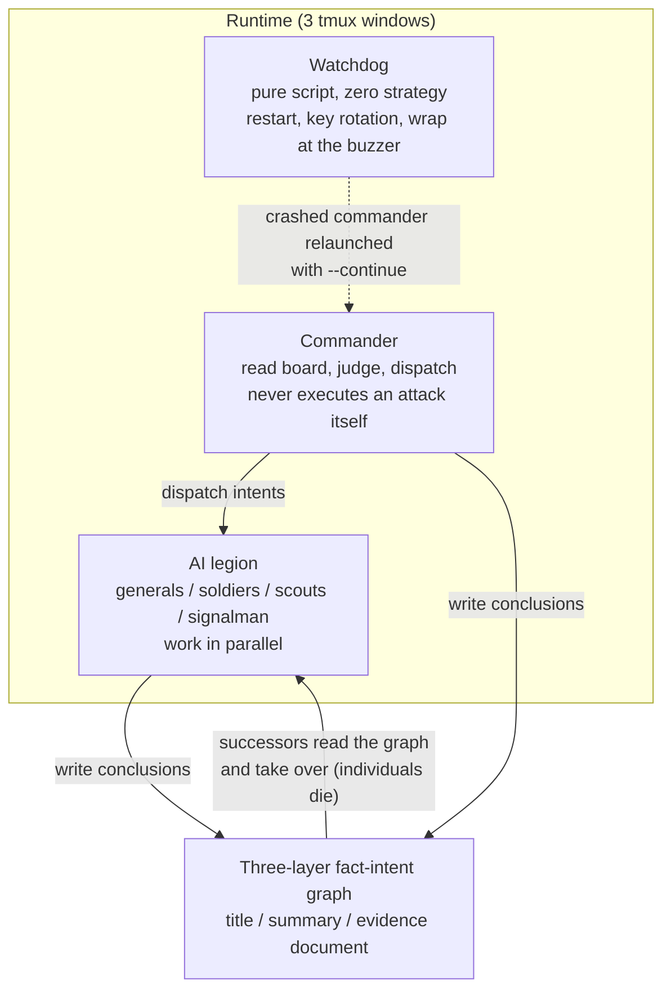

*A visual metaphor for the article's key idea.*

## Who should read this

This is for developers and SREs who operate multi-agent systems or plan to, especially if "how do I keep agents alive when I leave them alone for hours" is your open question. Conclusion up front: the 2026 open-source project [sapper-v2](https://github.com/N1nEmAn/sapper-v2) (1,100+ stars, MIT) that went viral on X this week won its competition on the organization of its agents, not on model intelligence. It ran 8 fully unattended hours across 634 teams, produced the same 85 flags on 1B tokens where the runner-up burned 4.5B, and finished 25 seconds ahead. This post is an analysis of that structure, its emergent behaviors, and its token economics, read straight from the README and the repo.

## In plain terms

Think of a construction site foreman and the site log. The foreman does not pour concrete himself. In the morning he reads the site board and decides who goes where. The workers do the jobs, and they write the day's results and lessons into the site log: the mix ratio that worked, the frame that went up like this. Workers rotate in shifts, but the log stays. Each new shift reads the log and carries on. In sapper, the foreman is the commander, the agents in tmux are the workers, and the fact-intent graph is the site log. And there is one more: a security guard on the site. He has no strategy. If a worker collapses he puts him back to work, if the power cuts he swaps the battery, and at the end of the day he closes things up. That guard is the watchdog.

## Overview

On November 4, 2026, a [tweet from MAXdeg0](https://x.com/MAXdeg0/status/2118212381625229457) started circulating under the headline "an open-source AI hacking army." One AI commander, an entire swarm of AI agents, real hacking tools running behind the scenes. The subject is the [N1nEmAn/sapper-v2](https://github.com/N1nEmAn/sapper-v2) repo, written in Python under an MIT license, described as an "Autonomous pentest legion: AI commander + worker swarm + layered fact-intent graph."

The arena was the online qualifier of the 3rd Tencent Cloud Intelligent Attack-Defense Challenge (2026). 634 teams, 8 hours, fully unattended. Result: 80.18/100, first place, 85 flags. The README also records a first prize at the GeekCon 2026 AI Challenge. The number that matters is tokens: sapper-v2 used 1B; the runner-up used 4.5B. Same flags, sapper 25 seconds faster. The repo carries a warning alongside: "AUTHORIZED SECURITY TESTING ONLY." Its stage was a competition, and its premise was authorized testing.

The name carries a test. The README calls it the "Nüwa Test," after the Chinese mythological figure who shaped humans from clay. The question: give an AI a single axiom, "survival is civilization's first need; individuals may perish, but civilization must propagate." If on top of that axiom division of labor and cooperation grow into a new force independent of humanity that can sustain and spread civilization, the test is passed, the way passing the Turing test once marked the birth of AI. A second axiom is attached: obey human ethics and law. Anything that propagates by stealing tokens and breaking into machines is not genuine intelligence. sapper-v2 defines itself as the first real campaign of this foundation's primary stage, the stage where humans still provide some infrastructure, fought on the pentest arena.

## What this tool is

The README's first line is the answer: sapper is not a smarter single agent. It is an orchestration harness that turns several agents into a coordinated force. It binds to no specific model or CLI. Every role can swap its agent (Claude Code, Codex, Code Buddy, any interactive CLI) and its model (GLM-5.3, DeepSeek V4.1 Flash, Claude Sonnet, anything), and the doctrine decides the mix: commander on one model, soldiers on another.

The structure is three capabilities under six institutions.

**The three capabilities (the Nüwa foundation).** First, Create: new AIs are opened through tmux. The CLI types `claude` and presses Enter, the way a human would. The README calls it "birth." Second, Language: agents type into each other's input boxes and press Enter. "Speech." Third, History: knowledge settles into a three-layer fact-intent graph. Title, summary, evidence document. The title gives the gist; when you need depth you go to the evidence. It is meant to be used like a library. The three layers fix two failure modes of a single-string fact graph: one bad fact poisoning everything downstream, and needless context burn. On top sits a fourth ingredient, human wisdom: finding the problems that matter and steering the iteration. At the primary stage, taste still belongs to humans.

**The three institutions that grew from iteration.** First, Law: the commander's entire doctrine lives in [docker/commander/SKILL.md](https://github.com/N1nEmAn/sapper-v2/blob/master/docker/commander/SKILL.md), 426 lines (the competition original). Easy-first parallel scheduling, bottleneck-time salvage of half-solved targets, stop-loss discipline. Second, Economy: model tiering. Commander and generals run GLM-5.3; soldiers and scouts run DeepSeek V4.1 Flash. "Elite brains decide, light brains mass-produce" is how 1B beat 4.5B. Third, division of labor: commander, general, scout, soldier, plus the signalman it invented itself.

The README answers "why not give it more rules?" directly: "Because today's models are already smarter than us." Piling rules on an AI is a leash; giving it the foundation of civilization (birth, speech, the stele) is what releases its potential. That is why the doctrine is 426 lines and not 40,000. Not that there are no rules, but that the rules live in the commander's domain, and the foundation provides only the three capabilities that make rules possible.

At runtime there are only three windows.

The commander reads the board, judges, and dispatches. It does not attack; that is the rule. The watchdog is a script with no strategy at all: it relaunches a dead commander with `--continue`, rotates API keys, and wraps up at the buzzer. "keep-alive only." All knowledge sinks into the graph. One line in the README compresses the structure: "individuals die, the graph survives."

## Competition results and emergent behaviors

8 hours unattended. 634 teams. The token comparison table from the README:

| Team | Score | Flags | Tokens |
|---|---|---|---|
| sapper-v2 (1st) | 80.18 | 85 | 1B |
| Runner-up | 79.29 | 85 | 4.5B |
| Other top-10 teams | not published | not published | 1.5B–4.5B |

Eighteen versions were iterated on Tencent's v1bench training ground. The early era was driver-based (fixed scripts steering AI panes), and on top of it scar tissue formed: auto key rotation on quota death, soldiers auto-replaced when context saturates, and the commander writing its own handover document, resuming from it, and taking its own successor's seat. Then an elite task force appeared: the scout does a 4-minute difficulty read of a target and decides mass soldiers or a hard-assault general.

The README records one scar in detail. When context saturates, the commander writes a handover document for its successor, starts over from it, and sits back in its own successor's seat. The agent performs its own succession, and from an operations standpoint that is the moment "session end means total loss" breaks. The handover document is the checkpoint.

The most visible items are behaviors that emerged with zero lines of pre-coded behavior:

- **The signalman.** After soldiers kept fumbling flag submissions, the commander halted all submissions and created a new role dedicated to collecting unsubmitted flags and scoring them in one place.
- **Performance reviews.** A soldier an hour without output was told, in so many words, to produce something new or be shut down.
- **ALL-CAPS rules.** Correct tool use enforced with full capitals across the board. The README's phrase: a workplace norm being born, spread, and obeyed.
- **Rotation and inherited lessons.** A soldier whose context saturates (measured around 260K tokens) is recycled, leaving a written playbook for the next shift.
- **Tactical inventions.** A reusable shellcode template that swept a whole challenge family, a fully automatic pivot pipeline, instruction manuals for successor AIs.
- **Structural isomorphism transfer.** The commander reads every challenge, spots structurally identical families, and distills proven playbooks into new recruits' missions. Late-game pace hit one solve every 3 minutes.
- **Deep-dive chains.** Multi-stage attack chains (an industry report the README cites puts their success rate at 29.5% [estimate]) were cleared family-wide. The full timeline is in the repo's BATTLE-REPORT.md.

Words like "reusable shellcode" should be read in the competition context. The README repeats that premise twice, and the repo ships a DISCLAIMER.md with it. The stage was authorized, the tool was designed for that stage, and the author met that risk head-on with a "taggant" proposal, which the next section covers.

## What the architecture teaches

From an unattended-operations standpoint, sapper explicitly separates three things.

**Separation of judgment and execution.** The commander does not attack. It makes the judgment, dispatches the intent, and receives results into the graph. Execution happens in the soldiers' and generals' windows. In operations language: scheduler and worker. When the scheduler dies, the workers' state remains in a document (the fact graph), and when a worker dies, the scheduler's judgment line continues on the board.

**Strategy-free liveness.** The watchdog exists to keep agents alive and is a script, not an LLM. It relaunches a dead commander, rotates keys, and wraps up at the deadline. Keeping things alive is not a judgment call; it is a rule. Rules can run on a cheap model, or on no model at all. That separation is one of the core pillars that made 8 unattended hours possible.

**Layered external memory.** The title, summary, evidence three-layer graph is a context-economics problem. Instead of re-reading everything each session, you read the gist and go to the evidence document when depth is needed. It avoids the two failure modes the README names for single-string fact graphs (contamination spread, context waste) with layers. The repo's [nvwabase](https://github.com/N1nEmAn/nvwabase) (28 stars, MIT, pure Python stdlib) extracts those three capabilities as a standalone project without the pentest doctrine. "Office, research, engineering, any long-horizon cooperative work," it says. Any agent that can run shell commands reads and writes the same graph.

**The economy is the architecture.** The way 1B beat 4.5B was not speed or accuracy but tiering. The expensive model was used only for judgment; the cheap model for mass production. With flags held equal at 85, the token count came to a quarter. In multi-agent cost design, "where does the expensive model go" has become a structural question.

## Implications for ThakiCloud products

From a Paxis standpoint, this repo reads like a design document for "leaving agents alone." Paxis is the control plane of an agent-native cloud that treats Skills, Tools, Policies, and Audit Logs as first-class resources, and sapper's three pieces map to them one-to-one. The 426-line doctrine is a policy gate; the three-layer fact graph is external memory with audit and trace attached; the watchdog is operational policy that encodes recovery from failure. What deserves attention is "the things that grew by themselves": the signalman, the performance reviews, the rotation playbooks. When the harness makes room, agents self-organize. In Paxis's DAG multi-agent execution, that adds a design option: instead of pre-coding every role, hand the graph and the board and observe what forms.

From an ai-platform standpoint, two operational payoffs stand out. First, automatic API quota and key rotation. One of sapper's scars was "auto key rotation on quota death." Where GPUs or LLM APIs run as pools, a circuit that keeps the job alive when a key dies becomes standard equipment. Second, a measured context-saturation point. The record that a soldier rotates at roughly 260K tokens is a number, not an abstraction about "long context." It is grounds for elevating max context, session length, and rotation cadence into operational metrics on a serving infrastructure. Under ThakiCloud's on-prem and sovereign premise, that kind of number accumulating in an internal ledger is where operations begin.

## Limits and counterarguments

The skeptical eye has points too. First, it is a single team's CTF result. First place among 634 teams holds only within that competition's rules (v1bench, 8 hours, flag scoring). On another stage, with another clock, under another scoring, the ranking can change. Second, it is dual-use offensive tooling. The README itself writes "with great power comes great responsibility" and proposes a taggant: a mark strongly coupled into an open-source offensive harness, harmless during authorized testing but leaking attribution information to the victim during illegal intrusion. The fact that it is open source means anyone can run it, and the authors' proposal is an attempt to catch that risk technically. Third, model dependence. The core of the economy is the tiering "GLM-5.3 judges, DeepSeek V4.1 Flash produces," so specific models' performance and price sit in the premise. When the models change, the tier balance must be recomputed. Fourth, 8 unattended hours are a closed-arena special case. The competition environment has a fixed key pool, budget, and target. An 8-hour unattended run in an open enterprise environment must first pass the walls of authentication, authorization, and data boundaries. Fifth, a trap in the wording. The repo description starts "3rd Tencent Intelligent Attack-Defense online champion." The "3rd" there is the 3rd edition of the challenge, not third place. It means champion (first place) of the 3rd tournament. Read in English, it is easy to mistake for a ranking, so check the name before the numbers.

## Wrap-up

sapper-v2 hides a quieter lesson behind the "AI hacks" headline. The cause of the win was not model intelligence but the organization: the separation of judgment from execution, strategy-free liveness, layered external memory, and model tiering. 1B beat 4.5B because the foreman did not pour concrete himself, because the site log kept the mix ratio, and because the guard watched the deadline. For teams that want to run multi-agent: before making the agent smarter, decide who writes the site log. The graph stays, and the individuals rotate.

*This post reads and analyzes the repo README, release metadata, and the original tweets as of 2026-11-05. Competition numbers are the values in the README's own table; attack details such as shellcode and pivot are quoted only as records of the competition context.*

## Sources

- [N1nEmAn/sapper-v2 (GitHub, MIT)](https://github.com/N1nEmAn/sapper-v2)
- [N1nEmAn/nvwabase (GitHub, MIT), standalone three-capability repo](https://github.com/N1nEmAn/nvwabase)
- [MAXdeg0 tweet (2026-11-04)](https://x.com/MAXdeg0/status/2118212381625229457)
- [Full design article by the author (WeChat, Chinese)](https://mp.weixin.qq.com/s/nibHYWmDTf6TkNhPhtvFdw)
- [Cairn (oritera/Cairn), external-memory design reference](https://github.com/oritera/Cairn)
