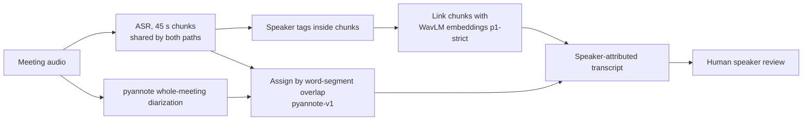
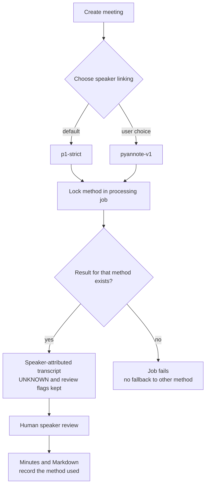

## Why read this

In meeting minutes, the error people notice first is usually not a typo. It is a **speaker error**. When two people are merged into one, the record of who promised what falls apart. This post is for engineers adding diarization to meeting notes or call records.

The short version. At ThakiCloud we compared two speaker-linking methods for our meeting-notes product, Thaki Minutes, on 64 real Korean meetings (dev2: 30, final2: 34), with the same ASR, the same references, and the same scorer. We report the two sets separately and never pool their numbers. All numbers below are from the product path, with the product rules turned on.

- In the 24 final2 meetings with 5-8 speakers, pyannote cut wrong merges sharply: **0.4085 → 0.0342**.
- In the 10 final2 meetings with 3-4 speakers, speaker precision and cpCER got worse: cpCER **0.2743 → 0.3562**. The cause is not confirmed. The same bin in dev2 did not show this regression.
- So we did not change the product default. Users pick the method when they create a meeting. We did not add automatic switching based on the estimated speaker count.
- Neither method makes diarization finished. A person still has to check the speakers.

## What we compared

Both paths share the same ASR (NVIDIA Nemotron 30B, 45-second chunks). The difference is the part that decides who said each word.

| | p1-strict (existing default) | pyannote-v1 (alternative) |
|---|---|---|
| Speaker cues | Speaker tags inside each ASR chunk + WavLM speaker embeddings | pyannote/speaker-diarization-community-1 RTTM (pyannote.audio 4.0.7) |
| Linking across chunks | Conservative linking by WavLM embedding similarity. Leaves words as UNKNOWN when unsure | Diarizes the whole meeting at once, so there is no cross-chunk linking step |
| Speaker count | Not given | Not given (`num_speakers` unset, default parameters) |
| Word assignment | strict linking rules | By overlap between word times and speaker segments. Mixed and overlapping turns are sent to review |

The title says "WavLM vs. pyannote", but strictly this is **a comparison of two pipelines**, not an embedder swap.

## Evaluation set: 64 Korean meetings

This study used existing evaluation material from the AI Hub dataset 「주요 영역별 회의 음성인식 데이터」 (Major-Domain Meeting Speech Recognition Data, #464). In papers and blog posts we present only aggregated performance metrics; we do not publish the original audio, individual transcripts, or meeting identifiers.

The 64 meetings are dev2 (30) and final2 (34). Both are existing evaluation sets that we have scored repeatedly.

| Set | Meetings | 3-4 speakers | 5-8 speakers | Role |
|---|---|---|---|---|
| dev2 | 30 | 10 | 20 | Existing evaluation set, scored repeatedly |
| final2 | 34 | 10 | 24 | Existing evaluation set, scored repeatedly |

Speaker-agnostic ASR CER is 0.1712 on dev2 and 0.1708 on final2. Both methods use the same transcript, so every difference below comes from the speaker side.

We do not rank the sets against each other, and we do not pool their performance numbers. Speaker bins are by the reference speaker count, not the system's estimate.

## Metric definitions

| Metric | Definition | Better |
|---|---|---|
| Precision (P) | Share of speaker-labelled words whose speaker matches the reference | Higher |
| Coverage (C) | Share of reference words that received a speaker. UNKNOWN counts as not labelled | Higher |
| UNKNOWN | Share of characters left as unidentified (meeting average) | Lower, though some designs leave them on purpose |
| DER | Output-level diarization error rate. 10 ms frames, ±0.25 s collar around reference boundaries, time-weighted. UNKNOWN never maps to a reference speaker | Lower |
| Wrong merge | Share of reference speakers whose most-overlapping system speaker is shared with another reference speaker, i.e. two people merged into one. Computed per meeting, then averaged | Lower |
| cpCER | CER after grouping characters by speaker and choosing the most favorable speaker mapping. Missing and invented speakers are penalized | Lower |
| Speaker count exact/under/over | Meetings where the estimated count equals / is below / is above the reference | More exact |

The reference labels in this dataset contain no overlapping speech, so this evaluation says nothing about overlap assignment.

Every pyannote-v1 value in the tables below is from the **product path**: the real product rules are on, so mixed and overlapping turns go to review and keep UNKNOWN speakers. That is why coverage is lower and UNKNOWN higher. This is intended. The diarizer's own output before the product rules is a different measurement stage, so we keep it out of the tables and report it separately below.

## Overall results

| Set | Method | P | C | DER | Wrong merge | UNKNOWN | cpCER | Count exact/under/over |
|---|---|---|---|---|---|---|---|---|
| dev2 (30) | p1-strict | 0.9355 | 0.8656 | 0.3014 | 0.3317 | 0.1255 | 0.3674 | 3/26/1 |
| dev2 (30) | pyannote-v1 product path | 0.9576 | 0.8894 | 0.2465 | 0.1679 | 0.0926 | 0.3585 | 19/7/4 |
| final2 (34) | p1-strict | 0.8905 | 0.8107 | 0.3862 | 0.3962 | 0.1792 | 0.4318 | 4/30/0 |
| final2 (34) | pyannote-v1 product path | 0.9652 | 0.8900 | 0.2480 | 0.1026 | 0.0888 | 0.3540 | 22/7/5 |

On each set, the pyannote-v1 product path beats p1-strict in every column. Coverage and UNKNOWN are weak comparisons, though, because the two methods leave words unidentified under different rules. Speaker count stands out. p1-strict undercounted in most meetings on both sets (under 26/30 and 30/34). strict is designed to protect precision by leaving words as UNKNOWN, and still had wrong merges of 0.33-0.40. Even inside the labels it was confident about, two people sometimes shared one label.

## 5-8 speakers: far fewer wrong merges

| Set · bin | Method | P | Wrong merge | cpCER | Count under |
|---|---|---|---|---|---|
| dev2 5-8 (20) | p1-strict | 0.9285 | 0.3059 | 0.3969 | 17 |
| dev2 5-8 (20) | pyannote-v1 product path | 0.9550 | 0.0768 | 0.3912 | 3 |
| final2 5-8 (24) | p1-strict | 0.8760 | 0.4085 | 0.4691 | 24 |
| final2 5-8 (24) | pyannote-v1 product path | 0.9719 | 0.0342 | 0.3534 | 3 |

On the 24 final2 meetings with 5-8 speakers, p1-strict undercounted every one. With pyannote-v1, undercounting fell to 3 meetings and wrong merges in the bin fell from 0.4085 to 0.0342. On the 20 dev2 meetings with 5-8 speakers, wrong merges fell from 0.3059 to 0.0768 and undercounting from 17 meetings to 3.

We measured that undercounting and wrong merges fell together. We did not separately test why p1-strict undercounts.

## 3-4 speakers: worse on one set

| Set · bin | Method | P | C | Wrong merge | cpCER | Count exact/under/over |
|---|---|---|---|---|---|---|
| dev2 3-4 (10) | p1-strict | 0.9527 | 0.9228 | 0.3833 | 0.2984 | 1/9/0 |
| dev2 3-4 (10) | pyannote-v1 product path | 0.9640 | 0.9401 | 0.3500 | 0.2822 | 6/4/0 |
| final2 3-4 (10) | p1-strict | 0.9471 | 0.9513 | 0.3667 | 0.2743 | 4/6/0 |
| final2 3-4 (10) | pyannote-v1 product path | 0.9348 | 0.9242 | 0.2667 | 0.3562 | 5/4/1 |

In the final2 3-4 bin, wrong merges fell from 0.3667 to 0.2667. But precision dropped from 0.9471 to 0.9348, and cpCER rose from 0.2743 to 0.3562. In the same bin on dev2, pyannote was better on both precision and cpCER.

What we observed:

- In 1 of the 10 final2 meetings with 3-4 speakers, pyannote-v1 split 4 speakers into 6.
- Speaker-count over-estimates: 0 meetings in the dev2 3-4 bin, 1 in the final2 3-4 bin.

**The cause is not confirmed.** We have not checked whether these observations explain the cpCER increase. With only 10 meetings per bin, we also cannot tell sampling noise from a real weakness. We had no criterion fixed in advance for judging this regression, and we did not build one after the fact to dismiss it.

## Reported separately: the diarizer's own output before product rules

These numbers come from a different measurement stage than the tables above. Here pyannote's speaker segments are assigned to words directly, without the product rules. What users get in the product is the product-path value in the tables. We do not put the two side by side as one comparison.

In final2 5-8 speaker meetings, the diarizer's own output had a wrong-merge rate of 0.0223; the product path has 0.0342. In final2 3-4 speaker meetings, cpCER was 0.3062 for the diarizer's own output and 0.3562 on the product path. Set-level cpCER for the diarizer's own output was 0.2663 on dev2 and 0.2694 on final2. We have not separately tested where the gap between the two stages comes from.

## Why we kept the default

We had three options.

| Strategy | What it means | Decision |
|---|---|---|
| A. Full switch | Make pyannote-v1 the default | On hold. The final2 3-4 regression is unresolved. Automatic diarization also failed in a separate limit case (below) |
| B. Auto-routing | Pick the method from the estimated speaker count | Not done. A wrong speaker count is the core error here |
| C. Keep default + per-meeting choice | p1-strict by default, users opt into pyannote-v1 per meeting | Adopted |

Building C, we kept these rules:

- The method chosen at meeting creation is copied into the processing job and locked once processing starts.
- If no result exists for the chosen method, the job fails. It never falls back silently to the other method's output.
- Transcripts, minutes revisions, and exported Markdown record which method was used, together with the note "automatic speaker attribution is not human confirmation."
- Speakers assigned by pyannote are never promoted to human-confirmed. UNKNOWN, review flags, and manual split and reassign stay as they were.

The option text on screen says only what we measured. For pyannote-v1 it reads: fewer wrong merges confirmed on real Korean 5-8 speaker meetings, more mixed and overlapping turns to review, no confirmed gain for 3-4 speakers.

## Limitations

- **Human review is assumed.** These numbers describe automatic output before anyone checks speakers.
- **No validation with real users.** Speaker confirmation and approval were done by an automated driver. There have been zero real users. We do not know how much reviewer time pyannote-v1's extra review items cost.
- **Overlapping speech was not evaluated.** The reference labels contain no overlap.
- **The evaluation sets are not fully independent.** Both are existing evaluation sets that we have scored repeatedly; final2 had also been scored in an earlier round, and we could not rule out the same speakers appearing in both dev and final.
- **The 3-4 bins have 10 meetings each.** One meeting can move the result a lot.
- Accuracy of the minutes content, such as decisions, action items, and owners, has no reference and is out of scope here.

### Limit case: a synthetic three-speaker meeting

This check is separate from the 64-meeting results, and its numbers are not pooled with them. We ran one synthetic three-speaker meeting through the real engines end to end. It passed from upload to approved Markdown, but automatic diarization failed: pyannote merged three people into two, and one role had zero automatic linking coverage. With a single sample, we do not use it to judge accuracy.

## Summary

Switching the diarization method cut wrong merges in final2 5-8 speaker meetings from 0.4085 to 0.0342. In final2 3-4 speaker meetings, cpCER rose from 0.2743 to 0.3562, and we do not yet know why. If we changed the global default based on a large gain in one bin, users in the other bin would pay for it. So the default stays, users choose per meeting, and every output records which method produced it.

Two things come next: re-measuring the 3-4 speaker bin with more small meetings, and measuring how long a person actually takes to review speakers.

Previous in this series: [Releasing a Korean LoRA for Nemotron 3.5 Transcribe: How We Fine-Tuned a 30B Speech Recognition Model](https://thakicloud.com/tech-blog/en/agentops/nemotron-transcribe-korean-lora/)

---

## Sources

Every figure in this post comes from measurements recorded in our internal experiment ledgers. The ledgers themselves are not published.

*Data source: AI 허브(AI-Hub) — 「주요 영역별 회의 음성인식 데이터」 (Major-Domain Meeting Speech Recognition Data, #464). The data is not redistributed; this post contains only aggregate metrics and per-speaker-bin aggregates.*

*ThakiCloud AI Engineering · Speech & Meeting Intelligence*
