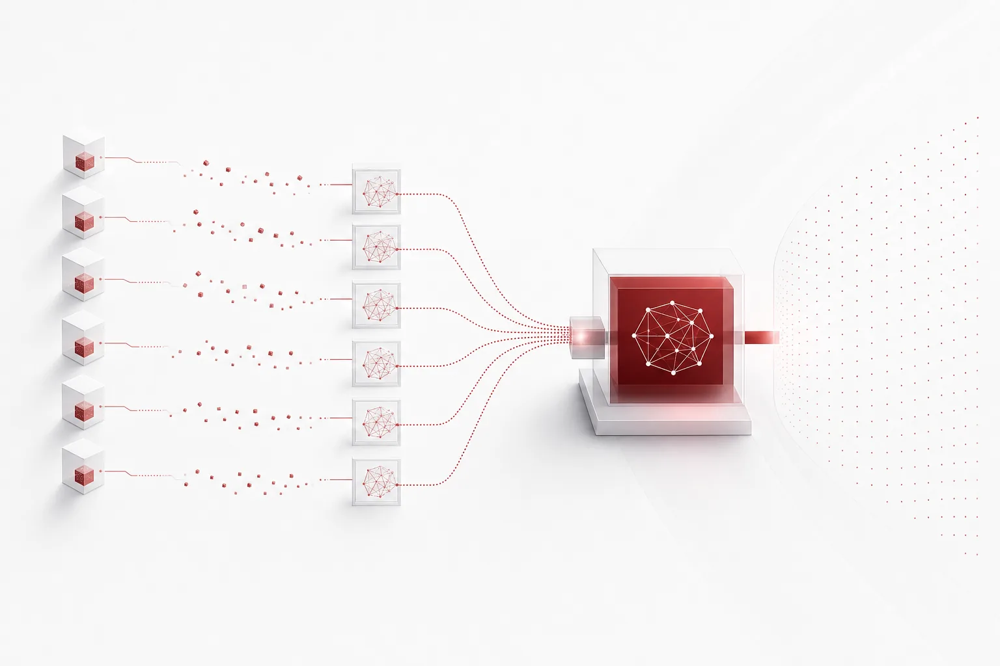
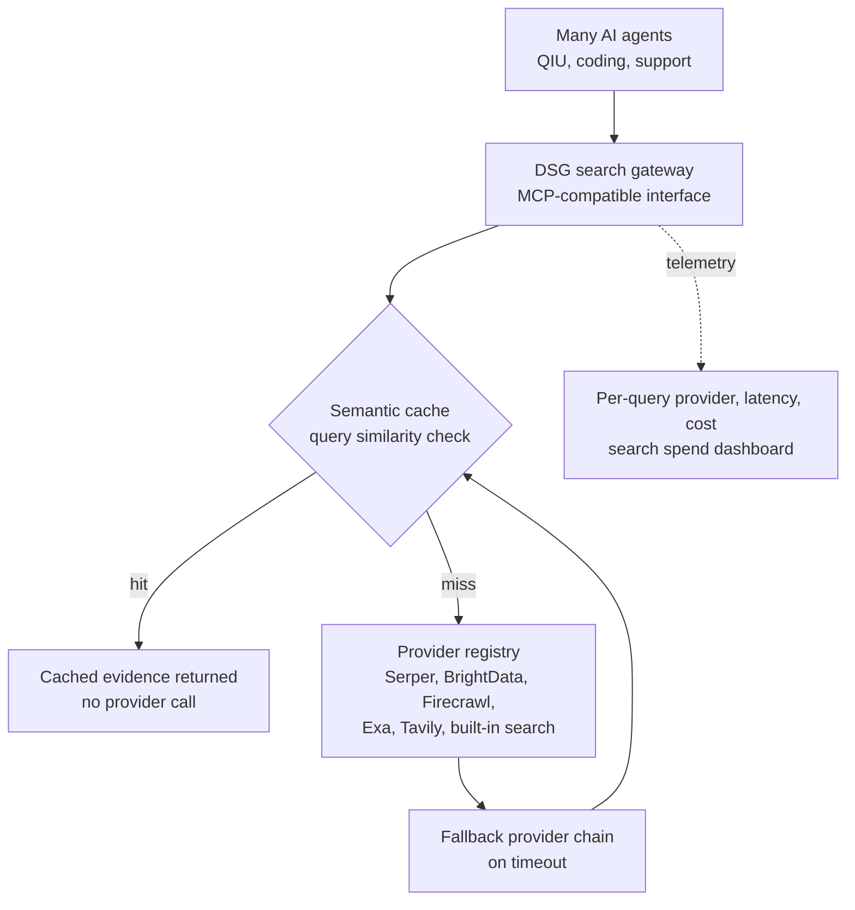
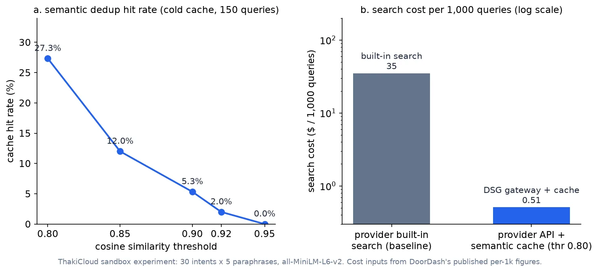

*A visual metaphor for the article's key idea.*

## Who should read this

This post is for AI platform and agent infrastructure engineers who have to decide who pays for web search in LLM-based agents. The bottom line up front: DoorDash cut search costs by more than 98% not by finding a cheaper search provider, but by pulling search out of the model's built-in feature entirely and routing every agent through a single shared gateway. In this post we re-verify that structure in a small sandbox: with a cold cache, a 27.3% semantic-cache hit rate still delivered a 98.5% search-cost reduction at 100% hit precision, measured on 150 real queries.


## In plain terms

Imagine every researcher in every department of a company ordering books directly from the publisher whenever they need one. Every order carries a publisher fee, and the same book ordered by two departments is paid for twice. DoorDash's answer is a central library order desk that every department must go through. The desk first checks the catalog of books already on the shelves (a semantic cache) and only orders from a cheaper regional wholesaler (a search provider API) when a title is missing. Which wholesaler to use, how many copies to order, and how long to keep them on the shelf are all tuned from one config file by the platform team that runs the desk. The rest of this post keeps using "gateway" and "catalog" in that sense.

## Overview

Decoupled Search Grounding, or DSG, is the structure DoorDash published in its engineering blog that puts a wall between agents and search. The headline numbers: on the QIU (Query Intent Understanding, i.e. classifying the intent behind a search query) production workload and three public QA benchmarks, search-provider costs fell by more than 98% while accuracy was held or slightly improved. In the warm-cache production regime, cache hit rate climbed from 6.2% to 99.4% and average latency dropped 68%.

The context matters. DoorDash runs workloads where search is a stage inside an agent pipeline, at production scale, and under the built-in-search pricing model that stage's cost is blended into the model bill, which makes per-query measurement structurally hard. If you use provider built-in search, there is no gate that tells you what search itself cost. DSG solved measurability before it solved savings.

QIU is a real DoorDash marketplace workload: when a user types something ambiguous like "450 north," the system uses catalog evidence plus web evidence to classify the final intent (for example, Alcohol). The evaluation set is 7,988 general non-food retail queries plus 2,335 synthetic long-tail queries; the inference model is Gemini Flash and the baseline is built-in search with Google Search grounding.

## What the technology is

Built-in search means the model provider's API runs its own search stack inside generation. It is hard to tune from the outside, and control, reuse, and observability all suffer. DoorDash's problem was not cost alone. Verbose responses from built-in search broke parsing of intermediate agent outputs into JSON, enums, and booleans: on HotpotQA, Claude Sonnet 4 had a 78.1% parse-violation rate. In a building-height comparison case, built-in search returned a 245-character answer while DSG returned a three-character "Yes", both correct, but only one parseable.

DSG is a gateway that sits between agents, the inference model, and a registry of search backends, exposing an MCP-compatible interface. Backends include Serper, BrightData, Firecrawl, Exa, and Tavily, and even built-in search is registered as one provider behind that interface. Provider choice, fallback order, cache policy, and search depth become configuration (YAML adapters), not code. A new HTTP source is one adapter; a timeout falls through to the next provider in the chain.

The core of the cache design is sharing. The cache is not partitioned per agent, so results accumulate across workloads; entries are partitioned per provider with individual TTLs. Observability records per-query provider, cache outcome, routing branch, search depth, latency, and cost as telemetry, and a dashboard tracks search spend.

Accuracy by provider, on the five tested models (GPT-4o, GPT-4o-mini, Gemini 2.5 Flash, Gemini 2.5 Pro, Claude Sonnet 4):

| Configuration | General non-food (7,988) | Synthetic long-tail (2,335) | Cost (per 1,000 queries) |
|---|---|---|---|
| Built-in search (baseline) | 93.40% | 87.62% | ~$35 [estimate] |
| DSG + Serper | 93.90% | 87.79% | under $0.70 |
| DSG + BrightData | within 1.6pp of baseline | same | 1/11 of baseline |

That table is the shape of the claim: accuracy held or slightly up while cost fell by more than 98%. The built-in-search cost figure is not published directly by DoorDash; it is back-solved from the 98% reduction, so it is marked [estimate].



## Setup and integration (our reproduction)

Reproducing all of DSG was not the point. The two cost-reduction levers, moving from built-in search to a provider API and semantic-cache dedup, are small enough to reproduce. We installed sentence-transformers (all-MiniLM-L6-v2) into the shared venv inside an isolated git worktree sandbox, and streamed 150 queries built from 30 base search intents, each with five paraphrase variants, interleaved like real agent traffic.

```bash
# isolated sandbox (scripts/blog/impl_sandbox.sh)
bash scripts/blog/impl_sandbox.sh setup dsg-search-grounding
VIRTUAL_ENV="$PWD/.venv" uv pip install sentence-transformers

# experiment: 150-query stream x 5 similarity thresholds
.venv/bin/python semantic_gateway.py
# results: outputs/blog-impl/dsg-search-grounding/run-1.log
```

Cost inputs are DoorDash's published per-1,000-query figures: DSG+Serper under $0.70 per 1,000 queries, and the built-in baseline back-solved to roughly $35 per 1,000 from the 98% reduction [estimate]. Upstream API latency on a miss is simulated at a typical 300 ms web-search RTT and labeled "simulated" on every output line. Embedding latency was measured for real on this machine: 6.77 ms per query (one-time model load of 9.65 s); embedding all 150 queries took 1.02 s, so the similarity check is negligible next to an upstream call.

## Actual experiment results

The sweep ran the gateway at five thresholds (0.80, 0.85, 0.90, 0.92, 0.95). The cache is cold-start: it records entries only on misses while walking the query stream, so the first query of each intent always goes upstream. That is the same starting point as the cache-warmup run DoorDash published (hit rate starting at 6.2%).

| Threshold | Cache hit rate | Precision | Upstream calls | Search cost (per 1k) | Avg latency |
|---|---|---|---|---|---|
| 0.80 | 27.3% | 100% (0 wrong) | 109 | $0.509 | 225 ms |
| 0.85 | 12.0% | 100% (0 wrong) | 132 | $0.616 | 271 ms |
| 0.90 | 5.3% | 100% (0 wrong) | 142 | $0.663 | 291 ms |
| 0.92 | 2.0% | 100% (0 wrong) | 147 | $0.686 | 301 ms |
| 0.95 | 0.0% | - | 150 | $0.700 | 307 ms |



Three things stand out. First, the primary lever is provider migration: moving from built-in search (~$35 per 1k [estimate]) to a Serper-class provider API ($0.70) alone cuts 98.0%; the cache is a secondary lever layered on top, pushing 27.3% of hits down to $0.51. Second, precision: zero wrong cache hits across all 150 queries, the same direction as DoorDash's "accuracy held" claim. Third, latency: 225 ms vs 307 ms even on a cold cache, a 26.7% reduction; DoorDash's 68% is from the warm production regime.

Operationally, 0.80 is the operating point of this experiment. Raising the threshold from 0.80 to 0.85 halves the hit rate (27.3% to 12.0%) while savings barely move (98.5% to 98.2%), because the bulk of the reduction already came from the first lever. You raise the threshold for precision, not for cost. The standard tuning order is: run this same sweep on real traffic, find where hit precision falls off 1.0, and set the threshold just above that point.

## Implications for ThakiCloud products

From an agent-operations view, this pattern maps directly onto the execution economics of Paxis. A multi-agent DAG pipeline readily re-issues the same topic query in different phrasings: a research agent investigating "Kueue preemption policy" and a verification agent asking "kueue preemption settings" are the same intent twice. With each agent on built-in search, the bill doubles; behind a shared gateway with a semantic catalog, the second query comes from cache and search spend stops scaling with the agent count.

When provider choice and cache TTL become configuration, you can change search policy without touching agents. Per-query cost telemetry makes per-tenant search spend visible on a dashboard, which sits in the same layer as the policy gates and audit logs that Paxis applies to agent actions. You can only decide which workloads to cache first if you can measure what fraction of agent-run economics search occupies.

The infrastructure view matters too. Once search cost is decoupled, the sum with the inference budget becomes simple. At DoorDash's figures, a search spend of roughly half a dollar per 1,000 queries is the same order as a few short inferences on the same model, which is exactly the regime where search quietly compounds into agent cost. Note that this post's experiment is a pattern verification, not a report that ThakiCloud operates DSG; the recommendations rest on the structural analysis above.

The opposite cases are just as clear. First, a single agent: the sharing effect needs at least two agents or workloads, and with one searcher, most hits come from its own session. Second, freshness-critical workloads: on FreshQA, built-in search beat DSG for all five models, so for market data or breaking news the answer is a cache TTL measured in minutes, or keeping built-in search in the provider chain. Third, low query volume: if the fixed cost of running and observing a gateway exceeds the savings, the structure creates cost instead of removing it. The DSG pattern holds where none of those three apply and search spend is growing like the chart.

## Limits and counterarguments

Our experiment is cold-cache. 150 queries in a single session from 30 intents means the hit-rate ceiling is 80%, and 27.3% sits below it. DoorDash's 99.4% is a warm-cache production figure accumulated over months of traffic; comparing the two as if they were the same number would be wrong. The $35 per 1,000 baseline is back-solved from the 98% figure [estimate], not a number DoorDash published directly.

The 100% precision is a property of this experiment, where every query is an honest paraphrase of the same intent. Real traffic contains near-duplicate queries whose answers differ, and when the cache serves the wrong one, the result is "worse than no cache at all." DoorDash's own write-up agrees: on FreshQA, freshness matters and built-in search wins for all five models; multi-hop reasoning gains less than single-hop and needs an iterative search loop. The structure also inherits dependence on third-party providers (stability, latency, quality, price drift).

The follow-up directions in the original are three: adaptive routing (splitting providers by query kind), output-contract-based validation (gating that search responses do not break the agent's parsing contract), and iterative search for multi-hop workloads. Without those three, DSG is "a shared cache in front of cheaper search"; with them, it becomes an agent-operations structure.

## Wrap-up

If your agents call built-in search, pulling search into one shared gateway is the first lever on cost, and a semantic catalog is the second. Start with measurement, not reproduction: per-1,000-query search spend and the similarity distribution between your queries. That is where the DSG pattern decides itself, and it is the point where the cost curve of a team that leaves search on the agents diverges from one that pulls it into a platform variable.

## Sources

- [DoorDash Engineering Blog: How DoorDash Reduced LLM Search Costs by 98% Without Losing Accuracy](https://careersatdoordash.com/blog/how-doordash-reduced-llm-search-costs-by-98-without-losing-accuracy/) (direct fetch returned 403 bot-blocking; fact-checked via the GeekNews translation)
- [GeekNews: How DoorDash cut LLM search costs by 98% while keeping accuracy](https://news.hada.io/topic?id=36733)
- ThakiCloud sandbox experiment: outputs/blog-impl/dsg-search-grounding/run-1.log (2026-11-08)
