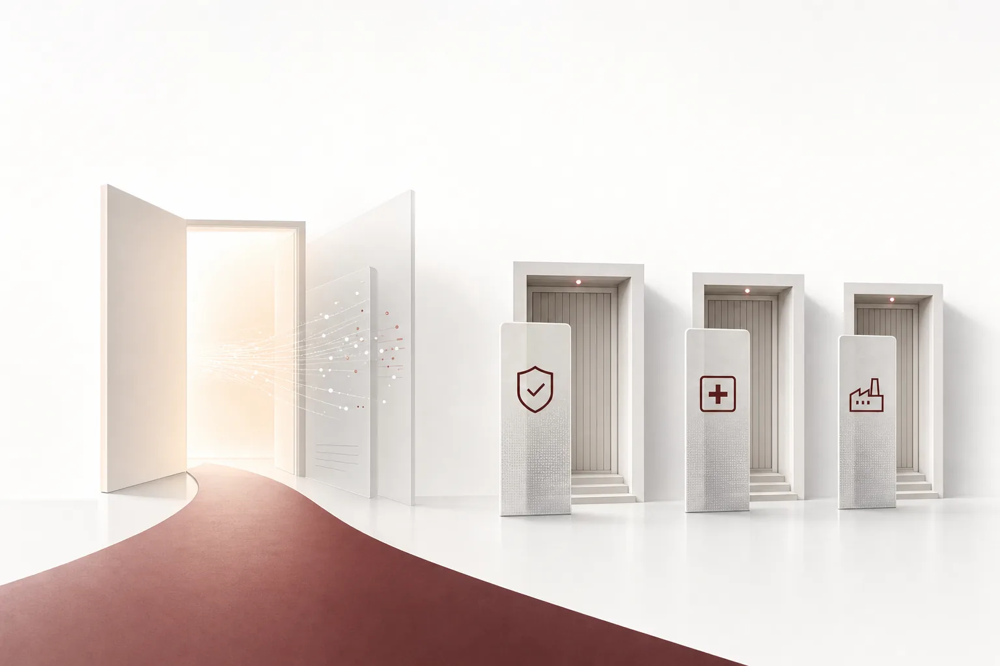

Hankyung wrote, "I thought it was just a used-goods app." In the afternoon, a shop owner opens ChatGPT. "How did my ads do today?" The AI reads the connected Danggeun ad account and answers about spend, clicks, and sales in plain language. This is no longer a hypothetical scene. According to Hankyung, Danggeun launched the first "Ads MCP" among Korean ad platforms last September. Connect an ad account to ChatGPT or Claude and you can query and analyze campaign status and performance in plain language.

Danggeun is a local used-goods marketplace where neighborhood shops and self-employed owners buy and sell. Even this kind of platform opening its ad operations to AI means that the entry point of AI is moving down to street level.

Judging by the pace, the direction has already been set. An MCP for querying and analysis in September, an open API for editing and event transmission in October, and as the next step, a feature where the AI creates and fixes ads on its own. It is climbing the ladder of opening the door in a few-month intervals.

*An image visualizing the core concept of the article.*

## The Door That Reached the Used-Goods App

In October it took one step further. It opened the beta of its ads open API, which lets external systems automatically handle not just the registration and editing of campaigns and ad creatives, but also the transmission of purchase and cart conversion events. This moves things from the stage where "the AI reads data" to the stage where "the AI performs work." And according to Hankyung, Danggeun plans to expand the scope of the MCP to ad creation and editing as well. At the next stage, the AI will do more than analyze performance; it will adjust the ad settings themselves. Ad operations were the archetype of repetitive work, and now that repetition is handed over with a single natural-language instruction.

Competitors are moving quickly too. Kakao released Moment AI last December, and Naver released an ad performance API. MCP (Model Context Protocol) is a standard layer that lets an AI model or agent connect to an external system, query data, and perform work. It is now hardening into the de facto interface for commerce and advertising platforms. The point of the same report is this: you can connect an external AI service directly to an ad account and run operations with just the AI you already use, without any separate data extraction or analysis tools. Hankyung reads this trend as the start of an era in which even small shops and SMEs that do not code are connecting their business systems to AI agents. As the adopters of AI spread from large corporations and the public sector to shops and self-employed owners, the demand for control and audit grows on the same trajectory. The door opened by a used-goods app is not a special case.

## A Door Without a Doorman

The interesting part is what comes after the door opens. The platform's motivation is clear. Open the door wide enough and the AI becomes the entry passage to its own service. But the door does not open on just one side. With the same MCP a shop owner uses to ask about ad performance, a competitor's salesperson or an internal operator could touch the company's ad spend. When the tool becomes a standard, the way of opening the door becomes a standard too.

The bigger problem is accountability. An AI judgment error or a misconfiguration is not a hypothetical loss; it is real wasted ad spend. Who should pay for the ads burned by a single wrong setting? At the door a consumer opens, the price of failure is ad spend. At the door a company opens, the price of failure could be patient data or a manufacturing process. The unit of the loss differs, but the structure of responsibility is the same. The Hankyung report points out that as the AI performs work directly inside the platform, demands for control and audit grow along with it, and that trust and security infrastructure for agent execution is becoming more important.

In the end, the question that grows as the door opens wider is this: which work, with whose permission, under what conditions is performed; if it goes wrong, who is responsible and can prove it afterward. What is needed is a doorman. The problem is that today's MCP is a standard for the "door", not a standard for the "doorman".

## Where Doors Are Opened, Each in Their Own Way

On the other side, where the doors are most firmly locked, they are building doormen.

Insurance has reached the stage of redesigning the sales model itself. Hyundai Marine's "Hi-Helper" automatically generates three recommended plans in under a minute, and Samsung Fire's "AI Advisor" supports consultation from enrollment through contract retention, based on the customer lifecycle. Samsung Life supports insurance agents' repetitive training with "AI role-play", in which an AI digital human plays a virtual customer, and Shinhan Life has introduced a natural-language-based enrollment design system. All four major insurers being in AI sales support is a signal that the AI transformation of the insurance industry has entered a new phase. The Green Economy reports that major consulting firms have identified business model redesign as the core task of the insurance industry's 2026 AI transformation. As products and coverage structures grow more complex, the balance between an insurance agent's expert consultation skill and AI automation is emerging as a competitive variable. As natural-language consultation and digital-human training tools reach commercialization, AI investment in agent education and training is growing along with them.

Hospitals give a different answer. Because patient data cannot go outside, Lunit opened its 30-billion-parameter domestic model "LearningUnit 2.0" as open source and completed a six-month validation at nine medical institutions. It is the result of leading a 23-institution consortium as the main organization of the Ministry of Science and ICT's "Medical Science Specialized Foundation Model" national project. The validation covered multi-disciplinary treatment proposals, emergency severity classification, and insurance review, and showed higher accuracy than the 120-billion-parameter GPT-OSS across 17 benchmarks. Instead of opening the door, they chose to run the AI internally.

Manufacturing put out a rulebook. According to a report from The Economist, under the standard terms of global AI services, company data can be used for retraining, and data can be passed to third parties in response to legal submission requests from the U.S. government. Contract terms alone cannot guarantee safety at that level. Against this backdrop, the National Intelligence Service will hold, at the end of this month, its largest-ever "Industrial Security Conference", and Hyundai Autoever is scheduled to release a practical guideline called the "AI Security Guide". The core is a hybrid strategy. Core secrets and national core technologies are handled by internal on-premises AI, and general work by cloud AI. It also sets three mandatory conditions for contracts with foreign AI vendors: no retraining on input data, storage restricted to domestic regions, and complete deletion at contract termination with objective proof. It also recommends a four-stage governance structure of role definition, contract review, permission management, and deletion verification.

Defense is where the door is most firmly locked. According to NewsWay, KT is hiring project-lead-level personnel for defense SI (systems integration) execution, along with specialists in 5G private networks and satellite communication. Last August it kicked off a 20.7 billion won defense 5G infrastructure project, and became the first Korean telecom to join the NATO Defense Communications Standardization Project (NWCSP) as a standardization committee member. SK Telecom took a different path. As the only private company participating in the Army Headquarters' "2026 Land Army Festival", it unveiled an "AI Staff" built on a data platform, ontology, and digital twin. In its Q3 earnings release, it forecast that business opportunities would open first in sovereign AI for public and defense, ahead of enterprise AI. The closer to national security, the more the center of competition shifts to "who builds the door".

The capability of the side moving through the door is becoming sharper too. According to a reporter's notebook in Shinailbo, Anthropic's AI agent found a vulnerability that had remained undiscovered in OpenBSD for 27 years. In the same week, the doors got wider and the doormen got heavier.

## The Door Is the Standard, the Doorman Is the Competition

Tied into a single line, a consistent picture emerges. The "door" is being standardized quickly. MCP, which lets anyone connect an AI, is spreading beyond advertising and commerce into wider areas of work. AI's entry point is coming down to the corner shops, and the range of work performed is growing from consultation to actual operation. What is being discussed slowly is the "doorman". Which work the AI does, with what permissions and under what conditions, and who is responsible when it makes a mistake. None of the industries gathered in today's news are places where "you just need to open the door wide". The front line of AI adoption is shifting from "how well does it work" to "how much can it be trusted".

Competition is no longer about how fast you open the door. It is about who stands in front of it. At the protocol level, capability is being productized. At the execution level, trust becomes the only scarce asset.

Today's answers branch into four: opening the door wide, locking it firmly, not opening the door and running internally, and opening it with conditions attached. All of these answers rest on the same premise: that the AI actually performs work. What is at stake is whether the organization that performs the work can be accountable for that performance.

When the next step Danggeun has foreshadowed becomes real, an AI that creates and fixes ads on its own, the doorman's question is no longer just a corporate task. It becomes the task of the platform that opened the door. Because the party that should be held responsible for the money the agent spends extends beyond the shop owner to the platform that opened the door.

## What the Doorman Paxis Is Preparing

ThakiCloud's Agent-Native cloud Paxis (v1.1 GA) can be said to be a product built exactly for the doorman's job. In Paxis, Skills, Tools, Policies, and Audit Logs are first-class resources, not add-on features. Agents do not execute unconditionally. Autonomy, from L0 to L3, passes through policy gates step by step within governance, and every execution is recorded in an audit log. The execution environment is an isolated sandbox, so even when a mistake happens, the scope of damage is limited.

Just as Danggeun connects ChatGPT to its ad system, Paxis's MCP connectors and skill marketplace attach agents on top of the business systems a company already uses. CostRouter's per-task model selection picks the model that fits each task, instead of solving everything with one model. It can also run in sovereign and on-premises K8s (ai-platform) environments, which keeps it inside the "secrets stay on internal AI" design boundary Hyundai Autoever has drawn. The pain points revealed by today's news each have a point of response. The audit log answers the question of who is responsible for a single wrong ad setting, the sovereign and on-premises execution environment answers the demand that patient data and national core technologies not leave the building, and per-task selection answers the concern that the most expensive model would be used for every agent call. The ability to deliver such answers every day, in production. That is the doorman. That is precisely the work Paxis has chosen.

Summed up in one sentence, today's news goes like this. The used-goods app opened its door to AI, and companies are building doormen. The door is becoming a standard. Because what decides the competition is not the size of the door, but who stands in front of it.

## References

This article synthesizes the news below.

- NewsWay, [KT gears up to expand defense SI... rivalry with SKT for public infrastructure leadership](https://www.newsway.co.kr/news/view?ud=2026110617292609797)
- Hankyung, ["I thought it was just a used-goods app"... why Danggeun opened its door to ChatGPT [Jung Ji-eun's Te...](https://www.hankyung.com/article/202611093475i)
- Biz World, [[Health Hot News] Lunit reveals medical-specialized AI "LearningUnit 2.0"... "at 9 hospitals ...](http://www.bizwnews.com/news/articleView.html?idxno=151185)
- The Economist, ["Company secrets stay on internal AI"... hybrid strategy that defends data sovereignty [2026 ...](https://economist.co.kr/article/view/ecn202611040074)
- The Green Economy, [Insurers build AI ecosystems in sales operations "one after another"... strengthening insurance agents' expert capabilities...](https://www.greened.kr/news/articleView.html?idxno=354117)
- Shinailbo, [[Reporter's Notebook] The era of AI click hacking... a "cross-ministry security control tower" is urgent](https://www.shinailbo.co.kr/news/articleView.html?idxno=5080371)
