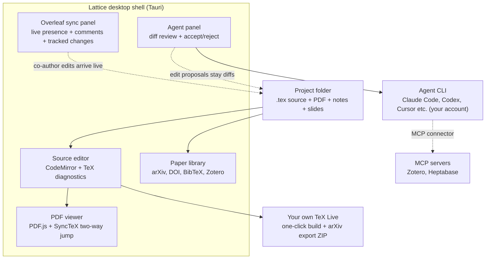

## Why read this

This is for platform engineers who are figuring out how to attach coding agents to their development environments, and for researchers who want an agent in their paper workflow. The core conclusion up front. The pattern of "embedding an agent inside an app" converges on three elements, as Lattice demonstrates. Keep the agent runtime owned by the user's CLI, accept every edit as a diff, and attach external knowledge through MCP. This pattern does not end with one app doing its own thing. It is the same work that ThakiCloud's Paxis systematizes at the platform level, appearing first in the small scale of a desktop application. That is the reason for this post.

## In plain terms

Imagine moving a writing desk into a room and seating a research assistant in the chair next to you. The assistant uses a tool the visitor brought in, your agent CLI. When the assistant revises the manuscript, the master copy does not change immediately. The revision becomes a marked-up list, a diff, stuck to the paper. Only after you nod, page by page, does it land in the manuscript. If you reject it, it goes to the trash, undo and restore. The desk holds only your own stationery, your TeX Live. The assistant does not go out and buy its own. We keep returning to this desk throughout this post.

## Overview

Lattice is a local-first LaTeX workspace for macOS. One window holds the source editor, the compiled PDF, a library of papers to cite, an Overleaf co-author panel, and an AI agent panel. The project stays an ordinary folder on disk, so it opens offline, opens in any other editor, and remains under Git. Overleaf is a sync target, not the place your paper lives.

It matters that the README introduces itself as "a local-first, agent-first LaTeX writing app for macOS." The agent is not a bonus feature. It is the design premise of the app. The app owns no model and no subscription of its own. It runs an agent CLI you are already signed in to on your Mac, Claude Code or Codex, in a bring-your-own-agent fashion. In other words, Lattice is not an execution environment for the agent. It is the approval table placed between the agent and the human.

The author is an undergraduate at Tsinghua University IIIS, @leoliuym. The project was announced with an introduction tweet on November 6 (UTC), and releases have kept coming since. As of the morning of November 9 (UTC), which is the reference point of this post, a v0.16.1 release and a new push had already landed that day. It reads as one of the first forms of a wave that is moving agents from coding environments into paper environments.

## What the tool is

Technically, Lattice is a native desktop app built on Tauri. The repository's primary language is TypeScript, and the license is Apache-2.0. Editing runs on Tiptap and CodeMirror, PDF display on PDF.js, the dockable panel layout on Trellis, and slides on the Open Slide React deck library. The runtime behind the agent panel is Synara, a project T3 Tools Inc. is involved in.

The desk structure is in the diagram below. The key point is that the agent panel never edits the project folder directly. When the agent CLI changes a file, Lattice receives the change as a diff and waits for your approval.



The main features group into three axes. The first is writing. Source and PDF sit side by side with two-way SyncTeX jumps, and builds run with one click on your own TeX Live. You can start from NeurIPS, ICML, ICLR, ACL, CVPR, or AAAI templates, or from two thesis classes, and the arXiv export ships as a single self-building ZIP. Hovering a citation key shows its reference, and six highlighters mark what still needs work.

The second is revision. Select text to proofread or polish it in place, and the agent attaches a reason to each edit. Annotate the source or the PDF, then run revision in rounds. The agent proposes an edit for each annotation, and you accept or reject it right there. Those annotations can be exported into standard PDF comments on a copy of the compiled PDF, following your selections, so collaborators can read them in Preview, Acrobat, or Zotero.

The third is collaboration. Two-way Overleaf sync brings live presence, chat, comments, and tracked changes. Co-authors can stay on Overleaf, and their edits arrive on your desk as they type. Track-changes mode, without an Overleaf plan, marks your edits in both the source and the PDF, one at a time or all at once. Any two versions can be compared and exported as a PDF marked up with latexdiff.

The fourth axis is format diversity. Inside the same project live Markdown notes with block editing, tldraw whiteboards, interactive HTML pages, and spreadsheets with formulas. Slides are React decks powered by Open Slide, where you edit and annotate, let the agent revise, and present from within Lattice. The project folder being the common store for all of it is the structural core. The targets the agent works on are not narrowed to a single .tex file. Notes, whiteboards, and slides sit on the same desk.

## Installation and integration

Official builds are signed, Apple-notarized, and self-updating .dmg files. They run on Apple silicon and Intel Macs alike, on macOS 14 or later.

```bash
# 1. Download the .dmg from the latest release (Apple silicon)
#    github.com/leo1oel/lattice/releases/latest
#    drag Lattice_0.16.1_aarch64.dmg into Applications

# 2. No TeX on the Mac yet: being offered BasicTeX install is the first step
#    of the Get started checklist (an existing MacTeX or TeX Live is used as-is)

# 3. (experimental) Linux: x86_64 AppImage (Ubuntu 22.04 or later, Fedora 45 class)
chmod +x Lattice_*.AppImage
./Lattice_*.AppImage
```

You enter through three paths: open a folder, start from a template, or connect an Overleaf project. The guided tutorial in the project menu walks a sample paper through a six-step checklist, from building the PDF to having the agent revise a paragraph. The Linux experimental build states explicitly that the built-in agent panel is not yet available.

If the project is a Git repository, the Git panel opens. You see changes and pull requests inside Lattice, the desk drawer under version control.

## Hands-on verification on this machine

On the home machine where this post was written, we attempted a full reproduction. Install the .dmg, bring in BasicTeX, actually build. Reproduction attempt failed: in a non-interactive session, installing a third-party desktop app and onboarding tens of gigabytes of TeX packages are approval-gated, so we did not perform them in this run. We substituted verification against public artifacts instead. What we checked, and when, is in the table below.

| Checked item | Finding | Check time (UTC) |
|---|---|---|
| Latest release | v0.16.1, aarch64 and x64 dmg plus .app.tar.gz (for auto-update), amd64 AppImage | 2026-11-09 04:44 |
| Repository activity | Last push 2026-11-09 10:20, 375 stars (measured via GitHub API) | 2026-11-09 |
| License and language | Apache-2.0, TypeScript (measured via GitHub API) | 2026-11-09 |
| Official site | "Lattice, a local LaTeX workspace for your research", demo, release, and developer docs links confirmed | 2026-11-09 |

Note what a release number of 0.16.1 means. Sixteen iterations past the second decimal, plus a patch. A project in an active early stage. At the same time, it is still 0.x. Baking it into an internal workflow on the assumption of stable public APIs or storage formats would be premature.

## ThakiCloud product implications

Lattice is a small-scale physical example of the question Paxis is answering. When you attach an agent to a production line, what table do you put between the human and the agent? Lattice's table has three parts.

First, the runtime belongs to the user. Lattice owns no model and runs the CLI the user is signed in to. From Paxis's perspective, this is agent-runtime neutrality. Whatever agent engine arrives, the platform provides the approval table and the audit trail. Just as one app chooses a CLI, Paxis sits as a control plane above agent execution without being bound to a specific model or front end.

Second, every agent edit arrives as a diff, in approval units. The premise that "the agent may write directly to the file system" disappears one step into Lattice. The agent proposes, the human accepts, and a rejection restores the original. This is the desktop version of the policy gates and audit logs that Paxis treats as first-class resources. The execution economics of agent work automation ultimately come down to the cost of one approval. The better the table, the more often the human nods, and the further the agent can go.

Third, external knowledge attaches through MCP. Memory and reference tools like Zotero or Heptabase enter as MCP servers of the agent CLI. Lattice does not reimplement them. The same logic as Paxis's MCP connectors, which handle OAuth auto-reconnect. The tool that holds the knowledge stays in its place, and the agent goes there to use it.

The part Lattice does not show is also instructive. Approval happens at one desk, by one person. What Paxis must solve at platform level is extending this approval table to teams and organizations, and making it asynchronous.

## Limits and counterarguments

The limits compress into six. First, the agent panel is macOS-only. The Linux experimental build does not have it yet. Second, the user carries the subscription and token cost of the agent CLI. The app is free, but the assistant's wages, the inference cost, are paid by you. Third, it is a one-desk, one-person tool. The approval table is not asynchronous or multi-person, so for team-scale paper collaboration, Overleaf remains the center. Fourth, it is a 0.x project with a single lead developer. Apache-2.0 keeps the code alive, but the app's operational continuity is a judgment call on repository activity alone. Fifth, it does not shed the inherent weight of TeX Live dependency. Outside domains where LaTeX is a premise rather than a choice, theses and conference submissions, the need for the desk weakens. Sixth, "agent-first" is positioning. No public record yet shows how many real submission papers the agent actually revised, so the technical analysis in this post is bounded to the README and release artifacts.

A counterargument is worth standing up. What is different from running Claude Code in a terminal with an existing LaTeX editor? Lattice's answer has three parts. The diff approval table sits inside the editing surface. Review tooling like SyncTeX, latexdiff, and PDF comment export applies directly to agent edits. And the paper library and Overleaf comments gather in the same window. For that answer to hold, the user must practice review-centric writing. For a user who merely commands the agent, the desk's advantage shrinks.

## Takeaway

Lattice does not put the agent inside the app. It puts a table between the human and the agent. That is the current form of the pattern. The runtime is user-owned, edits are diffs, knowledge is MCP. A case that has validated these three elements at desktop scale previews the shape of the work Paxis systematizes at platform scale. If paper workflows are your main work, install it today and run the checklist to the end. If you are designing an agent app, start by asking where the approval table goes. When the agent takes the seat beside you, the quality of the desk becomes the quality of the output.

---

Sources

- Lattice official site: https://leo1oel.github.io/lattice
- GitHub repository: https://github.com/leo1oel/lattice (Apache-2.0, per README)
- Latest release: https://github.com/leo1oel/lattice/releases (v0.16.1, 2026-11-09)
- Introduction tweet (leoliuym, 2026-11-06): https://x.com/leoliuym/status/2118774820293034437

*Note: this post was written on the home machine. The app-install reproduction was substituted with public-artifact verification due to non-interactive session constraints.*
