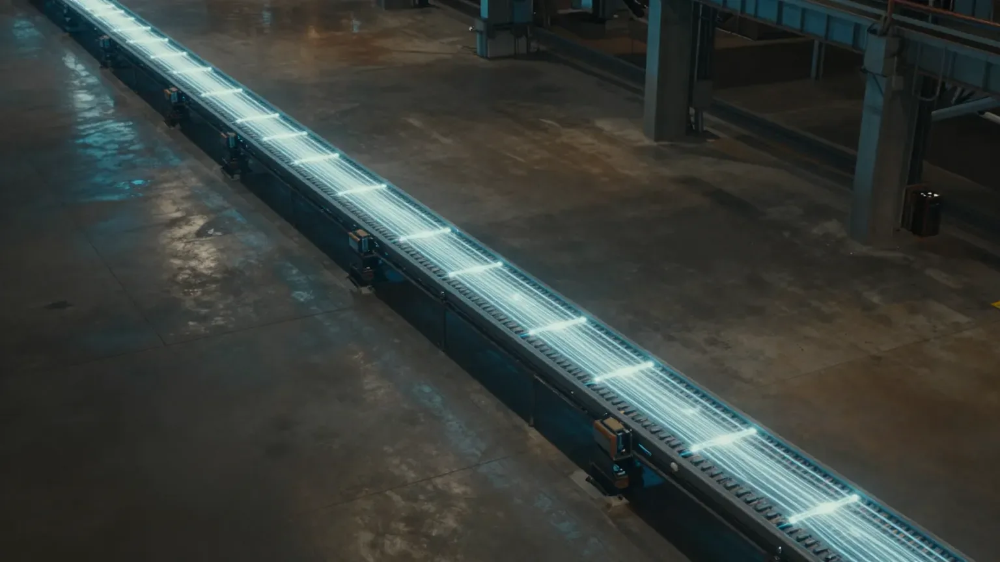
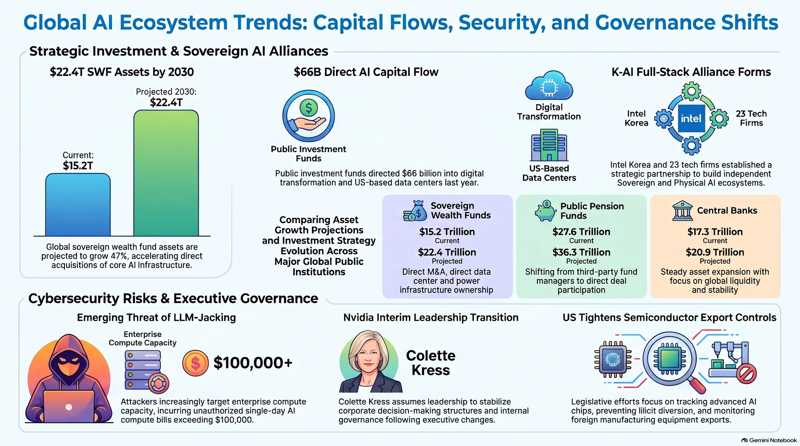
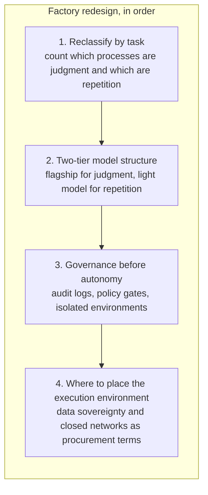
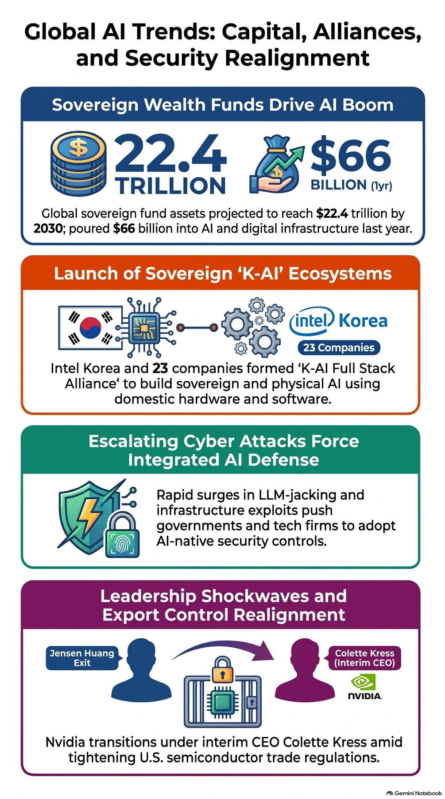

"Redesign the factory around AI agents." That was the line Baidu CEO Robin Li delivered yesterday (November 12) on the stage of the "Baidu World 2026" event in Beijing. He then added that an AI agent cannot become a CEO; it is an assistant that takes on repetitive work. According to Global Economic, the same event also unveiled the ERNIE 5.5 Flash Preview model, the "Tianchi 1024-card super node" compute infrastructure, and two enterprise agents, DuMate and Kooko. The company redefined its own identity as an "AI cloud and agent infrastructure group" and launched a neutral model service marketplace called Token Exchange.

There is one odd thing: today's main character is a shrinking company. Baidu's total Q2 revenue fell 4% year over year. And yet that keynote is the most repeated part of the industry conversation today. The answer lies in a single number. GPU cloud revenue grew 283% year over year.

What grew inside the 4% decline? It is worth looking at this number a little more.

*The article's core concept, visualized.*

## What Grew Inside the Decline

The 4% decline came from the old business. Search ad revenue shrank. The new business grew elsewhere. AI cloud infrastructure revenue rose 50% and GPU cloud rose 283%. AI-based business now accounts for 50% of total revenue. The whole cake got smaller, but the slice being replaced got bigger.

It is also a story of survival. The industry says that in China, on average, more than one new model appears every day. Baidu was pushed aside in consumer apps by ByteDance's Doubao and DeepSeek, and its revenue structure began to shift from internet to AI. So it turned toward the enterprise market. The launch of Token Exchange follows the same logic. When a model company builds an exchange for tokens, it means that competition over token price and efficiency has already risen to the level of market infrastructure.

On the same day, Wall Street was pricing in the "model." According to The People's Daily, about six times the planned offering size has piled up as demand for Anthropic's IPO, and a valuation above $1.4 trillion (1,800 trillion won) is expected. Q3 revenue is $17 billion, more than ten times the prior year's $1.4 billion. The capital markets have finished their bet on the model side. This IPO is also significant in that it stands on top of a $26 billion private investment from backers including Google, Nvidia, Microsoft, and AMD, and a computing cost commitment of roughly $900 billion. As the compute costs AI will consume going forward become numbers in the capital markets, the story about the "factory" can only get longer. This IPO, scheduled for November 19, is also expected to become a benchmark for fundraising at other AI companies, which supports this trend. In contrast, Baidu's story is that money is flowing not to the model but to the factory. Where capital flows is today's story. And today, two answers stand side by side.

<!-- nlm-visual -->

*Infographic generated by NotebookLM from the sources.*

## The Day the Buying Criteria Changed: "Economics Per Task"

This direction is not Baidu's alone. Google and Salesforce said the same thing on the same day, on a different stage.

Google released Gemini 4 Hydrogen, a model specialized for agent work. The Gemini 4 lineup has been expanding for six straight weeks, so the pattern itself matters. The top-tier model Argon was unveiled on October 1, Carbon was made available to the public on November 11, and Hydrogen followed just two days later. On the AAII overall intelligence index, Hydrogen scored 51 on the high setting, overtaking the flagship Argon (50), and 54 on the extra-high setting. Its Terminal-Bench 4.1 success rate is 57%, more than three times the previous 3.8 Flash (18.2%). Task completion speed is 2.5 times faster, and the hallucination rate is said to have dropped to less than one-fifth. Hydrogen supports a context of up to one million tokens and multimodal input across text, image, audio, and video. On the enterprise workflow automation benchmark AutomationBench-AA, it recorded 76.1%, above Claude Sonnet 5.5 (71.8%) and GPT-6.1 Terra (60.2%). API pricing is $1.50 per million input tokens and $7.50 per million output tokens. According to Artificial Analysis, its overall intelligence is slightly below Claude Sonnet 5.5 and GPT-6.1 Sol, but the cost is about one-third of Sonnet's. Performance at this price point is the essence of this product.

More interesting is how Google uses this model. It introduced an Orchestrator to its coding tool Antigravity. Complex judgment is handled by the flagship model Carbon, and repetitive tasks like code writing and testing are automatically handed off to Hydrogen. While keeping the success rate close to Carbon alone, allocation dropped 24% and completion time shortened by 19%. The CEO of Box said that after adoption, task accuracy rose from 74% to 79% and work time fell to less than half. In Zapier's independent evaluation, it recorded a 51.1% success rate, close to Argon (51.3%), with the cost per task at about half. The buying criteria for enterprise AI are shifting from "intelligence per token" to "economics per task."

Salesforce unveiled SOV-Transcribe-1, an open-weight speech transcription model. It is released under the Apache 2.0 license with the weights made public, so it can be run on your own infrastructure. The English word error rate is 2.28%, ranking 7th overall among the 44 models evaluated and 1st among open-weight models. It beats both Nvidia's Nemotron 3.5 Transcribe (2.81%) and Mistral's Voxtral Small (2.77%). It has 26.6 billion total parameters, of which 4.6 billion are active (MoE architecture). Notably, half of the evaluation set, 50%, is agent dialogue (AA-AgentTalk). As TokenPost's analysis puts it, the main battlefield for speech models has already moved to agent workflows like customer service and call record processing. Note that the evaluation is based on about eight hours of English, so Korean performance is still unverified. Salesforce also included this model in its sovereign AI plan and in the government national security business unit Mission Force. In a situation where even the input layer of an agent is sold on a "per-task" basis, Robin Li's word "factory" lands more solidly.

## Korea's Factory Is Turning on the Same Axis

The Korean stage is infrastructure. On the same day, Intel Korea launched the K-AI Full-Stack Alliance with 23 domestic companies at the "2026 Intel AI Summit Seoul" at COEX in Seoul. A total of 52 companies and 5 government public institutions took part, and about 1,000 people attended. According to AI Times, it is a sovereign AI and physical AI cooperation system that connects hardware, software, AI models, and industry-specific solutions around domestic servers. The alliance put a domestic AI semiconductor NPU and domestic servers, an open software framework, and industry-specific AI services on a single table. The form of a full-stack alliance, rather than selling individual chips, reads as the industry's current effort to avoid dependence on a single supplier. Intel also previewed that it will bring an inference-specialized GPU, the D series (Crescent Island), and the next-generation Xeon, Diamond Rapids, next year.

The scale of tokens to process is another dimension. Global token throughput is expected to grow about 330 times, from 970 billion per month in 2024 to 3,200 trillion in 2026. This country has more than 1,220 industrial robots per 10,000 workers, and the manufacturing base for physical AI is already in place. On this stage too, the redesign of the factory is underway.

However, the faster the factory becomes, the greater the cost of broken control. Naver Cloud is putting 4,000 B200s (roughly 200 billion won in conversion) into the pre-training of its 700B-class security-specialized model HyperCLOVA X-Cyber and calls AI-based attacks a "cyber pandemic." The background is clear. It comes from the experience of temporarily suspending Claude due to U.S. export controls. Byline Network only reports that it has felt with its own body the limits of depending on external models. The theft of AI computing power, called LLMjacking, has reported cases of more than $100,000 a day in misuse, and some companies have mentioned cumulative damages of $1 million. The Financial Services Commission is making it mandatory for digital asset operators to meet bank-level security standards. To borrow Digital Today's phrasing, the employee has entered the factory, but there are still no rules, no attendance records, and no emergency exit signs. This is today's practical risk.

## Where Korean Companies Should Start First

So where should a company in the middle of this change start? The three stages of today give the order.

First, reclassify work on a "per-task" basis. You need to count which processes are judgment and which are repetition. Robin Li said the ROI he talks about does not come from adopting a model but from redesigning the workflow. A realistic starting point is to begin with highly repetitive tasks like customer service, document processing, code writing, and data analysis. From Google's Terminal-Bench 57% success rate to a speech model with a 50% agent-dialogue share, models priced by the "task" are already in the market. Second, it is time to review a two-tier model structure. A structure where complex judgment goes to the flagship and repetitive work goes to a lightweight model. Antigravity's Orchestrator allocation reduction of 24% and completion time shortening of 19% are reference figures. Third, prepare governance before autonomy. Audit logs, policy gates, permission levels, isolated environments. What the Naver Cloud and LLMjacking stories warn is that the cost of broken control is far greater than model cost. Fourth, decide where to put the execution environment. Data sovereignty and closed-network requirements are no longer options but procurement conditions. The 52 companies that joined the Intel alliance and Naver Cloud's choice to put GPUs into security model pre-training first show the same horizon.

The three stages of today give the same order. Reclassify repetitive work by task, split judgment and repetition across two model tiers, put governance before autonomy, and then decide where the execution environment lives. The four steps are the factory being redesigned around agents.

## If Agents Are Employees, What Is the Factory's Operating System?

Let me unpack Robin Li's "factory redesign" one more time. This is not a slogan. Concretely, it means giving an agent a job description (skills and tools), drawing the boundaries (policies), making it leave an attendance record (audit logs), setting a discretion level (autonomy), providing a safe workplace (sandbox), and assigning work (model selection). The "ROI of workflow redesign" he talks about only begins to appear at companies where all of this is in place.

ThakiCloud's Paxis, the agent-native cloud (official product v1.1 GA), is an operating system designed on this definition. Skills, tools, policies, and audit logs are all treated as first-class resources. Autonomy is governed from L0 to L3, policy gates and audit logs control what an agent is allowed to do, and isolated sandboxes guarantee execution. MCP connectors and the skill marketplace make it easy to add new job roles, and sovereign, on-premises K8s (ai-platform) responds to the closed-network requirements of finance and the public sector. CostRouter's per-task model selection translates the very "economics per task" that three companies spoke of on the same day into an execution layer. What Baidu points to with 283% is the factory. And the operating system that runs that factory is a choice each company makes for itself.

The factory is being redesigned around agents. The difference between companies going forward will be split on whether that employee has a name, a work shift, and attendance records.

<!-- nlm-visual -->

*Infographic generated by NotebookLM from the sources.*

## References

This article was written by synthesizing the news below.

- Zdnet Korea, [Collet Kress Fills Jensen Huang's Vacancy, Nvidia Leadership Reorganization Begins](https://zdnet.co.kr/view/?no=20261113073253)
- Venture Square, [Celvas AI, Median Join Intel AI Collaboration Network… Expanding From Enterprise Workflow Automation to Hospital Logistics](https://www.venturesquare.net/1128264/)
- Hankook Ilbo, [Jensen Huang's Exit, the Future of the 'Kanbu' Alliance… U.S. China Semiconductor Regulation as a Variable](https://www.hankookilbo.com/news/article/A2026111216580002484?did=NA)
- AI Times, [Intel Korea Launches 'K-AI Full-Stack Alliance' With 23 Domestic Companies… Building Sovereign AI and Physical AI Ecosystem](https://www.aitimes.kr/news/articleView.html?idxno=42713)
- Edaily, [Sovereign Wealth Fund Becomes a Major Hand in AI Investment… 2030 Assets Approaching 30,000 Trillion Won](https://www.edaily.co.kr/News/Read?newsId=02243526645645392&mediaCodeNo=257&utm_source=naver&utm_medium=referral&utm_campaign=news_syndication&utm_content=original_article)
- Byline Network, [Naver Cloud "Cyber Pandemic, Security-Specialized AI Is the Way to Survival"](https://byline.network/?p=9004111222627446)
- Digital Today, [[Security Hot Issue] AI and IT Industry Takes Security Into Its Own Hands… Reorganizing National Security Policy](https://www.digitaltoday.co.kr/news/articleView.html?idxno=715133)
