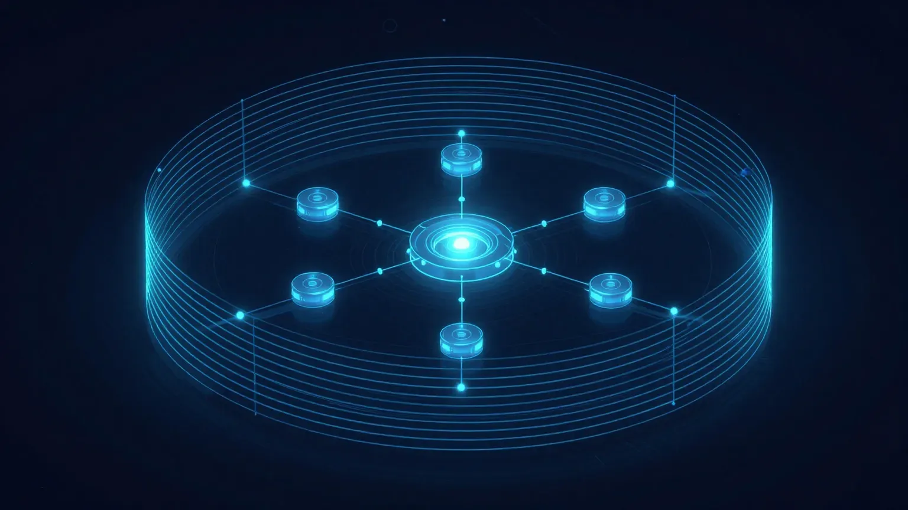
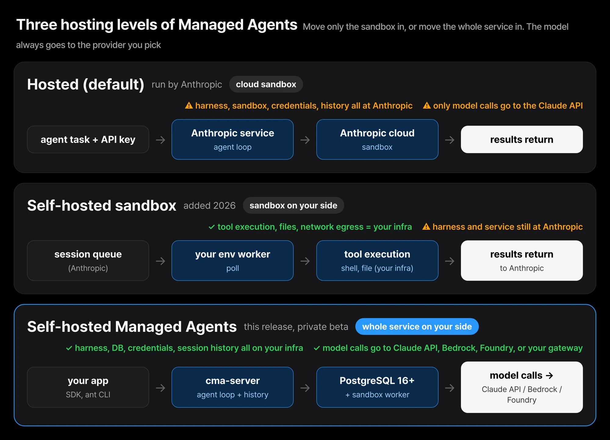
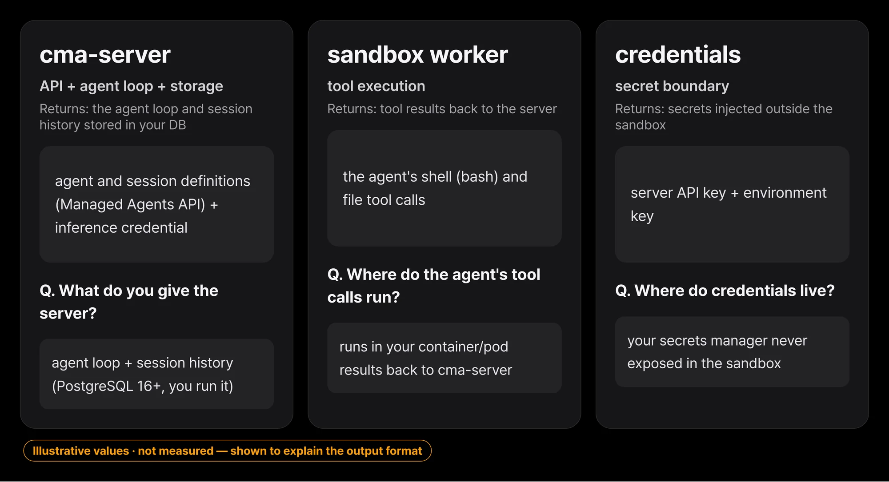
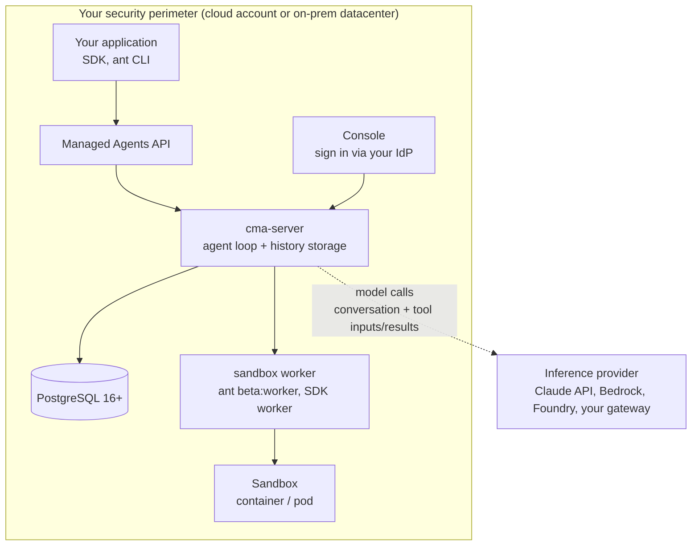

If your team has put an agent into production, you have faced this question. The agent that fixes a broken build in the middle of the night, the one that tests releases, the one that triages alerts, the one that works through your bug backlog. These agents have to run unattended, on your code, with access to your internal systems. But where does the platform that actually runs them live?

Until now there were two answers. Put everything in Anthropic's cloud, or move only the sandbox (the tool-execution environment) to your side and leave the rest of the service with Anthropic. The latter was self-hosted sandboxes. Anthropic has now pushed that answer one step further. Self-hosted Claude Managed Agents is out in private beta: the harness, sandboxes, credentials, and session history all run on your own infrastructure. That means you operate the agents, you hold the credentials and session history, and you even choose where requests to Claude are sent.

In short, putting the platform itself inside your security perimeter is now a first-class deployment option, not a build-it-yourself project. That is the core of this release.

This post looks at the structure of this new deployment option, the security principles it runs on, and which responsibilities move to you when you bring pieces in-house. It is useful for infrastructure owners who want the agent platform inside their perimeter, and for the Paxis team that already runs the same pattern.

*The decision core and the separated execution nodes, drawn inside a containment ring.*

## From moving only the sandbox in to moving one more thing

Managed Agents is a "suite of composable APIs for building and deploying autonomous agents." To take an agent to production you need four things, and Managed Agents gives you all four at once: the harness (the agent loop), sandboxes, credential handling, and session history. The deployment options split by where each of those four runs.

The three steps the docs lay out are in the figure below. The hosted default runs everything at Anthropic. Self-hosted sandboxes, added in 2026, move only tool execution to your infra while the harness and service still stay with Anthropic. And this self-hosted Managed Agents moves the whole service inside your perimeter.

*The three hosting levels of Managed Agents. The highlighted bottom lane is this release.*

For "when to choose self-hosted Managed Agents," the docs give exactly two reasons. First, when you must store agents, sessions, and session history yourself. Second, when model calls must go to an inference provider you choose. If neither applies and you only want tools to run on your infra, self-hosted sandboxes is the right choice, because Anthropic still runs that service for you.

## The server, the database, the workers, the console: the actors inside your perimeter

"One server, its database, and your sandboxes make one deployment." Seeing the actors inside it one by one makes it clear who does what.

- **cma-server**: serves the API, runs the agent loop, and stores agents, sessions, and each session's history. It calls your inference provider whenever the agent needs the model. But this server never directly runs the agent's shell or file tools.
- **Database**: PostgreSQL 16 or later. Without a database the server keeps its data in memory, and a restart erases it.
- **Workers**: programs that take work from the server and run the agent's shell and file tools in your sandboxes. A worker is an `ant beta:worker` command or an SDK worker.
- **Console**: a webpage at the server's address, where you sign in through your identity provider (IdP) to create agents and run sessions.
- **Admin CLI (cma-server-admin)**: creates environments and environment keys. A binary that runs on Linux (x86-64, Arm) and Apple-silicon macOS.
- **Your applications**: your code and scripts, which reach the server with the SDK or the `ant` CLI.

Three credentials are also distinct: the "server API key" held by applications, the `ant` CLI, and the admin CLI; the "environment key" held by the workers that poll the server; and the "inference credential" the server uses to authenticate to your inference provider.

*Server, worker, and credentials: what each actor takes in and returns.*

The network boundary is clearest from how these actors connect. Your applications, the server, the database, and the workers all live inside your network, calling the API, polling for work, and storing in the database. Only one thing crosses the boundary: the model call.

Even that one crossing is precisely worded. For each model call, the server sends "the conversation so far, including tool inputs and tool results," to your inference provider. By default that is the Claude API, and a call to the Claude API also carries the IDs of the session and of that session's agent and environment.

## Only the model call goes where you choose

The economic heart of this deployment option is that you decide where the model runs. The server sends each model call to the inference provider you configure. The Claude API is the default, and you can point it at Amazon Bedrock, Claude Models on Google Cloud (Google-managed), Microsoft Foundry, or your own model gateway.

What matters is that the API does not change. You build agents with the same core APIs as the hosted service, and the SDK and `ant` CLI work against your server. Adopting self-hosted does not require you to have used the hosted service first. Version-pinning headers appear in the docs' examples: `anthropic-version: 2026-10-21`, plus the beta header `anthropic-beta: managed-agents-2026-04-01`.

The data-retention angle follows the same structure. Session history lives in your database, and if your organization has a zero-data-retention (ZDR) agreement with Anthropic, ZDR applies to requests sent to Claude the same way it does to any Messages API call.

## Agent security starts with architecture

The release material says "agent security starts with architecture," and gives four design principles that hold whether Anthropic hosts everything, you host only the sandbox, or you host the whole service.

**The brain and the hands are split.** The harness (the brain) calls Claude; the sandbox (the hands) runs the agent's code. The agent loop, session history, and vault secrets stay outside the sandbox. Sandboxes start only when a tool needs them, and session history lives outside the sandbox as an event log.

**Credentials stay out of the sandbox.** A proxy outside the sandbox adds the credential to MCP tool and supported API calls, and with self-hosting you can also store credentials in your own secrets manager.

**Network access can be limited.** Each environment is bound to a list of allowed hosts, and hosts outside the list are blocked. For a build-fixing agent, that list might be just your git host and your package registry. When you host the sandbox, you set those limits in your own firewall.

**Every session leaves a full record.** It records every step, tool call, and return value, and exports over OpenTelemetry into your existing monitoring.

The four principles are not a feature list. They show how to think given the premise of "giving an agent access to internal systems." Especially the first and second: even as agents keep getting more capable, the execution environment must stay separate from the decision environment. That is an old principle of agent infrastructure, now fixed as a first-class API.

## What comes along when you bring it in-house

Choosing a good option matters only as much as knowing the responsibilities that follow it. The docs candidly list what you operate and secure with this self-hosted Managed Agents: running the server, its database, and your sandboxes and keeping them safe, plus installing each release yourself. What the hosted mode assigned to Anthropic moves to you here. That includes securing the server, hosting memory stores, and detecting unusual usage.

Sandbox isolation is the part that gets missed here. In the docs' words, "the agent's bash tool is a real shell with the worker process's permissions and network access," and "the worker doesn't isolate that shell." Isolation is on you. The Docker Compose stack and the `cma-sandboxes` Helm chart each start a session's worker in its own container or pod; if you run workers yourself, the docs recommend a "disposable container or VM that holds nothing you need to protect."

Multitenancy is another caution. "Each trust level needs its own deployment." You do not mix different trust levels inside one deployment. A change in trust grade means splitting the deployment itself. The software is licensed under the "Software License Agreement: Claude Managed Agents Server," and each release archive ships an operator guide (operator-guide.md) for that version. Onboarding is private beta, by request to your Anthropic account team.

## A familiar shape to ThakiCloud

This release is interesting because we already run the same structure. Paxis is ThakiCloud's Agent-Native Cloud, and its base design separates the environment where an agent executes code from the environment where the decision happens. Paxis's Skill Harness selects from 960+ skills via BM25, runs them in an isolated sandbox, and passes every action through a policy gate and audit log. Mapping the release's four principles onto Paxis layers, a lot overlaps.

| Principle from the release | What Paxis already has |
|---|---|
| Brain/hands split | Skill Harness (decision) and sandbox execution (action) already separated |
| Credentials outside the sandbox | MCP connectors with OAuth auto-reconnect; secrets injected outside the sandbox |
| Network limits | Sandbox egress policy, allowed-host lists |
| Full session record | Audit log as event history, exported to observability |

But the difference the Anthropic release makes is clear. The harness itself is now a first-party artifact that a customer can operate. "Whose brain runs" is no longer an architecture question. It is a deployment option.

On the infra side, the same shape appears. A deployment of cma-server, PostgreSQL, and workers that poll a queue, landing in K8s pods, overlaps how ThakiCloud runs and schedules workloads on Kubernetes. For on-prem or sovereign customers who must keep the agent platform inside their perimeter, there is now a first-party deployment option instead of a build-it-yourself project. This is an architecture comparison, not a product-integration announcement, and the two platforms are not directly chained together.

## Things to know before you write it

- It is private beta. You get access by request to your Anthropic account team, and you do not have to have used the hosted service first.
- Some features exist only on the hosted service. Before deciding, check the docs' "Differences from the hosted service."
- There are no public benchmark numbers yet. This release is a deployment option about "where the platform lives," not a speed or performance claim.
- The operational and security burden moves over whole. The server, memory stores, anomaly detection, and per-release install are all yours.
- The bash tool is a real shell the worker does not isolate. You must isolate it, at the container or pod level.
- Different trust levels need different deployments. Do not expect multitenant isolation within one deployment.

## To close

A first-party answer now exists to "can the whole agent platform live inside my security perimeter." The decision narrows to two triggers: do you have to store agents, sessions, and history yourself, and do you need model calls to go to Bedrock, Foundry, or your gateway. If both are yes, self-hosted Managed Agents. If you only need tools running on your infra, self-hosted sandboxes carry less burden.

Start the first experiment from the lower burden. With self-hosted sandboxes, move only tool execution to your side, confirm the shape where a worker polls and the sandbox comes up as a container, and lift in the cma-server and database when the service becomes necessary. The docs' self-hosted page, the claude.com resource article, and the license page are the source of truth for onboarding.
