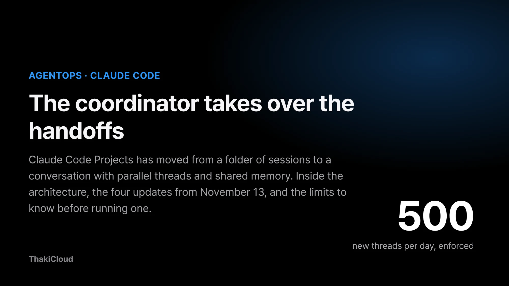
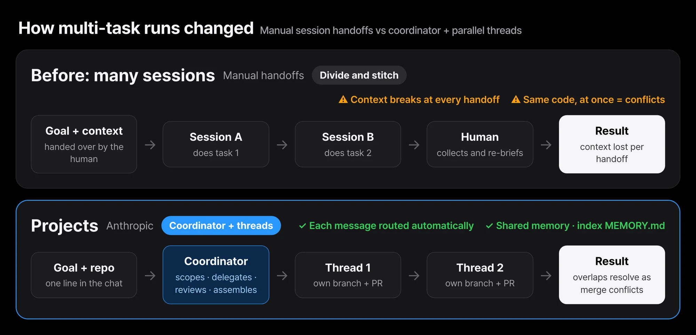
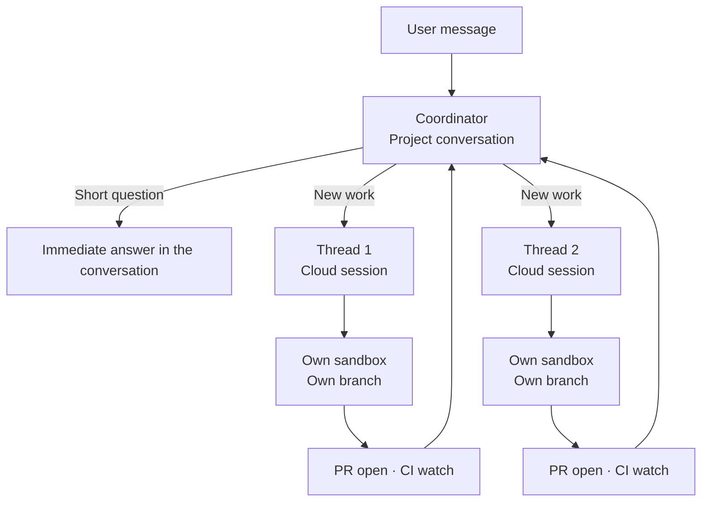
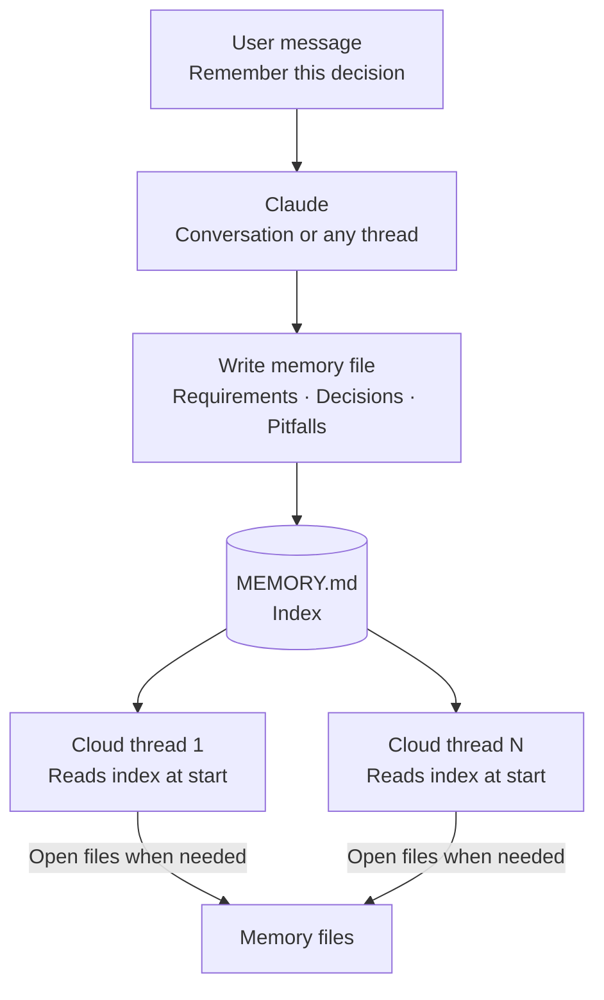

If you run AI coding agents in parallel, you know these three scenes well. You open three Claude Code sessions in the terminal, and the moment one finishes you copy its result and paste it into a new session. You have to re-explain to today's session the decisions you made in yesterday's. When two sessions touch the same file and collide, a human decides which side to keep. This post is for choosing whether to adopt Claude Code Projects.

On November 13, 2026, Anthropic announced a "major update" to Claude Code Projects. Projects is no longer a folder that holds sessions. It is one conversation, a structure in which that conversation directs threads running in parallel. The official docs define a project as "A project is one ongoing conversation where Claude coordinates a stream of related work for you".

One headline number up front. The hard limit for new threads you can create in Projects per day is 500. There is no fixed cap on the number of threads running at once, and the number you ask for is only a "preference". Instead, each thread is a full cloud session, so it burns through plan limits fast.

This post opens up the structure of Projects (coordinator, threads, shared memory), covers the four new features in the November 13 update, and the limits to know before using it. At the end it points to where this structure meets ThakiCloud's Agent-Native Cloud Paxis.

*The core of Projects: one conversation directs parallel threads. The hard limit is 500 new threads per day.*

*Abstract visual: parallel threads converging into one coordinator.*

## In plain terms

Projects is a lot like a restaurant kitchen. This post uses only that analogy.

Old Claude Code was like individual chefs, not a kitchen. Line up three chefs and each one works looking only at their own plate. Dividing the menu, pointing to where the ingredients are, checking the finished dish: all of that was the job of the human head chef.

Projects hands you the kitchen itself. The coordinator is the head chef. When it receives an order, which is a user message, if it is a question it answers on the spot, and if it is a dish it assigns it to a line cook. A thread is a line cook. Each one works at their own station (their own branch and sandbox) and, once done, puts the plate (a PR) on the pass. The order board hanging on the wall (shared memory) is read and written by every cook. When the board says "the ship date moved to Friday" or "that ingredient caused an allergic reaction", a cook who just walked in does not have to ask from scratch.

*The kitchen analogy translated into structure. The top lane is how humans used to stitch work and results together; the bottom lane is Projects.*

## Questions stay in the conversation, work goes to threads

At the center of Projects sits a single "project conversation", and the coordinator runs from there. In the official docs' own words, the coordinator takes in what the user sends, decides what becomes a thread, and tracks every thread it created. It receives the results threads report back, but it does not see every step a thread walked through.

Message routing is the coordinator's job. A short question gets answered right there in the conversation. New work is assigned to a new thread or to an existing thread already working in that area, and it tells you which one. If a single message contains several unrelated tasks, each one becomes an independent thread.

In the public launch article, Anthropic wrote it in five verbs. Claude scopes the request, delegates the work, coordinates parallel threads, reviews the artifacts, and assembles the finished product. The launch article says that if you brief it "like you're briefing a chief of staff", the work gets routed to a new thread or an existing one.

With the November 13 update, the coordinator became "much more proactive", in the official tweet's words. It answers directly in the project chat and reports the status of in-flight threads as updates. In the desktop app, Claude by default posts to the conversation when it writes something, when a thread hits an error, or when your input is needed, and a notification pops up. You adjust the update frequency inside the conversation. Just say "post short updates", "only update when something finishes or gets stuck", or "tell me the status of every thread".

*Three paths a single message can take. The sentences are the official examples, verbatim.*

## Each thread is a line cook with its own station

Each thread is usually a cloud session. Claude Code running in the cloud rather than on your machine, and the reason it is "usually" is that a path to run it on your own computer stays open via Remote Control.

A cloud thread provisions its own sandbox, clones the repo into its own copy, and works on its own branch. When it finishes the job it opens a PR and then watches itself. If CI breaks, it pushes a fix, and when review comments come in, it addresses them. Once the checks pass, it tells you inside the thread.

*The coordinator routes the message, and each thread works in its own sandbox and branch and sends back the result as a PR.*

There is no fixed cap on the number of threads running at once. Quoting the official docs: "Claude starts as many threads as the work demands, and a limit you ask for is a preference, not a cap. The enforced limit is 500 new threads per day across your projects."

The default for new projects is Opus everywhere. Threads start at high effort, and the coordinator conversation starts at low effort. The docs say that "running every thread at Opus high effort is the fastest way to burn through your plan". You can tell an individual task "do this with a smaller model", and a running thread can be switched with that thread's model picker.

One warning to note. A cloud thread's sandbox is paused between turns and resumed when it continues. If it cannot resume, it starts again from a fresh clone, so uncommitted changes can be lost. The docs' recommendation is simple. For long tasks, it is safe to ask Claude to commit and push its work in progress.

## The order board on the wall: shared memory

Like in the kitchen story, every thread writes to shared memory and reads from it.

By the official definition, project memory is "notes Claude keeps about the project". Requirements, decisions, pitfalls, all of it stored as files. Every cloud thread reads the index file MEMORY.md at start and opens the other files when it needs them. Say "remember this" or "forget this" in the conversation or in any thread, and Claude writes or deletes the file.

Project instructions are separate. Up to 16,000 characters, sent to the Claude in every new thread and in the project conversation.

*Shared memory is files. Every time a new thread starts it reads the index, and opens files when it needs them.*

Claude also remembers how you work and how you communicate. It stores its own project memory with the check-in cycle, how often new threads start, and the level of detail in updates, and follows it in later cloud threads. But in the docs' words, these are "instructions Claude keeps", not enforced settings.

This is where it diverges from local Claude Code habits. A cloud thread receives nothing from the local machine's Claude Code configuration. It reads the CLAUDE.md and .claude/rules at the repo root, but skips the CLAUDE.md files in subdirectories and the path-specific rules. Skills, settings.json, and .mcp.json do not load into the thread. MCP is replaced by connectors, plugins by project settings, and permission rules by in-thread approvals.

Alongside memory comes a library. A place where files you uploaded and artifacts Claude created collect. The explanation is that it makes related material easier to find and lets new work build on past effort.

## November 13: four things changed

The center of this update is the coordinator's proactivity. It no longer waits for you to come back and check. It answers in the project chat and posts updates on in-flight threads. The burden of remembering "what did I assign to which session" comes off your shoulders.

The second is /btw and /fork. /btw pulls a side question off into its own dedicated thread so the current thread does not drift off topic. /fork splits one new thread off from the one you are in. In kitchen terms, it is the difference between asking the head chef something mid-cook and opening a new station.

The third is thread reminders. You can set a reminder on any thread, or just tell Claude to remind you. Until then the thread stands down, and when the time comes it returns and brings that work up in the project chat.

The fourth is read-only thread links. You can share an individual thread with anyone logged into Claude via a read-only link. Open the thread menu and pick Share. Threads with access to your computer cannot be shared.

One thing to pin down precisely. /btw, /fork, reminders, read-only links, and the proactive coordinator are part of the official November 13 announcement. At the time of writing, the docs page has not caught up yet. The sentence "you cannot share a project or its threads with other users" is still there, and what that means is the rollout is in progress.

Availability, per the docs. It is a public beta on the Pro, Max, and Ultra plans, expanding in stages. It works on Web (claude.ai/code), the desktop app, and the latest mobile app. It is not offered in the terminal CLI or in the VS Code and JetBrains extensions. If you do not have access yet, you can join the waitlist.

## Things to know before you start

The first is burn. Because each thread is a full session, Projects consumes plan limits faster than a single session. The docs say "Especially on the Pro plan, expect to hit your limits sooner on days you run Projects".

The second is auto-resume. When a thread or the project conversation stops at a usage limit, it waits. Left at defaults, it picks itself back up when the limit resets. The same holds whether it is the 5-hour window or the weekly window. This setting applies to the whole project, so if you do not want it to keep running past a certain point, you have to stop the project before then.

The third is cache. Cache validity is set to 1 hour within plan limits. A thread idle for longer than that re-reads the entire conversation. It gets slower and burns more.

The fourth is control. During the beta there is no organization-level control. Changes to instructions, repositories, plugins, and environment settings propagate to new threads only, not to threads already running.

The fifth is the ground. Only github.com is supported; GitHub Enterprise Server, GitLab, and Bitbucket are not. You also need to install the Claude GitHub App. Deleting a project permanently removes its threads, memory, and files, and it cannot be undone. Branches and PRs already pushed to GitHub are not affected.

| Surface | Projects |
|---|---|
| Web (claude.ai/code) | ✅ |
| Desktop app | ✅ |
| Mobile app | ✅ |
| Terminal CLI | ⚠️ Not supported |
| VS Code · JetBrains extensions | ⚠️ Not supported |
| Bedrock · Agent Platform · Foundry | ⚠️ Not supported |
| github.com | ✅ |
| GHES · GitLab · Bitbucket | ⚠️ Not supported |
| Pro · Max · Ultra plans | ✅ Public beta |
| Team · Enterprise plans | ⚠️ Not yet offered |

## Paxis already has this structure, and the control plane is on the enterprise side

Decompose the structure of Projects, and it overlaps with the pattern ThakiCloud Paxis runs.

The coordinator is Paxis's DAG multi-agent orchestration. It takes a goal, breaks it down, assigns, checks, and assembles. A thread's own sandbox and branch is Paxis's Sandbox isolated execution. Shared memory, that is the MEMORY.md index and its files, is the location Paxis's HKE wiki knowledge engine uses. The common point is that knowledge and decisions are first-class resources.

The defaults are interesting too. The coordinator starts at low effort, threads at high effort. The expensive model sits where the work is, and the coordination side stays light. That is the intuition behind cost-aware routing. In Paxis, the model and effort per task are first-class resources of the policy gate, and they come from the same problem space as this structure's thread model picker.

The difference is not the shape of the structure, it is the location of the control plane. Projects is a personal tool. During the beta there is no organization-level control, a project belongs to one user, and a thread cannot be moved or copied to another project. Paxis is an enterprise control plane. Skills, Tools, Policies, and Audit Logs are first-class resources, and every action passes through the policy gate and the audit log. The economic question of "each thread burns a session's worth" is, on the platform side, the same shape as the question Kueue quota answers.

## In closing

Projects is the work of "stitching sessions together" turned into a product. The coordinator takes the message and routes it, the thread works on its own branch and sends back the result as a PR, and shared memory does not let decisions evaporate. The four items from November 13, the proactive coordinator, /btw and /fork, thread reminders, and read-only links, are work that finishes off the edge of that structure.

The first experiment you can run today is small. If your plan is Pro, Max, or Ultra, find Projects in the sidebar (or inside More) of claude.ai/code or the desktop app, and if it is not there, join the waitlist. Start with one goal you can chase in parallel, and just check whether the thread opens its PR properly and whether decisions get written to shared memory.

If you are building your own agent platform, read the limits section of the docs page first. The absence of organization control, the fast limit burn, and cloud threads not recognizing local settings. It is good to check these three with your own eyes first. Where the shape is the same and the control plane is different is exactly where you have to design.

## References

- [Claude Code Docs · Let Claude coordinate ongoing work with Projects](https://code.claude.com/docs/en/claude-projects): canonical source for structure, defaults, and limits
- [Projects redesigned: from folder to conversation](https://claude.com/resources/articles/projects-redesigned): the launch announcement article
- [@ClaudeDevs November 13 announcement tweet](https://x.com/ClaudeDevs/status/2121375309287301360): the four new features, public beta
- [Projects waitlist](https://claude.com/form/projects)
