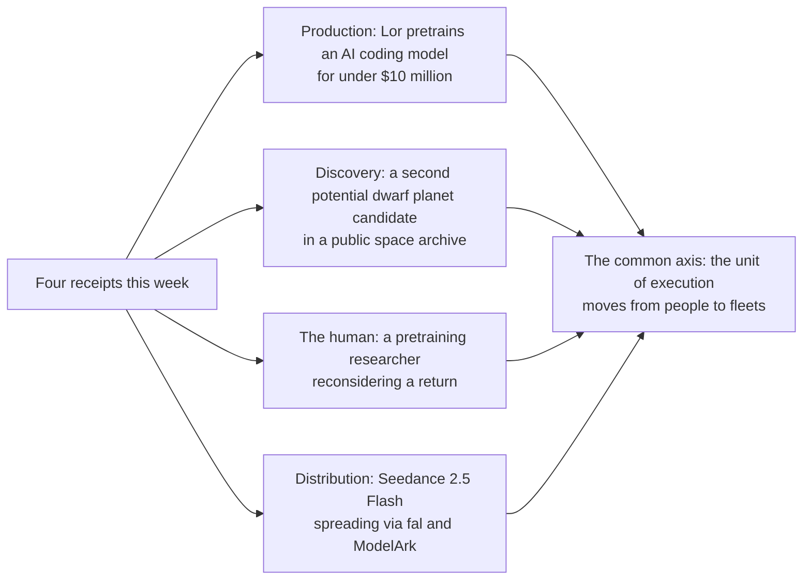

Reading the four stories from this week, you can see them converging in one direction. Research labor is moving to a nonhuman workforce.

Let's start with the two strongest pieces of evidence. On Thursday, Mirendil announced that its research platform Lor orchestrates hundreds of autonomous agents to pretrain an AI coding model for under $10 million. That same Wednesday, researchers using the Claude model found a second potential dwarf planet candidate in a public space archive.

On the other side, the pretraining researcher who left Anthropic over safety concerns is reconsidering a return, and ByteDance's video model is spreading across third-party platforms. The common thread among these four is not that AI has gotten smarter. It is about who does the work and what it costs. This week, the answer to that question shifted in a way you can actually see. We are past the era of treating AI as a tool, and standing at the threshold of an era where organizations must be built around AI workforce units. Let's go through the receipts one by one.

*The execution layer of research moving from individuals to fleets, visualized.*

## Under $10 million, without a research lab

Let's look at the structure of Mirendil's announcement first.

Lor is a research platform, and the way it works is orchestration. Hundreds of autonomous AI agents write software, run scientific experiments, and work in parallel. And the new Lor platform, per the announcement, pretrains an AI coding model for under $10 million.

Pretraining is the stage where you train a model from scratch to give it its base capability. It is not fine-tuning; it is the heaviest work that comes before fine-tuning. Historically it was a domain of a few, premised on massive capital and large-scale compute, and in that structure the scarce inputs were talent and compute. But when the execution layer is taken by an agent fleet, scarcity moves to the ability to coordinate the fleet and verify the outputs.

Here, "orchestration" is the key word. It is not hundreds of agents each working on their own; it is a structure where one platform assigns tasks and aggregates the results. It is no exaggeration to say that research has now become an object of project management.

Verification deserves separate attention. The more the execution layer shifts to agents, the more the human role converges on judging whether the outputs are correct. And that judgment becomes the bottleneck, because you cannot tell, by walking the floor, whether hundreds of agents are doing useful work. You only know once it is made visible through logs, metrics, and spot checks. That is why this week's news evaluates "orchestration" and "verification" bundled as one capability.

The number itself is a signal, but the deeper signal is its position in the pipeline. If this structure is reproduced even a little outside Mirendil, the cost baseline of the model industry will quietly shift. Pretraining stops being a large investment that comes to the board table and becomes a project a team can approve at the operational level. That is a change in the level of the decision-maker. Saying the cost baseline shifts also means the cost structure of the research organization itself changes, not the cost of making one model.

## The week the output was a dwarf planet

The second receipt came from the science side.

On Wednesday, Will DePue and his team found a second potential dwarf planet candidate in a public space archive. The input was telescope footage already stored in public archives, including NASA's. No new observation, no dedicated telescope time. Just one analysis workflow that runs the existing archive over a model called Claude. That is all.

The data already existed, the observation was already done, and the only new thing written was the analysis workflow. It is reprocessing, but the output is a discovery. Once that happens, "a discovery" becomes a reproducible process.

A second implication comes with it: the cost of research starts to separate from the cost of equipment. In conventional science, securing observation time for a single discovery was itself a huge cost. But when the model takes on the analysis layer, the remaining cost is running the archive through once. The archive is public, and one pass is within reach of any organization.

What stands out is the form of the output. The output of agent labor may now be neither a product, a service, nor a paper. It could be an astronomical object. And the phrase "second" carries weight. It means this approach is repeatable. Find one, then find the next, and the archive itself becomes a production line. The larger the fleet, the more the success or failure of this judgment stage decides the success or failure of the output.

The researchers set the goal, the agents run it, and humans verify. The three layers of goal-setting, execution, and verification have actually been quietly separating for a long time. What changed this week is that the speed at which the execution layer moves to AI shifted sharply.

## Humans in between

The human story moves in the opposite direction.

Pretraining researcher Jacob Coxon left Anthropic, citing safety concerns, in a departure big enough to become a story in itself. This week, reports came out that he is reconsidering that decision and may return to AI research. It has not been confirmed whether a return is settled. Either way, what he is choosing now is not simply one job. Whether to stand back at the center of the work called pretraining is the question.

It is more accurate to read this as a signal of industry gravity than as personnel news. The reason for the departure was a safety issue, not salary or headcount. Yet the fact that he is reconsidering a return means the research field still has a strong pull on people.

From a company's viewpoint, you can go one step further. Hiring one person and acquiring one capability are different things. The line between an organization that can pull off pretraining and one that cannot may no longer be headcount alone.

Put differently, the order of the questions a company faces changes. From "do you have the talent that can do it" to "can you reproduce the work that talent did." In a structure where the execution layer is a fleet, the answer to that second question comes from orchestration ability, not headcount.

But there is a contrast. The labor of pretraining that Coxon left behind is moving to the side that an agent fleet produces for under $10 million. The value of the human workforce condenses at the line the fleet has not yet crossed: goal-setting and safety boundaries, and verification. Safety boundaries are not just a modifier here. Because Coxon's reason for leaving was safety, the position of the one who draws the boundaries has grown more important. The wavering of the researcher and the labor of the agents are two sides of the same coin.

## Models ride the fleet to spread

The last receipt is distribution.

On November 15, the expanded distribution of ByteDance's video generation model Seedance 2.5 Flash began. It is provided through the fal platform and ModelArk. Even a big tech frontier video model now reaches users through a third-party service fleet.

The era when models stayed inside their own company, and the era when they flow through multiple platforms, make a company's options completely different. Which model, which route, at which cost to run becomes an operational judgment. The fact that Seedance 2.5 Flash flows through fal and ModelArk alone makes "which model to use" a judgment that changes on a weekly basis. That is why I folded the distribution news into the "unit of research" story. The route a model arrives on is exactly how you assemble a fleet. Compressed to one line, this week's digest is the same story told from three angles: Lor does production, the dwarf planet does discovery, and Seedance does distribution.

The unit that does the work and the route that carries it are both being reorganized as "fleet." In that fleet, the position of the human researcher is not disappearing but condensing. Because of this, this week reads less like AI industry news and more like org chart news.

## If fleet is the unit, what about boundaries

From here I will use a business lens, because this fleet ultimately has to run inside a company.

The fact that hundreds of autonomous agents write software and run experiments is, for the organization that hosts that fleet, the hardest governance problem. Which agent may touch which tool, under which policy, with which model. This is a question that needs an answer before the work begins.

Substituting Mirendil's case into a company makes it clearer. Execution must happen in isolated space, allowed actions must be spelled out in policy, and a record that explains the result later must remain. The more autonomous the agent, the weaker these three tend to be.

And the models a fleet calls are more than one. The task of helping pretrain, the task of running experiments, and the task of organizing documents each call for a different model, and the cost per call differs. "When to call which model" becomes part of governance.

The DePue case shows another delicate problem: where the input data sits. This time it was a public archive, so there was no issue. But the moment a company's private data becomes the fleet's input, where to run the analysis becomes a data sovereignty question. Where the model is and where the data are are separate things, and now a problem where the two can diverge.

"Under $10 million" is also the other face of the cost problem. A fleet that picks a model per task can hold the baseline; a fleet that does not dilutes that baseline in an instant. It is the point where cost control becomes a first-class requirement alongside safety.

This is exactly where ThakiCloud's Paxis fits in. Paxis is an Agent-Native Cloud, and v1.1 has been released as a formal product. Skills, Tools, Policies, and Audit Logs are first-class resources, and autonomy is managed in stages from L0 to L3. A policy gate checks before an agent acts, and every movement is left in an audit log. Execution happens inside an isolated sandbox, and CostRouter picks a model per task. MCP connectors and a skill market connect external tools to the fleet too, and it supports sovereign and on-prem K8s deployment.

Lor's "orchestration," DePue's "verification," and Coxon's "safety boundaries." Tying these three into a single operating system is ultimately the organization's choice. Research is moving to the fleet. That is this week's signal. A company has only one task left: within whose boundaries does that fleet run.

## References

This post synthesizes the following news:

- HuggingNews, [Mirendil's New Lor Platform Pretrains AI Coding Model for Less Than $10M](https://huggingnews.com/ai/mirendils-new-lor-platform-pretrains-ai-coding-model-for-less-than-10m-64cbb21e)
- HuggingNews, [Will DePue Finds Second Potential Dwarf Planet in Public Space Archive](https://huggingnews.com/ai/will-depue-finds-second-potential-dwarf-planet-in-public-space-archive-99c7ee2e)
- HuggingNews, [Jacob Coxon May Return to AI Research Following Viral Departure From Anthropic](https://huggingnews.com/ai/jacob-coxon-may-return-to-ai-research-following-viral-departure-from-ant-fc52cca4)
- HuggingNews, [ByteDance Launches Seedance 2.5 Flash Video AI on fal and ModelArk Platforms](https://huggingnews.com/ai/bytedance-launches-seedance-25-flash-video-ai-on-fal-and-modelark-platfo-08fc0b7f)
