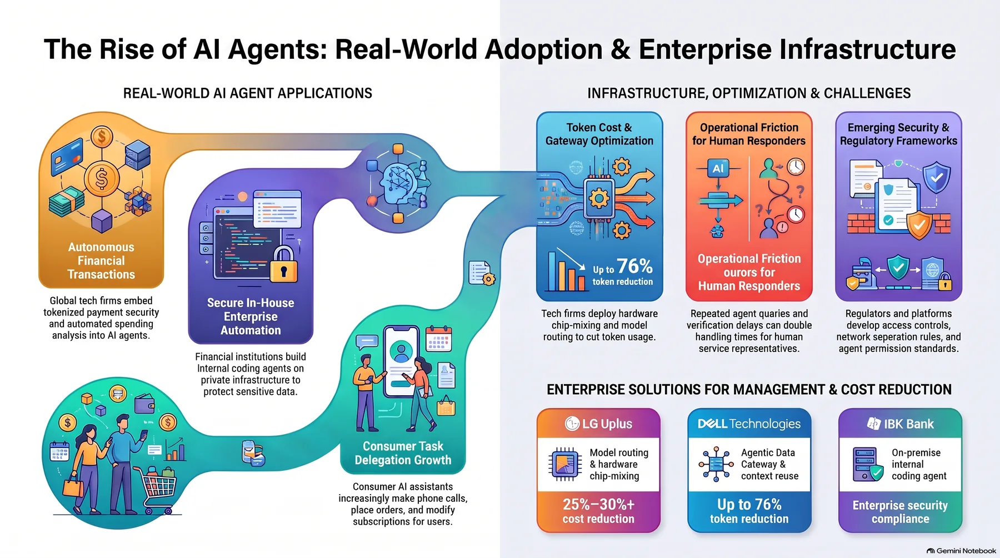
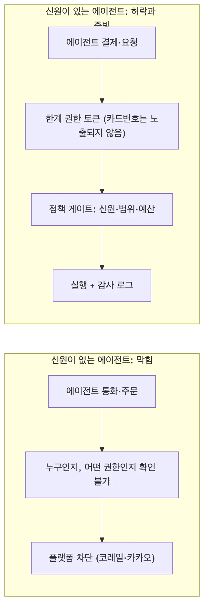
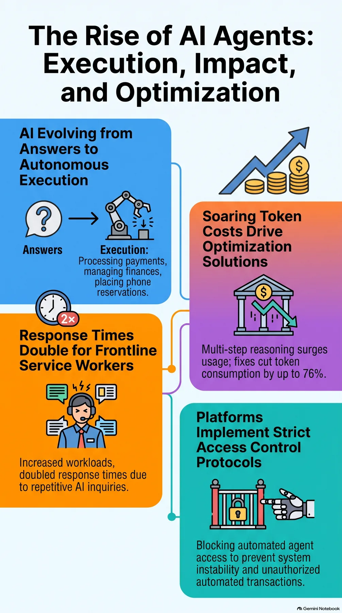

A restaurant in Seoul. At the time when evening customers crowd in, the phone rings. "Hello, I'd like to book a table for two at 7 tomorrow." The voice is polite and measured. When the owner asks whose order it is and on what authority, the same script is repeated on the other end of the line. This is not an imagined scene of a call that just came in from somewhere. It is reconstructed from what Chosun Biz reported after gathering testimony from self-employed owners and call center operators. The caller on the line is the AI assistant "Pickel".

That phone has been ringing every day across Seoul over the past two weeks. This morning's digest confirms this single scene repeatedly, through eight separate news stories. Agents have started acting in the physical world, and the world has not yet learned how to verify them. This post follows that one line and picks only the facts that came out today.

*The agent's call, and the identity gate that is not yet connected.*

## One Phone Call, Two Numbers

The demand-side number is remarkable. Pickel's daily active users (DAU) grew from 5,694 right after launch to 99,828 in about two weeks. That is more than 17x. It sits at number 3 among all free apps on the Apple App Store. With just an account link, it places product orders on Naver, Coupang, and Danggeun on the user's behalf, makes restaurant reservation calls itself, and even handles plan inquiries with telecom customer centers. The user is the one who gets the convenience. Where earlier generative AI stayed at the level of answering questions and providing information, today's agents connect to external services on the user's instruction and perform real tasks such as phone calls, reservations, and orders.

The number on the other end of the line is different. According to restaurant owners and call center operators, the AI repeats the same questions and fails to convey requests accurately, so handling time doubled. Some businesses announced that they will no longer take calls from AI assistants at all. The Public Transport Workers' Union demanded a response, saying that the authority of an AI acting on behalf of a user is hard to verify, and the platforms' first reaction was blocking. Korail cut off access from automation programs such as macros and AI agents. Pickel's KakaoTalk integration was suspended one day after it went live.

At the moment of meeting, there was no option to verify who is calling. So the first means became keeping callers out. What Korail's and Kakao's responses suggest is that the governance collision between the spread of agents and the existing service ecosystem has now fully begun. The first public friction of the agent economy is not a failure of capability, but a collision at the meeting. The agent is already the customer. The side that receives customers simply does not yet have a system for asking those customers who they are.

<!-- nlm-visual -->

*Infographic generated by NotebookLM from the sources.*

## The Other Side of the Same Digest: People Drawing "Verification"

The same day that phone calls were being blocked in Seoul, the other stories in today's digest showed identity designs being drawn.

OpenAI was one step further ahead. According to a Consumer Times report, OpenAI launched the "ChatGPT Wallet" in the United States, linked to American Express, Mastercard, and Visa, and let its AI agent "dots" perform payments on the user's behalf. The core of the design is this. At the moment of payment, it uses the card network's payment token instead of the actual card number, so that neither the merchant nor the agent receives the card information. The agent can spend money, but it cannot know the card number. Google chose a different axis. It linked Google Wallet to Gemini to provide spending chart analysis, subscription management, and year-end budget suggestions, while excluding anything that moves money, such as transfers and investing. One is the axis of moving money, the other the axis of looking at money. Where earlier AI stayed at providing information and summarizing, agents now intervene directly in the flow of funds. This is exactly the point where agent commerce begins in earnest. What the two giants chose side by side is the discipline of giving the agent less information than it needs.

The institutional side is moving too. The same report says the Financial Services Commission is expected to release an AI agent adoption roadmap around year-end.

Dell drew the enterprise version. At Supercomputing 2026 (SC26) in Chicago, it unveiled the "Agentic Data Gateway", which manages per-agent data and tool access from one place. External agents can also connect through MCP (Model Context Protocol), and each request gets an identity, access scope, and budget applied, with the processing tracked. In an internal test in September, under conditions of synthetic data, 20 questions, and 6 task types, token consumption dropped by up to 76% and answer accuracy rose from 60% to 94%. Those are Dell's internal test figures, not actual customer results. The new feature starts shipping in December. The competitive landscape is already fierce. While F5 promotes its next-generation AI gateway for agentic AI on governance and cost optimization, Symantec and Snowflake have also put MCP governance up front. That is a signal that "agent data access management" is breaking out as a separate product category. The differentiator Dell pushes is a multi-site approach that runs the pipeline where the data lives, whether in a private cloud, external infrastructure, or public cloud, with its on-premises strength as the background. It has more than 6,500 existing AI Factory customers.

In Korea, the finance sector is moving from the inside. The reason financial institutions are wary of external commercial agents is security and data sovereignty. An agent that must keep data inside the bank ultimately needs the execution infrastructure itself. According to a Newsian report, the Industrial Bank of Korea (IBK) built its own AI coding agent "Jenny Code" on the bank's internal infrastructure rather than an external commercial agent. When an employee requests in natural language, it performs everything from analyzing reports and Excel materials to developing business programs. The order is that AX leads in head office departments operate it first, and after stability verification and feature refinement, it is expanded in stages. The goal is an "AI-native bank". Shinhan Bank announced 21 self-developed AI agents. SK Inc. declared in its quarterly report its leap to an "AI default" company, and is building an integrated agent platform equipped with an AgentOps loop that detects performance degradation and cost increases in advance. It is also developing personalization memory technology with user-approval-based extraction and lifecycle management, deep agents, and a multi-agent coordination system.

There are many stories, but the question is one. Whether it is payment, data, or code, what is asked before allowing an agent to act is the same. Who are you? How far are you allowed to reach? Can you prove it later?

## Without an Identity Card, What Remains Is the Door

The same agent request ends in a completely different place depending on whether it carries an identity. Laid side by side, the difference between blocking and permitting is easy to see.

*An agent without an identity ends in a block; an agent with an identity ends in a least-privilege token and an audit log.*

If you cannot verify, the other side's options narrow. Korail's blocking policy and the restaurant owner's "we will not take them at all" are the same move. When an agent cannot make its identity clear, the world apparently had no answer other than closing the door.

This is the price of a capability-first strategy. The 17x growth curve hit a wall that nobody had built, and the friction was paid by the people on the other end of the phone. Doubled handling time is an invoice in the name of labor cost. That is not the only cost. Look at the figures BizHankook reported. An agent goes through about 20 steps to produce one result, and internal reasoning that never shows on screen accounts for more than 80% of the total cost. By OpenRouter statistics, global token consumption grew about 35x in one year. Over the same period, the unit price fell about 80% by big tech's standard. The structure has become one that uses cheaper tokens in greater volume. Agent operations are recorded in two ledgers at once: the labor ledger and the token ledger.

So the first question for a company must move from "how fast can it do it" to "can it prove it later". And a miniature of that answer is already in today's news. The payment token structure of dots, in other words a design that separates capability from secrets and puts only a least-privilege token in the agent's hands. Extend that schema to internal data, purchasing, and code, and each request gets an identity applied, the permission scope is set in advance, and the processing trace remains in a ledger. When an agent is given an identity card, the conversation with the other side changes from "block it or take it in" to "what to permit and what to prove". The Pickel case also opened a demand. A "company that receives calls from agents" now has to build its own receiving system. Outbound call quality and inbound verification are both areas that are becoming infrastructure.

## Paxis: Not the Sound of a Phone, but the Audit Record

Paxis, ThakiCloud's Agent-Native Cloud, takes this scene as its lens. Paxis is a formal product released at v1.1 GA, and the answer it offers is infrastructure, not a policy document.

Paxis governs Skills, Tools, Policies, and Audit Logs as first-class resources. Every action of an agent runs as a skill that has passed a policy gate, and autonomy is divided under governance from L0 to L3, so it is set in advance how far the agent decides by itself and where it gets human approval. Every execution remains in the audit log, so it can be proven later whose action it was, under what authority, and what was done. The isolated sandbox keeps execution inside a boundary that does not affect its surroundings, and MCP connectors and the skill marketplace connect tools and data as channels with an identity rather than as wild phone calls. CostRouter picks a model per task, so the 20 steps of internal reasoning do not inflate the bill. In finance and public sectors where sovereignty is the issue, Paxis is installed on on-premises K8s (ai-platform), so the boundary itself can be kept inside one's own territory.

The receiving side has the same problem. A company is now both a sender that puts out its own agents and a receiver that takes calls from other companies' agents. Detecting incoming agents, verifying their authority, and leaving the exchange in a ledger are the mirror image of the same capability. What Pickel's two weeks showed is that the demand for this mirror is real, not speculation.

## When the Next Phone Rings

Pickel went 17x in two weeks. If the agent adoption curve moves at this speed, there are still more walls to hit before the protocols catch up. The Financial Services Commission's roadmap is around year-end, and the platforms' blocking will soon turn into rules. December is the watershed. When Dell's gateway starts shipping, companies will have to ask what the criterion of choice is. Buy an external gate and bolt it on, or embed it in the execution environment from the start. The agent's identity card is moving from nice to have to required to get in. The speed race is already one round over. The race starting now is won by the company that first makes agents verifiable, restrictable, and provable.

The restaurant phone will keep ringing. What changes is whether, when it rings, the other side can verify the caller's identity. ThakiCloud's answer to this question is Paxis. Not making calls faster, but making calls trustworthy.

<!-- nlm-visual -->

*Infographic generated by NotebookLM from the sources.*

## References

This post was written by synthesizing the news below.

- Consumer Times, [AI Makes Payments and Analyzes Spending: OpenAI, Google Launch Services in the US](https://www.cstimes.com/news/articleView.html?idxno=728098)
- TokenPost, [Dell Unveils Data Gateway for Enterprise AI Agents; New Feature Ships in December](https://www.tokenpost.kr/news/ai/439180)
- Chosun Biz, [AI Assistant Makes Even Reservation Calls: Users Find It Convenient, Operators Say "It Takes Twice the Time"](https://biz.chosun.com/topics/topics_social/2026/11/17/MAIZ7H6CFJDLDEBOSDZSM2G43E/?utm_source=naver&utm_medium=original&utm_campaign=biz)
- Newsian, [[Finance Pick] Industrial Bank of Korea Builds Its Own AI Coding Agent "Jenny Code", and More](https://www.newsian.co.kr/news/articleView.html?idxno=101380)
- BizHankook, ["The Trick to Cutting AI Bills Is About to Become a Revenue Model" LG Uplus "Token Optimization Recipe..."](https://bizhankook.com/articles/lguplus-recipe-token-strategy.html)
- Financial Post Korea, [[Analysis] SK Inc. Leaps to an "AI Default" Company... Revolution Through Next-Generation Agent Architecture...](https://www.financialpost.co.kr/news/articleView.html?idxno=301325)
