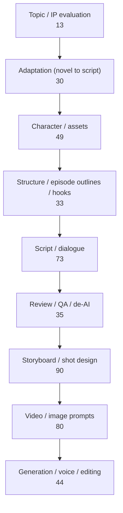
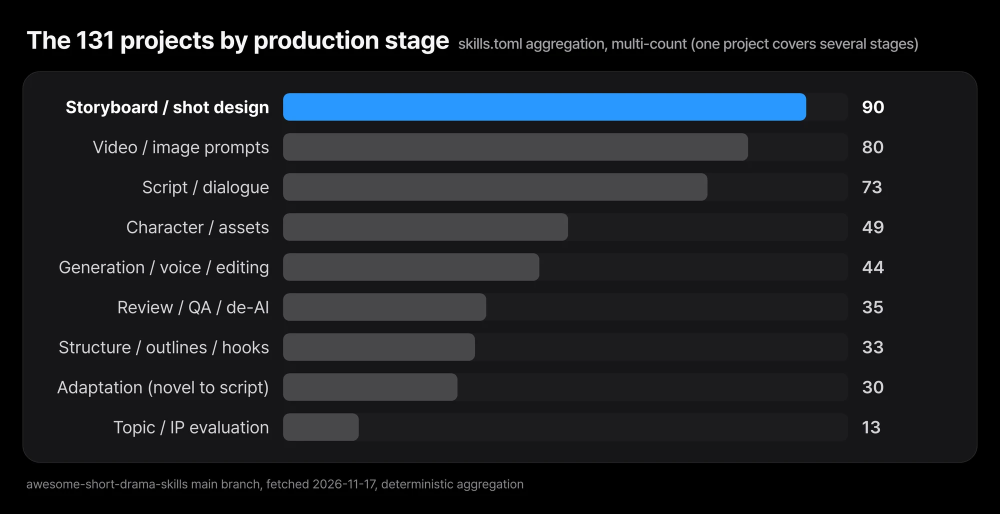
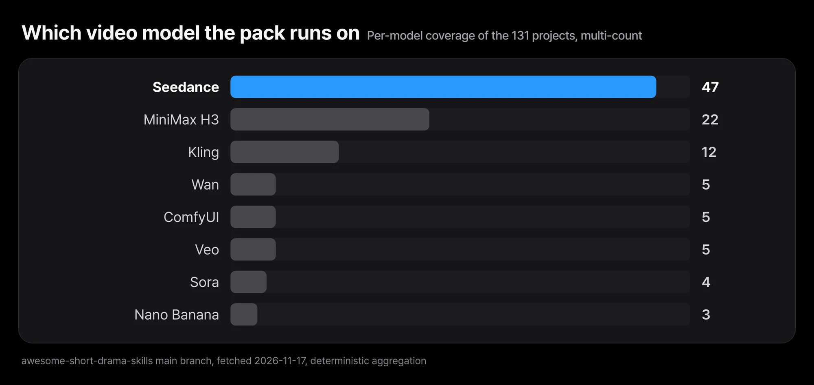
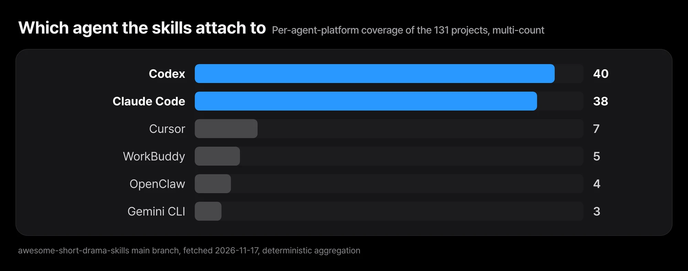
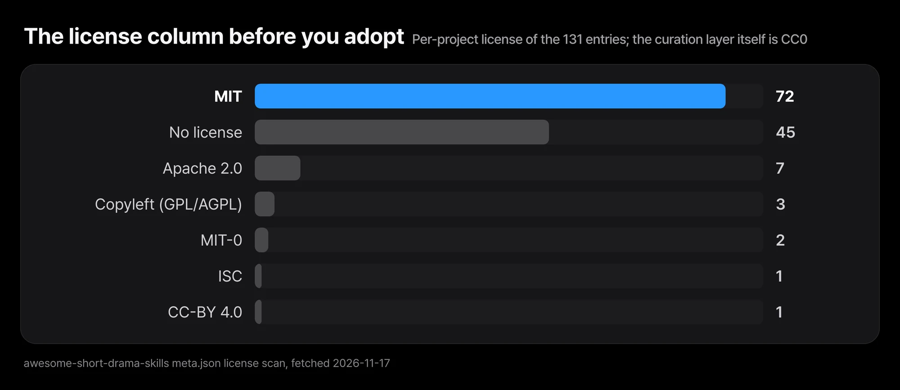
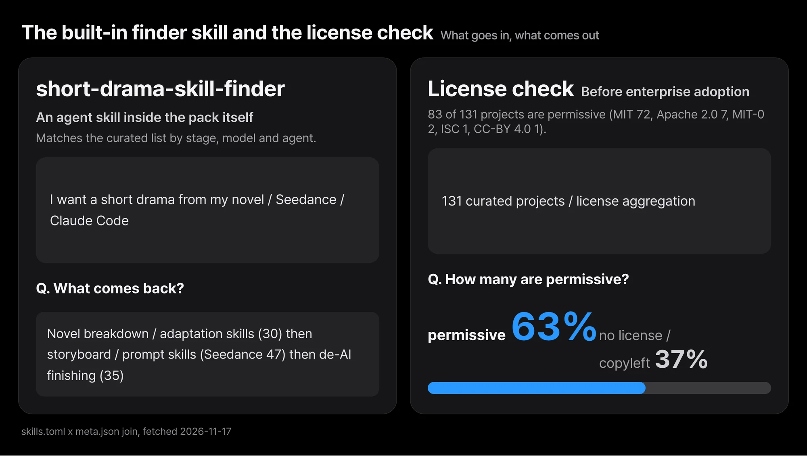

*131 skill projects, indexed on three axes. The structure is the point, not the count.*

If you run vertical video content, short dramas and comic dramas, as a pipeline on top of a coding agent, this post is for deciding whether to adopt this skill pack, and what to borrow from it even if you do not. On November 17, VibeEverything's "86 useful skills for making AI short dramas" did the rounds.

Plot, script and hooking, storyboards, locked character sheets. Practical skills organized by production stage, with per-model prompt skills for video models like Seedance, Kling and MiniMax. With hundreds of skills in circulation, a pack that curates the entire vertical of short-form video production is a new kind of object.

The conclusion first. The number 86 is already dated. The repo holds 131 projects, and it gained 16 in a single day. The interesting thing is not the count, it is the structure: indexing on three axes of stage, model and agent, and embedding a finder skill inside the pack that consumes that index.

That is the shape agent-native skill curation should take. This post pulled the pack's data, aggregated it, and lays out what to take from the structure.

## A curation whose numbers move

The pack's source of truth is the awesome-short-drama-skills GitHub repository. Maintained by UnderleveledBuilder, with 2.5k stars, 300 forks and 96 commits. shortdramaskills.com serves the same data as an index.

The data splits into two layers: the layer people write and the layer machines crawl. skills.toml is the human layer. Each entry carries the repo, a summary, group, stages, models and agent tags, and a checked date marking the day a person cross-checked the curation info. meta.json is the machine layer.

scripts/refresh.py pulls stars, forks, licenses, SKILL.md counts and last-commit dates from the GitHub API. Human-checked classifications and machine-refreshed numbers meet in one repository. That structure is also the premise of the evals and the license column covered later.

The numbers, in order. The tweet said 86. The site's data.json said 115 skill projects, updated 2026-11-16. The repo's skills.toml main branch, as I pulled it on 2026-11-17, held 131. Sixteen in a day. Inside the week the tweet went out, the count grew from 86 to 131, close to fifty percent.

The velocity looks deliberate. The repo takes external contributions through a Suggest-a-skill issue, and stars refresh every Monday. Curation that is a river, not a mountain. So every number in this post is "as of the 2026-11-17 pull," and any citation should carry the date with it.

## Three axes: stage, model, agent

Spread the 131 projects over three axes. The first axis is production stage, nine of them.

*Nine production stages and per-stage coverage. The numbers are multi-counts: one project covers several stages, so they sum past 131.*

Bar order is production order. Storyboards 90, prompts 80, scripts 73. The back end, the layer that feeds the video model, holds the most projects, and the entry stage, topic selection, the fewest. Judging an IP still takes a human, it seems.

*Bar order is production order: the back end (storyboards, prompts) holds the most projects, the entry stage the least.*

The second axis is the video model. Seedance 47, MiniMax H3 22, Kling 12, Wan 5, ComfyUI 5, Veo 5, Sora 4, Nano Banana 3. Forty-seven of 131 lean on Seedance. The distribution shows you which model the actual production line in the vertical video market runs on.

*Seedance holds 47 of 131 — the distribution mirrors the actual production line of the vertical video market.*

The third axis is the agent platform. Codex 40, Claude Code 38, Cursor 7, WorkBuddy 5, OpenClaw 4, Gemini CLI 3. The skill attaches not only to the model but to the agent itself. The tag "this skill is written for Claude Code" is a first-class classification axis.

The six tags sum to 96 against 131 entries; the roughly 35 entries with an empty agent field mean "the author did not state one," and SKILL.md-style skills are presumed to work in any agent. Untagged entries drop out of the search axis, and that is the practical implication of this axis.

*Codex 40 against Claude Code 38 — near parity, because many skills are dual-tagged and the skill body is agent-neutral.*

The Codex and Claude Code near-parity, 40 against 38, deserves a look. Many skills are dual-tagged, and the pack answers the question "do we build a separate skill per agent?" with its own data: the skill body is agent-neutral, and the attach points are many.

The group split sharpens the picture. visual 54, pipeline 35, platform 16, writing 11, source 6, craft 6, companion 3. Visual, nearly half, is the "looking" layer: storyboards, character assets, prompt bundles. Pipeline, 35, is the novel-to-finished-film tools.

Platform, 16, is not skills at all but finished apps, Toonflow, huobao-drama, waoowaoo and the like, and by stars this group owns the top of the pack.

The format split points the same way: skill 113, app 16, prompts 2. The overwhelming majority of the pack is SKILL.md files, documents that agents read.

## What we actually checked

The method is simple. I pulled the repo's data files, skills.toml, meta.json and skill_index.json, and aggregated them deterministically. No network during the analysis. The experiment log lives in outputs/blog-impl/short-drama-skill-pack/, and every number in this post is from that log.

Licenses first. MIT 72, Apache 2.0 7, MIT-0 2, ISC 1, CC-BY 4.0 1: permissive 83, sixty-three percent. No license 45, thirty-four percent. GPL 3.0 two and AGPL 3.0 one: copyleft 3, two percent. The curation layer itself is CC0, but each project's license is its own.

*Permissive is 83 (63%), but the 45 unlicensed entries (34%) are all-rights-reserved under default copyright.*

*The pack ships a skill that finds curation for you, and runs the pre-adoption license check on the same data.*

The top of the star table: blader/humanizer 69,484, HBAI-Ltd/Toonflow-app 21,894, chatfire-AI/huobao-drama 17,527, waooAI/waoowaoo 14,865, HKUDS/ViMax 12,932, dramaclaw 7,718, yi1108/printfilm 7,455, shuohao-skills 6,685, seedance2-skill 4,494. The 131 projects carry 232,164 stars in total, and 954 SKILL.md files were crawled.

The average is 1,772 stars. But that average is pulled up by the top. Remove humanizer alone and 162,680 remain; remove the top five and 95,462 still stand. The distribution is a handful of large repositories plus a long tail of small ones. That is why the top ten and the remaining 121 need different eyes.

Two things stand out. First, the star leader, humanizer, is a de-AI skill. Seventy thousand stars attached to "removing the AI smell" says the bottleneck of this industry is not generation but finishing. Second, HKUDS is the HKU Data Science lab. An academic lab having its name in a vertical video production pack is a signal that the domain became a research object.

The featured tier holds only five. The curation carries 131, but hand-picks the top and marks them separately. The five show the eye that picked them. shuohao-skills goes from character breakdown to shot design; drama-skills runs the full chain from novel breakdown to video prompts.

manju-laoli-skill is the gated-workflow case: stage approvals, asset locking and rule-based QC attached, though the author marks it a test version.

Seedance2-Storyboard-Generator carries the model name in the repo name, a skill that is attached to a model. screenwriting-skills is the only theory-axis featured entry: structure, Truby, the series bible, with Japan, Korea, France and America cases alongside the Chinese ones.

The checked date is the day a person cross-checked the curation info, not the day the effect was tested. The repo's own comment says so. The five are within that scope too.

## A pack that puts a finder inside itself

The most agent-native part of the pack is that it embeds a finder skill in itself: short-drama-skill-finder. The SKILL.md frontmatter carries name and description, and the description is the routing hint. Ask for a short-drama skill recommendation, and the pack answers before the repository does.

The finder's SKILL.md description carries the routing hint in two languages. Chinese and English both hold the stage-model-agent matching conditions and a "Use when" clause, the exact phrasing a BM25-style retrieval will match on. The skill's description is documentation for humans and an index for machines at the same time.

The data.json schema is worth a look too. Each item carries the repo and GitHub link, a summary and a longer overview, an editor's note, and detail-page links, plus the type, stages, models and agents tags. The summary and note are editorial prose written by the curator. A machine index with editorial judgment inside it.

The design says something plain. Curation must be an index that agents consume, not a table that humans read. Serving data.json and llms.txt is not a site convenience; it is making the pack readable by agents. And the pack ran three blind evaluations on top of that index, script, topic selection and full-drama skeleton, as the README records. Curation started to carry evals.

## What to take for skill curation

In Paxis, where skills are first-class resources, this pack is a sample of what vertical-domain curation should look like. ThakiCloud's Paxis Skill Harness picks from 960-plus skills by BM25. Those 960 are horizontal skills that ignore domains. The pack's 131 are the opposite: vertical skills that live inside the single domain of short drama.

Put the two side by side and the difference and the commonality both show. The difference is scope; the commonality is the act of picking. Picking the right one out of 960 and picking the ones that fit your stage and model out of 131 are the same work. Paxis does it with horizontal skills; the pack does it with vertical skills inside its own domain.

Five things to take. First, three-axis indexing: do not pile skills flat; classify by workflow stage, target model and executing agent. Second, a machine-readable index: ship the curation itself in a form agents consume directly, like data.json and llms.txt.

Third, the built-in finder: put the skill that consumes the index inside the pack, so the pack receives the question "which one should I use?" Fourth, evals: keep verification records, like the three blind evals, with the curation. Fifth, a license column: with thirty-four percent unlicensed, make the pre-adoption check possible as data.

The de-AI stage as a first-class item is worth a separate look. Review, QA and de-AI are split out as their own stage with 35 projects on it, and the star leader sits in that layer. When generation quality rises but finishing does not, the final output dies of AI smell. Making de-AI an explicit stage in Paxis content workflows is exactly the direction this pack shows.

## Before you adopt

If you are adopting, look at licenses first. Permissive at sixty-three percent is good, but the thirty-four percent with no license is all-rights-reserved under default copyright. The moment they mix into corporate output, it becomes a problem. The one AGPL has strong network-service conditions, and serving it needs a separate call.

Next, freshness. The meta.json pushed_at shows skills with 1,600-plus stars whose last commit was in April. Seven months untouched as of November. Video prompt skills are model-version-dependent, so an old skill's prompts may already be dead. That is why you read the push date, not the star count.

Third, model skew. Seedance 47. Prompt skills are model-locked; when the model changes, the prompts change. Read the pack as a Seedance production line and you are accurate; read it as general video models and you are wrong. Fourth, language.

zh 78, multi 31, en 22. Sixty percent is Chinese source text. Korean content needs adaptation work, and that adaptation is exactly the shape of Paxis skill work.

One bright point. The curation layer itself is CC0. The taxonomy and editorial notes in skills.toml, taxonomy and data.json are open for legal reuse. The projects keep their own licenses, but borrowing the map of this vertical's skill terrain needs no permission.

## In closing

From 86 to 131, sixteen a day. The number will keep moving. What survives the movement is the structure. Three-axis indexing, a machine-readable index, the built-in finder, evals, the license column. The minimum form of agent-native skill curation is already on display in this pack.

One thing to keep. When you build a skill set for a vertical domain, do not count the skills; count the axes. Which stage, which model, which agent. An index that answers those questions turns a skill pack from a list humans read into a tool agents use. Pulling shortdramaskills.com's data.json and building your own finder over your pipeline is the next step this post proposes.

Sources:
- [awesome-short-drama-skills (GitHub)](https://github.com/UnderleveledBuilder/awesome-short-drama-skills)
- [shortdramaskills.com (EN)](https://shortdramaskills.com/en/)
- VibeEverything X post (2026-11-16, via this queue's RT; primary source not confirmable, quoted only)
