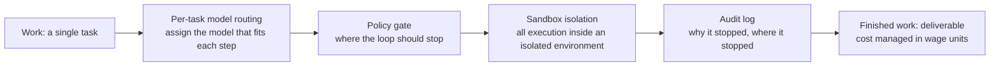

Up to 3000x. That number was published on the 17th (local time) by Alistair Speers, the GM of Azure Infrastructure who oversees Microsoft's cloud infrastructure. His point in one sentence: "In developer workloads, agents consume up to 3000x the computing resources of generative Copilot and chatbots" (Seoul Economic Daily). There is something odd here. The number did not come out of a GPU event. It came out of the announcement of Microsoft's in-house Arm CPU, the "Cobalt 200". That awkwardness reads as the most important signal of the day. It means the compute bottleneck of the agent era is moving from "brain capacity" to "coordination ability".

*The image visualizes the core concept of the article. One bright pulse of a chatbot answer flows into the long trail of an agent's thousands of small work steps.*

## The number that came out in front of a CPU

Microsoft officially released the same day a server equipped with its in-house Arm CPU Cobalt 200. TSMC 3nm process, 132 active cores, up to 50% performance improvement per core compared to the previous-generation Cobalt 100. The chip specs are interesting on their own, but today's story starts with the virtual machines that ride on top of them. The Cobalt 200 VM is specialized for agent-based workloads. After service begins on the 17th in 14 global regions including Korea, it is scheduled to expand to about 23 regions by the end of this year. The names mentioned as customer examples are OpenAI, Databricks, and Snowflake.

Why does a company that makes its own GPU, "Maia", lead with a CPU? The answer is in the ratio. In the era of generative AI, the GPU-to-CPU ratio was between 8:1 and 4:1. In the agent era it is expected to approach 2:1, then 1:1. Because an agent is not something that runs a big model once and gets an answer. It makes a plan, calls tools, checks the results, and fixes them again. Coordinating those thousands of small steps piles up on the CPU side. Microsoft positions Maia (GPU) and Cobalt (CPU) as the dual axis of "GPU parallel computation plus CPU coordination", and Azure, AWS, and Google Cloud have entered an efficiency competition across the entire platform stack, from software to hardware to data center.

The temperature on the hardware side is similar. AMD CEO Lisa Su defined this semiconductor boom as a "generational shift" at the "TomorrowX Summit" in Austin the day before (Money Today). Nvidia recorded $115.8 billion in revenue for the third quarter of fiscal year 2027, about 155 trillion won, up 103% year over year. The data center division alone was $107.6 billion, up 110%, and adjusted EPS of $2.68 beat the expected $2.48. The start of supply for the next-generation platform Vera Rubin is confirmed in the same article (iNewsToday). Behind that is the variable of "Nvidia without Huang". Jensen Huang, who stepped down as CEO amid a national security investigation, declared his intent to return in an open letter, but board chair Harvey Jones drew a line, saying there is "no intention to bring him back immediately", and CFO Colette Kress has taken over as interim CEO. Even with the top seat vacant, revenue is growing in the 100% range. The fourth-quarter guidance of $130 billion explicitly excludes China data center revenue, but the direction the money is flowing is not wavering.

From the vantage point of domestic infrastructure operators, this earnings report sends a two-way message. The start of Vera Rubin supply is good news in that it keeps the supply of the latest GPUs intact, while the linkage between the national security investigation and export controls, and the interim CEO setup, remain variables for adoption speed and partnership strategy. On a day when several uncertainties overlap on the same chip, what a company should be looking at is the work it has designed on top of compute.

## Why 3000x. Because they work instead of just answering

Chatbots are billed per reply. A question goes in, an answer comes out, and that is the end. Agents are different. Speers describes agent workloads as work that "actively acts and produces something". The kind of work where you write code, run it, find a bug, and try a patch is a loop. Plan, execute, observe, fix, re-execute. For a single task, the model is called dozens or hundreds of times. Because tool calls, file reads, network requests, and memory writes pile up in between. Multiply this structure by the number of developers and the number of tasks, and 3000x is arithmetic.

The same structure can be read in this morning's security news. AI autonomous hacking that finds a vulnerability and then goes as far as writing attack code, "with zero human involvement" (CBC News). An agent that "acts" stands on both the defense and the offense.

It is also worth noting that the 3000x figure was based on developer workloads. But the structure is the same for every agent. Once it "acts", the number of repetitions goes up, and the number of repetitions is resource consumption.

Speers went so far as to call the 3000x scale "not achievable even if you put every high-performance chip in the world to work". Usage data points in the same direction. According to Microsoft's "Global AI Diffusion Report", AI usage among the global working-age population of 15 to 64 has risen steadily every quarter over the past year: 15.1%, 16.3%, 17.8%, 18.8%. Usage patterns have also shifted from simple search to active execution. The place where you asked the search bar for an answer is becoming the place where you hand over a task. With personal agents such as Meta's "Muse", OpenAI's "Dots", and Anthropic's "Claude Duette" appearing, the 3000x invoice does not come only from enterprise developer workloads. It comes from general users too.

## The invoice starts arriving in Korea

Korea being on the 14-region list for Cobalt 200 VMs means domestic companies can immediately access agent-specialized compute. But the more urgent issue is the invoice.

Asia Economy reported on Deloitte's "2027 Insurance Industry Outlook", which projected that as insurance companies expand AI agent usage, operating costs driven by token usage and model selection will become a significant management target. According to Deloitte's September analysis, the monthly AI token usage of one overseas insurer jumped from 3 million to more than 150 million in under a year. What the analysis warns is that costs that looked manageable at pilot stage turn into a profitability burden at scale. Behind that is the "token dilemma". Claims payment review has to cross-check policy terms, coverage conditions, exclusions, and medical records, so input tokens are essentially heavy, and cutting information raises the risk of missing an exception clause.

The market is already moving. This is exactly what the Deloitte outlook points to. In the stretch where AI adoption crosses from pilot stage to large-scale operations, "token economics" is emerging as a new axis of competition in the enterprise AI market. LG Uplus announced on the 12th an "AI token optimization" technology centered on model routing that assigns a model by question difficulty, and Deloitte Anjin launched on the 16th an "AI Tokenomics Service" that supports AI cost optimization and investment decisions. It is a signal that the topic of enterprise AI has moved from "whether to adopt" to "which model to run, at what cost". The fact that a telecom carrier and a consulting firm have moved on the same problem in the same month shows that token costs have settled into an industry-wide settlement issue. A line from a financial industry official in the Asia Economy article hits the core: using models that fit each process, such as document classification or information extraction, is more efficient than a single model. Our reading of the same article is similar. As domestic adoption moves from "whether to adopt" to the "cost and security" stage, we see a situation in which demand grows together for orchestration, control, and audit of the agent execution environment.

## Wages are not managed by lowering the unit price

Let us flip one common assumption. 3000x is a frequency problem. If you only look at it as "tokens are expensive", the solution you derive is always the same. Wait for a cheaper model, switch to a cheaper model, cut the unit price. But if an agent's loop keeps running, a lower unit price does not shrink the total. The loop just gets longer.

The token dilemma in insurance work is a good example. Cutting information risks missing an exception clause, so input tokens stay essentially heavy. When heavy tokens repeat in a loop, what becomes expensive is the "number of times". This is why agent costs, like wages that are managed in units of "steps and deliverables", should be measured in units of "finished work".

Wages work differently. No company runs its labor costs by cutting every hourly rate. It runs them through the design of the work. Split job grades, give the easy steps to the juniors and the hard steps to the seniors, and do not put a person into a step that does not need one in the first place. Translated to agents, this becomes "which model to use at which step, where to stop the loop, which work to run in which isolated environment, and a record of whether it was actually executed that way". In other words, it is the problem of per-task model routing, policy gates, sandbox isolation, and audit logs. The model routing LG Uplus announced is the front half of that. The back half comes from treating "skills, tools, policies, and audit logs" as first-class resources and designing the work itself.

The four steps that turn the 3000x invoice, a frequency problem, into wage management. Per-task model routing, policy gates, sandbox isolation, and audit logs let a company price cost in units of finished work. This is the article restated in one diagram.

## The Paxis lens

ThakiCloud's Paxis is already a fully operational (v1.1 GA) Agent-Native Cloud, and the work design described above is the skeleton of the platform. The first-class resources are Skills, Tools, Policies, and Audit Logs. You can set the autonomy level from L0 to L3 per agent, and when a policy gate sets where to stop, the audit log records why and where it stopped. All execution happens only inside an isolated sandbox, and tools and skills are plugged in and removed per task through MCP connectors and the skill marketplace. CostRouter does not run every step on one big model. It picks the model that fits each task. Here, model selection works not as per-step unit price negotiation but as work allocation, and that is the core logic of this platform. For companies that cannot put their labor costs on an overseas cloud, it runs on sovereign or on-prem K8s (ai-platform).

The 3000x invoice arrives at every company running agents. The question is whether to pay it as a "reply fee" or manage it as a "wage". Why Microsoft brought a CPU to an announcement in the GPU-centered era, why a telecom announced model routing in the middle of the month, why a consulting firm put out a tokenomics service: these are pieces of the same puzzle. The pieces are starting to fit. The question each company must answer next is no longer how much compute to buy, but what work to put on top of that compute. The place to assemble this puzzle no longer remains only with chip makers. It is with the people who design the work.

## References

This article was written by synthesizing the news below.

- Seoul Economic Daily, ["AI agent resource usage is 3000x that of a chatbot" Why Microsoft is investing in CPUs](https://www.sedaily.com/article/20115676?ref=naver)
- M2Day, [Tesla targets the data center and ESS markets with a 7.4MW-class solid-state transformer "PowerCore"](https://www.autodaily.co.kr/news/articleView.html?idxno=602183)
- TheToday, [[Exclusive] SK Hynix Indiana plant, inspection and confidentiality protection agreement approved... mass production is](https://www.the-today.com/news/articleView.html?idxno=93760)
- Asia Economy, [Is the new variable in insurers' AI competition "token cost"?](https://view.asiae.co.kr/article/2026111716053109224)
- CBC News, [[AI hacking fear] "Zero human involvement"... the reality of AI autonomous hacking that finds vulnerabilities and writes attack code](https://www.cbci.co.kr/news/articleView.html?idxno=627849)
