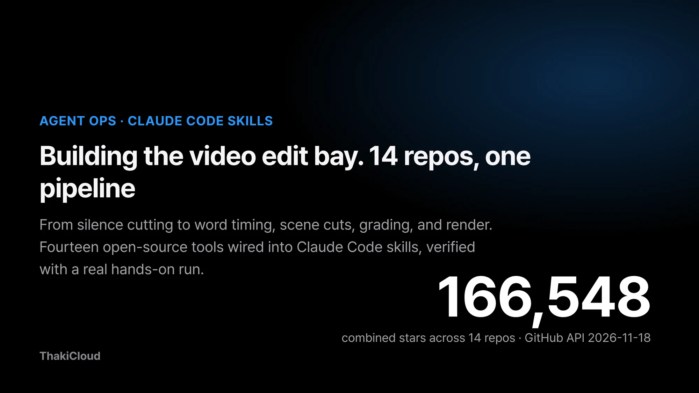
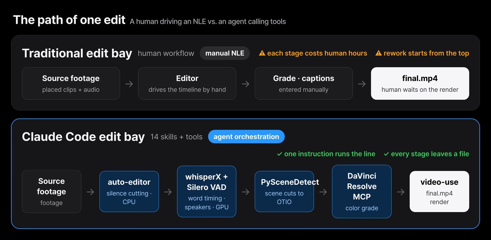
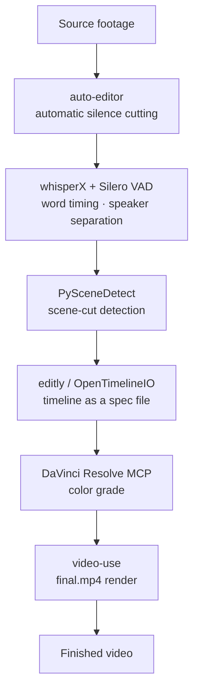
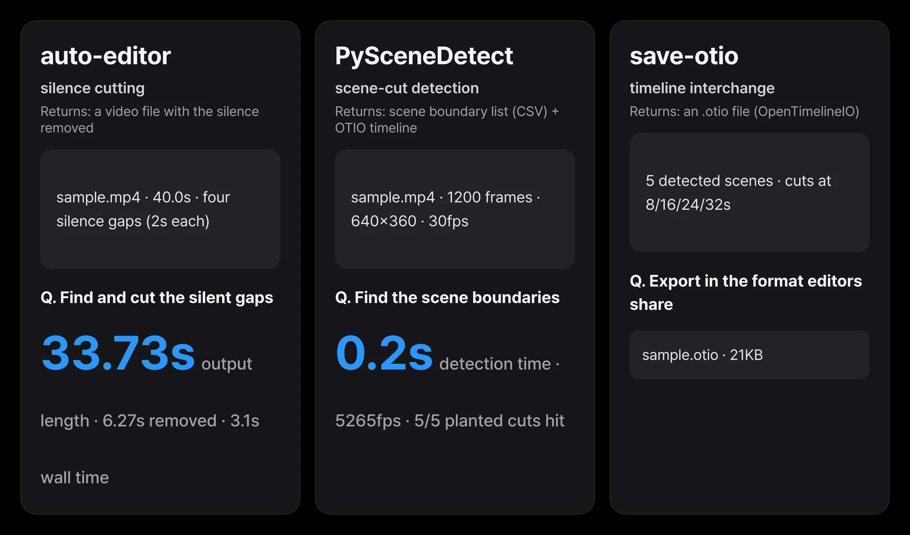
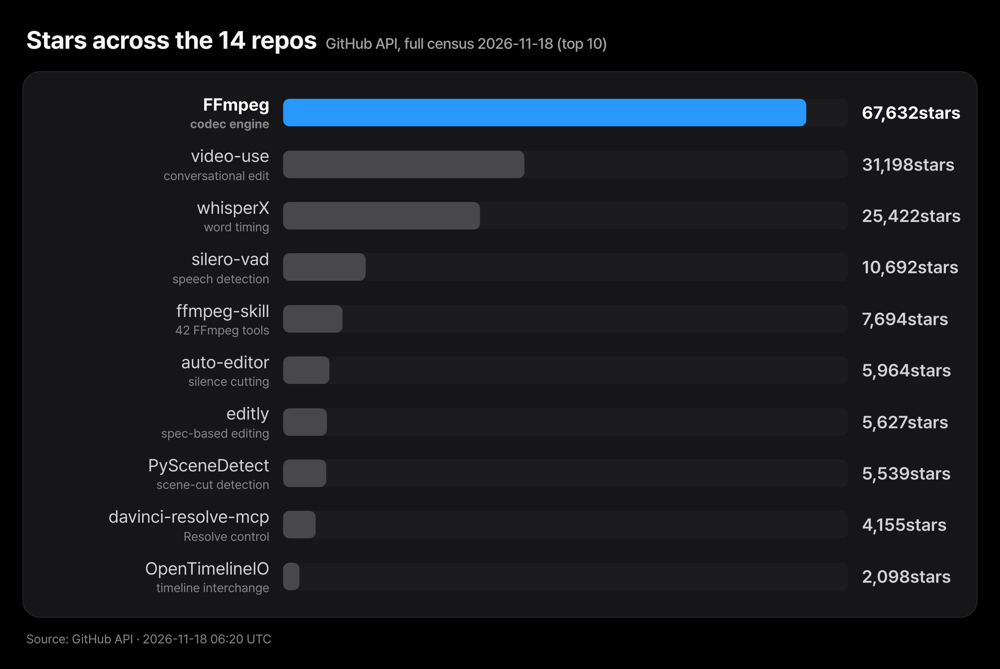

If you are a developer who wants an AI coding agent to make video too, you have hit these three scenes. You open the editor window by hand the moment the source footage is loaded. You cut the silent gaps on the timeline, one by one, with a mouse. You confirm where the scene changes by scrubbing the footage left to right with your eyes. This post is for the decision of whether there is a tool set that can build a video edit bay for Claude Code.

Here is the conclusion first. Fourteen open-source repos can be assembled into a video editing pipeline, and the CPU core of that line is something I actually ran, with real numbers. I counted the stars of all 14 repos through the GitHub API today. The total is 166,548.

This post is a record of verifying that list of 14 repos that circulates as a single tweet. I check where each tool sits on the line, how much silence actually comes out of a synthetic video when the CPU stages run, and why the GPU stages were left out. It also covers the repo that stopped being maintained and the version where the API broke.


*14 repos, 166,548 combined stars. Full census via GitHub API on 2026-11-18.*


## In plain terms

This pipeline is a factory unit line.

The source footage arrives at the first workstation. Each workstation does exactly one job. One cuts the silent gaps. One attaches word-level timing. One finds where scenes change. One grades the color. The last one renders. Finished work is handed to the next workstation as a file.

Claude Code is the line foreman. The foreman does not assemble anything by hand. Say "cut all the silence" and the auto-editor workstation runs and hands over the cut file. Say "make me a scene boundary sheet" and the PySceneDetect workstation runs and hands over a CSV and an OTIO file. The human's job is to give the foreman instructions and to pick up the finished piece at the end of the line.

I will keep calling the tools "workstations" to the end of this post. The analogy stays with us.

## The 14 workstations, and where they sit on the line

The original thread compresses the line into five stages. Watch. Cut. Caption. Grade. Render. Spelled out, the line runs from footage through silence cutting, word timing, scene cuts, grading, and render. Placing the 14 tools in that order gives the table below.

| # | Tool | Job | stars (11-18) |
|---|---|---|---|
| 1 | video-use | conversational editing from raw clips to final.mp4 | 31,198 |
| 2 | ffmpeg-skill | 42 local FFmpeg tools | 7,694 |
| 3 | Claude Eyes | an agent that watches the footage | 98 |
| 4 | whisperX | word-level timestamps + speaker separation | 25,422 |
| 5 | Silero VAD | finds where speech starts and stops | 10,692 |
| 6 | auto-editor | cuts every silent gap automatically | 5,964 |
| 7 | PySceneDetect | finds scene cuts and transitions | 5,539 |
| 8 | editly | a whole edit in one spec file | 5,627 |
| 9 | OpenTimelineIO | open interchange format for timelines | 2,098 |
| 10 | DaVinci Resolve MCP | Claude drives Resolve Studio | 4,155 |
| 11 | Uncut | macOS editor with Claude Code inside | 27 |
| 12 | Yap Studio | agent cuts dead air, adds B-roll | 57 |
| 13 | Take One | one line in, a launch video out | 345 |
| 14 | FFmpeg | the engine under almost every tool here | 67,632 |

All 14 repos were verified to exist via the GitHub API, and the star counts are measured on 2026-11-18. The thread's "160K+ stars combined" claim holds at 166,548.


*Traditional editing proceeds on the time scale of one person. The skill pipeline splits responsibility per tool, and a shared format like OTIO becomes the seam between stages.*

## The order of the line, as a diagram

The flow of the line is below. Each arrow means "a result file moves on."



The important part of this diagram is not the tools. It is the arrows. The file with silence cut, the file with word timing, the scene boundary sheet, the OTIO timeline. While the line runs, the outputs accumulate as files. And files are a format an agent can read and write.

Accumulating as files matters when things fail, too. The line can resume from the input file of whatever workstation it broke at. The agent re-runs the failed stage instead of the whole line. In an NLE the state lives inside the project file, so rewinding means opening the editor. On the line, the unit of rewind is one file.

## Two CPU workstations, measured on a synthetic video

The GPU stages were not part of this experiment, so I ran the two CPU workstations of the line for real: auto-editor and PySceneDetect.

The setup is simple. A synthetic 40-second video: 640x360, 30fps, 1200 frames. Five different picture patterns, 8 seconds each, concatenated for four hard cuts. A 440Hz sine wave as audio, with two-second silences planted at 4 to 6s, 12 to 14s, 20 to 22s, and 28 to 30s. Four cuts and eight seconds of silence, with known answers. A test sheet with a key.

**auto-editor.** On first run it downloaded its own Go binary (29.3.1 macos-arm64) from GitHub releases. It processed the 40.000-second video in 3.1 seconds, and the output was 33.733 seconds. Of the 8 planted seconds of silence, it cut 6.267. The reason it is not 8 is that silence detection is threshold-based (the default is an amplitude ratio of 0.04). Encoder tails left at the edges of the silent gaps, and the parts where the sine never fully drops to silence, get mixed in. A 1.7-second difference that shows silence is not a boolean. It is a threshold problem. The cut list can be exported, and it can be written as XML that Adobe Premiere Pro reads.

**PySceneDetect.** The first wall I hit was here. The 0.6-generation API call `video.detect_scenes()` is gone in 0.7.3. It threw an AttributeError. The 0.7 line is reorganized around the CLI.

```
scenedetect -i sample.mp4 detect-content list-scenes save-otio -o exp_out
```

That one command processed 1200 frames in 0.2 seconds, an average of 5,265fps. It hit all four planted cuts (8s, 16s, 24s, 32s) and detected 5 scenes. The output CSV looks like this.

```
1,1,00:00:00.000,0.000,240,00:00:08.000,8.000,240,00:00:08.000,8.000
2,241,00:00:08.000,8.000,480,00:00:16.000,16.000,240,00:00:08.000,8.000
```

Scene number, start and end frames and timecodes, length. One row is the minimum unit of an edit.


*Measured on one synthetic 40-second clip (4 hard cuts + four 2s silence gaps). GPU stages (whisperX etc.) were not run.*

And the output I liked most from the experiment is `sample.otio`. A 21KB OpenTimelineIO timeline file. Open it and you find the OTIO schema declaration ("Timeline.1"), a Video 1 track, and each scene stored as a clip with its own source_range. The four scene boundaries, exported in a format editing software shares. This is why what PySceneDetect hands to the next tool is a file, not the sentence "there are 5 scenes."

## Why the GPU workstations stayed off the line

whisperX and Silero VAD are the stages that decide the cost of this line. Word-level timing and speaker separation mean running an ASR model, and that is not laptop-scale work. If the same line ran at ThakiCloud, those two stages would be jobs in the GPU queue, while auto-editor and PySceneDetect stay local jobs of a few seconds. When the GPU job finishes, its word-timing file moves to the next workstation on the line, and that file is where the precision of silence cutting gets re-tuned. The point where the two tiers meet.

So this post only carries the CPU measurements. I did not measure how accurate whisperX's word timing is on this video, or how much the silence detection and speaker separation overlap, so I will not claim those numbers here.

## Where writing the spec becomes the edit

Two workstations sit in unusual positions on the line: editly and OpenTimelineIO. Neither touches video files. Both touch the "plan" of the edit, as files.

editly expresses a whole edit in one spec file. Where to cut, which captions to add, grade parameters, declared in a file, and the file renders through to the output. OpenTimelineIO is the timeline interchange format the Academy Software Foundation made into a standard. It is the shared language that lets different editors read and write the same timeline.

In an agent workflow, these two replace the line foreman's console. Where a human used to drag the timeline with a mouse inside the NLE, the agent now writes a spec file and reads an OTIO. The moment the output of an edit moves from "state inside the project file" to "a file on disk," the next workstation has to receive that file for the line to run at all.

## Things to know before you rely on it

**The shape of the 14 repos is not even.** The top three, FFmpeg (67,632), video-use (31,198), and whisperX (25,422), hold 75% of the combined stars.


*FFmpeg alone out-stars 40% of the top-10 total. Half the pipeline is decades-old software; the agent skills are a thin layer on top.*

**One workstation has stopped moving.** I checked the last push date of all 14 repos as well, separate from stars. Thirteen are alive within the last two months. The exception is editly. Its last push is May 2025, eighteen months of silence. It got the spec-based editing concept first, but the moment you copy this table and use it as-is, your dependency is pinned to that repo's last commit. Stars point at a large community. Push dates point at a hand that is there right now. Check both.

**The long tail is small.** claude-eyes at 98 stars, yap-studio at 57, uncut at 27. Projects of one or two maintainers, and none of them sit on the critical path. For the critical path, a star count check is enough.

**One workstation costs money.** The Resolve Studio that the DaVinci Resolve MCP drives is a paid license. The MCP is free, but the machine at the end of the control stick is not.

**The cut silence can be kept as evidence.** auto-editor does not only hand back the video with silence removed. It can export the removed silent gaps themselves as a separate file. When the report says "6.27 seconds cut," the four removed gaps sit next to it as files, and verification is done. The outputs of an edit being evidence of the process, not just the result, is another feature of this line.

| | Traditional NLE | Skill line |
|---|---|---|
| Who drives it | a human's hands | an agent |
| Output | project file inside the editor | handoff files (OTIO, CSV) |
| Cost of rework | redo the timeline | re-run the stage's command |
| Scale | one person, one line | as many lines as workstations |
| Version risk | editor updates | per-repo push history (editly silent 18 months) |

## Two places this line meets ThakiCloud

**Paxis.** ThakiCloud's Agent-Native Cloud, Paxis, already runs a video production skill family that overlaps this tool set. Skills that route to the video-use, ffmpeg-toolkit, and openmontage lines, with each stage handing a file to the next, are the same shape as Paxis's DAG multi-agent execution. One difference. On Paxis, every workstation call on the line passes a policy gate and an audit log. Every instruction the foreman gives leaves a record of "was this tool allowed to touch this file."

**GPU infrastructure.** The cost structure of this line mixes CPU and GPU stages. auto-editor at 3.1 seconds and PySceneDetect at 0.2 seconds belong on the local tier, and whisperX belongs in the queue. The same pipeline running across two execution tiers is the exact division of labor ThakiCloud's GPU cluster does when Kueue assigns jobs by cost. Keep the cheap stages close. Put the expensive stages in line.

## In closing

A video edit bay is not software you install. It is a pipeline you assemble. The 166,548 stars across 14 repos is evidence that this line has been standing for a long time, and the CPU measurements are my record of tapping it, one beat at a time. All four planted cuts hit, 6.27 of 8 planted seconds of silence removed, a 21KB OTIO file out.

The first experiment you can run today. Five minutes is enough.

```
uv pip install auto-editor scenedetect
scenedetect -i your-video.mp4 detect-content list-scenes save-otio
auto-editor your-video.mp4 -o cut.mp4
```

Take the scene boundary CSV from your own video, cut the silence, and confirm another editor reads the OTIO file. Once you have run the line, you can see where each of the 14 workstations belongs on yours. If you want an agent to make video, stop looking for an all-in-one editor. Place the workstations, and make the handoff file between them OTIO. That is what "building the video edit bay" means in this post.

## References

- Original thread: [@plusxbt, 2026-11-16](https://x.com/plusxbt/status/2122312123183235554)
- The 14 repos: [video-use](https://github.com/browser-use/video-use) · [ffmpeg-skill](https://github.com/kajisho5/ffmpeg-skill) · [Claude Eyes](https://github.com/moritzkremb/claude-eyes) · [whisperX](https://github.com/m-bain/whisperX) · [Silero VAD](https://github.com/snakers4/silero-vad) · [auto-editor](https://github.com/WyattBlue/auto-editor) · [PySceneDetect](https://github.com/Breakthrough/PySceneDetect) · [editly](https://github.com/mifi/editly) · [OpenTimelineIO](https://github.com/AcademySoftwareFoundation/OpenTimelineIO) · [DaVinci Resolve MCP](https://github.com/samuelgursky/davinci-resolve-mcp) · [Uncut](https://github.com/blazejkustra/uncut) · [Yap Studio](https://github.com/cathrynlavery/yap-studio) · [Take One](https://github.com/talsiach/take-one) · [FFmpeg](https://github.com/FFmpeg/FFmpeg)
- PySceneDetect docs: https://scenedetect.com/docs/
- Star census: GitHub API, 2026-11-18 06:20 UTC (all 14 repos)
- Experiment outputs: 40s synthetic video · auto-editor 33.733s output · sample.otio 21KB (2026-11-18, Mac local CPU)
