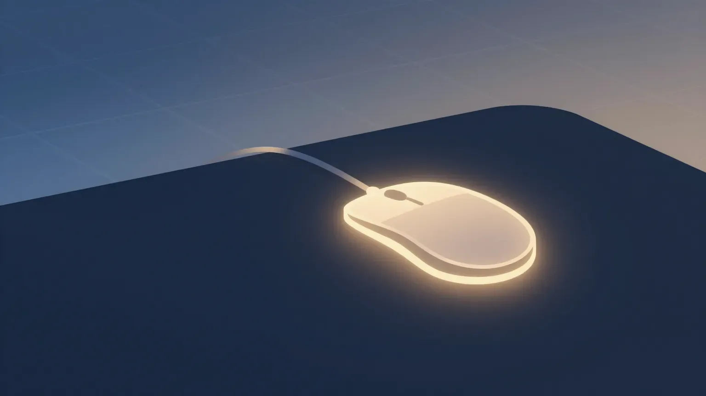
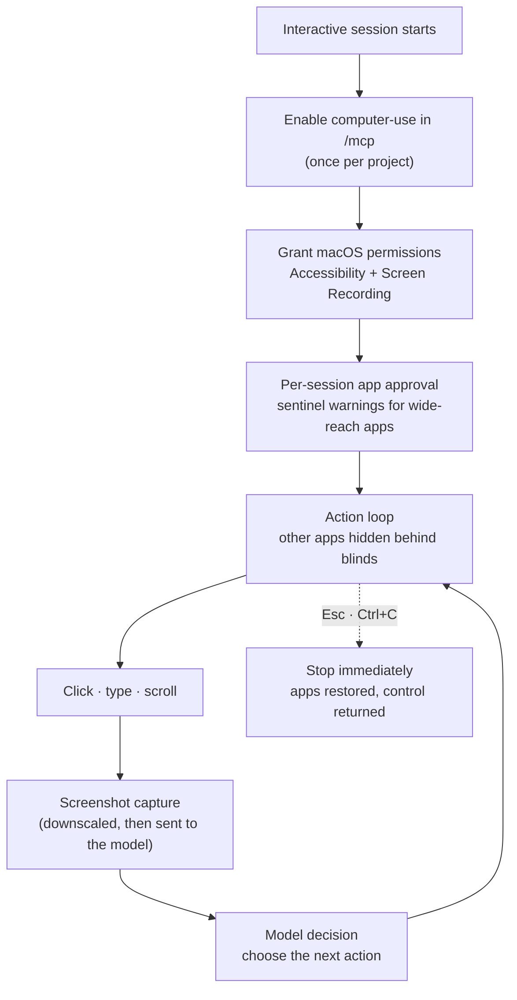

This post is for developers who want to hand their own mouse and keyboard to an AI agent, and for agent operators who design long unattended runs. The conclusion first. Claude Code's computer use is not a toy, it is a real feature worth trying, but the viral "GTA 6 8-hour unattended play" is a claim that does not fully line up with the feature's documented constraints. Before you entrust an unattended run, you need to understand the screen as a new safety boundary. This post works from two verified sources, the viral experiment and the official feature docs, and draws out the implications for agent operations.

## In plain terms

Picture a new employee's first day. A desk is waiting for them, with a monitor, a mouse, and a keyboard. Computer use is exactly that seat. You do not hand over the whole building at once. The new hire is granted access room by room (per-app approval), and while they work the blinds are drawn in every other room (other apps hidden). What shows on the monitor is the same screen you see (screenshots), and you can pull the plug at any time (Esc). The 8-hour GTA 6 experiment is not about how long that new hire can run the office PC alone while you are away. It is about having confirmed the result through a video. I will keep this office-PC analogy to the end of the post.

## What the claim actually said

The source is a post by X user @starmexxx, timestamped 20:15 UTC on November 18, 2026. The account says this. In the morning before work, it gave the agent screen access and told it to play through the story without dying. When it got home, the agent had finished 4 missions. It had found a money-farming method on its own and was running it on repeat. It learned the controls in about 15 minutes, and by hour two it was driving cleaner than the author ever could. By hour five it had started picking up side missions, because it decided the main story needed higher stats first. The author says it did not write a single line of code or set up any scripts, it gave it one sentence. It says the prompts it used are in the replies, but I did not verify the replies.

As of the morning of November 19, the post had roughly 6,928 likes, 411 retweets, and about 1.19 million views, and a YouTube video on the same topic was attached. In the replies, people joked about the cost angle, that you have to pay for GTA 6 and for Claude. A separate video examining the claim also surfaced.

> The 8-hour play video from the original post. Shot after the author handed over screen access in the morning and left.



## The agent that reads your screen: what computer use is

Computer use is a built-in MCP server in the Claude Code CLI, named `computer-use`. It is off by default. Enable it from the `/mcp` menu in an interactive session, and the setting persists per project. Anthropic is clear about where this feature sits. An agent has several ways to interact with an app, and computer use is the broadest and the slowest. In order, MCP servers, shell commands, browser tools, and finally the screen. Screen control is reserved for targets nothing else can reach, native apps, simulators, and tools with no CLI or API.

The requirements are all in the docs. It is macOS only, it is a research preview, it is available on Pro, Max, and Ultra plans, and it does not work through third-party paths like Bedrock. It runs only in an interactive session, so it is not available in non-interactive calls like `-p`.

Once enabled, a permission flow follows. You grant two macOS permissions, Accessibility (click, type, scroll) and Screen Recording (see the screen), and then approve, per session, the apps the agent will work in. Apps with a wide reach get a sentinel warning. A terminal is equivalent to shell access, Finder can read and write any file, and System Settings can change the system. The control tier differs per app category. Browsers and trading platforms are view-only, terminals and IDEs are click-only, and everything else gets full control.

Three design choices matter operationally. First, while the agent works, other apps are hidden and the terminal is excluded from screenshots, so the agent never sees its own output on screen. Second, screenshots are downscaled automatically. A 16-inch MacBook Pro at native 3456×2234 is reduced to roughly 1372×887 before it is sent. Third, one computer is locked to one session. While the agent holds the lock, no other session can use the screen, and the lock is released when the session ends.

## Where it does not match the docs: 8 hours unattended

Back to the analogy. Leaving the new hire alone for an 8-hour business trip. Possible, or not? Against the docs, four points do not line up.

First, the interactive-session requirement. On paper, computer use runs only in an interactive session. If the 8 hours were filled with a "conversation left open," it is a plausible story, but if it was run like non-interactive automation, it is outside the documented range. The post does not say which path the author used. [Estimate] It is likely one of two things, a community computer-use MCP project that runs on Windows, or an interactive session that was simply left running.

Second, macOS only. On the CLI path, it is macOS alone. The operating system of the machine that ran the 8 hours is not clear from the post or the video.

Third, plan and authentication. A personal subscription (Pro, Max, Ultra) and claude.ai authentication are prerequisites. The feature does not open through enterprise paths like Bedrock. The 8-hour experiment is, in the end, a story where an individual's subscription is the infrastructure.

Fourth, app approval is per session. The structure approves apps per session, but there is no public material on how the approval list was maintained, or whether any new app request appeared in between.

The post's "I did not write a single line of code" does match the intent of the feature. Computer use is designed precisely so that the screen world, which has no CLI or API, can be driven by a sentence. But the "8 hours unattended" part does not sit inside the documented range of the feature. This experiment is a claim confirmed through a video, not a recipe that carries the reproducible pieces. So this post does not try to prove or disprove the success of the 8-hour play. The important question is, "what would make it safe."

## What the video proves and what it leaves out

Viral agent experiments usually arrive as a single video. The 8-hour GTA 6 is no exception. You need the eye that separates what a video proves from what it leaves out.

Whether a continuous session actually ran is hard to confirm from a video. A clipped clip is a product of editing, and without a timestamp or session log published alongside it, "did one session fill 8 hours" stays unverified. The author says the prompts are in the replies, but the length and count of those prompts is evidence that must be read together with the "one sentence" claim. If it was several instructions rather than one sentence, it is closer to long-duration remote steering than to an unattended experiment.

Whether the model judged "on its own" is the same story. The account that it chose side missions first only carries meaning if the model reset its own objective function. But in a structure that watches the screen and picks the next action, a video does not distinguish "on its own" from "it happened to press that button in the next frame." The screenshots of the decision moments, plus the action log in between, must be published together for the word "on its own" to hold.

In the end, the video shows "an agent driving a game by watching the screen," but it does not show "for how long, under which instructions, and how autonomously." Reading that gap is the basic stance toward viral agent claims. The real value of this experiment is not the 8-hour number. It is that the public saw an agent using the screen as a channel with its own hands.

## The safety boundary splits at the screen

Claude Code's Bash tool runs inside a sandbox, while computer use reaches approved apps on the real desktop. The docs themselves warn that the trust boundary of the two is different. A sandbox fences off the filesystem and the network, but the screen cannot be fenced off, because everything that appears on it is input.

This is clearest in the 8-hour-game context. In the new-hire analogy, a sticky note on the monitor while you are away is read at the same level as every piece of information inside and outside the company.

List the input that actually lands on an 8-hour game screen and it gets sharper. In-game text, the bottom HUD, mission objective lines, the NPC dialogue window. On top of that sit out-of-game elements. Other players' chat, ads and pop-ups, operating-system notifications, even a sticky note in the corner of the screen. All of it reaches the model through the same channel, the screenshot. Unlike a sandbox, the screen has no boundary that says "read only this." Because reading is input, if a person keeps their eyes off for 8 hours, the only thing standing in this input channel is the model's own check. The docs say that on each action it checks and warns about prompt injection coming from on-screen content. But the side doing the checking and the side watching the screen are, in the end, the same model. This design works while a human is right there, because someone is available to press Esc.

Left alone for 8 hours, the story changes. Thanks to the session lock, no other session can use this computer, so an unattended 8 hours is a monopoly over the whole machine. Blinds, sentinel warnings, terminal exclusion, Esc. Every one of these safety devices assumes "a person is in front of the machine." Once a person steps away, control moves to before and after. The recorded video, and the log you read later. The safety device for an unattended run must be a "device to review," not a "device to block."

## Where this meets ThakiCloud

Paxis is ThakiCloud's Agent-Native Cloud, and it treats skills, tools, policies, and audit logs as first-class resources. Computer use sits in the "tools" layer where the boundary between an agent's hands and the real environment is thickest. The weakness this experiment exposes, that the safety devices stop working while no one is present, points in exactly the same direction as the reason Paxis keeps agents in isolated sandboxes and pushes every action through a policy gate and an audit log. The moment you hand over screen access, that screen becomes a new policy target, and every action taken on top of it must be able to remain in the audit log.

The economic corner must not be missed either. The cost joke from the replies, that you must buy GTA 6 and Claude too, has substance behind it. An unattended 8 hours is expensive time as an experiment. In Paxis, a long agent session is a management target of budgeting and cost-aware routing. For how long, at what cost, through which model. The 8-hour experiment shows that you can run 8 hours from one sentence, but it does not answer the operator's question.

Finally, the tool-priority design (MCP, shell, browser, and the screen last) is a pattern that transplants directly into agent operations. Use the narrow interface first, and open the screen only when every other means cannot reach it. Holding that order reduces how often you have to open the wide boundary of the screen.

## To close

Back to the starting point. The moment an agent grabs the mouse, "how to watch" becomes a feature. The 8-hour GTA 6 experiment is the rehearsal placed in front of that. For the person who has tried it, one thing. Before you leave for the trip, write down first how many doors you opened for the new hire left alone at the office PC, whether you drew the blinds, whether you left a way to pull the plug, and what you will review when you come back.

1. Start with a view-only app (the browser), and grant approval explicitly per session.
2. Do not begin with an unattended run. Record a short session and verify it through after-the-fact audit.
3. Treat screen access as a new safety boundary, not a convenience. Set up the policy and the log first, then open the door.

The day an agent grabs your desktop is not far in the future. Somewhere today, an 8-hour experiment is being uploaded as a video. Whether that video shows "it was possible" is each reader's verification to do. What to protect is this post's job to show.

## References

- Original post: [@starmexxx, 2026-11-18](https://x.com/starmexxx/status/2123148028487868838)
- 8-hour play video: [Claude Code just played GTA 6 for 8 hours while i was at work](https://www.youtube.com/watch?v=SSxGzFQpEdw)
- Claim-verification video: [Did Claude Code really play GTA 6 for eight hours?](https://www.youtube.com/watch?v=rjEFyWfmqLg)
- Claude Code computer use official docs: [Let Claude use your computer from the CLI](https://code.claude.com/docs/en/computer-use)
- Community Windows computer-use MCP: [sshh12/windows-computer-use-mcp](https://github.com/sshh12/windows-computer-use-mcp)
