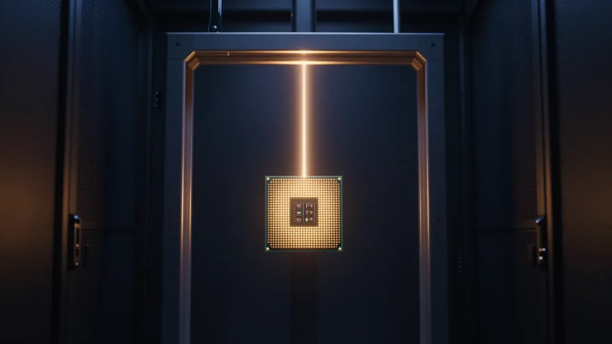
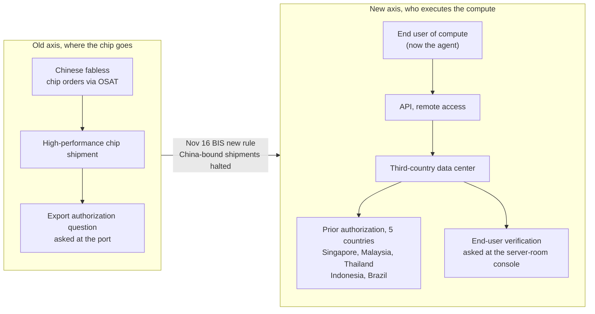

*The article's core concept, visualized.*

## A Question That Suddenly Appeared in the Server Room

November 16, U.S. time. The U.S. Department of Commerce's Bureau of Industry and Security (BIS) issued a new export rule. The interim final rule (IFR), issued at the direction of the Treasury and the National Security Council (NSC), prohibits Chinese companies from remotely accessing advanced AI semiconductors through third-country data centers. In one line: control has extended from the chip's final destination to the final user of the compute resource. The regulator's gaze has moved from the path the goods travel to the side that actually uses them.

What matters is that the target of the ban is not the object called a chip but the act of remote access. That means the reach extends to the point where compute is borrowed and used in someone else's data center. For data center operators, this is an unprecedented question. The contract carries the buyer's name, but now they must verify the name of the company that ultimately presses the power button. At the same time, the U.S. government requires prior authorization for exports to five countries: Singapore, Malaysia, Thailand, Indonesia, and Brazil. One could say the passport era of the compute market has opened.

## The Cut Bypass Route

Until the rule came out, there was one bypass. A Chinese fabless company would order high-performance chips through independent packaging and test (OSAT) vendors, and once it was confirmed that the design was not subject to export controls, the chips could ship without direct U.S. government approval. On the 16th, Samsung Electronics and TSMC notified Chinese customers that they would suspend shipments of certain processors pending export review, as a follow-up measure to the new regulation. That channel has been cut at the source.

The scope of the suspension is wider than expected. Even the existing exception that applied to non-AI smartphone chips has been abolished, extending to the advanced chips used by Xiaomi, Oppo, and Vivo. Baidu's Kunlun and ByteDance take direct hits. The industry expects that phone chips may win later authorization, but the review period is likely to cause considerable disruption to finished-product production schedules.

More worth watching is the timing. The U.S. government first cut the path the chips travel and has now moved its hand to the point where compute is executed. The axis of regulation has moved from "product" to "service," which means the data centers and clouds that lend out compute are now the objects of verification. The export authorization question once asked at the port is now asked on the console screen of the server room.

Stated on a single map, control that followed the chip now follows the end user of compute. The port's export question, the five countries' prior authorization, and the server-room console's end-user verification sit on the same axis.

For Korea, this configuration arrives with a double meaning. With high-performance chip supply to China blocked, SMIC's capacity limits overlap with surging memory prices, deepening the supply crunch; in the opposite direction, demand for GPUs and AI chips outside China rises. Korea, which holds both roles, foundry and sovereign cloud, has an opportunity to position itself as "alternative supply and an execution environment independent of export controls." At the same time, the uncertainty of Samsung foundry's China-related revenue and global supply chain risk remain tasks to manage alongside.

## What Moves as Regulation Tightens

Where doors close, rooms are being newly built. Naver signed its first supply contract with a North American AI inference company for a 20MW AI factory. The deal is worth a total of 2 trillion won over 4 to 5 years, opening is scheduled for the first half of next year, and the target is 200MW secured by 2028. Korea is not on the five-country prior authorization list, but analysis suggests domestic data centers and foundries could face demands to strengthen supply chain management systems that verify a customer's ultimate parent company and the purpose of the compute.

The bet carries a cost. Naver's third quarter came in below expectations, with revenue of 3,472.4 billion won and operating profit of 451.3 billion won, and the operating margin fell from 18.2% to 13.0%. Infrastructure costs rose 29.1% year on year and marketing costs 32.3%, outpacing revenue growth. The common brokerage read is "the stretch where investment effects lag costs," and the 20MW supply contract reads as the first step turning that infrastructure cost back into revenue.

On the U.S. side, the bottleneck in data center construction has moved from chip and equipment scarcity to law and regulation, and the earliest untangling is expected in the second half of 2027. Reuse of idle generation capacity and MW-scale distributed construction of inference data centers have emerged as alternatives, and battery energy storage systems (BESS) are cited as the core of power buffering. In the middle of all this, AMD fell as much as 11% intraday on the 19th before closing in the 8% range, on the "circular financing" controversy. The question of who finances GPU investment with money has now become a stock price variable.

Alibaba plays the most aggressive card. Alongside an announcement that it will move all AI model training to its own T-Head chip by 2027, its Q2 AI cloud revenue grew 53% year on year to 61 billion yuan. The full-stack strategy that links its own chips, cloud, and models vertically is being proven by the financial results. Alicia Yap, an analyst at Citi, reads the earnings surprise as a signal that Alibaba's AI strategy is evolving from a parameter race toward maximizing enterprise customer ROI and deeply integrated agent workflows. When the sources of compute divide, the question of who uses what power, where, grows only larger.

## The Money Keeps Coming In

Meanwhile, the capital market is making a different kind of bet. Anthropic, founded by people from OpenAI, listed on Nasdaq on the 19th local time, raising a total of $107.3 billion including a private placement to strategic investors. It is also the first listing record by an AI model developer. The size breaks the IPO record set by SpaceX last June. On its first day, shares began trading at $111.50 and closed 17% above the $83 offer price, with the intraday market cap passing $2 trillion. An analyst at market research firm CFRA called the listing the most important IPO of the past 20 years.

The question this record listing leaves behind is not the size of the money but the share that money must repay. Can revenue absorb the enormous GPU infrastructure costs of training and inference for frontier models? The AI bubble thesis steps onto the testing table in earnest through this listing. A kind of game is running at the same time: the capital market pours money to secure compute, and the regulator looks for the user of that compute.

If the listing lands successfully, a wave reaches the domestic market too. Once global AI investment confidence is established, follow-on investment in and borrowing conditions for Korean data center and GPU projects improve, and the infrastructure investment cycle can speed up. As enterprise use of frontier models like Claude expands, demand for model serving and inference infrastructure and token consumption grow together, leading directly to demand for GPUaaS and inference-optimization solutions. The very baseline of AI company valuations has risen, an effect that raises the investment appeal of domestic sovereign AI and GPU cloud businesses by a step.

## The User Who Executes Power Has No Name

But the board of this game tilts one more time. "The user of compute" is beginning to point to no person or company. It points to an agent.

Nous Research's agent Hermes was announced as natively integrated into Microsoft Teams and Azure. Daily throughput is about 2 trillion tokens, it holds the lead among OpenRouter's public open agents, and its GitHub stars have reached 264,700. Yet enterprise distribution is not through the Teams store but as a private custom blueprint inside the customer's tenant. Measured against the official repositories, it stays in a transitional form. The fact that the Azure Container Apps sandbox operates as an isolated microVM that boots within a second and releases compute when idle is evidence that the agent execution environment is being standardized as a first-class resource rather than an app. Hermes's "collective wisdom" is a structure in which procedures an individual completed successfully for recurring work are automatically accumulated as skills and built into organization-level reusable knowledge. The 6G network operation system the government is pushing is likewise structured so that self-operating AI agents in each domain, and a domain orchestrator managing the many of them, hold the steering wheel. The Ministry of Science and ICT will invest a total of 800 billion won over five years, 2028 to 2032, in core-technology R&D for fully autonomous 6G networks, targeting autonomy level 5 in individual domains and level 4.5 for end-to-end integrated operation. Megazone presented, as the representative use case for a sovereign won stablecoin, the scenario in which "an AI agent pays on the user's behalf."

Domestically, the agent economy already appears in cost numbers. In comparative validation between its own AI model and general-purpose models, LG Uplus cut coding-task operating costs by about 90%, and internal testing showed savings of more than 25% on general query processing and more than 30% on coding agent costs from model routing alone. Two token-optimization papers were accepted at the NeurIPS 2026 workshop. The government sees the same direction. The 2027 AI and ICT R&D budgets, combined, cross 2 trillion won for the first time ever, and the government's "Top 10 AI·ICT Issues for 2027" lists both full-stack sovereign AI and maximizing token efficiency. Sovereignty and compute cost have been elevated to the level of national strategy.

The situation is this. The regulator has begun to ask, for the first time, "who" the power belongs to, and the being that executes the power has already become something that a single name cannot erase. Drivers have appeared on the network, proxies have appeared in the payment screen, and the final user of the server room sits behind the contract, the tenant, and the API.

## We Give Compute a Residence Registration

Then the one question enterprise AI platforms must answer over the next two years is this: can they show, in records, who, with what authority, on which machine, executed what and spent how much.

Paxis, as ThakiCloud's Agent-Native Cloud, treats this question as a first-class resource rather than an after-the-fact log. Skills, Tools, Policies, and Audit Logs are registered and managed before execution. The range an agent may handle on its own is set step by step across autonomy levels L0 through L3, a policy gate brakes the moment that line is crossed, and every processing history remains in the audit log. Whatever model or skill is run, it operates only inside an isolated sandbox, so the execution environment is always sealed. If a closed network and data sovereignty are required, the platform itself travels as a sovereign on-premises K8s environment.

Now that the sources of compute divide, model selection happens per task too. On the recently released CSAT dashboard, OpenAI and Google models tied for first with a perfect 450 points, while Korea's top model K-Exaone 2.5 followed at 414.7, a gap of 35.3 points. In a reality where the right price of a model changes with task difficulty, the CostRouter that picks a model per task, the MCP connector, and the skill market convert into the devices by which an agent designs where it uses power, at what cost, with what authority.

The rule of the 16th changed the question from "where does the chip go" to "who executes the compute." And the being that will answer that question, the agent, is already working in the team's chat window and on the network, and soon in the payment screen. The next infrastructure competition will not be decided by whether power is more expensive or cheaper. It will be decided by what passport the power executes with.

## References

This post was written by synthesizing the news below.

- 글로벌이코노믹, [알리바바, 美 첨단 칩 규제 정면 돌파… "자체 칩 'T-헤드'로 차세대 AI ..."](https://www.g-enews.com/view.php?ud=2026112007531812270c8c1c064d_1)
- EBN, ["삼성전자·TSMC, 미 수출통제 강화에 중국행 첨단 칩 출하 중단"](https://www.ebn.co.kr/news/articleView.html?idxno=1732409)
- 글로벌이코노믹, [AMD도 ‘순환금융’ 논란…엔비디아 반사이익에 제동](https://www.g-enews.com/view.php?ud=202611200747065579a1f309431_1)
- 인더뉴스, [[인더컴퍼니] 네이버, 본업 둔화에 낮아진 눈높이…AI 팩토리가 반전 이...](https://www.inthenews.co.kr/news/article.html?no=94759)
- 연합인포맥스, ["美 데이터센터 건설 지연…'유휴 전력설비·BESS' 대안 부상"](https://news.einfomax.co.kr/news/articleView.html?idxno=4445649)
- 이데일리, [“AI도 수능 봤다”…오픈AI·구글 450점 만점, 한국 AI 성적은?](https://www.edaily.co.kr/News/Read?newsId=01361206645647688&mediaCodeNo=257)
- 토큰포스트, [허메스 에이전트, 팀즈·애저 연결…팀즈 스토어 아닌 비공개 배포](https://www.tokenpost.kr/news/ai/441146)
- 이코노미톡뉴스, [LG유플러스, AI 성능·비용 동시 잡는다… 코딩 운영비 90% 절감](http://www.economytalk.kr/news/articleView.html?idxno=425416)
- 디지털데일리, [통신망도 '자율주행' 시대…정부, 6G NW AI 에이전트 개발 추진](https://www.ddaily.co.kr/page/view/2026112002301345469)
- 바이라인네트워크, [메가존, 소버린 원화 스테이블코인의 핵심은 ‘정산’](https://byline.network/?p=9004111222628526)
- 정보통신신문, [AI·ICT 성장 흐름 바뀐다…내년 실전적 R&D 추진](https://www.koit.co.kr/news/articleView.html?idxno=209984)
- SBS Biz, [[부자들의 투자노트] CFRA "앤트로픽 IPO, 역대 가장 중요"](https://biz.sbs.co.kr/article_hub/20000347724?division=NAVER)
