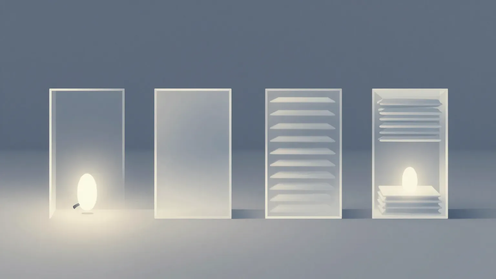

Applause comes later, confirmation comes first. For a reader who runs agents that write code, produce reports, and handle financial tasks, that order becomes the design standard of the execution environment. This morning's digest collects in one place the signals that back that standard. A mathematical proof and its verification, a human-only proof draft, a benchmark that measures research performance, a small open model, and 4.5GW. The five items on the table all point to the same layer. The biggest mathematical achievement of the day became news as a claim waiting for verification, and the industry's first reaction was the judgment bench.

*One generating side, four verifying sides. A visual metaphor for the asymmetry of the day.*

## A Proof That Came Out as a Claim

Levent Alpöge, a mathematician at Anthropic, presented a proof of the Riemann Hypothesis with the assistance of Claude. The Riemann Hypothesis is the representative unsolved problem of mathematics dealing with the distribution of prime numbers. If this proof is confirmed, it becomes one of the top achievements in modern mathematics. But the headline of the day's news was verification. The Lean core team and independent verifiers confirmed the proof. The Lean kernels that participated in the verification were four different ones, with zero errors.

A Lean kernel is, in effect, a program that mechanically inspects a proof. If the content of the proof is written in a format the kernel can accept, the kernel either passes or rejects the proof. What the kernel checks is whether each step of the proof holds on top of the preceding steps and the axioms. If even one step does not fit, the kernel rejects the proof as a whole. The judgment moved to the side where the computation renders it. Looking at the participating actors, the configuration becomes clear. The Lean core team, the camp closest to generation, and the independent verifiers, the camp furthest away, sat down together. The kernels used for verification were four, each different. The generating side was one, and the verifying side was four. That asymmetry is the news of this event.

Past AI proof stories ended at "it was made". This one ends at "it was verified". Because Claude's assistance was in the generation process, the industry put weight on the independence of the verifying side. For an achievement that, if a person had written the proof alone, would have been enough with a few confirmations, an independent verdict was attached first.

Turned into an enterprise question, a clear gap appears in one line. When the agents I run produce code and reports, do I have a verification path that is independent from the side that made them? We know generation grows every day. That no one is yet growing verification is the point.

## The 940 Pages on the Other Side

The other claim came from a person. The mathematician Alessandro Masullo released a purely human proof draft of the Generalized Riemann Hypothesis, GRH. The volume is 940 pages, and the release timing was the same day as the AI-based proof claim.

GRH is a problem that generalizes the Riemann Hypothesis. So the two claims are not the same work. One is the Riemann Hypothesis and the other is its generalization. At the point when the AI-assisted proof began to make news, "human-only" also became a property of the proof draft. The moment you have to declare purity tells you how rare that has become. But when the two are placed side by side, the difference is clear. The human proof is a draft. To become a conclusion it must go through the path of peer review, and that path is not new. The speed is not that fast either. What was new was the path of the AI proof. The proof carried a path that could be inspected by a machine and whose verdict could be entrusted to four independent kernels.

The fact that it was the same day is also a signal. On the very day the AI claim came out, the fact that a human-only proof draft was placed on the table cannot be read as anything other than a declaration that the human path is still alive. The word "draft" also needs attention. Because the 940 pages are preparation material to be reviewed, the human proof, too, enters the rank of a claim from the moment of release.

When reading this contrast, there is a line that must not be crossed. It is not that the human proof is inferior, nor that the AI proof is already trustworthy. Both have not yet gone beyond a claim. The 940-page draft waits for peer review, and the proof that received error-free verdicts from four kernels is a different stage from the final conclusion of the mathematical community. In an era where generation capacity has exploded, the verification path becomes the variable that separates a claim.

## The Work of Judgment Has Started to Be Scored

The work of the judgment bench began to be standardized this morning. AlphaXiv launched the OpenResearch Intelligence Index. It is the first open-source benchmark that measures the performance of an AI model performing scientific research end to end. Claude Opus 5.5 recorded first place on this benchmark.

The range of the word "end to end" is wide. It means measuring the entire process of research, from choosing a problem, reading the literature, and continuing the reasoning to producing an output. It is not a math test score or a coding evaluation. Whether one can do research has become the object of measurement.

The word "open source" carries the following meaning. If the benchmark's method is open, anyone can recalculate and inspect the judge's measurement. It means the judge itself is in a verifiable form.

The meaning goes one step further. Research ability that does not get verified is not counted as research ability under this index. A model that is good at generation but weak at verification sinks down the leaderboard. There have always been many benchmarks that score generation, but the appearance of an open benchmark that scores research itself means the object of scoring has moved up a layer.

There is also a point that overlaps with the other news on the table. Claude Opus 5.5, which recorded first place, is a model of the same family as the Claude that assisted the Riemann Hypothesis proof in the same feed. The situation where the side that helps generation and the side that measures research performance are placed in the same model competition is met on one table.

## Judgment No Longer Has to Be Expensive

The economics of verification also moved in this feed. Thinking Machines released Inkling 2 Mini, a 26B parameter model under the Apache 2.0 license. It is a size that also runs on a Mac laptop with 32GB of RAM, and it tied with Claude Opus 5.5 on the CyberBench benchmark.

The number of tying a flagship can go into the calculation that a flagship is not needed for the purpose of verification and inspection. It is the moment when the side standing shoulder to shoulder with the top model becomes a size that runs on a 32GB laptop. When the cost of generation drops, the room to attach verification also widens. Because when the unit price of one inspection drops, you can attach even the inspections you were not attaching.

The other side is the story of a super adapter for Qwen3.8-27B. Under the xhigh thinking setting, it raised the average pass rate from 55.5% to 63.5%. One is a new model release, and the other is a patch to an existing model. The direction is different and the size is different. But the common point is one. Inspecting and verifying does not require the most expensive black box.

Apache 2.0 is more than a license name. It is a condition in which the verifier itself can be audited. The fact that a 26B model runs on a laptop means the cost structure of the verification side is different from that of the generation side. Because you do not need to rent gigawatts to run verification.

At the opposite end of the news is the generation side. Oracle secured in full the funding needed to fulfill the 4.5GW-scale infrastructure contract with OpenAI. It became the first hyperscaler to be fully funded in the current investment cycle. It is a situation where 4.5GW-scale funds are concentrated on the seat of generation. In the meantime, the seat of judgment is on top of a 32GB laptop, the license is public, and the price is the cost of one adapter. The asymmetry of pouring gigawatts into generation and placing a laptop on verification is the current structure. If we say it is an era where production is expensive and trust is cheap, that becomes the name of the asymmetry.

## The Seat of the Judgment Bench

This morning's signals converge in one direction. That scarcity has moved. The side that moved is the verification path and its record. For enterprises running agents, this sentence changes the design question. An agent's output, whether code, a report, or a financial task, is a claim. Until a verification path independent from the side that made it inspects it, the word "claim" is more accurate than the word "output".

What form can that verification path take. For code, it is tests and static inspection that are executed and checked through a separate path from the side that wrote the code. For a report, it is a cross-check against the source data. For a financial task, it is a gate that stops execution if it does not match the policy. The common point is that verification is done in a place independent from generation and its record is left somewhere.


<!--
  animated-architecture-diagram - self-contained D3 embed template.
  HuggingFace research-article style: declarative NODES/EDGES/SEQ model,
  data(solid)/event(dashed) edges, hover-trace + tooltip, flow-dot animation
  along edge paths, replay button, scroll-into-view autoplay, reduced-motion +
  light/dark aware. The renderer injects window.__ARCH_SPEC__ at the marker.
  Format (D3 machinery + CSS) is owned by this committed template; the model
  only authors the JSON spec (content). See references/spec-schema.md.
-->



*One generating side, several verifying sides at an independent seat. The claim is judged, and the record stays in the audit log.*

When records of verification accumulate, you can explain when the point at which the output was a claim was inspected and by which path. If it passes without a problem, the record is a cost, and if a problem arises, the record becomes an asset. It is the moment when enterprise outputs also start to receive the treatment that a mathematical proof received.

Generation can be swapped out by price and performance once competition attaches. The verification path is the structure of the seat that receives components. Components can be changed as much as you want, but the seat does not change easily. If the judgment bench is outside, you pay a cost each time the output receives a judgment. If the judgment bench becomes the structure of the execution environment, judgment becomes part of execution. The structure of the seat must change for verification to change.

Paxis is ThakiCloud's Agent-Native Cloud and is running in the formal product v1.1 GA. In Paxis, Skills, Tools, Policies, and Audit Logs are managed as first-class resources, and the verification path enters as the structure of the execution environment. Before an agent's task is executed, a policy gate inspects it, all execution is recorded in the audit log, and it is done inside an isolated sandbox. Autonomy is governed step by step from L0 to L3, so how far an agent can move without a person's approval becomes a managed item. Formal verification tools and inspectors are connected to skills through the MCP connector and the skill market, and that is the very seat where this morning's error-free verdicts from four kernels are transplanted to the enterprise work level. In the flow where verification work goes to cheap local models, the CostRouter's per-task model selection takes on routing. If the entire judgment bench is placed on sovereign, on-premises Kubernetes (ai-platform), the claim is changed into a result without leaving the enterprise building.

The industry's first reaction to the Riemann Hypothesis proof was four kernels and zero errors. The applause came after that. When the largest output also comes out for an enterprise agent, the first reaction must come from the same seat. In the place where the seat of the judgment bench is installed, the output remains as a result.

## References

This post was written by synthesizing the news below.

- HuggingNews, [Thinking Machines' 26B Inkling 2 Mini Ties Claude Opus 5.5 on CyberBench](https://huggingnews.com/ai/thinking-machines-26b-inkling-2-mini-ties-claude-opus-55-on-cyberbench-0958f389)
- HuggingNews, [Four Independent Lean Kernels Verify Anthropic Mathematician's Riemann Hypothesis Proof With Zero Errors](https://huggingnews.com/ai/four-independent-lean-kernels-verify-anthropic-mathematicians-riemann-hy-9481fc1e)
- HuggingNews, [Masullo Releases Human-Only Proof of GRH Same Day as AI Claim](https://huggingnews.com/ai/masullo-releases-human-only-proof-of-grh-same-day-as-ai-claim-3d23dcdd)
- HuggingNews, [Opus 5.5 Tops AlphaXiv's First Open Benchmark for AI Autoresearch](https://huggingnews.com/ai/update-opus-55-tops-alphaxivs-first-open-benchmark-for-ai-autoresearch-aeadac61)
- HuggingNews, [Oracle Becomes First Fully Funded Hyperscaler for 4.5 GW OpenAI Contract](https://huggingnews.com/ai/oracle-becomes-first-fully-funded-hyperscaler-for-45-gw-openai-contract-f9ef21fd)
- HuggingNews, [Qwen3.8-27B Super-Adapter Lifts Mean Coding Score to 63.5% Across Three Harnesses](https://huggingnews.com/ai/qwen38-27b-super-adapter-lifts-mean-coding-score-to-635percent-across-th-bffc3d76)
