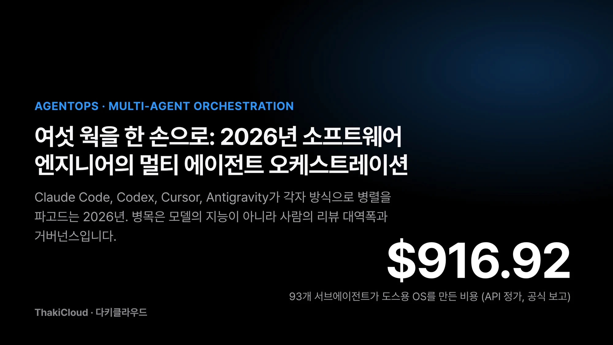
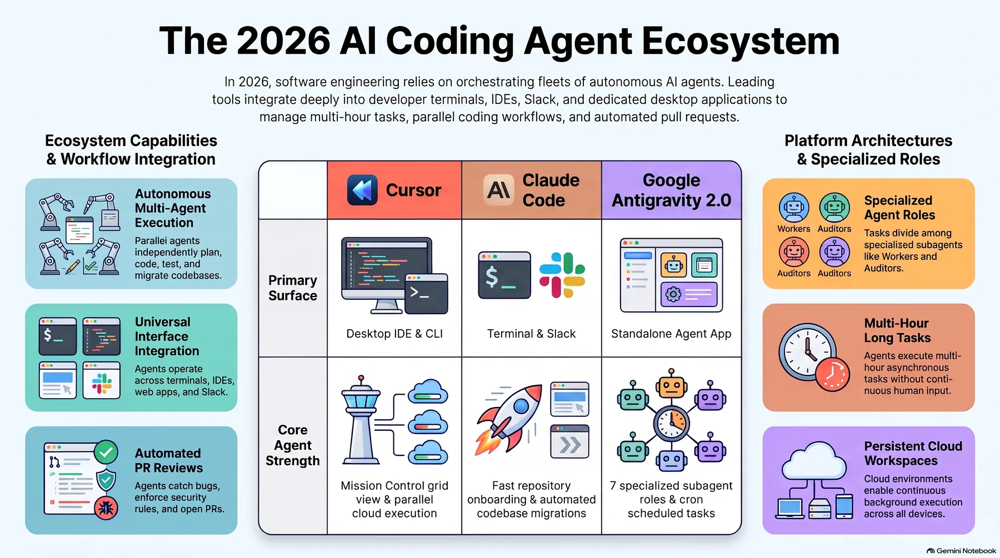
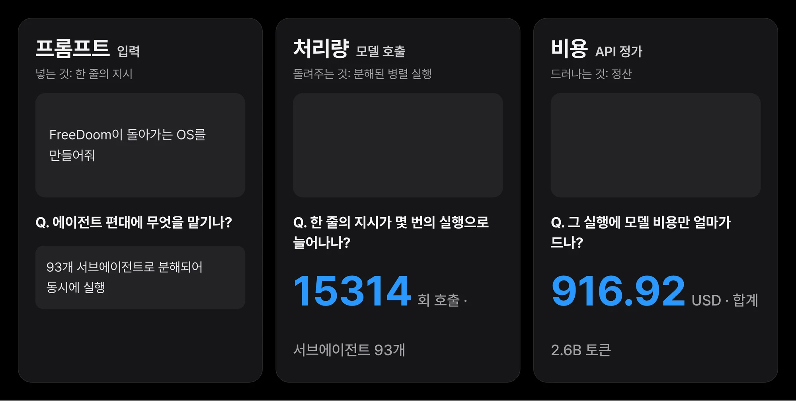
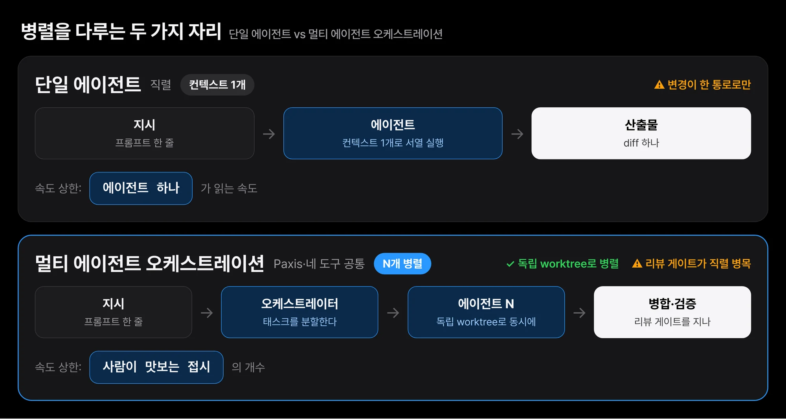
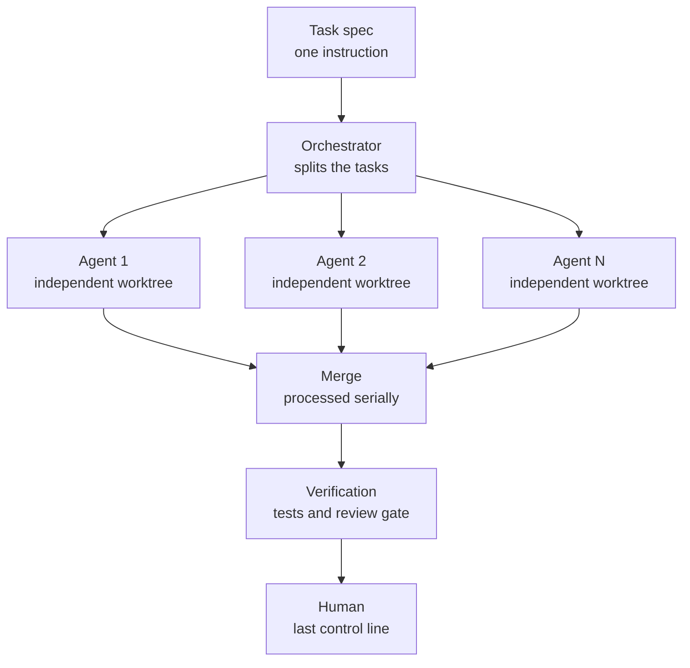

This morning, a 9-second video of a single chef working six woks at once lit up X. The caption read "Software Engineers in 2026 Orchestrating Claude, Codex, Cursor, Antigravity and other agents." 330K views and 171 replies within five hours of posting. A video with not a single line of code went this far because the people who commented tuned into their own seat, not the chef's.

This post is for the engineers and technical leads who have already started running several coding agents at once, or who must now decide whether to start. The conclusion first: the bottleneck of multi-agent orchestration is not the intelligence of the model. It is human review bandwidth and governance.

That claim is not abstraction. The Antigravity demo Google showed at I/O last May completed an operating system where Doom runs, with 93 subagents from a single prompt, and the officially reported cost was $916.92 at API list price. This post starts from how four tools each dig into parallelism, then covers what that demo proves and what it does not, and how the field where the bottleneck now sits gets designed.

*Like the chef's six woks, an engineer's six agents in one hand, 2026. The bottleneck is in human review bandwidth and governance.*

## Why a 9-Second Video Took 330K Views

The star of the video is a single chef in a striped shirt. He drops glistening green beans into the woks on six gas burners, stirs one, and moves his hand to the next. He pours oil, checks the seasoning, flicks in the rest. Six woks are on the fire at once, yet no tension shows on screen. The video is 9 seconds and carries no numbers.

But once the caption landed, the scene was read as something else immediately. The one line "software engineers in 2026 orchestrate Claude, Codex, Cursor, Antigravity" was laid over the chef's hand motions. All four names are coding-agent products that actually exist right now, so the analogy becomes a technical explanation on the spot.

What deserves attention here is that the analogy reads without needing explanation. Two years ago, saying "an engineer runs several agents at once" required extra context. Now a 9-second kitchen video compresses that state more accurately. The workflow has already changed into that shape. That is what it means.

<!-- nlm-visual -->

*Infographic generated by NotebookLM from the sources.*

## The Four Tools Dug Into "Parallel" Each Their Own Way

I checked the four products named in the tweet caption on their official sites. The common ground is clear: the 2026 product pages use the word "parallel" directly.

Claude Code is Anthropic's coding agent, and its execution surface is wide: command line, desktop, editor, browser, phone, Slack. The official page presupposes running several Claude agents at once. OpenAI Codex is offered in four branches, inside ChatGPT, an editor extension, a CLI, and Codex cloud, and the page states "runs many agents in parallel" verbatim.

Cursor is a product that started as an AI-native editor and added cloud agents on top. The official site uses "fleets of agents that work in parallel" and puts the picture of sending an agent fleet on one instruction front and center. Antigravity is Google's agent-first development platform: first unveiled in November 2025, it returned as 2.0 at I/O in May 2026. 2.0 is an agent manager without an IDE, and it newly adds asynchronous task management, dynamic subagents, JSON hooks, and scheduled tasks.

The four products' parallel strategies look similar on the surface, but the seats they touch are different. One table organizes them.

| | Claude Code | OpenAI Codex | Cursor | Google Antigravity |
|---|---|---|---|---|
| Parallel as the official wording says it | several Claude agents running at once | "runs many agents in parallel" | "fleets of agents" working simultaneously | dynamic subagents (2.0) |
| Main execution surface | CLI, desktop, editor, browser, Slack | ChatGPT, editor extension, CLI, cloud | AI-native editor, cloud agents | agent-first app (no IDE) |
| Control devices | permission modes, hooks | cloud sandbox, review flow | cloud agent review | JSON hooks, scheduled tasks, guardrails |

(Per each product's official site, checked November 23, 2026.)

One boundary to draw here. All four products solve the problem of "one developer running N agents from their own desktop." If an organization runs N agents and must audit all of their actions, one more seat is needed that this table does not have. You will meet that seat again in the Paxis section below.

## 93 Subagents Built an OS Where Doom Runs

As evidence that parallelism has become an execution primitive, the Antigravity team's OS build is the most concrete. Google published on its official blog that it built a functional OS running FreeDoom from a "single prompt." The reported numbers are these.

93 subagents, 15,314 model calls, more than 339 million input tokens. The total exceeded 2.6 billion tokens. The model was Gemini 3.5 Flash, and the cost at API list price was $916.92. And the concluding sentence is short: "It worked. We could play Doom on it." Doom ran on top of it. A list was published alongside: a playable version of AlphaZero built the same way, a photo editing suite, a real-time messaging app, and a multi-user collaboration platform.

*Numbers quoted from the OS build report on the Google Antigravity official blog. The input and output of the run that built a Doom-capable OS with one "single prompt".*

What this demo proves is clear. The structure in which agents split into agents and the split agents work at the same time has moved from a research topic to a product primitive. The cost came down with it. Officially reported: "a three-figure number of dollars."

But what this demo does not prove is larger. The report has no sentence saying a human reviewed the 2.6 billion tokens of changes. "Doom runs" does not mean "this OS is safe, maintainable, and will still run next week." In the demo, the verification cost is pushed outside the report. The $916.92 includes model cost only; review cost is not in it. That distinction divides the remaining half of this post.

## When There Are Six Woks, the Chef's Hands Become the Bottleneck

Back to the kitchen. What were the conditions under which the chef could work six woks at once? First, the ingredients in each wok were independent. The wok frying green beans did not share broth with the other woks. Second, the tasting was still done by one chef. Third, every wok was inside the reach of the chef's hands.

Parallel execution of coding agents takes these three as conditions. But all three leave cost on the human side.

First, context fracture. Each agent sees only the context of its own worktree. If agent B does not know the interface agent A changed, a collision happens at merge time, or even without a collision the two break each other's assumptions. More woks means more recipes that share "the same broth," and the fracture grows with the number of combinations.

Second, merging is still serial. Agents work in parallel, but git merge is processed one at a time. The moment the changes of six agents are gathered into one codebase is the moment the benefit of parallelism is verified, and also the moment failure shows up.

Third, review bandwidth. A chef cannot taste six plates at once, and an engineer cannot read the output of six agents at once. If the human is the last control line, the ceiling of parallel speed is set by human reading speed.

Fourth, cost control must come first. 2.6 billion tokens is the amount of one demo. A demo does not need a budget. A workflow that runs every day does; without one, $916.92 gets replicated as a monthly number.

*The left lane is the serial path of a single agent; the right lane is multi-agent orchestration. The benefit of parallelism is settled at the merge and verification stages.*

The diagram says one thing. The benefit of parallelism is not born while the agents are working; it is settled at merge and verification. So the design unit of orchestration should be counted as "how many review gates," not "how many agents."

## Paxis Does Not Assume "This Seat Is Empty"

At this point I will add ThakiCloud's view. The problem the four tools solved is "one developer running N agents from their own seat." The next problem is "an organization running N agents, auditing all of their actions, and settling the cost." No product has yet been designed on the premise that this seat is empty.

Paxis is ThakiCloud's Agent-Native Cloud, a control plane that treats this seat as a first-class resource. Translated back into the chef's kitchen, it goes like this.

Task splitting is done by Paxis's DAG multi-agent. It is not entrusted to one prompt line: it is split as a code-owned execution plan, and the output of each stage becomes the input of the next. As the chef divides the ingredients into six woks, the orchestrator divides context to each agent.

The stations are isolated sandboxes. Each agent cannot touch the file system of another. This is isolation of the execution environment itself, going beyond worktree isolation. It is the same reason each wok sits on its own burner.

The recipe book is the Skill Harness. Paxis selects from more than 960 skills with BM25 and puts them on the execution surface. As the chef does not rewrite the recipe from scratch when adding one more wok, an agent receiving a new task selects and uses the skills it needs.

The health-inspection authority is held by the policy gate and the audit log. Every action, which agent did what to which file with which tool, must pass the gate, and once it passes it is recorded. As no plate the chef has not tasted can leave the kitchen, no action that has not passed the policy gate reaches the organization.

Even through the ai-platform lens it is one line. Multi-agent execution is ultimately GPU cost. When agent N makes model calls M times, the fact that those calls pass through a queue, get settled, and stay under budget is the work of ai-platform's Kueue queue and cost layers. The same reason the gas meter has to get more precise as the kitchen grows.

## Four Things to Know Before You Write

An analogy is good because it teaches where it breaks. Four of them, organized in fours.

One: coupled tasks are not parallelizable. Splitting an agent into six in a codebase where file and feature boundaries are blurred makes the six changes share the same broth. The premise of parallelism is the independence of the ingredients; without it, the merge cost is just prepaid.

Two: the review gate is not optional. The Antigravity demo showed that "it ran" does not prove "it ran correctly." When agent output comes out in parallel, review comes in serial, and that serial decides the overall speed. An organization that does not widen review bandwidth is an organization that only adds woks.

Three: cost measurement is a premise. $916.92 is the number of one demo. In a workflow that runs every day, the word "every day" attaches to that number. Without a budget cap and token settlement, the benefit of parallelism evaporates on the invoice.

Four: the chef is still one person. The one working six woks is the chef, and the one tasting six plates is the chef. Multi-agent does not give the engineer six hands. It makes one hand reach farther. The farther the reach, the deeper the last tasting has to be.

## To Close

The 9-second kitchen video was an analogy. But that the analogy reads without explanation means the field is already in that shape. The four tools are digging into parallelism each their own way, Google published the demo of building an OS with 93 subagents, and the question has now moved from "whether to run it" to "how to govern and settle it."

The first experiment you can do today is small. Two agents, two worktrees, one review gate. At the seat where these three turn, check with your own eyes where the bottleneck sits. The real lesson of the scene where a chef works six woks with one hand is not the number of woks. It is the number of tastings.

The limit of multi-agent orchestration is not the intelligence of the model. It is human review bandwidth and governance. The wider the kitchen, the more precise the gas meter and the health-inspection authority must be. That is the law of this field.

---

**Sources**

- [Jaydeep (@_jaydeepkarale) tweet, 2026-11-23](https://x.com/_jaydeepkarale/status/2124717898203849052) (original 9-second video, chef with six woks)
- [Google Antigravity: Our agents built an OS](https://antigravity.google/blog/google-antigravity-built-an-os) (93 subagents, $916.92)
- [Google Antigravity 2.0, 2026-05-19](https://antigravity.google/blog/introducing-google-antigravity-2) (dynamic subagents, JSON hooks)
- [Anthropic Claude Code](https://claude.com/product/claude-code)
- [OpenAI Codex](https://openai.com/codex/) ("runs many agents in parallel")
- [Cursor](https://cursor.com) ("fleets of agents that work in parallel")
