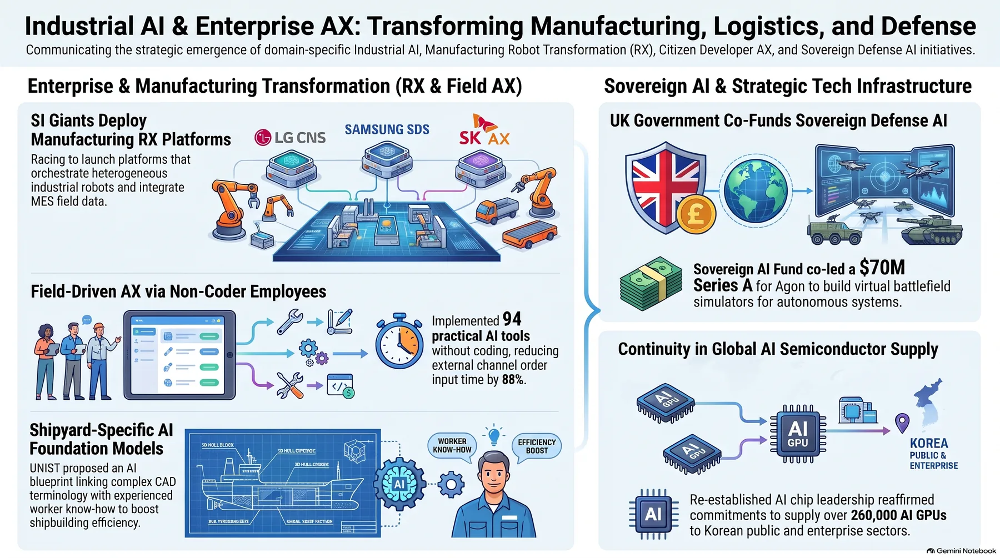
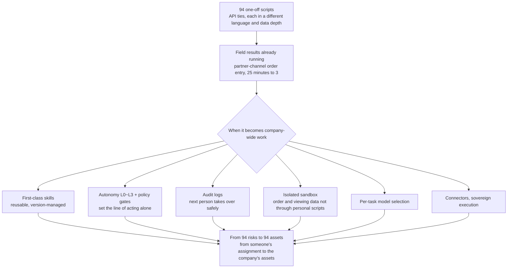
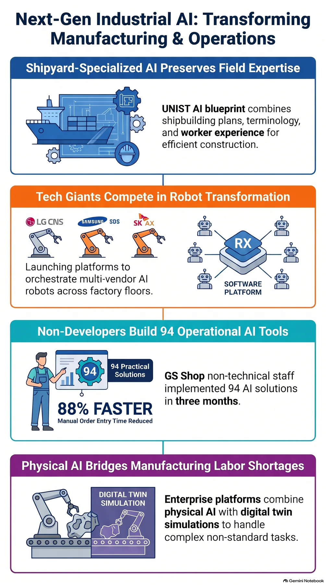

The team winner of the live demo day on November 20 was called "Moonrae Bangatgan." A name you rarely hear at a company showcase. The team built an AI that connects viewing data with order data to support broadcast operations. Demo Day was the final stage of GS Shop's internal AI program, which ran for three months from August 24 to November 20. Eight teams and eight individuals advanced to the finals. 178 employees who do not write code, including MDs, PDs, and marketers, registered 113 assignments, and 94 of them became completed AI solutions. Popcorn News reported it on the 24th. 94 is clearly a number worth celebrating. But before the applause, one more question. Where do those 94 go from here?

*The post's core concept, visualized. 94 citizen AIs, and the one layer that has to sit beneath them.*

## 94 Born Without Code

The program is called AX:CEL. Employees built the solutions with commercial generative AI like ChatGPT, Gemini, and Claude, plus internal mentoring. Most of the 94 completed solutions address practical work such as order processing and data-processing automation. The biggest result is order entry for partner channels. A task that used to take 25 minutes now takes 3, cutting processing time by about 88 percent, and some solutions moved into real operations at the end of October. That means these are not performances for demo day. They are work running on the sales clock.

This is not a GS Shop story alone. The race for dedicated AI teams is in full swing in the home-shopping industry. NS Home Shopping's content-production AI, Nsongi, cut post-broadcast processing from 4 hours to 40 minutes. HomeN Shopping has set up an AI strategy team, and Hyundai Home Shopping has built an AX team of about 10 people and is introducing its own AI agents. GS Retail created an AX innovation division in its July reorganization. It is not even a home-shopping-industry story. According to SisaOn, LG CNS, Samsung SDS, and SK AX are in a standoff over factory robot orchestration, and the competitive landscape in that field is expected to take shape by 2027. Ulsan Daily reports that UNIST has presented a development blueprint for an AI that learns shipyard design drawings and production records. Field workers who cannot code are building AI directly, and AI is moving into the field at the same time.

The direction of this change is clear. The focus of field AI transformation is shifting from large-scale system builds to a citizen-development stage, in which employees in operational roles redesign their own processes directly with commercial AI tools. GS Shop's three months are the clearest evidence of that shift.

<!-- nlm-visual -->

*Infographic generated by NotebookLM from the sources.*

## From 25 Minutes to 3, and From 3 to Questions

It sounds like a story that ends on a congratulations card: order entry went from 25 minutes to 3. But the moment it moves into real work, the story changes. What data does this solution touch? Who has the authority to run it? Who is accountable when it is wrong? Which model runs it, and what does it cost? If another department says it wants to use Moonrae Bangatgan's broadcast-operations AI as-is, what has to change first?

Most of the 94 solutions completed in three months were born as one-off scripts and API connections. Within the same company, each solution uses a different language, a different tool environment, and reaches a different depth into the data. None of that is a problem by itself. The problem arrives when they come down from the demo stage and become "company-wide work." Look at the list from a governance angle and the gaps are bigger than expected. Relying on commercial APIs, unconnected data systems, and thin security controls are acceptable at the scale of one person and one department. The moment they go company-wide, the same properties become operational risk and governance risk. As field pilots spread, the demand grows for a platform that turns them into verifiable agent assets, and the industry's gaze is already moving in that direction.

And these questions do not come up only once. The further we move toward an era where work itself runs in place of people, the more the answers to the same questions are needed again every morning. If no one has drawn the line on how far you may act on your own, freedom becomes an incident. The real output of a field AI program is not 94 pieces of software. It is 94 of these questions. The wave of citizen development that GS Shop demonstrated is now flowing through retail, manufacturing, and shipbuilding at the same time. The questions that follow are all the same. If you cannot build up answers, the next 94 will become 94 risks.

## The Same Week, the Top Paid for Governance

The interesting part is that the same week, the top did the opposite: it put money into "devices that take responsibility." According to Global E, Jensen Huang returned to the CEO seat 11 days after his resignation. The board approved the return unanimously, and the incident began with suspicions of involvement in Chinese spying activity. The price of the return is dual oversight. A "National Security and Export Control Committee" composed entirely of independent outside directors, and a newly created Chief Compliance Officer (CCO) under the board. President Trump welcomed the return, saying there is "no national security risk." During those 11 days, the market was shaken by the fear that the roadmap as a whole, from AI model companies to data center infrastructure, could stop. Global E reports that with Huang's return, the next-generation Rubin architecture roadmap and the big tech capital expenditure cycle came back to normal. On the news of the return, Nasdaq rose 6.5 percent, its largest one-day gain in 19 months, and Financial Post reported that NVIDIA's stock jumped more than 30 percent in a day.

The credentials of the person who sent that one-line welcome matter too. Ha Jeong-woo, the full-time vice chair of the National AI Strategy Committee, comes from industry, where he led HyperCLOVA X and sovereign AI at Naver Cloud. He also served as the first Chief of Staff for AI Future Planning. His remark that it is a "truly dynamic AI world" shows how the policy control tower saw the 11 days in which the center of the supply chain wobbled.

The regulatory current hardened over the same period. On the 16th (local time), the US Department of Commerce (BIS) announced a rule that makes prior approval mandatory for overseas data centers providing large-scale compute remotely to high-risk countries, and existing operators have to comply within 90 days. The intent is to block the path by which Chinese companies borrow third-country data center resources, such as in Southeast Asia, to make indirect use of advanced US semiconductors. Meanwhile, NVIDIA's commitment to supply more than 260,000 GPUs to Korea by 2030 stands. The government, Samsung, SK, and Hyundai Motor Group get 50,000 each, and Naver Cloud gets 60,000. But with NVIDIA's decision-making structure being reorganized, the supply priorities for next-generation accelerators may be readjusted, which is why startups and research institutions that cannot secure their own GPUs are watching most closely.

The UK government combined the Sovereign AI Fund and the National Security and Strategy Investment Fund (NSSIF) for the first time to co-invest in a $70 million Series A for the defense AI startup Aegon. Aegon is developing "virtual battlefield" simulations that train and test autonomous defense systems. Its total funding has reached $100 million, and its valuation is $450 million. The UK government also put an additional £140 million into the Sovereign AI Fund in its autumn budget. It is a signal that defense AI is crossing from a product into a national security issue.

In Korea, that money is already turning into groundbreakings. Gyeongnam Newspaper reports that Hanwha is proceeding with a Changwon defense AI data center project worth 809.8 billion won in total, and that Hanwha Aerospace has secured 50 percent of the IT capacity through a lease. The phase-one budget of 627 billion won is being financed in the financial market, with completion targeted for March 2028. Hanwha Aerospace also said it will invest roughly 2 trillion won more, together with Hanwha Systems, in a "Defense OS" that learns from and infers on battlefield data in real time by 2040. Changwon is the largest cluster of the defense industry. In the same July, an investment agreement for a 100 MW-class AI data center dedicated to the defense industry, worth 1.6555 trillion won, was also signed. Sovereignty, export controls, oversight, investment. The bigger the authority, the steeper the price the top is paying for autonomy.

And yet, Maeil Business Newspaper pointed out that even two weeks after emergency patches were deployed, 57 percent of military firewalls were still at "automatic door" level. At a time when the security industry's standard is moving from "was the patch applied" to "is the defensive effect actually verified," what that 57 percent says is clear. The top buys governance, the top's governance is attached conditionally, and the bottom's execution walks on without governance.

## So What Is That "1"?

The "1" in the title is not a specific product. It is a layer. The layer that turns the one-off 94 into assets that can be held accountable for. What the 94 solutions prove is that employees in operational roles no longer have to "wait for the IT department" to use AI. And precisely for that reason, when this power goes company-wide, the question "who sets up governance" follows. Look at GS Shop's three months through the lens of ThakiCloud's Paxis, that is, Agent-Native Cloud (v1.1 GA, the official product), and you see not a deficiency but a missing structure.

The 94 solutions should be first-class skills that can be reused and version-managed. The autonomy level (L0 to L3) and policy gates decide how far MDs and PDs can execute on their own, and audit logs record what was actually executed. Audit logs exist not to punish but so the next person can take over the work safely. Order and viewing data must not flow through personal scripts. They have to run inside isolated sandboxes. Which model runs which task is decided not by inertia but by per-task model selection. The places where systems need to connect are the job of connectors, and if those assets have to run on a closed network, sovereign execution becomes part of the question as well.

*The missing "1" in the 94 is not a product but a layer. The six components that turn the 94 one-off scripts into company assets the moment they become company-wide work.*

The same holds from the skills perspective. A skill validated in one department has to be reusable by another department's agents. Only then do the 94 become shared assets of the organization.

Think concretely. If order-entry automation is registered as a skill, then when one more channel is added, the work is not coding again but re-reviewing permissions and policy. If one more department starts using the broadcast-operations AI, the work is not building anew but raising the autonomy level by one notch. That is the moment when the 94 become 94 "assets" rather than 94 "possessions." Paxis is not a tool for rewriting the 94 solutions from scratch. It is the place where what was validated on demo day changes from "someone's assignment" into "the company's assets." That is exactly the difference between the 94 and the next 100.

## Demo Day Is Over; the Real Work Is Beginning

Popcorn News framed it as "field-driven AI transformation." The 94 that GS Shop completed in three months will become the sample other companies look at when they design governance next quarter. The field's departure has already happened. The next stage is growth, and growth comes from operations, not demos. The place to start is every company that ran AI in real work this year. First, count the solutions you have built, then classify them: how much autonomy to give each one, what permissions and what audit to attach to the ones you will reuse, and whether you can roll back when one is wrong.

The applause on demo day was the end of three months, but the 94 questions are the start of the next three. Deciding who is accountable for the next 100 is no longer a GS Shop problem alone. Jensen Huang paid that price in the boardroom, and 57 percent of military firewalls are still automatic doors. The top, conditionally. The bottom, not at all. And the middle, still unprepared. The price of autonomy is not paid once. It is paid again every time something runs.

<!-- nlm-visual -->

*Infographic generated by NotebookLM from the sources.*

## References

This post is compiled from the news articles below.

- Global E, [Jensen Huang Returns... He Prevented a System Collapse, but Wore the Shackles of Dual Oversight](https://www.globale.co.kr/news/articleView.html?idxno=41811)
- Gyeongnam Newspaper, [Hanwha Fully Pushes Its Changwon Defense AI Data Center Project](https://www.knnews.co.kr/news/articleView.php?idxno=1555781)
- Popcorn News, ["Field Employees Who Don't Code Directly Implemented 94 AI Solutions"... GS Shop's "Field-Driven" AI Transformation](http://www.popcornnews.net/news/articleView.html?idxno=141181)
- SisaOn, ["It Commands the Robot Factory"... the Three Major SIs' "Manufacturing RX" Standoff](https://www.sisaon.co.kr/news/articleView.html?idxno=206037)
- Ulsan Daily, [UNIST Presents a Blueprint for Developing AI That Learns Shipyard Field Knowledge](http://www.ujeil.com/news/articleView.html?idxno=395750)
- Hankooki Weekly, [The "Jensen Huang Shock" That Swept Korean Industry: The Actual Impact Is "Hmm"](https://weekly.hankooki.com/news/articleView.html?idxno=7194703)
- AI Times, [UK Government Invests Directly in Sovereign Defense AI Development... "Aegon," Which Raised $70 Million](https://www.aitimes.kr/news/articleView.html?idxno=42858)
- Financial Post, [Ha Jeong-woo, Vice Chair of the AI Strategy Committee: "Jensen Huang's Return, a Truly Dynamic AI World"](https://www.financialpost.co.kr/news/articleView.html?idxno=302644)
- Maeil Business Newspaper, ["What Good Is Shouting About Communications Security... 57% of Military Firewalls Are at Automatic Door Level"](https://www.mk.co.kr/article/12216691)
