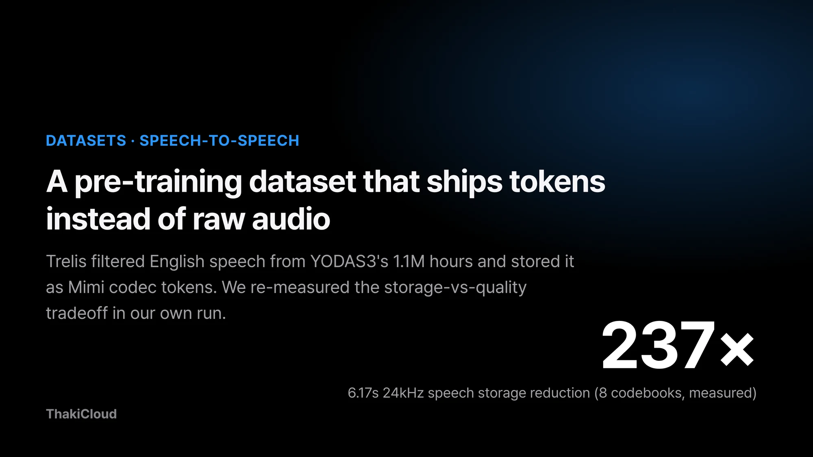
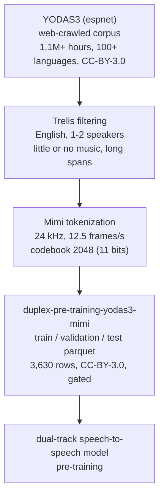
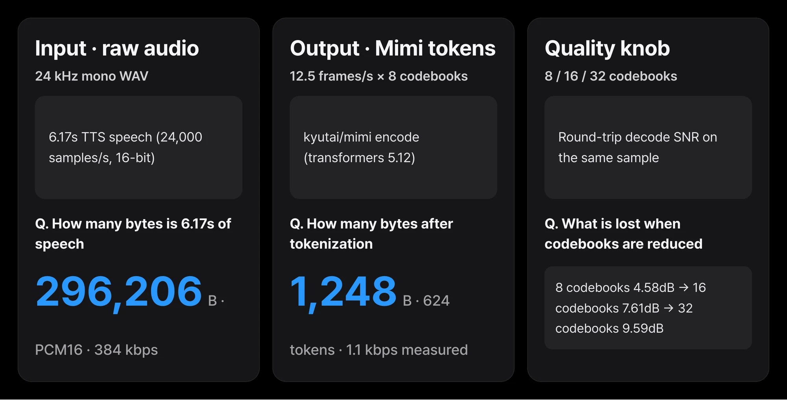
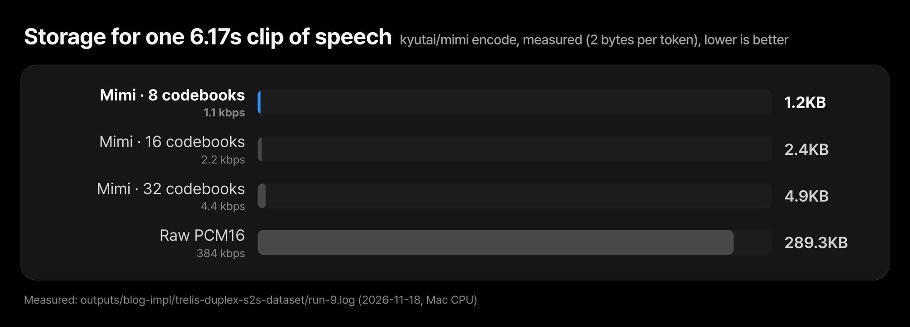

*A pre-training dataset that ships tokens instead of raw audio. Headline number: 237x storage reduction for a 6.17s 24 kHz clip (8 codebooks, measured).*

If you work on voice agents or speech-to-speech (S2S) models, you will eventually face a storage decision. Keep conversation logs as raw audio, or convert them to codec tokens. That decision changes more than storage cost. It changes the I/O structure of the entire training pipeline.

It has become more pressing because duplex voice, where both sides of a conversation speak at the same time, is moving from research demos into products. The amount of conversation data you have to keep grows with it.

A new public dataset gives this decision a concrete reference point. Trelis, a company that runs speech separation and audio annotation services, published `Trelis/duplex-pre-training-yodas3-mimi` on Hugging Face on November 18, 2026. It is the first release in their planned series of S2S datasets and models.

The defining feature: it ships Mimi codec tokens instead of raw audio. The card claims it is "compact." So we re-measured that claim ourselves. Encoding a 6.17-second 24 kHz clip with Mimi at the 8-codebook setting reduced the original 289 KB to 1.2 KB. A 237x compression. This post covers what the dataset is, how far the tokenization claim holds up under measurement, and four things to know before using it.

## A speech company's first move: a dataset that carries tokens, not audio

Trelis lists its speech separation and audio annotation contact on the dataset card. This is not an academic release from a research lab. It is a service company publishing the data it actually uses in its own pipeline. The announcement tweet calls it the first in a series.

The publicly readable card facts:

| Field | Value (public page, checked) |
|---|---|
| Name | `Trelis/duplex-pre-training-yodas3-mimi` |
| Purpose | pre-training for dual-track speech-to-speech models |
| Content | English, 1-2 speakers, little or no music, long spans |
| Source | drawn from YODAS3 (English), referenced by shard and member |
| Format | audio tokens (Mimi) in place of raw audio |
| Files | train / validation / test parquet |
| Size | 3,630 rows (viewer metadata; row granularity unverified) |
| License | CC-BY-3.0 |
| Access | gated (approval required) |
| Published | created 2026-11-13, updated 2026-11-18 |

The phrase "referenced by shard and member" matters. The dataset does not carry raw audio. It carries an index into the source corpus. The YODAS3 schema has a shard field, and this dataset points at the originals by those coordinates. If you need the raw audio, you follow the coordinates back. If you only need training data, the tokens are enough.

## YODAS3: a filter over 1.1 million hours

YODAS3 is a web-crawled audio corpus maintained by espnet. Its official card says it holds over 1.1 million hours in more than 100 languages, licensed CC-BY-3.0, and crawled from a distinct set of videos from v1 and v2 so there is no overlap. It targets ASR, TTS, and audio representation learning.

Trelis took the English subset and filtered it on three conditions the card states. Long spans of speech, one or two speakers, and little or no music. Put against the name, you can see why those conditions matter for "duplex."



For pre-training, a long natural flow of two people talking is more valuable than precise utterance labels. The no-music condition picks segments where the background is almost entirely speech, the case where the signal and the interference an S2S model must learn are clearest. YODAS3 is weakly labeled, so Trelis's filtering selects on signal quality rather than label quality.

The license carries through. YODAS3 is CC-BY-3.0, and so is the Trelis dataset. With attribution, you can train on it and distribute derivatives.

The words "duplex" and "dual-track" are worth a second look. The card names "dual-track speech-to-speech models" as the target, which reads as keeping the two sides of a conversation (speaker 1, speaker 2) on separate tracks. The README is gated, so the exact track definition is unverified, but the 1-2-speaker filter points in the same direction. A full-duplex voice model must handle conversations with crosstalk and overlap, and separate tracks let it learn who spoke when, explicitly.

## Mimi tokens: a codec with a 32-position quality dial

Mimi is the neural audio codec developed by Kyutai. It turns 24 kHz audio into tokens at 12.5 frames per second, with 32 codebooks per frame. A codebook is a table that represents part of the audio as a discrete number, one of 2048 entries, 11 bits. The first codebook carries the semantic token, and the rest carry acoustic tokens, timbre and intonation. Kyutai's official page says it was built for Moshi, their full-duplex voice assistant, and that Sesame CSM, VoXtream, and LFM2-Audio use the same tokenization today.

The Mimi model card states a bitrate of "1.1 kbps." Our experiment showed what that number actually refers to. Opening the checkpoint, we counted 32 codebook layers (1 semantic + 31 acoustic). Decoding with only the first N codebooks gives three natural settings.

```
8 codebooks  -> 1.112 kbps  (matches the model card claim)
16 codebooks -> 2.225 kbps
32 codebooks -> 4.449 kbps
```

The dial works because of RVQ, residual vector quantization. The first codebook captures the coarse shape of the audio, the second fills in what the first left over, and so on up to 32 stages. Truncating at any point still decodes, and quality steps down with the number of stages you drop.

In other words, Mimi is not a single-bitrate codec. It is a 32-position quality dial. When storage is tight you drop to 8, and when quality is tight you go to 32. The Trelis dataset ships "Mimi tokens," and which position on the dial it carries is not in the public information. That is exactly why we measured all of 8, 16, and 32 in our own run.


*The storage format of one 6.17-second 24 kHz clip. Left is raw audio, middle is Mimi 8-codebook tokens, right is round-trip SNR by codebook count. All measured in this post's experiment.*


*kyutai/mimi encode, measured (2 bytes per token). The tiny bars are what 237x compression actually looks like.*

## Measuring one 6.17-second clip

Here is the run. We pulled the `kyutai/mimi` checkpoint from Hugging Face, loaded it with transformers 5.12's `MimiModel`, encoded a 6.17-second 24 kHz mono clip from our own TTS benchmark, and decoded it at 8, 16, and 32 codebooks. On a Mac CPU, encoding took 0.11 s and the full decode 0.093 s.

| Setting | Tokens | Storage | Bitrate | Round-trip SNR |
|---|---|---|---|---|
| Raw PCM16 | - | 296,206 B | 384 kbps | reference |
| Mimi, 8 codebooks | 624 | 1,248 B | 1.112 kbps | 4.58 dB |
| Mimi, 16 codebooks | 1,248 | 2,496 B | 2.225 kbps | 7.61 dB |
| Mimi, 32 codebooks | 2,496 | 4,992 B | 4.449 kbps | 9.59 dB |

Three numbers to note.

First, compression. Versus raw, 237.3x at 8 codebooks, 118.7x at 16, and 59.3x at 32. Bit-packed storage (11 bits per token) takes the 8-codebook case down to 858 B.

Second, quality. SNR climbs by roughly 3 dB each time the codebook count doubles. 4.58 dB at 8, 9.59 dB at 32. But SNR is not a perceptual quality metric. The sample was a single TTS voice, and the decoded output came back at 0.93-0.96x the input scale, which may understate SNR. Read the storage numbers as this run's measurements, and treat the quality numbers as needing a listening test.

Third, the model card's claim. "1.1 kbps" is the 8-codebook setting, not the full 32. When a dataset card says only "Mimi tokens," this is where you find out why you should ask which position on the dial it carries.

One caveat up front. The sample is TTS-synthesized speech, not recorded human speech. Its spectral profile may differ, and that difference shows up in the SNR column. The compression structure, frame rate, codebook count, and bits per token, is content-independent, so the storage and bitrate measurements stand on this sample alone.

## The storage economics of one hour of conversation

Extrapolating the measured rate to one hour (3600 s), raw PCM16 is 172.8 MB while Mimi at 8 codebooks is 711 KB. The same conversation, about 240x apart.

The gap matters most in a pre-training dataset. S2S conversation data grows to hundreds or tens of thousands of hours, and every step, landing in S3 or a data lake, moving to GPUs, being read in batches, repeats the same multiplier. Raw audio runs at 384 kbps at every step. The 8-codebook tokens run at 1.1 kbps.

Transfer pays the same multiplier, not just storage. Moving 172.8 MB between nodes inside a cluster may not feel heavy. Replicating a corpus across environments, or moving it outside the workspace, prices the 240x directly. For a dataset that moves at all, the token-versus-raw choice lands on a different line of the cost sheet.

There is a second benefit: alignment with the training pipeline. Tokenized speech is a discrete sequence like text tokens, so it sits close to the existing LLM pre-training infrastructure, tokenizers, padding, batching. That is likely why Trelis labels it "pre-training."

## Four things to know before using it

**1. It is gated.** The raw README requires Hugging Face access approval. The public card cuts off at "It carries rich...", so what metadata is included is not visible before approval. Once you get in, the checklist is already set. The schema (field definitions), the track structure (what dual-track actually means in columns), the Mimi configuration (which codebook position is carried), and one sample segment. Every number in this post comes from the public page and our own measurements.

**2. English only.** YODAS3 covers 100+ languages, but Trelis filtered only English. You cannot use it as-is for Korean duplex voice work. The filtering recipe, though, long spans, 1-2 speakers, no music, transfers to other languages.

**3. It is codec-locked.** If the data is Mimi tokens only, decoding requires Mimi, and re-encoding with another codec is not possible. Tokens are a representation of the original, not the original. Keep in mind Trelis may choose a different codec for the next release in the series.

**4. A filter is not a label.** "Little or no music" is a selection condition, not a guarantee of precise utterance labels. The source YODAS3 is weakly labeled, and the Trelis dataset inherits that limit. It is probably sufficient for pre-training. For precise downstream evaluation, verify separately.

## Where it fits in a voice agent's storage economics

ThakiCloud meets this problem from two sides. In Paxis, our agent platform, a voice agent that logs conversations as raw audio accumulates 172.8 MB per hour. Logs are first-class data, the raw material for replay, regression evaluation, and audit. Keeping them raw means paying that 172.8 MB move every time a case is replayed or re-scored. As token sequences, the same log becomes an object you can sample, batch, and store alongside text-based LLM evaluation data.

The same holds on the ai-platform side, our learning infrastructure. When a customer pre-trains an S2S model on their own conversation data, the storage format is where the pipeline starts. Trelis's release compresses "corpus + filter + codec tokens" into a single dataset. Applying the same recipe to your own data, a practical design is to keep the originals and carry a token index alongside them, balancing storage against training.

## In closing

The biggest thing this experiment confirmed: the storage format for speech data is not a binary of raw-versus-tokens. It is a 32-position dial over codebook count. Trelis's first dataset is a public data point that shows the dial exists.

The first experiment you can run today: take one 24 kHz clip you have on hand, encode it with `kyutai/mimi`, and measure storage and SNR at 8, 16, and 32 codebooks. The measurement script from this post is at `outputs/blog-impl/trelis-duplex-s2s-dataset/mimi_token_measure.py`. The line that slices the codebooks and decodes is the core.

The dataset, the source corpus, and Mimi itself are linked below.

- Dataset: [Trelis/duplex-pre-training-yodas3-mimi](https://huggingface.co/datasets/Trelis/duplex-pre-training-yodas3-mimi) (gated)
- Source corpus: [espnet/yodas3](https://huggingface.co/datasets/espnet/yodas3)
- Mimi checkpoint: [kyutai/mimi](https://huggingface.co/kyutai/mimi) · [Kyutai codec explainer](https://kyutai.org/codec-explainer/)
- Announcement: TrelisResearch X post (2026-11-18) · [timeline RT](https://x.com/hjguyhan/status/2122894104720031996)

Sources: Trelis dataset public page (accessed 2026-11-18), espnet YODAS3 official card, Kyutai Mimi model card and codec explainer, our own measurements (run-9.log, 2026-11-18).
