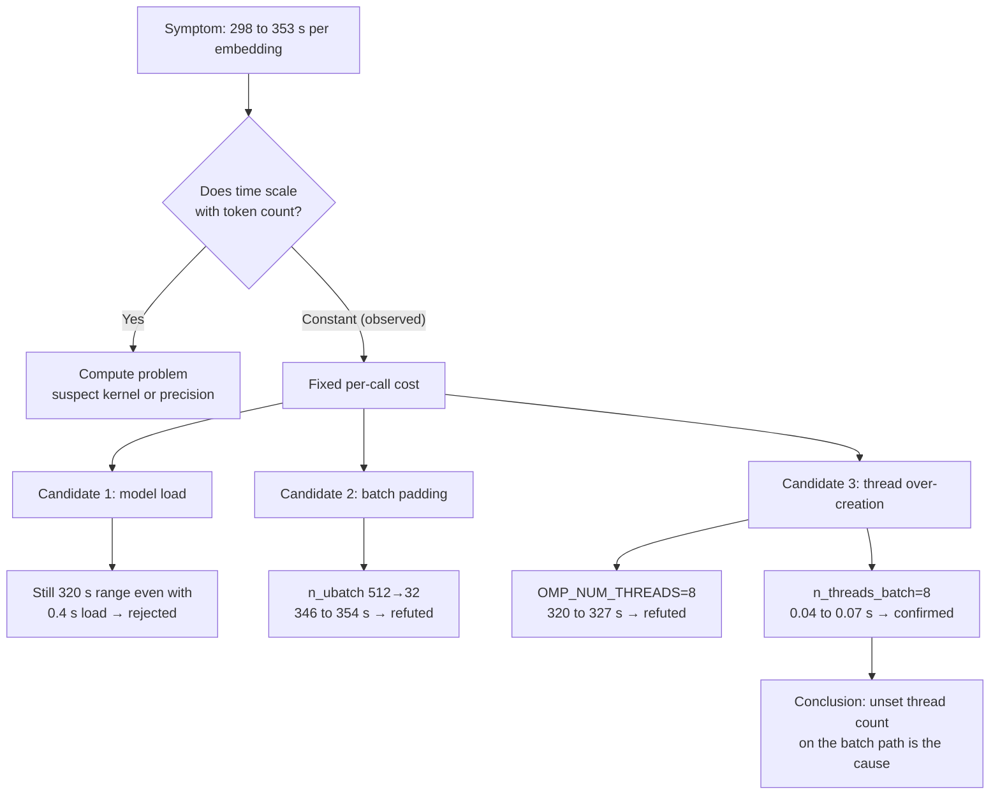

## Why Read This

This is for engineers running CPU inference or batch embeddings in Kubernetes pods who have to decide "why is this model so slow?" Bottom line first. The 7000x latency we hit was not the model or the quantization. It was **thread over-creation caused by not setting the thread count**, and the core count the library auto-detected inside the container differed from the core count the cgroup actually allowed. One observation, that latency did not grow when the token count grew, was the entry point to the diagnosis.


*Hundreds of threads blocking one another in front of a channel with only eight slots open.*

## Overview

We quantized a 0.6B embedding model to low bit width, then re-encoded it as a GGUF Q4_1 file (378,522,208 bytes) so a standard loader could run it. Whether the conversion preserved values was checked by a separate gate, which another post covers. This post covers only **one operational defect that surfaced as a side effect** of that verification.

The verification job is CPU only. We turned CUDA off (`GGML_CUDA=OFF`), installed llama-cpp-python 0.3.36, and loaded the model with `embedding=True`, `n_ctx=512`, `n_batch=512`, `n_ubatch=512`, `n_threads=8`. One embedding took **298 to 353 seconds**. The model is 0.6B and the sentence is about ten words. That number does not explain itself.

This is an easy place to misdiagnose. We had just quantized and converted the format, so explanations like "the low-bit kernel is slow" or "Q4_1 dequantization is expensive" were within arm's reach. But those explanations conflict with one observation.

## The Clue Was "Time Does Not Grow"

The measurement log printed the token count and elapsed time for each sentence. The Korean sentence was 9 tokens, another was 16 tokens, and the English sentence was 8 tokens. Yet the time was the same, in the 320-second range, in all three cases.

The absence of proportionality is what matters. If compute were the cause, doubling the tokens would roughly double the time. A near-constant time regardless of token count points to a **fixed per-call cost**. The candidates for a fixed cost are few: model load, graph allocation, memory copies, and thread creation and synchronization.

Model load was ruled out. In the first measurement the load took 51.1 seconds, and in the next run, which re-read the same file, the page cache was warm and the load took 0.4 seconds. Even in the run with a 0.4-second load, the embedding still took 320-odd seconds. Load and inference were separable.

## How to Recognize This Symptom in the Log

llama.cpp prints a performance summary when it frees the context. The summary from our first run looked like this.

```text
llama_perf_context_print:        load time =  322563.85 ms
llama_perf_context_print: prompt eval time =  322540.01 ms /     8 tokens
                          (40317.50 ms per token,     0.02 tokens per second)
llama_perf_context_print:        eval time =       0.00 ms /     1 runs
llama_perf_context_print:       total time =  322563.94 ms /     9 tokens
```

There are three ways to read it. First, `prompt eval time` is nearly all of `total time`. That is expected for embeddings, which do no generation, and it also means **the slow section is the prompt-evaluation path**. That one line points you at the batch path's thread setting. Second, 40 seconds per token cannot be explained physically for a 0.6B model. Memory bandwidth or precision issues do not produce a gap of this size. Third, `load time` and `prompt eval time` are printed with almost the same value. In this implementation the load timer includes everything up to the first evaluation after context creation, so reading the two adjacent values as "load is slow" sends you digging in the wrong place. Our grounds for dropping load as a candidate were elsewhere: in the run where the warm page cache cut load to 0.4 seconds, embedding stayed in the 320-second range.

The same summary also printed `graphs reused = 0`. That line reads as "the graph is rebuilt on every call," which made it look like a fixed-cost candidate, but we **did not attribute the cause to it**. In arm A, changing only the thread argument made the latency disappear, and we never touched graph reuse. Writing a plausible-looking line down as a cause sends the next person digging in the same spot again.



## The Hypothesis That Was Wrong First: OpenMP Over-Creation

We read two facts inside the pod first. `os.cpu_count()` returned **256**, and `/sys/fs/cgroup/cpu.max` was `800000 100000`. The latter means 800 milliseconds of CPU time per 100-millisecond period, which is **8 cores**. So when the library counts cores automatically, it sees 32 times the actual allowance.

The llama.cpp build log also printed `OPENMP = 1`. So we formed a hypothesis: ggml runs its parallel sections with OpenMP, and the OpenMP runtime spawns as many threads as the host has cores, contending within 8 cores. The explanation was clean and fit the environment facts.

We pinned `OMP_NUM_THREADS=8` and `OPENBLAS_NUM_THREADS=8` and re-timed the same sentences. The results were **320.77 s, 325.9 s, 326.7 s**. Nothing changed. The hypothesis was refuted.

Not stopping there is the whole point of this investigation. When a plausible hypothesis matches the environment facts but the numbers do not move, the thing to trust is **the number that did not move**.

## Splitting Into Arms and Measuring Once

Two candidates remained. One was that the batch is padded to `n_ubatch`, so it always computes 512 positions. The other was that llama.cpp keeps a separate thread count for the prompt-evaluation path. The latter came from rereading the API. When loading the model we had passed only `n_threads` and left the batch-path argument empty.

We measured both as arms within the same job. Same file, same build, same machine, same three sentences. Measuring them together matters. Measuring separately mixes in differences in node state and page cache.

| Arm | Setting | Embedding time (3 sentences) |
|---|---|---|
| Baseline | `n_threads=8` | 298.53 s / 327.69 s / 353.4 s |
| A | `n_threads=8`, `n_threads_batch=8` | **0.05 s / 0.04 s / 0.07 s** |
| B | `n_threads=8`, `n_batch=32`, `n_ubatch=32` | 346.2 s / 349.51 s / 354.09 s |

Two things were settled at once. Arm A is **about 7000x** faster than the baseline. And arm B stays as slow as before, so **the batch-padding hypothesis was refuted**. If padding had been the cause, arm B, which cut the computed positions from 512 to 32, should have been visibly faster.

The cause breaks down like this. llama.cpp uses **different thread counts** for the path that generates tokens one at a time and the batch path that processes the prompt in one go. Embedding is entirely prompt evaluation, so it takes only the batch path. If that value is not set, the library sizes the pool from the host core count, and in a container where the cgroup allows only 8 cores, hundreds of threads fight over the same eight slots. As threads multiply, synchronization cost and context switching grow, while the actual compute progresses only at an 8-core pace. That is why it looked like a fixed cost independent of token count.

## So in a Pod, Read the Core Count and Set It Explicitly

The lesson is not "use 8." Eight was just that container's cgroup allocation. The answer is to **read the usable core count at runtime** and pass it straight into the thread settings. We wrote the same thing in the public model card.

The code that reads available cores in a container looks at three places: cgroup v2's `cpu.max`, cgroup v1's `cpu.cfs_quota_us` and `cpu.cfs_period_us`, and CPU affinity. The smallest of the three is what you can actually use.

```python
import os
from pathlib import Path


def usable_cores(default: int = 4) -> int:
    """Number of cores the container can actually use. Checks cgroup v2, then v1, then affinity."""
    candidates = []

    # cgroup v2: "<quota> <period>" or "max <period>"
    v2 = Path("/sys/fs/cgroup/cpu.max")
    if v2.is_file():
        parts = v2.read_text().split()
        if len(parts) == 2 and parts[0] != "max":
            quota, period = int(parts[0]), int(parts[1])
            if quota > 0 and period > 0:
                candidates.append(quota / period)

    # cgroup v1: a quota of -1 means unlimited
    v1q = Path("/sys/fs/cgroup/cpu/cpu.cfs_quota_us")
    v1p = Path("/sys/fs/cgroup/cpu/cpu.cfs_period_us")
    if v1q.is_file() and v1p.is_file():
        quota, period = int(v1q.read_text()), int(v1p.read_text())
        if quota > 0 and period > 0:
            candidates.append(quota / period)

    # Affinity reflects cpuset limits. os.cpu_count() counts the whole host.
    try:
        candidates.append(len(os.sched_getaffinity(0)))
    except AttributeError:
        pass

    if not candidates:
        return default
    return max(1, int(min(candidates)))


if __name__ == "__main__":
    print("os.cpu_count()      =", os.cpu_count())
    print("usable_cores()      =", usable_cores())
```

In our pod, this code prints `os.cpu_count() = 256` and `usable_cores() = 8` side by side. If the two values differ, that gap is a sign of how many extra threads may be created.

Pass the value you read to **both arguments**. Pass only one and the symptom in this post reproduces exactly.

```python
import numpy as np
import llama_cpp

NT = usable_cores()

llm = llama_cpp.Llama(
    model_path="model-q4_1.gguf",
    embedding=True,
    n_ctx=512,
    n_batch=512,
    n_ubatch=512,
    n_threads=NT,
    n_threads_batch=NT,   # ⛔ without this line the pool is sized from the host core count
    verbose=False,
)


def embed(text: str) -> np.ndarray:
    v = np.asarray(llm.embed(text), dtype=np.float32).reshape(-1)
    return v / np.linalg.norm(v)      # the output comes back unnormalized


docs = ["The capital of Korea is Seoul.", "The capital of France is Paris."]
query = embed("What is the capital of South Korea?")
print(np.stack([embed(d) for d in docs]) @ query)
```

The same applies when running from the CLI. `llama-embedding` has two separate flags.

```bash
./llama-embedding -m model-q4_1.gguf --pooling last \
    -p "The capital of France is Paris." \
    --threads 8 --threads-batch 8 --embd-normalize 2
```

In a Kubernetes manifest, one approach is to set requests and limits as integers and pass the same value down as an environment variable for the code to read. Note that if `limits.cpu` is fractional (for example `500m`), the value the code computes becomes 0 and has to be floored to 1, so giving inference jobs whole cores is easier to debug.

## Actual Result: Measuring Again on the Same File

We re-measured on the file we are about to publish, with the fixed settings. Across 9 sentences, the embedding call took between **0.039 and 0.097 seconds**, and every vector was 1024-dimensional, fully finite, with a norm above zero. On a small retrieval set (6 documents, 3 queries), top-1 matched the intended answer in all 3 cases.

It is important not to overstate this. **This is not a model performance improvement.** It is the result of fixing an operational defect, thread over-creation. The slow path and the fast path did the same computation, so the embedding values were the same. The quality figures measured on the slow baseline, a minimum cosine of 0.999020 against the fp32 reference and top-1 of 3/3, remained valid after the setting was fixed. The effect of quantization and conversion on accuracy and this thread story are independent axes.

## Implications for ThakiCloud Products

ThakiCloud's ai-platform takes GPU and CPU workloads through Kueue queues on Kubernetes and runs them multi-tenant. This incident has a shape that is easy to repeat in that environment. Each tenant has a different cgroup allocation, the same image gets scheduled onto nodes with very different core counts, and the library sizes its resources from the host without knowing the difference. The bigger the node, the worse the symptom, so moving to better hardware can show up as getting slower.

So we settled on not leaving the thread count of inference and batch jobs to library auto-detection, and instead reading it at runtime and setting it explicitly. CPU embedding benefits especially. If a 0.6B-class embedding model can run on CPU pods without a GPU, on-prem environments can give GPUs up to query serving and push batch work such as search indexing onto cheaper nodes. But that economics only holds when the thread setting is right. In an environment where the same file swings between 320 seconds and 0.04 seconds, the cost calculation itself loses meaning.

The same check is needed in sovereign cloud and closed-network deployments. A customer node's core count and allocation differ from our development environment, and that difference changes the numbers in a performance report. That is why writing the thread setting and the cgroup allocation alongside delivered measurements is not a mere formality.

## Limitations and Counterarguments

The measurements in this post come from **one environment, one model, and one library version**: llama-cpp-python 0.3.36, a CPU-only build, a Q4_1 file of a 0.6B embedding model, and a pod with 8 cgroup cores on a 256-core host. Default handling may differ in other versions or build options.

The 7000x ratio is also a value from that environment. The host-to-allocation ratio was 32x, so the contention was that severe. On a smaller node or with a more generous allocation, the gap would be far smaller. Do not cite this number as a general expectation.

The scope of the root-cause finding is also worth stating. What we confirmed is the causal link "setting the batch-path thread count makes the symptom disappear." We did not dig at the code level into exactly how the library decides the default, or which of synchronization cost and context switching dominates. We went only as deep as needed to remove the operational defect, and going further was not the goal of this work.

Finally, one counterargument. One could say "this was a long write-up for something solved by passing both arguments from the start." True. But what we nearly lost was not one line of configuration, it was closer to a **wrong conclusion**. Right after quantization, we could have written "low-bit inference is slow on CPU" and moved on, and a wrong performance statement would have stayed on the public card.

## Summary

If time does not grow when you increase the token count, suspect a **fixed cost**, not compute. Following that clue, we refuted the OpenMP hypothesis and the batch-padding hypothesis with numbers each, and reached the cause: the thread count for the prompt-evaluation path was sized from the host core count. The same file went from 298 seconds to 0.04 seconds, and the embedding values and quality figures stayed the same. A defect went away, and calling it a performance improvement would be an exaggeration.

If you are running CPU inference in a pod right now, check four things in order.

1. Double the input length and see whether time grows in proportion. If it does not, look at fixed costs.
2. Print `os.cpu_count()` and the cgroup allocation together inside the pod. If the two values differ, auto-detection is wrong.
3. Check whether your library takes a separate thread argument for the batch path, and if it does, pass the available core count to both arguments.
4. After changing the setting, confirm the output vectors match the previous ones. The thread count must not change results, and if it did, another problem is mixed in.

The model from this work is published. You can run the code above as is against the GGUF Q4_1 file of [ThakiCloud/Qwen3-Embedding-0.6B-MultiCal-M1a-GPTQ](https://huggingface.co/ThakiCloud/Qwen3-Embedding-0.6B-MultiCal-M1a-GPTQ), and the card carries the same caution about thread settings.
