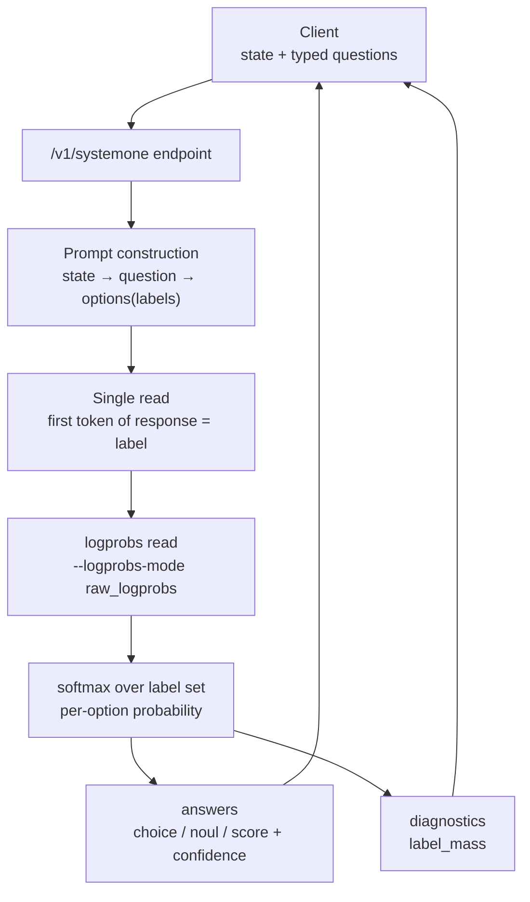

*A visual of typed questions converging, together with the state, into a single decision point.*

## Why read this

This is written for platform engineers and developers who serve LLM endpoints with vLLM (whether ThakiCloud Metis or on-premises self-hosting) and need to decide on the v0.32.0 upgrade. Reading to the end lets you judge in a single sentence whether this release is worth it for your workload, and you will see a record of what the newly added `/v1/systemone` endpoint means operationally, verified by installing it directly and opening the code.

The conclusion up front. The core of vLLM v0.32.0 is not a new model or new quantization, but **structured judgment becoming a first-class API of the engine**. Send a typed question about some state (multiple choice, yes/no, score) and it returns the probabilities and confidence for every option in a single read. The implication is simple. If your workload carries a high share of classification, routing, or scoring traffic, this is the release that brings the cost of that call down to the level of "reading one token."

## Overview

v0.32.0, released on October 18, 2026, contains 814 commits from 363 contributors (including 121 new ones). That is a substantial size for a single minor release, and the changes cluster around three axes.

First, the `/v1/systemone` endpoint. Second, a generic `hf` tool/reasoning parser that reads the checkpoint's `response_template` instead of maintaining per-model parsers. Third, the expansion of low-precision KV cache. NVFP4 (4-bit) KV cache support extends out to older GPUs such as Ampere (SM80) and Ada (SM86/89) as well as to SM90 and SM120, and ROCm gains a 4-bit `ultraquant_4bit` KV cache. Along with that, the API server's CORS defaults are hardened and the Python floor moves up to 3.11.

For reference, the "DiffusionGemma-as-Jev" post published on September 24 covered the prototype path for serving structured judgment with open weights. This release is the event that promotes that capability to a formal endpoint.

## What is this: /v1/systemone

`/v1/systemone` answers a "bundle of typed questions about a state" and returns the probability for each allowed answer. There are three question types.

- **choice**: a map from option names to descriptions (or null). Options receive labels A through Z in request order. The response is the chosen option, per-option `probabilities`, and `confidence`.
- **noul**: a yes/no probability question. `criteria` is null or a `true`/`false` description object. The response is the yes probability (`noul`), `probabilities`, and `confidence`.
- **score**: an ordered list of level names (2 or more, 10 or fewer). The response is the probability-weighted mean of the 0-indexed level (`score`), a per-level `legend`, and `probabilities`.

Looking at the mechanism, each question is one read. The user message is composed of the state, the question, the options with their type labels, and the instruction to "answer with a single label." The read is the **first token** of the model's response. Each label must be a single token; otherwise the request gets a 400. The probabilities are the softmax taken over the logprobs of that question's label tokens. That is why serving requires the `--logprobs-mode raw_logprobs` (or `processed_logprobs`) flag. Computing `label_mass` (the probability mass that lands on the label set) needs logprobs.

Two properties matter operationally. First, because every question in a request starts from the same state, turning on `--enable-prefix-caching` means the state is prefilled only once, and each subsequent question prefills only its own text and then reads one token. A request with N questions costs close to N reads. Second, the probabilities for an identical request can vary with the batch composition and whether the prefix cache hits. To make judgment reproducible you set `VLLM_BATCH_INVARIANT=1`, but that carries a throughput cost.

The response body contains `answers`, `usage`, and `diagnostics`. `diagnostics.label_mass` is how much probability the model placed on the labels across the whole vocabulary. A low value means most of the probability leaked to non-label tokens, and `confidence` is the chosen option's share of the full vocabulary (share within the labels × label_mass). This diagnostic field is the key to telling whether "the model is actually answering inside the labels."

Looking at how the arithmetic works with the numbers from the documentation example, if the team question's label_mass is 0.93 and billing is 0.97 in the label-normalized space, then confidence is 0.93 × 0.97 ≈ 0.90. Conversely, if label_mass drops to 0.4, then even if it picks billing within the labels, measured against the full vocabulary the model preferred other tokens, so you should lower your trust in that judgment. When you do classification with a generation call, the difference between ending at "the model answered A" and also receiving "probability 0.93 on A, label mass 0.93 over the whole vocabulary" connects directly to malfunction detection.

**Why "System 1"?** The name comes from Kahneman's dual-process theory. System 1 is fast, automated intuitive judgment, and System 2 is slow, step-by-step reasoning. Release coverage describes this endpoint as "judgment calls, not generation." In practice, a large share of the most frequent LLM calls are not really System 2. Most are asking which team to route a ticket to, which category an input belongs to, or which of two options is correct, and none of these questions requires "generating" a sentence. The answer is a label, and you only need the probability distribution over that label. systemone makes the engine treat exactly that call as first-class. Compared with the existing approaches (putting "answer only with A/B/C" in the prompt and parsing the response, or restricting the label set with constrained decoding), parse failures disappear structurally (the answer comes out of the label set), and probabilities and diagnostics come along with it.

The limits are 64 questions per request, 26 options per choice, and 10 levels per score. A model without a registered read strategy returns 501. The supported model group splits into two axes. On top of general generation models like Qwen3-0.6B and Gemma4 (read strategy registered) there is a family of decision-only models. Cloudflare's clef-flash/clef-omni (scores the entire question in a single forward pass with a joint schema head), the vllm-sr d3 series (from 27B down to a 0.6B edge, served as classification models), LiquidAI/d1-3B (an LFM2.5-VL-3B post-trained so the decision answer is the first token), all the way to DiffusionGemma. The current official documentation also describes a text-only implementation (MVP) of OpenAI's `POST /v1/decisions` API, but the structured_decisions module of the 0.32.0 package installed in this experiment registers only the `/v1/systemone` route, so the decisions route could not be verified in this build.

The flow below summarizes how a request is converted into reads inside the endpoint.


*The internal flow of /v1/systemone, where one question becomes one read.*

### Other changes in this release

- **Generic hf parser**: the tool/reasoning parser runs by reading the checkpoint's `response_template`. Because you no longer maintain per-model parsers separately, the parser maintenance cost drops when adopting new open-weight models.
- **GPU expansion of the NVFP4 KV cache**: the 4-bit KV cache widens its support to Ampere, Ada, SM90, and SM120. Since the KV cache is the dominant memory component in the decoding phase, cutting it to 4 bits maps directly onto per-rank memory savings. In the same vein, on SM100 the KV default for GLM-5.x becomes FP8 (roughly halving per-rank KV memory), and ROCm gains a 4-bit `ultraquant_4bit` KV cache at about 2× the density of FP8.
- **Security defaults**: the API server's CORS no longer allows all origins by default. Self-hosting environments should check their deployment configuration before upgrading.
- **Floors and dependencies**: Python 3.10 support ends (3.11 or higher, 3.12+ recommended). Dependency updates including `transformers>=5.16.1,<5.20.0` and `tokenizers>=0.23.2`.
- **Removed**: cascade attention, the `torch.compile` sequence-parallel / AsyncTP pass, and `mamba_cache_mode="all"`. `max_tokens` no longer reserves a slot in the context window. The reasoning stream event names in the Responses API also changed.

### Upgrade checklist

A set of items to check from the operator's perspective when moving to 0.32.0.

1. **CORS**: if you self-host and expose vLLM directly in front of a gateway, verify that the default CORS has been closed and revalidate the origin settings on your proxy/ingress.
2. **Python/image**: move 3.10-based images or runtimes up to 3.11+. Since the range shifted to `transformers` 5.x, check that any dependency you pin directly does not collide.
3. **Removed flags**: configurations that used `cascade attention` or `mamba_cache_mode="all"` no longer work. Code that sized context lengths on the assumption of `max_tokens` reservation behavior should recheck its numbers.
4. **KV cache precision**: if you run a fleet on an Ampere/Ada/Hopper set, first measure the per-rank memory savings of NVFP4 KV in staging, and readjust memory assumptions such as `--gpu-memory-utilization`.
5. **systemone adoption**: `/v1/systemone` opens by default on endpoints that use a model with a registered read strategy. Before moving judgment-type traffic to this endpoint, I recommend first watching the distribution of `label_mass`/`confidence` over short traffic.

## Installation and integration

Starting from the pip route. Attempting to install `vllm==0.32.0` in this experiment environment (macOS, arm64, Python 3.12.8) fails outright at resolution: the new dependency `pynvvideocodec==2.0.4` provides wheels only for manylinux (x86_64/aarch64) and win_amd64, so there is no wheel matching `macosx_26_0_arm64`.

```
× No solution found when resolving dependencies:
  ╰─▶ Because pynvvideocodec==2.0.4 has no wheels with a matching
      platform tag (e.g., `macosx_26_0_arm64`) and vllm==0.32.0 depends on
      pynvvideocodec==2.0.4, we can conclude that vllm==0.32.0 cannot be used.
```

In other words, a local macOS experiment with vLLM 0.32.0 presupposes going through a container. (The install wheel's Requires-Python is `>=3.11,<3.15`, so the release note's statement that Python 3.10 support ends is confirmed in the code.)

The Docker route presupposes a host with an NVIDIA GPU. The official `vllm/vllm-openai:v0.32.0` image includes a linux/arm64 variant, so pulling itself works on Apple Silicon, but the image is a CUDA build (torch 2.13.0+cu130), so on a Mac without a GPU `vllm serve` dies outright at the argument-parser construction stage. The detailed failure record is in the experiment results below. Serving on a GPU host goes like this (Qwen3-0.6B, the smallest model that appears in the official documentation example, with `raw_logprobs` and prefix caching turned on, which systemone requires).

```bash
docker run -d --name vllm0320 --platform linux/arm64 -p 8811:8000 \
  vllm/vllm-openai:v0.32.0 \
  vllm serve Qwen/Qwen3-0.6B \
  --max-model-len 4096 \
  --logprobs-mode raw_logprobs \
  --enable-prefix-caching
```

On a local machine without a GPU, the CPU container + pip wheel route opens up. Build a venv inside an `ubuntu:24.04` arm64 container and run `pip install vllm==0.32.0`, and PyPI's manylinux aarch64 wheel comes in.

```bash
docker run -d --name vllm0320cpu --platform linux/arm64 -p 8812:8000 ubuntu:24.04 sleep 4000
docker exec vllm0320cpu apt-get update -qq
docker exec -e DEBIAN_FRONTEND=noninteractive vllm0320cpu \
  apt-get install -y -qq python3-venv python3-pip curl ca-certificates
docker exec vllm0320cpu python3 -m venv /opt/venv
docker exec vllm0320cpu /opt/venv/bin/pip install vllm==0.32.0
```

It installs. It does not run. In 0.32.0 the `device` argument is removed (the `device` parameter in `device.py` is marked "deprecated, will be set automatically based on the current platform") and the platform is auto-detected, but in that detection CPU is enabled only when the `VLLM_TARGET_DEVICE=cpu` environment variable is present, the build is a CPU build, or it is darwin. Even after passing the CPU platform via the environment variable, the distributed aarch64 wheel has no CPU operator extension (`vllm._C`), so the worker dies at the start-up stage. Both tracebacks are in the experiment results below. In short, **local CPU execution is not possible with this release's distributed artifacts**, and run verification has to happen in a GPU environment (the official image below).

A systemone request is sent like this (the official documentation example, customer support ticket classification, on a servable GPU environment).

```bash
curl -s http://localhost:8811/v1/systemone -H "Content-Type: application/json" -d '{
  "model": "Qwen/Qwen3-0.6B",
  "state": {"ticket": "My card was charged twice for one order."},
  "questions": {
    "team": {"type": "choice", "instructions": "Which team should handle this ticket?",
      "criteria": {"billing": "payments and refunds", "shipping": "deliveries", "security": "account access"}},
    "urgent": {"type": "noul", "instructions": "Does the customer need a reply within the hour?",
      "criteria": {"true": "the account is locked or money is moving"}},
    "tone": {"type": "score", "instructions": "How upset is the customer?",
      "criteria": ["calm", "annoyed", "furious"]}
  },
  "chat_template_kwargs": {"enable_thinking": false}
}'
```

## Hands-on results

The experiment splits into three routes, all with real records.

**1) macOS pip route: failed (as expected).** As seen above, it ends at the dependency-resolution stage. This effectively confirms the fact itself that vLLM 0.32.0 has no macOS wheel.

**2) Official Docker image route: pulling succeeded, serving failed.** Pull `vllm/vllm-openai:v0.32.0` arm64 and start a container, and `vllm serve` dies at the argument-parser construction stage, before even downloading the model.

```
File ".../vllm/entrypoints/cli/serve.py", line 172, in subparser_init
    serve_parser = make_arg_parser(serve_parser)
  ...
File ".../vllm/config/device.py", line 55, in __post_init__
    raise RuntimeError(
RuntimeError: Failed to infer device type, please set the environment variable
`VLLM_LOGGING_LEVEL=DEBUG` to turn on verbose logging to help debug the issue.
```

Opening `device.py` makes the cause clear. When `device` is the default `"auto"`, it infers from `current_platform.device_type`, but on this arm64 host without a GPU that value is empty. An explicit `device` skips the inference. However, the CLI constructs `VllmConfig` via a default factory before parsing any flags, so adding `--device cpu` dies at the same point.

**3) CPU container + pip wheel route: install succeeded, run failed at two stages.** `pip install vllm==0.32.0` installs normally from the manylinux aarch64 wheel (installed version `0.32.0`, torch `2.13.0+cu130`, `Requires-Python >=3.11,<3.15` confirmed, `import vllm` passes). Two run attempts were made.

First, the offline API. 0.32.0 has no `device` argument at all.

```
File ".../vllm/entrypoints/llm.py", line 296, in __init__
    engine_args = EngineArgs(
TypeError: EngineArgs.__init__() got an unexpected keyword argument 'device'
```

Second, passing the CPU platform detection via `VLLM_TARGET_DEVICE=cpu` and then starting `vllm serve`. The CLI parser passes, but it dies at worker initialization.

```
WARNING ... [cpu.py:667] Failed to import from vllm._C:
ModuleNotFoundError("No module named 'vllm._C'")
  File ".../vllm/v1/worker/cpu_worker.py", line 70, in __init__
    torch.ops._C.init_cpu_memory_env([memory_node])
AttributeError: '_OpNamespace' '_C' object has no attribute 'init_cpu_memory_env'
ERROR ... EngineCore failed to start.
```

Conclusively, the distributed aarch64 wheel is a build with no CPU operator extension. Reproduction attempt failed: local CPU execution is not possible due to the absence of `vllm._C` (a GPU-build-only wheel).

**Endpoint code verification (installed package).** Even in an environment where serving is impossible, I opened the 0.32.0 package directly to confirm the release note's claims. The `vllm/entrypoints/generate/structured_decisions/` module contains `api_router.py` (the `"/v1/systemone"` route on line 37), `question_types.py` and `strategies.py` (choice/noul/score), `protocol.py`, and `serving.py` (`ServingStructuredDecisions`, `create_decision`), and `protocol.py` has, in code, `max_output_tokens=1` limiting the read to one output token and `argmax_is_label` for response diagnostics. The documentation's claim that "one question becomes one first-token read" is confirmed in code. The `response_template` parser exists under `vllm/parser/` (`response_template.py`, `parser_manager.py`, etc.).

To sum up, the behavior of `/v1/systemone` (HTTP response, probabilities, 400/501) was not measured in this local experiment. What was verified locally is (a) the release composition by the installed package code, (b) a complete map of the run route's limits (absence of the macOS wheel, absence of the CPU extension in the aarch64 wheel, the CLI crash on a host without a GPU), and (c) the official documentation's API contract. Measuring the endpoint remains as the next step in a GPU environment.

## Implications for ThakiCloud products

### ai-platform (K8s-based AI/ML inference infrastructure)

ThakiCloud ai-platform serves customer models through vLLM-based serverless endpoints (Metis). v0.32.0 means two things here. First, low-precision KV cache reaches a wider GPU set. NVFP4 KV being supported up to SM90 (Hopper) reduces per-rank KV memory on the H200 fleet, and the FP8 KV default for GLM-5.x on SM100 is the same effect on the B200 fleet. Where decoding is memory-bandwidth-bound, KV savings convert into per-rank throughput gains, i.e. lower serving cost. Second, the hardened CORS defaults and the dependency floors (Python 3.11+, the transformers 5.x range) are a practical note that on upgrade you must revalidate the endpoint image and serving configuration.

### Paxis (Agent-Native Cloud)

Agent workflows demand judgment at every step. Which skill to route to, which category the user's intent belongs to, how many points to assign to confidence, whether to approve this action. Until now all such judgment was full generation calls. With `/v1/systemone` you can turn judgment into a typed single read, and the response is in a form code can consume directly (choice, probability, confidence). Seating this endpoint as a low-cost decision layer in Paxis's agent loop is the natural next step. Secondary coverage (BestHub) mentions a median of roughly 23 ms on d1-3B in a GPU environment, and that should be read with the distinction that it is a number from a dedicated decision model.

## Limitations and counterarguments

- **It is an MVP.** 64 questions per request, 26 options per choice, 10 levels per score. Exceeding the 200/255 that the OpenAI upstream allows, this backend returns 400.
- **The probabilities are not calibrated.** `confidence` is not a value calibrated to the OpenAI model, the probabilities are normalized over the presented options and vary with the batch composition. Where stable judgment is needed, `VLLM_BATCH_INVARIANT=1` is a prerequisite, and that carries a throughput cost.
- **Running presupposes a GPU environment.** Locally (macOS/arm64) it cannot even be installed, and on a CPU container the distributed wheel lacks the CPU operator extension, so it is not runnable. All secondary coverage citing millisecond-level latency numbers are GPU-environment values.
- **It is not a substitute for generation.** It is judgment (a 1-token label read), not generation. Workloads with a high share of open-form text see no change.
- **The 1-token constraint on labels** is a structural limit: depending on tokenizer characteristics, a label that splits into multiple tokens on some models/languages can trigger a 400.

## Takeaways

vLLM v0.32.0 is a release that puts judgment on top of types. `/v1/systemone` returns option probabilities with one read per question, the generic hf parser lowers the cost of model adoption, the NVFP4 KV expansion cuts per-rank memory across a wider GPU set, and the hardened CORS raises the baseline security posture. The upgrade decision splits on the share of judgment traffic in your workload. If classification, routing, and scoring make up a large share, 0.32.0 is a worthwhile release, and if you are pure generation traffic, upgrade for the security defaults and KV memory but you can still watch systemone from the sidelines. If you pick just one next action, it is to measure the share of judgment-type calls on your endpoint, and for ThakiCloud to measure the NVFP4 KV memory savings on the H200/B200 fleet.
