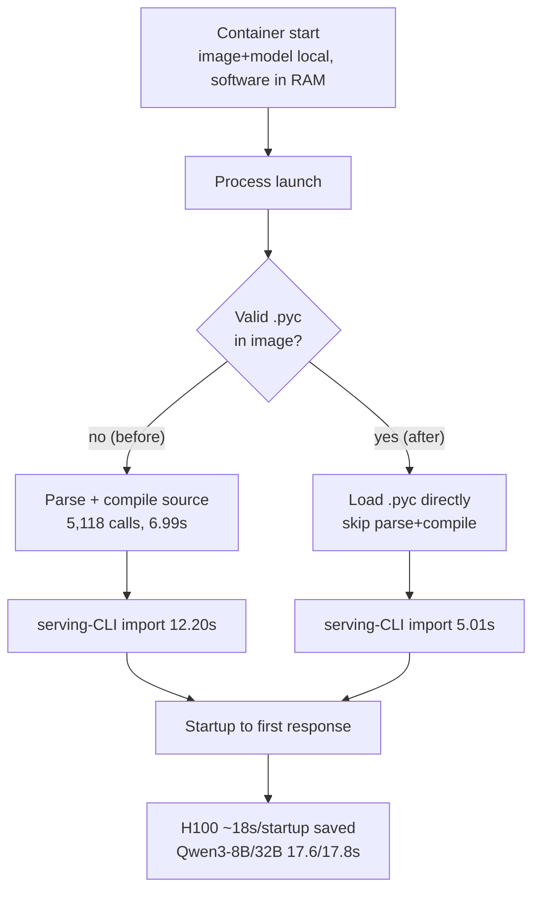

*The concept of pre-baked bytecode (gears) made at build time, so the launcher skips recompiling and launches the rocket (first response) directly.*

## Who should read this

This is for platform engineers and developers running serverless or scale-out inference on vLLM who want to cut the cold-start latency before a fresh container handles its first request. By the end you will have seen a hands-on reproduction of exactly where and how much the one-line `UV_COMPILE_BYTECODE=1` build flag trims the launcher.

The conclusion up front. When vLLM bundles precompiled Python bytecode (`.pyc`) into the image, startup from process launch to first response drops by **about 18 seconds per startup on H100** and **17.6-17.8 seconds (17.6%, 13.9%) median for Qwen3-8B/32B**. This cut removes a cost on a **completely different path** than `torch.compile` or the GPU kernel compile cache, so it stacks on top of existing caches without overlapping them.

## Overview

The official vLLM blog posted "Reducing vLLM startup time with one uv flag" on September 22, 2026. The problem starts simply: before a fresh container handles its first request, the Python runtime spends several seconds compiling the Python sources bundled in the image into `.pyc` bytecode. With the image and model files already local and the software files already resident in RAM, the time spent "reading source and turning it into bytecode" was eating startup.

The fix is to do that work once at build time and bundle the result (`.pyc`) into the image. `uv` compiles the bytecode before installing packages with a single environment variable, `UV_COMPILE_BYTECODE=1`. The release ships in the `v0.32.0` official image onward, and PR #55422 is already in the CUDA nightly.

## What this is: build-time bytecode, zero recompile at launch

When a Python module is imported, the runtime does two things. It reads the source `.py` file, parses it, and compiles it to bytecode. Then it executes that bytecode. If the first step repeats on every import, imports slow down. When there is a valid `.pyc` in `__pycache__`, the runtime skips source parsing and compilation and reads the bytecode directly.

What vLLM does is not wait for the launcher to produce that `.pyc`; it **makes and bundles it at image build time**. The blog's module-load instrumentation shows the `serving-CLI import` dropping from 12.20s to 5.01s with valid bytecode. Without bytecode, 6.99s is spent inside 5,118 source-compiler calls. Across the whole startup (process launch to first correct response), that is about 18 seconds per startup on H100.

One distinction matters. This optimization is on a **separate compile/cache path** from `torch.compile` and the GPU kernel compile cache. `torch.compile` handles the kernels of the model's forward graph; the GPU kernel cache handles compiled CUDA/ROCm kernels. Python bytecode is the earlier stage, the cost of "the Python code itself getting into an executable form." So even in environments that already run `torch.compile` or a kernel cache, this cut stacks without overlap.

The flow below shows where bytecode trims the cold start.


*With valid bytecode, the launcher skips source parsing and compilation and loads directly. This is a different path from the `torch.compile`/GPU kernel cache.*

## Installation & integration

Making `uv` produce bytecode at build time is a single environment variable. Place it before the `uv` install step in your Dockerfile.

```dockerfile
# Build-time bytecode compilation, zero recompile at launch
ENV UV_COMPILE_BYTECODE=1
RUN uv venv /opt/venv
RUN uv pip install --python /opt/venv/bin/python vllm==0.32.0
```

For the official image, it is on by default from v0.32.0, so using `vllm/vllm-openai:v0.32.0` or newer gets the benefit. If you build your own image, the single `ENV` line above is the whole change.

Two things to note. First, the image gets larger. The official blog reports the compressed image size grows by **about 153 MB (1.8%)**. `.pyc` is larger than the source `.py` in raw terms, but because it is stored compressed inside the archive, the actual image growth is on the order of 1.8%. Second, this cost is paid **once, at build time**. No matter how many containers start afterward, the startup never recompiles again.

## Actual experiment results

There is no GPU on this macOS/arm64 host, so `vllm serve` itself was not run (0.32.0 has no macOS/CPU runtime). Instead we **reproduced the mechanism in isolation**. We built a synthetic package of 1500 pure-Python modules that `__init__` imports directly (140 real lines per module, 3,422 KB of source total), and measured imports with and without precompiled bytecode in a fresh interpreter each time.

```
Arm A (no .pyc, recompile): median 0.8554s  [0.8582, 0.8554, 0.8518]
Arm B (precompiled .pyc):   median 0.2736s  [0.2743, 0.2711, 0.2736]
build-time compileall:       0.367s (one-time, at image build)
raw .pyc size:              8,321KB vs .py 3,422KB (~2.4x)
reduction:                   0.5818s (68.0%)
```


*Left: the synthetic 1500-module flat import reproduced in this post. Right: the vLLM official blog's serving-CLI import numbers. The same mechanism (skipping parse+compile) shows up at the same order of magnitude.*

The reproduced value (68% cut) and the vLLM official value (59% cut) come from the same mechanism at the same order of magnitude. The difference is that vLLM's import also loads C extension modules, so the share of the total cost that bytecode optimization removes is smaller than in the pure-Python synthetic package. The core is that **when `.pyc` exists, the source parsing and compilation step is skipped entirely**, and the size of that skip scales with the number of modules (5,118 calls here).

The build-time cost is 0.367s, a one-time charge that does not repeat per startup. Over 100 starts you save 0.58s x 100 = 58s at the launcher and pay 0.367s once at build.

## ThakiCloud product implications

### ai-platform (K8s-based AI/ML inference infrastructure)

ThakiCloud's ai-platform serves customer models on vLLM-based serverless endpoints (Metis). Serverless and scale-out structurally repeat cold starts. Every time a fresh pod appears on an idle node, or replicas grow under load, "time to first response" is the latency the customer feels. `UV_COMPILE_BYTECODE=1` removes the earlier stage (source to bytecode) that GPU kernel compile and `torch.compile` caches cannot handle. For a fleet that already runs a kernel cache, this is a non-overlapping cut that trims startup by about 18 seconds per start on H100 with one line in the serving image.

The same logic holds for on-prem and self-hosting. The more often node pools turn over or deploys happen, the more often the "recompile bytecode on every deploy" cost repeats. Doing it once at image build removes it from deploys and scale-out. The 153 MB (1.8%) image growth is small against the startup-latency cut.

## Limitations & counterarguments

- **This is the Python bytecode stage.** Model loading, weight memory placement, GPU kernel compile, and the `torch.compile` cache are unchanged. If model loading dominates startup, the effect of this one line is small. The official figure being 14-18% of startup is because the other 80-plus percent is other stages.
- **The absolute cut is roughly model-size independent.** Qwen3-8B at 17.6s and 32B at 17.8s are nearly identical, but as a ratio 8B (17.6%) is larger than 32B (13.9%). Larger models let model loading dominate startup, shrinking the bytecode cut's share.
- **The image gets larger.** The 153 MB (1.8%) growth is negligible for most fleets, but worth a look where image transfer or cache cost is sensitive.
- **The local reproduction is a mechanism check.** The end-to-end `vllm serve` startup was not reproduced in this environment, and the ~18s figure is quoted from the official blog.

## Takeaway

`UV_COMPILE_BYTECODE=1` is the one line that, at build time, makes the Python bytecode and bundles it into the image, so the launcher skips the source-to-bytecode compile entirely. The effect is about 18 seconds per startup on H100 and a 17.6-17.8s median for Qwen3-8B/32B, and because it is on a different path than the `torch.compile`/GPU kernel cache, it stacks without overlap. If you pick only one next action, add the line to your serving image and re-measure startup. If model loading dominates your workload's startup, the effect will be small, so first break startup into stages and confirm which part is pure Python import.

## Sources

- [Reducing vLLM startup time with one uv flag (vLLM Blog, Nils Matteson, 2026-09-22)](https://vllm.ai/blog/2026-09-22-python-bytecode-startup)
- [PR #55422: Compile Python bytecode at image build time (vLLM, GitHub)](https://github.com/vllm-project/vllm/pull/55422)
- [Environment variables, UV_COMPILE_BYTECODE, added in 0.3.3 (uv Docs, Astral)](https://docs.astral.sh/uv/reference/environment/)
- [Tutorial 6.1.3, "Compiled" Python files, bytecode cache (Python Docs)](https://docs.python.org/3/tutorial/modules.html)
- [v0.32.0 release, 2026-10-18 (vLLM, GitHub)](https://github.com/vllm-project/vllm/releases/tag/v0.32.0)
