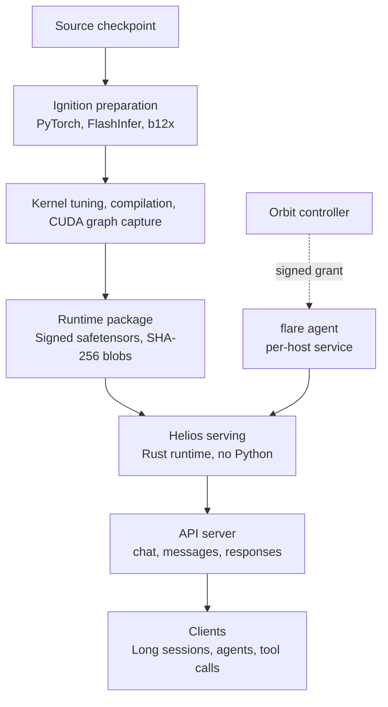

*Flare's core concept, visualized: ignition bursting upward from a dark crystalline core, with a calm strata of geometry below.*

## Why Read This

If you run local inference on a DGX Spark or RTX PRO 6000 Blackwell, or operate long agent sessions on vLLM, this is the post to read. The takeaway up front: NVIDIA Flare is not "vLLM rewritten in Rust" but a reference implementation of a two-stage design where Python compiles at build time and Rust serves without Python at runtime, and it is a research prototype that its own README states "will never be a replacement for production inference engines like vLLM." Even so, the repository is the most concrete document of what a serving contract for long agent workloads looks like: runtime packages, explicit memory planning, signed distribution.

## Overview

NVIDIA published the `flare-local-inference` repository under the `NVIDIA` GitHub organization around October 20, without a launch post or formal announcement. It hit the NVIDIA developer forums and community immediately. The license is Apache 2.0, and the core is a Rust CLI (currently v0.1.0).

The target hardware is narrow: SM120 and SM121, namely the RTX PRO 6000 Blackwell workstation GPU and the DGX Spark's GB10 chip. No datacenter GPUs like H100, H200, or B200, and no consumer GPUs like the 5090. Flare is a server designed around the question of how the memory, bandwidth, and compute of these chips go further under the workload of "long conversations, coding agents, repeated tool use." In the README's own words: vLLM covers the breadth of models, hardware, and deployment patterns, while Flare trades that breadth for a focused serving contract around selected models and local workloads.

Community analyses read this release as the software reinforcement of NVIDIA's local-AI full stack announced at GTC Berlin (the RTX Spark, DGX Spark, and DGX Station hardware lines). It is NVIDIA filling in, by itself, what runs on top of the chip after you buy it.

## What It Is

Flare's design splits into two names: Ignition and Helios.

Ignition is the Python-side preparation stage. Using PyTorch, Transformers, FlashInfer, and NVIDIA's b12x kernel stack, it loads a source checkpoint, tunes kernels, compiles the complete forward with torch.compile, then warms up and captures CUDA graphs to produce a **runtime package**. The runtime package consists of a metadata-only primary `.safetensors` file plus immutable payload blobs named by their SHA-256 hashes, sealed with a signed Protobuf format (generation 4, with encrypted cubins and graph records). The published payload-file limit is 64 GB.

Helios is the Rust-side serving stage. It loads the package without Python and replays the captured CUDA graphs while handling requests. A CPython extension called `heliopause` sits between preparation and serving, but its role is to let Ignition touch Helios during preparation; the serving path has no Python.

The repository's core-design document answers why this shape directly. "Rewriting vLLM wholesale in Rust" is a poor trade when it severs access to the Python model and kernel ecosystem. Model structure, numerical semantics, compiler optimizations, and kernel preparation stay on top of the accumulated work of the PyTorch ecosystem, while only the serving loop (scheduling, cache storage, request handling) is carved out into a small, shared Rust runtime.

The model recipes start at eight: Nemotron 3.5 Bolt 74B-A9B 24GB (a Mamba-2 hybrid MoE with the C-RADIO vision encoder and a LiLiCorr learned draft model), Qwen3.8 27B (NVFP4 quantization, Gated DeltaNet), Qwen3.8 Flash (MTP 5 draft tokens, TP1/TP2), DeepSeek V4 Flash and V4.1 Flash, MiMo V2.6 Pro MOPD, Step-5 Preview, and Kimi K3. Every recipe defaults to FP8 E4M3 KV storage, including learned draft-model caches.

The distribution design of the runtime package is documented in detail. Final packages use the format-4 signed envelope, with cubins and CUDA graph records encrypted inside. Tensor-parallel packages carry one resource bundle per rank, and adjacent ranks share weight shards within a file-size limit. Graphs, kernels, and auxiliary resources live in separate shards, so a kernel change does not rewrite unchanged weight shards. At export time, unchanged blobs are hard-linked from the package cache. What is distributed is not "a model file" but "a signed execution bundle," which is evidence that this design treats serving as a distributable unit.

The handling of memory and state is the other axis. Buffers and execution capacities are planned ahead of time, and conversation state (KV caches together with recurrent state) is treated as a single object, so prefix reuse, branching, and resuming preserve state correctly, the documentation explains.

The API shape shows the target of this server. One server carries four protocols at once: OpenAI chat/completions and completions, Anthropic messages and count_tokens, and OpenAI Responses. That means clients can plug in as-is whether they use an OpenAI-compatible library or an Anthropic-compatible client. The count_tokens endpoint in particular tells you the exact prepared input token count without generating, letting agent clients plan prompt budgets while trusting the serving engine's prepared state. Tools are not executed by the server: the client executes tools and returns results in subsequent requests, and session state lives in the server's cache (prefix reuse, branching, resuming).

When hardware scales to multiple boxes, the Orbit fleet-control layer appears. A controller runs `flare orbit`, and each serving host installs `flare agent` as a user service. Orbit places prepared models on GPUs, distributes package data, and starts and supervises serving groups. Tensor-parallel serving across two or four DGX Sparks over RoCE (b12x RoCEnante through ConnectX-7 ports) belongs here.



*The two-stage Ignition/Helios pipeline and the Orbit fleet-control layer.*

## Installation and Integration

The real commands, from the repository's model-preparation.md. Preparation environment and native CLI build:

```sh
uv sync --locked --extra prepare --extra test
cargo build --release --manifest-path flare/Cargo.toml
```

Build dependencies: a C/C++ compiler, CMake, Ninja, pkg-config, Protobuf's protoc, OpenSSL headers, Python headers, and liburing headers. On Ubuntu:

```sh
sudo apt-get install build-essential cmake ninja-build pkg-config protobuf-compiler libssl-dev python3-dev liburing-dev
```

Preparation requires the CUDA toolkit (nvcc, CUPTI). FlashInfer is pinned to a specific git revision in pyproject.toml.

Package export (Qwen3.8 27B, single-GPU example):

```sh
.venv/bin/ignition export qwen3.8-27b --gpus 0 --max-concurrency 4 \
  --output /data/flare-runtime/qwen38-27b-tp1-c4.safetensors --verbose
```

Serving:

```sh
./flare/target/release/flare run \
  /data/flare-runtime/qwen38-27b-tp1-c4.safetensors \
  --gpus 0 --bind 127.0.0.1:8001
```

The Nemotron recipe, which uses MTP (multi-token prediction), specifies draft tokens explicitly:

```sh
.venv/bin/python -m ignition export nemotron-bolt-24gb --gpus 0 \
  --max-concurrency 8 --prefill-chunk-size 4096 --mtp-draft-tokens 7 \
  --speculative-token-capacity 64 \
  --output /data/flare-runtime/nemotron-bolt-images-lilicorr-c8.safetensors
```

Three caveats. First, packages must be prepared per tensor-parallel size (a TP2 package cannot be loaded as TP1). Second, the DGX Spark's GB10 shares physical DRAM with the CPU, so you subtract host headroom with `[memory] reserve` (e.g., "4G"), and since NVML does not report VRAM capacity on GB10, Ignition plans from Linux MemAvailable. Third, an SM120 package cannot serve an SM121 machine (architecture check failure).

## Our Hands-On Attempt

We attempted replication in the ThakiCloud environment. The execution host is a macOS ARM MacBook, and none of our GPU fleet (H100, H200, B200, 5070 Ti) has an SM120/SM121 chip.

1. Repository clone: shallow clone of `NVIDIA/flare-local-inference` succeeded (~23 MB). The structure is flare (CLI), helios (Rust runtime), heliopause (CPython extension), ignition (Python preparation), packaging, qualify, scripts, and docs (~12,000 lines). Note: the `NVIDIA-AI` organization path 404s; the real org is `NVIDIA`. Some community posts mixed up the two.
2. Release build attempt (macOS arm64): dependency fetching failed on an external git dependency (`deepseek-recipe`, pinned to a specific revision) under cargo's internal git, and succeeded on retry with the system git CLI fetch that cargo itself suggested. The `flare-helios` (Rust runtime) compilation then failed with 24 errors (type mismatches, integer-width related, and others). The documented build targets are Ubuntu/Debian (with an explicit apt dependency list) and Windows; macOS appears to be outside the supported range.
3. Inference run: failed. Without an SM120/SM121 GPU, CUDA graph capture and serving cannot be performed.

So this post contains zero benchmark numbers. Flare's performance is confirmed only through published documentation and community analysis (optimization for long-conversation and agent workloads, the breadth trade-off versus vLLM); numerical comparisons require re-measurement on SM120/SM121 hardware.

## Implications for ThakiCloud Products

From the ai-platform lens: SM120/SM121 is not in our current fleet, so direct adoption is a long way off. But the pattern itself lives in the same problem space as the vLLM stack we serve today. First, the "compile at build time, replay at serve time" runtime-package concept sits in the same context as Metis serverless endpoint tuned defaults (compile mode, max_num_seqs), and Flare extends the result into a signed distribution unit (64 GB blobs, format validation, per-rank selective distribution). Second, the explicit memory model that plans KV and recurrent state as a single conversation state is a reference point for understanding the cost structure of long agent sessions where context keeps growing. Third, the FP8 KV default offers a comparison hook against vLLM's quantization options for raising tokens-per-memory.

From the Paxis lens: the workload Flare targets head-on is exactly the shape of agent execution that Paxis handles: repeated tool-result appends, prefix branching, session resuming. Orbit's grant-based controller/agent design is a miniature control plane for "placing agent inference on local GPUs and supervising it," and when Paxis extends agent inference to customer edge or local GPUs, Flare previews what that contract looks like.

One distinction is worth drawing deliberately here. Flare's trust model is single-organization internal: signed packages and grants presume "our controller places our models on our machines," with no multi-tenancy or external-customer isolation in the design. When Paxis solves the same problem, isolation between customers, policy gates, and audit logs are added on top. If Flare's contract is the minimal core of agent inference, Paxis is the problem of extending that core to the enterprise boundary. The two are close to a layering relationship, not a competitive one.

## Limitations and Counterarguments

First, the repository calls itself a research prototype. The documentation still carries the sentence that Qwen TP4 packages require model validation.

Second, coverage is narrow: eight model recipes, two GPU architectures. It cannot be compared on the same plane as vLLM's thousands of models and every datacenter GPU. The README's statement that Flare "will never be a replacement for production inference engines like vLLM" reads less like humility than like a design declaration.

Third, watch the name collision. NVIDIA has had FLARE (Federated Learning Application Runtime Environment), a federated-learning SDK, for years. The two are easy to confuse in search; distinguish this local inference server by the `flare-local-inference` repository and the SM120/SM121 context.

Fourth, "no Python in serving" alone is not novel enough to call. vLLM also captures and reuses CUDA graphs, and the host language itself is not the whole of performance. Flare's novelty is not the language of the serving loop but the signed runtime package as a distribution unit, the explicit memory planning built on that premise, and the API contract tuned to agent workloads.

Fifth, the cost of replication. FlashInfer fork git-revision pins, external recipe-repository dependencies, and system dependencies like the CUDA toolkit and liburing raise the bar for "clone and run." When this research prototype moves toward production infrastructure, the maintenance cost of this dependency graph becomes the real variable.

## In Summary

NVIDIA Flare compresses the problem of serving agent workloads on local workstation GPUs into a single contract: prepare with Python, serve with Rust, distribute as signed packages. For anyone running a DGX Spark or RTX PRO 6000, the eight model recipes are the filter; for platform engineers, the Ignition/Helios boundary design is a document worth reading.

The next step is clear: re-measure benchmark numbers on SM120/SM121 hardware and compare against vLLM on the same workload. This post is the analysis of the state without numbers; when numbers land, it needs to be rewritten.

## Sources

- GitHub repository: [NVIDIA/flare-local-inference](https://github.com/NVIDIA/flare-local-inference) (Apache 2.0, docs, recipes, Orbit documentation)
- NVIDIA developer forum: [Flare - NVIDIA's new inference server in Rust](https://forums.developer.nvidia.com/t/flare-nvidias-new-inference-server-in-rust/386436)
- Architecture analysis: [veduis.com, NVIDIA Flare architecture](https://veduis.com/blog/nvidia-flare-architecture-local-inference/)
- vLLM comparison: [explainx.ai, NVIDIA Flare vs vLLM](https://www.explainx.ai/blog/nvidia-flare-local-inference-rust-server-sm120-dgx-spark-agents-2026)
- Tool overview: [singularitybyte.com, NVIDIA Flare](https://singularitybyte.com/tools/nvidia-flare-local-inference-server-dgx-spark.html)
- Original tweet: [x.com/hjguyhan/status/2113088158032433360](https://x.com/hjguyhan/status/2113088158032433360)
