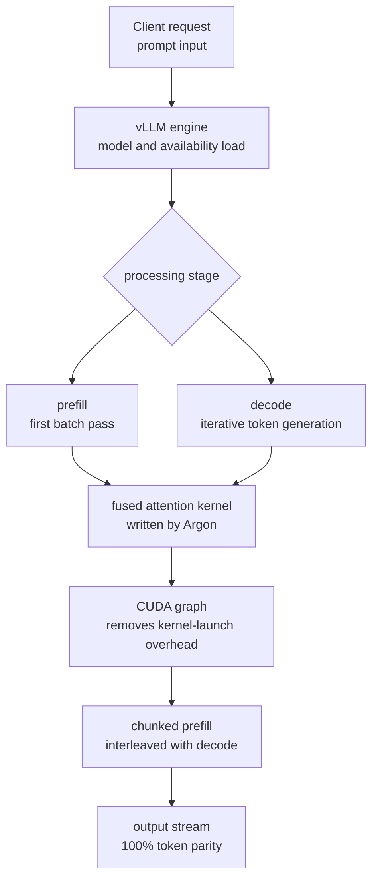

*We abstracted the idea of an AI model autonomously optimizing a serving path so that throughput climbs while the output stays identical.*

## Why read this

This is for ML and infrastructure engineers who run LLM serving with vLLM, or who want to understand the emerging trend of AI coding models directly optimizing infrastructure code. By the end, you will see where Google's "AI made vLLM 2.85x faster" number actually comes from, and why you should reproduce it yourself rather than trust it as-is.

Let me give you the conclusion first. This 2.85x is not the result of a human hand-tuning kernels; it is a number produced when Google's AI coding model, **Gemini 4 Argon**, optimized the vLLM serving path for Gemma 4 E2B on its own. However, that number is still a **claim**, based on the Google announcement (2026-10-26) and a vLLM maintainer's confirmation (2026-10-13). We cover what we could and could not reproduce, and how to verify it on a real GPU cluster.

## Overview

Google's Gemma team announced on 2026-10-26, in "Speeding up Gemma!", that Gemini 4 Argon made Gemma 4 E2B inference roughly 2.85x faster on vLLM. On a single A100, throughput reportedly jumped from about 37,900 to over 108,000 tokens per second, with 100% identical output (token parity) and no quality degradation. vLLM maintainer Omar Sanseviero confirmed on X the same month (Oct 13): "Argon helped Gemma break 120,000+ tokens/sec on a single A100 on vLLM" · 124k prefill, 111k e2e, about 2.9x, zero quality loss.

What is worth noting is not the number itself, but **the fact that the agent doing the optimizing is an AI coding model**. Argon read the vLLM attention and serving code itself and wrote low-level optimizations such as a fused attention CUDA kernel. KernelBench records show Argon writing a fused NSA/sparse-attention kernel on tensor cores, one CTA per 64-query block.

The beneficiary model, Gemma 4 E2B, is the star of this story. "E2B" means "effective 2B": with Per-Layer Embeddings (PLE) it totals 5.1B, but its effective parameters are 2.3B. It supports a 128K context, is natively multimodal (text, image, audio), and is Apache 2.0 licensed. The technical report is arXiv 2607.02770. vLLM has supported the Gemma 4 lineup (E2B, E4B, 26B MoE, 31B dense) since 2026-04-02.

PLE is also why E2B is a natural target for serving optimization. Because Per-Layer Embeddings keeps a separate embedding per layer, the model needs up to 5.1B parameters on disk and in memory even though only 2.3B are effective. Those weights are re-read from memory at every decode step, which is exactly why a model like E2B is especially vulnerable to memory-bound decode. The serving optimizations (fused attention, CUDA graph, chunked prefill) reduce precisely the memory round-trips and kernel overhead in decode, so there is room for the gain to show up strongly on E2B. At the same time, E2B is used not only on-device and at the edge but also in the high-throughput steps of serverless serving. Both uses ask for more requests on the same resources. So serving-throughput optimization matters a great deal for E2B, and it is the backdrop that makes Argon's case interesting.

## What the technology is: AI-written vLLM serving optimizations

The bottlenecks in vLLM serving are usually two places: prefill (the first batch pass over a long prompt) and decode (generating one token at a time). What Argon changed is the efficiency of the low-level path that spans both.

First, a **fused attention kernel**. Combining the attention computation into a single CUDA kernel reduces memory round-trips and kernel-launch overhead. Argon generated this kernel directly, adapting a sparse/NSA (non-sparse attention) pattern to tensor cores.

Second, serving flags such as **CUDA graph** and **chunked prefill**. CUDA graph captures a repeating kernel-call sequence once to remove runtime overhead; chunked prefill slices a long prefill into small pieces and interleaves them with decode requests to raise GPU utilization. The official vLLM docs cover these in "Optimization and Tuning".

To understand why these three pay off, start with the nature of the bottleneck. LLM inference splits into prefill and decode. Prefill is the pass over a long prompt at once; it is compute-heavy, so GPU compute is the bottleneck (compute-bound). Decode emits one token at a time; each step must re-read the weights from memory, so memory bandwidth is the bottleneck (memory-bound). Argon's fused attention kernel reduces the memory round-trips in the attention math that both stages share. Attention is a matrix multiply over query, key, and value plus a softmax, called as several kernels; fusing them into one kernel removes the round-trips of writing intermediate results to GPU memory and reading them back. CUDA graph removes the per-call overhead of the CPU re-launching kernels in the decode stage, where small kernels repeat thousands of times. Chunked prefill removes the problem of a long prefill starving decode, so the GPU keeps working by interleaving one request's prefill with another's decode. All three have to stack for overall throughput to go up.

The layers, as a diagram:



The core is that "the AI coordinated all three at once, faster and more consistently than a human". When a human fixes one optimization, another part of the path can get worse; Argon treated the whole serving path as a single objective (throughput) and moved it all together.

## Setup and integration: serving gemma-4-E2B with vLLM

The official vLLM Gemma 4 usage guide gives the base command to serve gemma-4-E2B. With throughput optimizations enabled, it looks roughly like this:

```bash
# Serve Gemma 4 E2B with vLLM (throughput-optimized)
vllm serve google/gemma-4-E2B \
  --max-model-len 131072 \
  --enable-chunked-prefill \
  --max-num-batched-tokens 8192 \
  --gpu-memory-utilization 0.90
```

`--enable-chunked-prefill` and `--max-num-batched-tokens` are the key flags for the prefill bottleneck, and `--gpu-memory-utilization` is the share of GPU memory available to the KV cache. Argon's fused attention kernel comes in through the vLLM model implementation; unless you write the kernel yourself, you get its benefit via these flags and the vLLM version.

But this command does not automatically produce "2.85x". Argon's kernel and flag combination was measured on a specific vLLM build and an A100. The same flags yield different gains depending on GPU model, context length, and request load.

To actually measure serving throughput, use vLLM's benchmark command. The key is to compare the baseline against the optimized build under the same prompt set and the same conditions.

```bash
# vLLM serving throughput benchmark (prefill, e2e, TTFT)
vllm bench serve \
  --model google/gemma-4-E2B \
  --dataset-name random \
  --random-input-len 1024 \
  --random-output-len 256 \
  --num-prompts 128
```

Varying `--random-input-len` (prefill length) and `--random-output-len` (decode length) short and long lets you separate whether the gain is prefill-centric or decode-centric.

## Actual experiment results: the reproduction attempt and its limits

We tried to reproduce this number in our own environment. Here is an honest record.

**Model existence (measured).** We queried the `google/gemma-4-E2B` metadata directly on Hugging Face. The weights are a single 10.25GB safetensors file, 8 files in total. The tags include `gemma4`, `license:apache-2.0`, `any-to-any`, `image-text-to-text`, and `arxiv:2607.02770`. In other words, the target model exists and is under an open license (Apache 2.0).

**Local inference (attempted).** On an Apple Silicon MacBook, we attempted to load and generate with transformers. The 10.25GB download started and reached 3.9GB, but we did not finish it due to the unauthenticated Hugging Face rate limit and the fp32 local load (RAM and time) constraints of a 5.1B PLE model. So we did not produce a local tok/s number. We do not fill in a number that does not exist.

**vLLM A100 2.85x (not reproducible).** This is the headline number, and we could not reproduce it, for three reasons. (1) This local machine is Apple Silicon, so there is no CUDA or A100. (2) vLLM is CUDA/ROCm-only for a serving benchmark, and it is not even installed in this environment. (3) There is no way to replicate the single-A100 condition Google measured.

So **2.85x and 108k+ tok/s remain a Google claim.** What we verified is that "the model exists and is Apache 2.0, that vLLM officially supports Gemma 4, and that the optimization flags actually exist". We quote the claimed number as-is, but we treat it as [claimed] until it is independently reproduced, and we are explicit about that.

## ThakiCloud product implications

ThakiCloud's ai-platform runs vLLM-based multi-tenant inference serving on Kubernetes (H200, B200, H100 clusters). Why this matters to us: serving throughput is literally the per-token cost.

**Move the verification recipe to the cluster, concretely.** The procedure by which we would accept Argon's number is this. (1) Put up two vLLM builds (baseline and the Argon-optimized version) on the same node. (2) Record Metis serving's tuned defaults (maxModelLen, max_num_seqs, parser flags) identically on both arms. (3) With vllm bench serve, grid-search prefill length over 512, 2048, 8192 and output length over 128, 256. (4) In each cell, confirm tokens/second, TTFT, TPOT, and output-token identity for the same prompt (token parity). (5) Produce a table of the relative value on our GPU rather than the A100-based 2.85x. Only then do you have a number we confirmed, not a claim Google made.

**Lightweight uses of an efficient model.** An effective-2B model like E2B fits lightweight agent loops, first-stage RAG screening, and serverless steps that do not need a heavyweight model. A 2.85x throughput gain is the same as "more requests on the same GPU", which goes straight to serverless serving economics.

**A Paxis lens (secondary).** The fact that "an AI coding model directly optimizes the low-level code of infrastructure" aligns with the direction of Paxis. Paxis is the Agent-Native Cloud where agents run skills and tools in an isolated sandbox and every action passes through policy gates and audit logs. Extending the case of Argon writing vLLM kernels, you get a picture where an agent loops over measuring, hypothesizing, optimizing, and verifying serving performance. That said, right now it is a single Google case, so whether it becomes a general pattern is worth watching.

## Limitations and counterarguments

There are also counterarguments to weigh.

First, **a specific single-A100 condition**. On other GPUs, longer contexts, or decode-heavy load, the gain can differ. If the optimization is prefill-centric, a decode-heavy workload can see a much smaller e2e gain.

Second, **it cannot be reproduced as a single pull request**. External analyses (explainx.ai, kartikbhalerao.in) note that "2.85x is an end-to-end sum of several optimizations, and no single pull request reproduces it." In other words, Argon did not change "one line" to get 2.85x; it is a result of kernel, flags, and scheduling stacking together.

Third, **the sources are Google and the vLLM maintainer**. Independent third-party reproductions are still limited. We tried to reproduce above and could not in this environment, so we should separate "acknowledge" from "trust".

Fourth, **the scope of multimodal input**. Argon's gain is most likely measured on text inference. E2B handles image and audio input as well, and whether the same gain holds on a prefill path that includes image tokens or audio encoding needs to be checked. Text-only serving and multimodal serving have different memory and compute profiles, so when we verify on our cluster we must state the input modality.

## Conclusion

Google's announcement that an AI coding model optimized vLLM serving for a 2.85x is news in the **paradigm**, not the number: a model, not a human, reached all the way down to low-level kernels. But that number is still [claimed] until it is independently reproduced.

So the action we should take is clear. Do not take "2.85x" as-is; reproduce it on our cluster with (1) the same vLLM version, (2) the same single GPU, (3) dual prefill/e2e measurement, and (4) token-parity confirmation. Do that and you move from "Google says a few times" to "we confirmed a few times". For teams trying to cut serving cost, Gemma 4 E2B plus the vLLM optimization flags is a combination worth putting on the test bench right now.

## Sources

- Google Gemma (X, 2026-10-26): "Speeding up Gemma!" · https://x.com/googlegemma
- Omar Sanseviero (vLLM maintainer, X, 2026-10-13) · https://x.com/osanseviero/status/2110096066293207535
- vLLM official: "Announcing Gemma 4 on vLLM" (2026-04-02) · https://vllm.ai/blog/2026-04-02-gemma4
- vLLM Gemma 4 recipe · https://docs.vllm.ai/projects/recipes/en/stable/Google/Gemma4.html
- vLLM Optimization and Tuning · https://docs.vllm.ai/en/latest/configuration/optimization/
- Hugging Face: google/gemma-4-E2B · https://huggingface.co/google/gemma-4-E2B
- Gemma 4 Technical Report · https://arxiv.org/abs/2607.02770
- explainx.ai: "Gemma 4 E2B 108,000 tok/s: Argon vLLM Speedup (claimed vs verified)" · https://explainx.ai/blog/gemma-4-e2b-108000-tokens-per-second-gemini-4-argon-vllm-a100-claimed-vs-verified-2026
- KernelBench: Gemini 4 Argon (fused attention kernel) · https://kernelbench.com/models/gemini-4-argon-high
