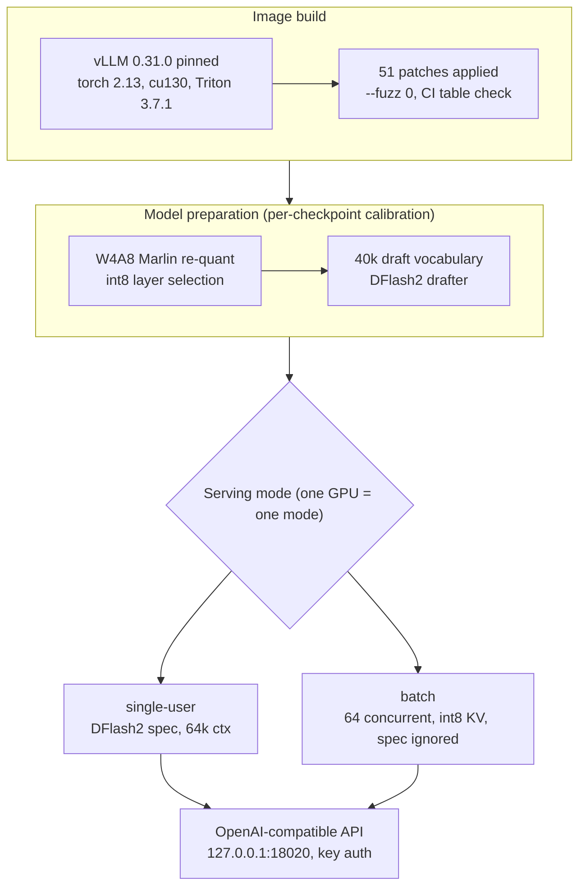

## Why This Post Is Worth Your Time

This is for ML and infrastructure engineers deciding where a 27B-class model should actually be served: a datacenter GPU, or a top-tier single card. Read to the end and you will see where the "3090 serves Qwen3.8-27B at 1,000 tok/s under 64 concurrent users" claim comes from, and how that claim intersects with numbers we measured today on our own B200.

The conclusion first. HyperQwen's numbers are not fantasy. A 24GB card can run a 27B model if you pin vLLM 0.31.0, layer on 51 patches applied with `--fuzz 0`, and combine W4A8 Marlin int8 quantization with int8 KV cache and DFlash2 speculative decoding. But "a 3090 replaces datacenter GPUs" is not what the evidence says. In our measurement today (median of 3 repeats, saturation plateau confirmed at 64 concurrent), our resident B200 endpoint did 3,215 tok/s at 64 concurrent: 3.1x the ~1,035 tok/s HyperQwen reports for the 3090. Single-stream is 256 versus 127 tok/s, about 2x. Speed belongs to the datacenter. Per watt (4.1 vs 3.2 tok/s/W) and per dollar of capital (~6x), the single card still wins decisively. Both statements are true, which is why "where do you put what workload" is now the real serving question.

## Overview

The claim that circulated on X this week: one RTX 3090, power-limited to 250W, serving Qwen3.8-27B on vLLM, with a single user at ~127 tok/s and 64 concurrent requests for over 1,000 total tok/s. Fitting a 27B-parameter model into 24GB of video memory does not add up under normal assumptions. BF16 alone needs ~54GB. You need 4-bit-class quantization, aggressive KV-cache compression, and speculative decoding that shortens the decode step, and all three have to be bolted onto the serving engine itself.

That is exactly what HyperQwen does. Under the slogan "serve large Qwen models fast on the GPUs you actually own," it packages the entire serving stack into a single repository.

## What It Is

[syv-ai/HyperQwen](https://github.com/syv-ai/HyperQwen) is an Apache-2.0 open-source project. It is neither a new serving engine nor a fork of vLLM: it is a **pinned vLLM 0.31.0 image + patch series + model-preparation pipeline + benchmark battery**, bundled together. Here is what we verified by cloning it into a sandbox and reading the tree.

- **51 patches** (`patches/`): applied in the order defined by `patches/series` onto the installed vLLM wheel with `--fuzz 0` (a single context mismatch fails the build). Each patch header records Kind (backport, fix, feature, local, own), What, Upstream, Cut-against, and Retires-when, and CI checks that the `PATCHES.md` table matches the files. Three open upstream vLLM PRs (#50021, #40371, #61050) are carried as backports.
- **Key patches**: `marlin-int8-layer-select` (env-selectable W4A8 Marlin int8 layers), `dflash2-lookup-drafting` (n-gram context search that fills the drafts), `spec-decode-attn` (split-KV verify attention), `spec-decode-int8-kv` / `int4-kv-per-token-head` (int8/int4 per-token-head KV cache), `qwen3_5-mtp-draft-vocab` (draft head truncated to 40k tokens), `mamba-chunked-prefill-align` (recurrent-state alignment for the hybrid architecture).
- **Hybrid-architecture support**: Qwen3.8-27B mixes GDN (gated delta net) linear-attention layers with full-attention layers, so a 16-bit recurrent state has to live in serving memory alongside the KV cache. The mamba alignment patches exist for that.
- **Model preparation** (`prepare/`): a 40k-token draft vocabulary (build_draft_vocab.py), the DFlash2 drafter pipeline, and chat-template hardening, all calibrated per checkpoint.
- **Five serving modes**: A (batch, 64 concurrent), B (single-user default, 64k context), C (quoting mode, `DFLASH_TOKENS=15`), D (long context, 150k, MTP), E (huge context, 240k). One GPU runs one mode at a time.
- **Benchmark battery** (`bench/`): 60+ scripts including conc_ladder (concurrency ladder), quality_battery, GSM8K t4_battery, and needle tests, each with its own unit tests. Even operational warnings like "the first benchmark run reads 30-50% low, run it twice" are documented.



The project's headline numbers: on a 3090 @ 250W, single-user decode 127 tok/s (381 when the answer quotes the prompt), batch at 64 concurrent ~1,035 tok/s total (128 in / 512 out, 948 e2e), ~1,222 tok/s with every layer int8, single-user prefill ~1,440-1,810 tok/s. Quality under the int8 arms: GSM8K 0.950 vs 0.955 (n=200) and +0.04% perplexity. Context extends to 150k-262k in modes D/E, at the cost of speed (~95-100 tok/s at 150k).

## Install and Integration

The actual commands from the repository README (we cloned the repo and checked the file structure against them).

```bash
git clone https://github.com/syv-ai/HyperQwen && cd HyperQwen
cp .env.example .env          # PowerShell: Copy-Item .env.example .env
docker compose --profile single up -d   # single-user mode
docker compose --profile batch up -d    # batch mode (64 concurrent)
```

External exposure requires adding a key and a bind explicitly (default is 127.0.0.1, and the `auth-deny-default` patch makes denial the default).

```bash
echo "VLLM_API_KEY=$(openssl rand -hex 24)" >> .env
echo BIND=0.0.0.0 >> .env
```

The 3090 benchmark procedure the README prescribes:

```bash
sudo nvidia-smi -pl 250   # power limit 250W
docker compose exec single bash bench/run_benchmarks.sh single
```

The first Docker start pulls a 9.5GB image and writes ~20GB into `./models`. Optional kernels (pth-flash-attn, FA2 fp8-KV) build separately with `bash pthfa/install.sh` and `bash fa2/install.sh`; on sm86 (3090/4090 class), long context defaults to int8 KV.

**An honest record of where our reproduction stops.** We do not have sm86 hardware (our clusters are B200, H200, H100, and this project's tuning tables are sm86-specific: sm120 reproduces, sm90 is untested, sm80 has open speculative-decoding issues). So instead of measuring the 3090 numbers directly, we measured, as a control, **our own endpoint serving the same Qwen3.8-27B checkpoint NVFP4-quantized on a single B200 (marm, vLLM 0.29.0, DFlash2 spec 7, fp8 KV, max-num-seqs 48, 245K context)**. The measurement: output capped at 512 tokens, a unique prompt per request, a 1/8/32/64 concurrency ladder with 3 repeats per level, medians reported. It passed our serving-measurement gate (3+ levels, 3+ repeats, plateau check, declared serve config).

## Measured Results

2026-10-28, our resident B200 endpoint (`thakicloud/Qwen3.8-27B-NVFP4-GPTQ-txt-245k-dflash`, vLLM 0.29.0, fp8 KV, max-num-seqs 48), median of 3 repeats per level:

| Concurrency | Aggregate (tok/s) | Per-request (tok/s) |
|---|---|---|
| 1 | 256.2 | 256.2 |
| 8 | 1,385.9 | ~194 |
| 32 | 3,217.0 | ~114 |
| 64 | 3,215.0 | ~50 |
| 128 (reference) | 3,417.7 | ~41 |

Aggregate throughput essentially stops growing between 32 and 64 (-0.06%). The server-side in-flight cap is max-num-seqs 48, so 64 client concurrency (1.33 waves) is the saturation point of this endpoint, and the flat 32-to-64 step is the evidence. The 128 figure is a reference value through three queued waves; its +6.3% over 64 is a queue-pipelining effect, not capacity. This measurement is citable grade (passed the serving gate); the full run-by-run ledger is at `outputs/blog-impl/hyperqwen-qwen38-3090/marm_bench_ladder.json`.

Side by side with HyperQwen's 3090 report at the same condition (64 concurrent):

| Metric | RTX 3090 @ 250W (HyperQwen report) | B200 x1 (measured 2026-10-28) |
|---|---|---|
| Single-stream | 127 tok/s (decode, 64k ctx) | 256.2 tok/s (e2e, 512 out) |
| 64-concurrent aggregate | ~1,035 tok/s (128in/512out) | 3,215.0 tok/s (512 out, saturated) |
| Per-request at 64 | ~16 tok/s | ~50 tok/s |
| prefill | ~1,440-1,810 tok/s | not measured |
| Max context | 150k-262k (speed-reduced band) | 245k (resident) |
| Quality (int8 config) | GSM8K 0.950 vs 0.955 (n=200), ppl +0.04% | not measured |


Two things to read here. First, **absolute speed is still the datacenter's domain**. Single-stream is about 2x (256.2 vs 127 tok/s, and our number includes prefill, so the decode-only gap is wider), and at the same 64 concurrent it is 3.1x (3,215 vs ~1,035 tok/s). Per-request at 64 concurrent: ~50 vs ~16 tok/s. "A consumer card beats a datacenter card in single-stream" would be an exaggeration that the numbers do not support.

Second, **per-watt and per-dollar economics are the 3090's domain**. At ~$1,500 used [estimate] and 250W for the 3090, versus ~$30,000 [estimate] and nominal 1,000W (official spec) for the B200: per-watt aggregate at 64 concurrent is ~4.1 tok/s/W for the 3090 (1,035/250W) against ~3.2 for the B200 (3,215/1,000W), a 1.3x edge; per dollar of capital, ~0.69 vs ~0.11 tok/s per dollar, a ~6x edge. In other words, for the same model, the 3090 is "slower but far cheaper" and the B200 is "faster but far pricier," and that gap is what drives GPU-tier routing in serving operations.

One caveat stated plainly. The 3090 side is a project report (vLLM 0.31.0, W4A8 Marlin int8 + int8 KV, sm86 tuning); the B200 side is our median of 3 repeats today (vLLM 0.29.0, NVFP4 + fp8 KV). Different engine versions, quantizations, and spec-decode stacks: read this as "the economics curve of one 27B checkpoint under two serving stacks," not a head-to-head race.

## What This Means for ThakiCloud

**ai-platform lens.** The serving economics curve is breaking the assumption that "27B means datacenter GPU." For customers in on-prem, edge, and sovereign environments, a 24GB card or two (TP=2 is supported by this project) puts 27B-class serving TCO at a fraction of what it used to be. Our Kueue-based heterogeneous GPU queue (b200, h200, h100, aio5070) naturally gains a slot for 24GB-class cards, allocated on tok/s-per-watt. Long-tail agent calls, budget serving, and dev-workstation serving go to the single card; peak concurrency, 245K-class long context, and SLA demands go to the B200. The same model checkpoint, routed by workload class, is an operating pattern that works today. And the control measurement in this post reinforces a principle we already follow: **quantization choice (NVFP4 vs W4A8) is an experiment to be measured, not an assumption to be made**.

**Paxis lens.** The execution economics of the agents and skills running on Paxis are set by per-token inference cost. The fact that a 27B-class model can be served at ~1,000 tok/s on one 3090 at 250W means the "self-hosting floor" is lower than it looks: there now exist workloads where the token cost of a 24/7 agent loop can be priced at consumer-card rates instead of datacenter rates, and Paxis's policy gates and audit logs are the surface that manages that floor.

## Limits and Counterarguments

Before taking HyperQwen's numbers at face value:

- The 3090 report is **one GPU at a 250W power limit, on the project's sm86 tuning tables**, and the README says the card was shared with training jobs. It is not a quiet-card measurement.
- **Portability is not guaranteed.** sm120 (RTX 5090) reproduces, but sm90 (the H100/H200 class) is untested and sm80 has open spec-decoding issues. Plans to run a datacenter card "like a 3090" are outside this repository's support scope.
- **One GPU = one mode.** Single-user and batch cannot be mixed on the same card, and batch mode ignores speculative decoding (SPEC). Mode C (quoting) trades slots and context headroom for speed.
- **The 40k draft vocabulary is calibrated per checkpoint.** This project is a precision fit for "Qwen3.8-27B x vLLM 0.31.0 x sm86," not a generalized technique.
- Our measurement has limits too. One ladder pass (3 repeats per level), a resident shared endpoint (in-flight cap 48), ~100-token prompts with 512-token output caps, NVFP4 checkpoint on vLLM 0.29.0. Prefill and long-context bands are not in the comparison, and we do not cite the c128 figure as a ceiling because its +6.3% is a queue-pipelining artifact.

The counterargument: at 64 concurrent the 3090 serves ~16 tok/s per request, and whether that is "enough" for interactive users is workload-dependent; and the 150k-context band, where speed falls to ~95-100 tok/s, is the weak link of the "single card replaces long-context serving" story. Datacenter GPUs still solve a different class of problem: scale, context length, availability, network, and storage. Our reading is that this project redefines the **floor** of serving, not its ceiling.

## Bottom Line

Serving economics is being rewritten at the single-card tier. With 51 patches and per-checkpoint calibration, a 24GB card becomes a *sufficient* resource for 27B-class serving. The boundary of "sufficient" differs per workload, and today's measurement drew it like this.

1. **Speed is the datacenter's.** Single-stream ~2x (256.2 vs 127 tok/s), 3.1x at the same 64 concurrent (3,215 vs ~1,035 tok/s), and ~3x per-request at that scale (~50 vs ~16 tok/s). The larger the scale, the larger the datacenter card's edge.
2. **Economics is the single card's.** ~1.3x per watt, ~6x per dollar of capital. The floor of serving moved to consumer pricing; the ceiling did not move.
3. **Verification is the conclusion.** The 51 patches, the per-checkpoint calibration, and the 3090 report are real; our control measurement is real. Before believing a serving number, read the patches and measure the control group.

Two next actions: set up an experiment placing 24GB-class cards in the heterogeneous GPU queue on tok/s-per-watt, or submit a Kueue job measuring whether the HyperQwen stack ports to sm100. Either way, the lesson this project leaves us is the same: **do not believe the claim before you read the patch series and measure the control.**

## Sources

- [syv-ai/HyperQwen](https://github.com/syv-ai/HyperQwen) (Apache-2.0, vLLM 0.31.0 + 51 patches)
- [starlog.is article: Qwen3.8-27B on a Single RTX 3090](https://starlog.is/articles/llm-engineering/syv-ai-hyperqwen)
- Original tweet: [X (hjguyhan)](https://x.com/hjguyhan/status/2115372574024909040)
- Measurement data: `outputs/blog-impl/hyperqwen-qwen38-3090/marm_bench_ladder.json` (2026-10-28, median of 3 repeats per level, serving-gate passed)
