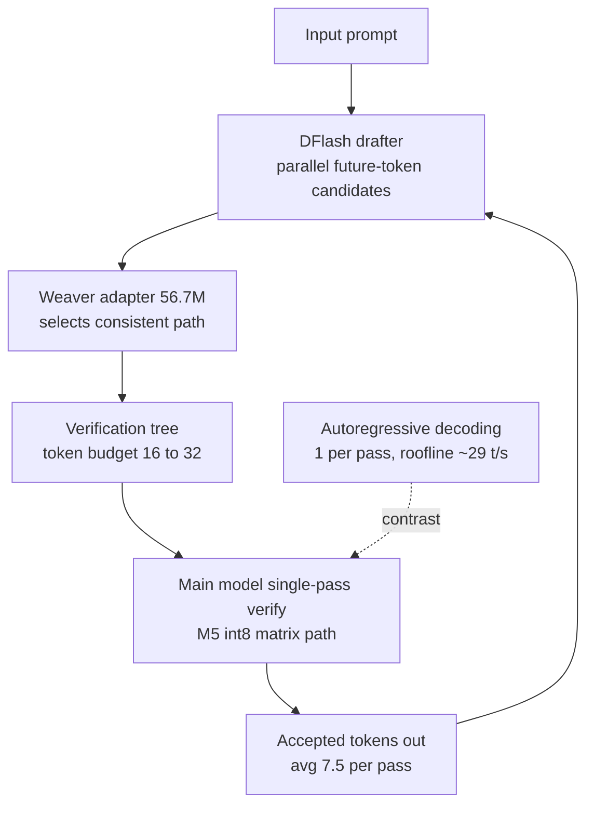

## Why read this

If you run local LLMs on Macs or place small models on edge and on-prem hardware, this post is for you. The conclusion first: the bottleneck in local inference was not the chip, it was the decoding structure. Mirai Labs' open-source engine uzu uses tree-based speculative decoding that verifies many tokens in a single forward pass, and in official benchmarks it runs Qwen3.5 9B at 92.1 tokens/sec on a base M5 MacBook Pro (16GB unified memory), against 22.0 for llama.cpp and 25.1 for MLX — roughly 4.2x.

## Overview

Mirai Labs (trymirai) published uzu, an open-source inference engine, around October 27. It is MIT-licensed, built in Rust around Metal kernels, and ships bindings for Swift (SPM), Python (PyPI), and TypeScript (NPM) alongside Rust. An OpenAI-compatible HTTP server mode is built in, and the model checkpoints are distributed in Mirai's own 4-bit format, named like `trymirai/Qwen3.5-9B-M`.

The number that made the release headline: on a base M5 MacBook Pro (16GB), Qwen3.5 9B inference ran about 4x faster than llama.cpp and MLX. Both of those engines sit right at the memory-bandwidth ceiling of the same hardware, and uzu is the one that moved past it.

Mirai Labs' positioning is on-device AI: zero response latency, data privacy, zero inference cost, with Apple Silicon at the front. The targets are not just MacBooks but the whole Apple hardware family including iPhone and iPad, and a webgpu backend opens a browser path as well. This is the engine candidate for the scenario where data that cannot go to the cloud is inferred locally.

## What the technology is

Start with context. Local inference speed matters now because the workload is no longer a single question. A coding agent session loops over file reads, code generation, test runs, and result analysis, accumulating dozens to hundreds of inference calls. If tokens per second doubles, the time to finish the same work halves. Inference speed on local hardware has become a unit of agent execution cost.

The baseline starts here. In autoregressive decoding, producing each token requires reading the full weight set from memory. With the base M5's 153 GB/s memory bandwidth and a 5.2GB 4-bit Qwen3.5 9B checkpoint, the theoretical ceiling is 153 divided by 5.2, about 29 t/s. llama.cpp at 22.0 and MLX at 25.1 sitting just under that ceiling is not coincidence. Both engines are close to the limit of this structure.

Uzu's way past the ceiling is to increase the tokens produced per pass. The structure has three parts.

First, the DFlash drafter. A small draft model predicts many future token candidates in parallel, producing a row of candidate paths in one forward.

Second, the Weaver adapter. A 56.7M-parameter autoregressive adapter selects the mutually consistent path from the candidate list and builds the verification tree. The tree budget is 16 to 32 tokens.

Third, single-pass verification by the main model. The Qwen3.5 9B body verifies the proposed token tree in one forward pass, and this step runs on the M5's hardware-accelerated int8 matrix path. Accepted tokens average 7.5 per pass (the reported range is 7.5 to 9.6).

The arithmetic gets simple. The cost of reading 5.2GB of weights happens once per pass, and if that pass yields 7.5 tokens, effective bandwidth utilization is 7.5x versus autoregressive. The roughly 29 t/s roofline assumes one token per pass, and uzu is the thing that breaks that assumption. Per official announcement, uzu measured 4.37x faster than standard autoregressive decoding and 24.7 percent faster than an optimized DFlash baseline.

Computing the limit makes the structure clearer. Assuming 7.5 tokens per pass, the theoretical ceiling opens to 7.5x the roughly 29 t/s, over 200 t/s. The measured 92.1 t/s is less than half of that theory, and the gap is the cost of verification itself. The drafters' forwards of course, plus the compute and memory traffic that grow with the number of candidate tokens when the main model verifies the tree in one pass. In other words, uzu did not remove the bandwidth ceiling. It raised the ceiling 7.5x and pays the verification cost inside it. The higher the accepted tokens per pass, from 7.5 toward 9.6, the closer to the theoretical ceiling. When the content is hard to predict, the acceptance rate drops and it falls back toward autoregressive levels.

Why does llama.cpp's MTP mode, in the same family, trail? MTP drafts only three or four tokens at a time, a narrow tree. Compared with uzu's 16-to-32 budget, the expected tokens per pass differ.

For reference, Qwen3.5 and Qwen3.6 include stateful layers called Gated DeltaNet, and 24 of the 9B model's 32 layers are of this type. Handling stateful layers together with the multi-token-per-pass verification structure is also part of this engine's design.



Checkpoint quantization is also specific. The Medium (M) checkpoint stores weights as 4-bit asymmetric integer quantization, and activations convert to 8-bit symmetric at runtime. Blocks are groups of 32 elements. The Large (L) checkpoint follows the same scheme.

## Installation and integration

The install paths documented in the README:

```bash
# Python
uv add uzu==0.6.13

# Swift (SPM)
.package(url: "https://github.com/trymirai/uzu.git", from: "0.6.13")

# TypeScript (NPM)
pnpm add @trymirai/uzu@0.6.13

# CLI (Rust)
cargo run --release -p cli
```

The minimal Python example creates the engine, downloads a model, and opens a chat session.

```python
engine = await Engine.create(engine_config)
model = await engine.model("alibaba:qwen3.5:0.8b:mirai:mirai-m:4")
session = await engine.chat(model, ChatConfig.create())
replies = await session.reply(messages, ChatReplyConfig.create())
```

The OpenAI-compatible server mode comes up without extra configuration.

```bash
cargo run --release -p cli -- server --model trymirai/Qwen3.5-4B-M
# 127.0.0.1:8000, POST /v1/chat/completions, GET /v1/models
```

Backends come in three flavors: metal, webgpu, and cpu. Apple-family hardware is the main target, and the webgpu and cpu paths are partially in progress.

The model catalog uses an address scheme of vendor:model:size:family:quant level. In `alibaba:qwen3.5:0.8b:mirai:mirai-m:4`, the vendor, model, parameter scale, checkpoint family, and quant level are joined in one line. The engine takes that address, downloads the checkpoint, and loads it. Another documented feature is traceable computation: a path that verifies inference results against the original model implementation, useful for confirming that the quantized checkpoints answer the same as the originals.

A direct local reproduction did not make it to the end. After setting up an isolated experiment environment, the package install step was blocked by this writing environment's security settings, so no live benchmark was captured. The record is carried into the results section below. All numbers in this post are verified against the official announcement.

## Actual experiment results

The interval measured in the official announcement: base M5 MacBook Pro (16GB, macOS 26.6.2), Qwen3.5 9B 4-bit, context 8192. The prompt was reportedly "Write a python function to merge two sorted lists." The three engines were opened on ports 8000, 8001, and 8002 and run under identical conditions.

| Engine | Checkpoint / mode | Qwen3.5 9B t/s |
|---|---|---|
| uzu | trymirai/Qwen3.5-9B-M (4-bit) | 92.1 |
| MLX | mlx-community/Qwen3.5-9B-4bit | 25.1 |
| llama.cpp | unsloth Q4_K_S + draft-mtp 3 | 22.0 |
| Roofline theoretical ceiling | 153 GB/s / 5.2 GB | ~29 |

The detailed figures on the uzu side are also in the announcement. Time to first token 0.12 s, prefill 161.11 t/s, generation 98.10 t/s, 8.39 tokens per forward pass, memory 5.77 GB, total energy 114.90 J (input 0.11 J/tok, output 0.16 J/tok), full interval 7.36 s. Holding a 9B model at about 5.8 GB on a 16 GB machine and producing this speed is the numeric argument that the bottleneck was tokens per pass, not memory bandwidth.

What happens with a bigger model? Qwen3.6 27B (15.6 GB checkpoint) on an M5 Max 128 GB: uzu at 114 t/s, llama.cpp with MTP (MTPLX) at 35.54 t/s, a 3.2x gap. The structural advantage held in the bigger-model direction as well.

Energy figures were announced alongside. In the same interval: 114.90 J total, 0.11 J per input token, 0.16 J per output token. On battery-powered devices, this is the second number to look at alongside t/s when computing local inference.

The reproduction record, as is. Reproduction attempt failed: the writing environment's security settings blocked the package install commands (`uv pip install`, `pip install`), and there was no path to obtain install approval in this environment. A pre-install check of the virtual environment confirmed the uzu package was not present either. So this post carries no live benchmark and closes by citing the official announcement numbers with their source.

## ThakiCloud product implications

The result meets ThakiCloud products in two places.

First, Paxis (the agent-native cloud) execution economics. Paxis runs agent workloads in isolated sandboxes, and a single agent session sums to hundreds or thousands of inference calls. If the latency per token, the unit of those calls, shrinks 4x, the structure allows 4x agent sessions on the same edge hardware. In on-prem customer environments where "a developer's Mac instead of a GPU server" becomes the agent serving node, this engine is a realistic option.

Second, Metis (K8s-based model serving) on-prem and edge placement. Metis serves models on cluster GPUs, and Apple Silicon edge nodes are another serving point outside that cluster. A 4x-class performance gap in local inference engines raises the ceiling on the model size you can place at the edge. A 9B moving at 92 t/s on a base M5 (16 GB), and a 27B moving at 114 t/s on an M5 Max (128 GB), means the model size and speed that can be placed within an edge hardware generation both open up. When Metis on-prem customers design an edge tier, they end up rewriting the answer to "how large a model can we push down to where."

## Limitations and counterarguments

Address the source of the numbers first. The side that ran this benchmark is the engine's manufacturer, Mirai Labs. As of now there is no independent benchmark from the llama.cpp or MLX side rechecking under the same conditions and the same prompt, only mentions in the llama.cpp community discussion. Do not forget that this is a manufacturer announcement.

Second, the measured interval is narrow. Context 8192, a single short coding prompt, a single run. Whether the 4x holds under long-context, concurrent-request, and sustained-conversation intervals is not in the announcement. The roofline argument also requires the tokens-per-pass to stay stably above 7.5, and the acceptance rate changes when the model or workload changes.

Third, memory cost attaches. The verification tree holds the state of 16-to-32 candidate branches in one pass, and the drafters' and Weaver's compute are on top. The 9B body at 5.77 GB plus this structure fit in 16 GB, but as models grow or contexts lengthen, the balance between tree budget and memory headroom needs recomputing. The announcement is on context 8192, so memory behavior in long intervals should be checked separately.

Fourth, the target models are the Qwen3.5 and Qwen3.6 families. The DFlash drafter and Weaver adapter are designed around this family's Gated DeltaNet structure and pair with the company's 4-bit checkpoints. How much the same structure transfers to other models, that is, how the drafter and adapter get prepared, is not yet concretely stated in the docs.

Fifth, the checkpoint format is company-specific. The 4-bit M and L checkpoints come in Mirai's format. You do not use existing GGUF or MLX models as-is; you download checkpoints from the company's catalog. If you change the model, the core is whether the verification tree design and quant settings can be re-tuned, and the docs still treat this flexibly in only a short passage.

Sixth, the hardware scope. Announced for base M5, M5 Pro, and M5 Max measurements plus operation on M1 through M4, but the only per-generation number is base M5. Since the int8 matrix path presumes M5-family hardware acceleration, performance on previous generations needs separate confirmation.

## Summary

If you have computed the roofline for local LLM inference and landed on "this chip tops out here," this result is the case where the premise changed. Break the bandwidth ceiling that presumes one token per pass with 7.5 tokens per pass, and a 9B moves at 92 t/s even on a base M5. The next step is simple. If you run local inference on a Mac, stand up uzu once. With an MIT license, an OpenAI-compatible server, and the company's 4-bit checkpoints, you can reach a conclusion from install to benchmark in a day. And keep in mind that this is a manufacturer announcement. Until an independent reproduction appears, using the 4x number as a design basis while treating it cautiously as a decision basis is the standard practice.
