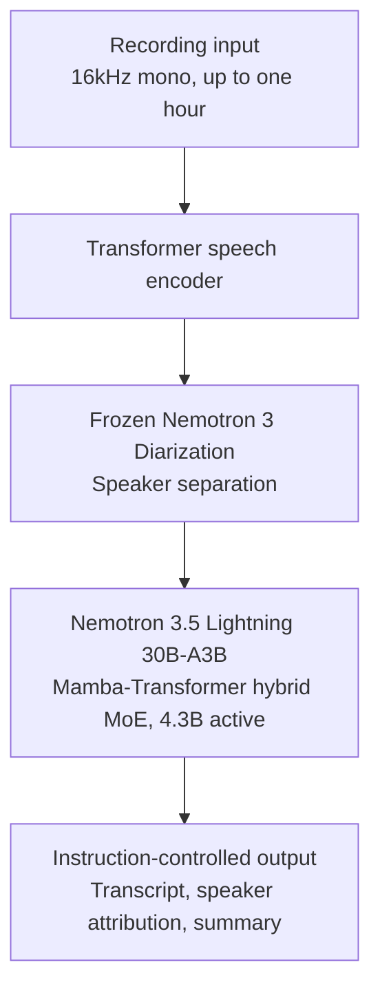
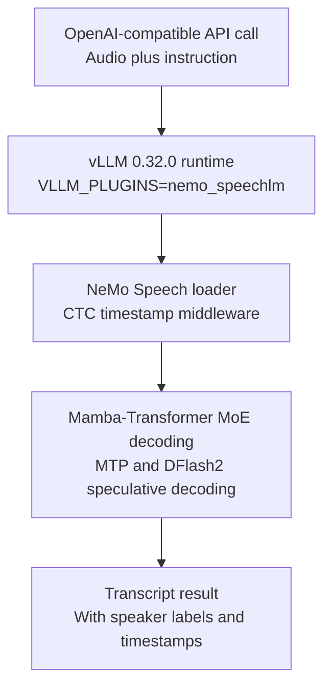

## Who Should Read This

If you serve STT (speech-to-text) on a K8s AI platform, or you are a speech ML practitioner deciding what to build your in-house STT on, this post is for you. The core conclusion first: on October 28, NVIDIA released Nemotron 3.5 Transcribe, a 40-language multilingual ASR model, and opened day-0 serving on vLLM 0.32.0 through the NeMo Speech plugin the same day. ASR has entered, for the first time, the day-0 serving stack that LLMs have enjoyed for the past two years. Speech recognition inference is no longer separate infrastructure; it becomes a first-class workload on the same GPU queue, the same runtime, and the same quantization tiers (BF16/FP8/NVFP4) as LLMs.


## Overview

NVIDIA announced Nemotron 3.5 Transcribe on October 28, 2026. Four release channels opened the same day: Build.Nvidia.com, GitHub (the NVIDIA-NeMo/Speech repository), Hugging Face, and NGC. The vLLM project account also announced day-0 serving through vLLM + NeMo Speech that day. This is the first speech transcription ("Transcribe") model in the Nemotron family.

The model is roughly 34B total parameters including the audio encoder, with about 4.3B active. The 30B-A4B in the name refers to the LLM backbone, Nemotron 3.5 Lightning 30B-A3B, a hybrid Mamba-Transformer mixture-of-experts. A single model transcribes 40 languages, accepts 16kHz mono recordings up to one hour long, and supports sequences up to 65,536 tokens. It is an offline batch recognizer, not a real-time streaming one. The license is OpenMDW-1.1.

What sets it apart from prior ASR models is that it does not only transcribe. It is designed to be controlled by instructions, so summarization, speaker attribution (who said what), and spoken language identification all run in the same model. Speaker separation is not a post-processing step; a frozen Nemotron 3 Diarization model runs inside the architecture.

The phrase "day-0 serving" is worth unpacking. In LLM serving, day-0 means the serving stack is ready on the day the model is released: the runtime recognizes the model, per-precision launch profiles are documented, and install and serve commands work from day one. This contrasts with the usual case where a new model waits days or weeks for runtime support. For Nemotron 3.5 Transcribe, the phrase is accurate: model release and serving support opened the same day across four channels.

## What Is This Technology

The architecture reads as three layers.



The first layer is a Transformer speech encoder that turns 16kHz mono audio into feature vectors. The second is the frozen Nemotron 3 Diarization model, which attaches speaker labels to segments. The third is the LLM body, Nemotron 3.5 Lightning 30B-A3B, which reads the encoder features and diarization results and generates the transcript according to the instruction.

The Mamba-Transformer hybrid backbone is the key engineering choice. The Mamba part updates a recurrent state at linear complexity, which handles long audio sequences efficiently; the Transformer part covers attention-heavy segments. Combined with MoE, the active parameter count stays at 4.3B while one model handles transcription, speech translation, language identification, and summarization across 40 languages. One-hour recordings are exactly why this hybrid structure exists.

The serving flags show the same structure. `--use-replayssm` manages Mamba states via recomputation (replay), so long sequences run without checkpoint-restore overhead, and `--mamba-backend flashinfer` provides the kernels. `--no-enable-prefix-caching` turns off the prefix caching that is on by default in LLM serving. For audio workloads, encoder features differ per call, so prefix caching is rarely a win; instead, `--enable-chunked-prefill` splits long-audio prefill into chunks for batched processing. The `--limit-mm-per-prompt` audio count of 6 means up to six audio clips per call. The `--middleware` CTC timestamp middleware computes CTC alignment separately from the attention-based decoding and attaches word-level timestamps to the result.

Two additions deserve attention. One is instruction control. With `--reasoning-parser nemotron_v3`, the model reasons over the audio before transcribing, and the research page reports a six-fold reduction in named-entity errors on the context ASR benchmark (ContextASR-Bench). The other is speculative decoding. Besides MTP (Multi-Token Prediction), a separate DFlash2 draft model is released, and the model card's serve command includes `--speculative-config` (MTP, 8 proposed tokens). For DFlash2, the model card recommends K=7 as the starting point.

## Installation and Integration

The install path pins NeMo Speech main branch + vLLM 0.32.0. The following are the commands verbatim from the model card.

```bash
pip install git+https://github.com/huggingface/transformers
git clone https://github.com/NVIDIA-NeMo/Speech.git nemo-speech
cd nemo-speech
uv venv --python 3.13 .venv
UV_PROJECT_ENVIRONMENT=$PWD/.venv uv sync --extra asr --extra vllm --locked --no-install-project
uv pip install --python .venv/bin/python --no-deps -e .
uv pip install --python .venv/bin/python --no-deps av==19.0.2
uv pip install --python .venv/bin/python --no-deps opencv-python-headless==5.0.0.93
source .venv/bin/activate
hf download nvidia/NVIDIA-Nemotron-3.5-Transcribe-30B-A4B --local-dir ./NVIDIA-Nemotron-3.5-Transcribe-30B-A4B
```

The serve command is as follows.

```bash
export VLLM_PLUGINS=nemo_speechlm
export VLLM_MAX_AUDIO_DECODE_DURATION_S=3600
export VLLM_MAX_AUDIO_CLIP_FILESIZE_MB=180
export VLLM_USE_V2_MODEL_RUNNER=0
vllm serve ./NVIDIA-Nemotron-3.5-Transcribe-30B-A4B \
  --served-model-name nvidia/NVIDIA-Nemotron-3.5-Transcribe-30B-A4B \
  --trust-remote-code --dtype bfloat16 --gpu-memory-utilization 0.94 \
  --max-model-len 65536 --max-num-batched-tokens 4096 --max-num-seqs 192 \
  --enable-chunked-prefill --no-enable-prefix-caching \
  --use-replayssm --mamba-backend flashinfer --mamba-cache-mode none \
  --mm-processor-cache-gb 0 --no-async-scheduling \
  --limit-mm-per-prompt '{"audio":{"count":6,"length":120000000}}' \
  --speculative-config '{"method":"mtp","num_speculative_tokens":8}' \
  --reasoning-parser nemotron_v3 \
  --trust-request-mm-kwargs \
  --middleware nemo.collections.speechlm2.vllm.salm.ctc_serving.ctc_timestamp_middleware
```



Four points in the commands deserve attention. First, vLLM is pinned to 0.32.0. Second, the V2 model runner must be off (`VLLM_USE_V2_MODEL_RUNNER=0`). Third, two audio limits are fixed as environment variables: up to one hour per call (`VLLM_MAX_AUDIO_DECODE_DURATION_S=3600`) and up to 180MB per file (`VLLM_MAX_AUDIO_CLIP_FILESIZE_MB=180`). Fourth, FP8 and NVFP4 use different KV cache settings, so a launch profile cannot be carried over as-is when switching precision tiers.

The hardware tiers are as follows.

| Precision | Minimum hardware | Note |
|---|---|---|
| BF16 | 1x H100 80 GB | Reference for the RTFx comparison table |
| FP8 | 1x RTX PRO 6000 Blackwell 96 GB | KV cache settings differ from BF16 |
| NVFP4 | Blackwell GPU | 2,238 audio-seconds per second measured |

## Actual Experiment Results

On October 30, 2026, we ran verification in an isolated sandbox. A full reproduction was not possible due to hardware requirements; what was possible was the following three checks.

First, we checked vLLM's PyPI state. The latest version is 0.32.0 (3 artifacts, Python >=3.11,<3.15). The exact version the model card requires matches the current PyPI latest, which is consistent with the day-0 claim.

Second, we shallow-cloned the NeMo Speech repository and checked the plugin registration. The vLLM entry point `nemo_speechlm = "nemo.collections.speechlm2.vllm.salm:register"` (line 364) is registered in pyproject.toml. The day-0 plugin lives in the main branch itself, not in a separate distribution package.

Third, we judged reproducibility. The experiment machine is macOS arm64. The flashinfer Mamba backend and NVFP4 require CUDA (Blackwell), and BF16 requires at least an H100 80GB. Reproduction attempted, failed: this model needs at least 1x H100 80 GB (a Blackwell GPU for NVFP4), so local reproduction could not be performed. All benchmark numbers below are therefore vendor-published values from the model card.

The key numbers from the model card are as follows.

| Metric | Value | Condition |
|---|---|---|
| English 9-dataset mean WER | 4.71% | English Open ASR Leaderboard |
| Long-form mean WER | 10.98% | English Open ASR Leaderboard |
| Multilingual mean WER | 4.62% | Multilingual Open ASR Leaderboard, mean of 7 language means |
| Korean CER | 2.78 | FLEURS; CoVoST2 not reported |
| Throughput | 2,238 audio-seconds per second | Nemotron Transcribe NIM, 1x RTX PRO 6000 Blackwell Server Edition, NVFP4 + DFlash2 |
| 30-second recording response | 0.13 seconds | Same NIM configuration |
| BF16 RTFx | MTP2 410 / MTP8 270 / DFlash2 K=7 340 / K=15 260 | 1x H100 80 GB, batched English ASR, reasoning disabled, rough estimate |

The Korean CER of 2.78 is the FLEURS figure; CoVoST2 is not reported for Korean. For comparison, the same table lists English FLEURS 3.35, Japanese 4.42, and Chinese 8.62 (CER). In the BF16 RTFx table, DFlash2 K=7 (340) is the recommended starting point, and K=15 was slower on that ASR workload, per the model card. RTFx is the ratio of processed audio-seconds to elapsed seconds; it is a rough estimate excluding server startup, and it is not a single-request latency figure.

Interpreting the numbers splits into two lines. One is accuracy. The English 9-dataset mean WER of 4.71% versus the long-form mean of 10.98% shows the gap between short utterances and long recordings. In long-form inputs such as one-hour meeting or call recordings, WER roughly doubles versus short utterances, and this model follows the same pattern. Accuracy judgments should separate input length. The other is throughput. 2,238 audio-seconds per second (NVFP4, DFlash2, one Blackwell GPU) means, in RTFx terms, that one hour (3,600 seconds) of recording corresponds to about 1.6 seconds of elapsed time. The NIM measurement may include batching, so it is not a single-request latency.

## Implications for ThakiCloud Products

For a K8s AI platform, this release changes the shape of the speech pipeline. Until now, LLM serving and ASR serving required separate runtimes: vLLM, versus a Whisper server or standalone NeMo serving. Now STT can run as a workload on the same vLLM stack, the same Kueue GPU queue, and the same multi-tenant service. For Metis, which serves inference in customer environments, this removes one serving infrastructure for audio workloads.

The queue angle matters too. Batch STT jobs are workloads whose demand is computed in "audio-hours processed." With Kueue allocating GPU quota and priority classes under the same scheme as LLM inference, a job like "transcribe last night's backlog of call recordings" becomes a backend batch job in the queue. One serving runtime also collapses the management surface for images, plugins, and launch profiles into one.

Quantization tier economics are worth watching. BF16 needs an H100 80GB, and moving to FP8 and NVFP4 on Blackwell cuts the cost. LLMs already run the NVFP4 path in our stack, and ASR is now offered at the same precision tiers. With throughput of 2,238 audio-seconds per second at NVFP4 and 410-class RTFx at BF16, a comparison table in per-hour-of-audio serving cost is immediately computable. It has become an input to serving economics calculations.

From the Paxis perspective, one-hour offline processing plus speaker attribution is a ready-made building block for a meeting-recording pipeline. A workflow that takes call or meeting recordings and produces per-speaker summaries and action items becomes a batch job rather than a custom integration. Note that this model is not a streaming recognizer. Live dialogue (duplex voice) still needs a streaming STT path; this model occupies the batch/offline slot.

Our in-house Korean ASR research proceeds on the premise of training and distillation from a Qwen3-ASR base. Now that an open-weight model reporting Korean FLEURS CER 2.78 has also shipped a day-0 vLLM path, re-evaluating off-the-shelf models as distillation base candidates is a natural next step.

## Limitations and Counterarguments

First, offline only. It does not support streaming, so if the goal is live dialogue, this model is out. Second, the license. OpenMDW-1.1 is an open-weights license, but it is not fully open in the BSD/MIT class. Commercial use and redistribution terms must be verified before product integration. Third, all benchmarks are vendor-published. Because hardware requirements blocked a full reproduction, the model card values are the basis. Fourth, the vLLM pin. The 0.32.0 pin and V2 runner OFF mean that when the platform's vLLM stack upgrades, the ASR service needs a separate upgrade path. Fifth, per-clip limits. The one-hour and 180MB limits are generous, but recordings beyond them need splitting, and enabling instruction control (reasoning) moves you closer to the 65,536-token limit.

## Summary

ASR is now a workload served on the vLLM stack. Same queue, same runtime, same quantization tiers. For platforms that operate inference, the work item "build additional serving infrastructure for speech recognition" drops out of the architecture. The next steps are three. First, verify the OpenMDW-1.1 license terms. Second, run a smoke test at the BF16 tier on an H100 or Blackwell and measure audio-seconds per second and CER on your own Korean data. Third, put this model on the shortlist of in-house ASR base candidates and compare. Korean FLEURS CER 2.78 and the day-0 vLLM path are the reference values to measure against.

## Sources

- [NVIDIA Nemotron 3.5 Transcribe research page](https://research.nvidia.com/labs/nemotron/NVIDIA-Nemotron-3.5-Transcribe/)
- [Hugging Face model card nvidia/NVIDIA-Nemotron-3.5-Transcribe-30B-A4B](https://huggingface.co/nvidia/NVIDIA-Nemotron-3.5-Transcribe-30B-A4B)
- [NeMo Speech repository (GitHub)](https://github.com/NVIDIA-NeMo/Speech)
- [vLLM project X announcement (RT)](https://x.com/hjguyhan/status/2115816535176683737), 2026-10-29
