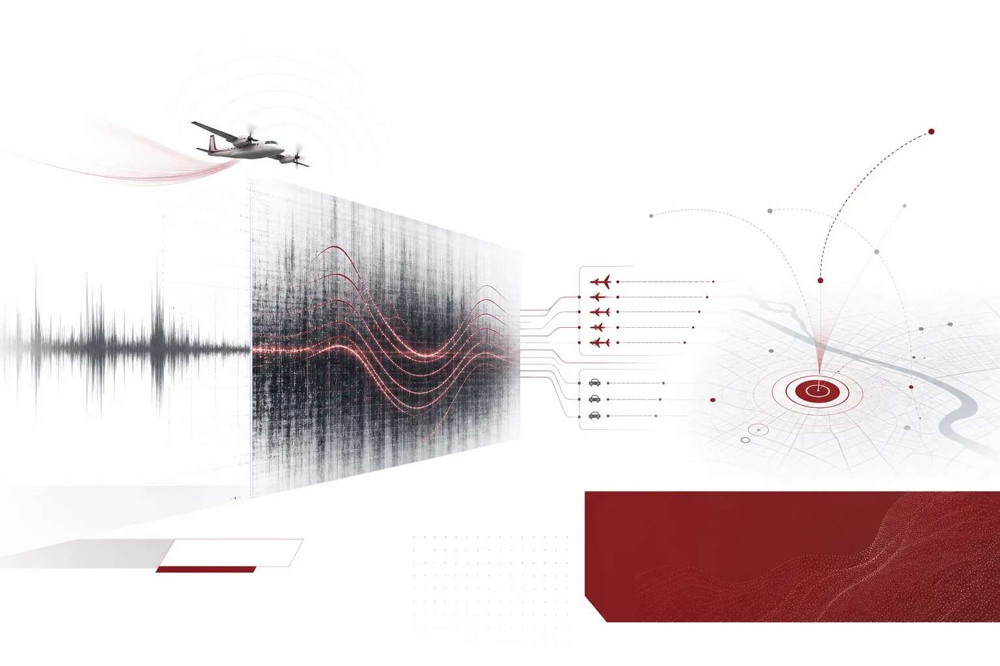
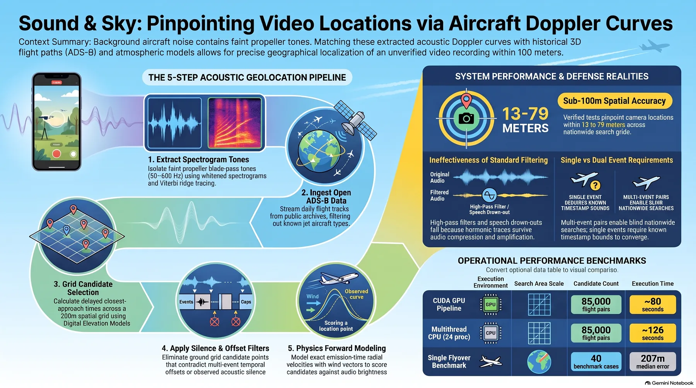
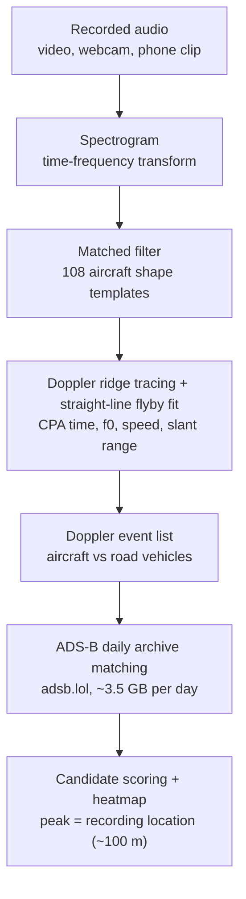
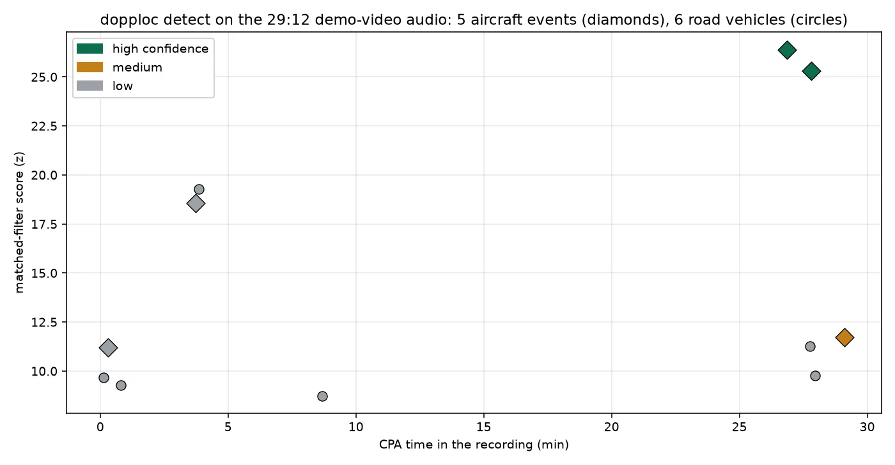
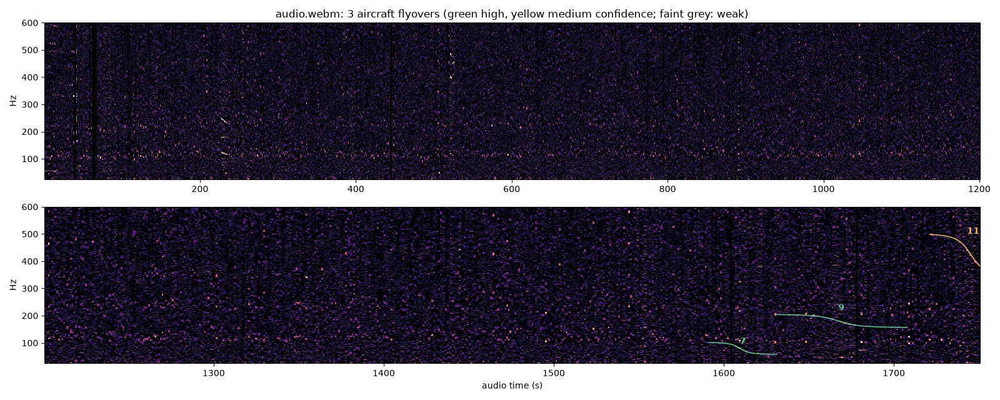
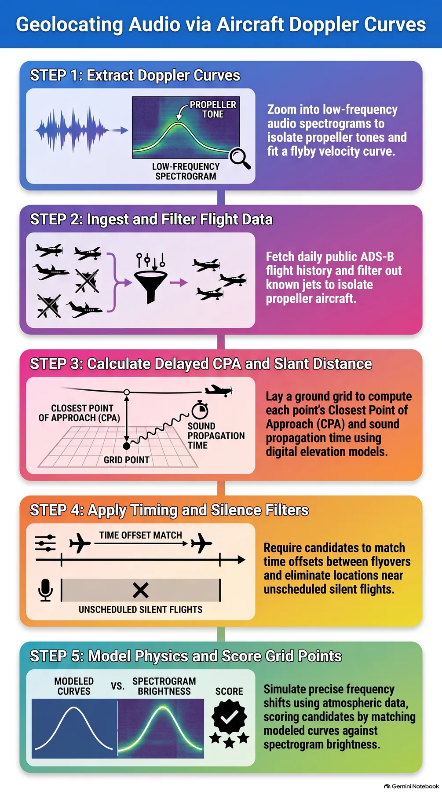

*A visual metaphor for the article's key idea.*

## Who should read this

If you publish video or audio, or you are an OSINT analyst who wants to know where a video was shot, this post is for you. The conclusion first: the inaudible propeller aircraft mixed into video audio leak the recording location. We ran the open-source reimplementation of the technique on the original demo video, and it caught 5 aircraft Doppler events in a 29-minute audio track in 36 seconds.


*Colsto's original demo video, the OSINT piece that first showed the "sound that leaks your exact location."*


*A visual metaphor for the article's key idea.*

<!-- nlm-visual -->

*Infographic generated by NotebookLM from the sources.*

## In plain terms

Think of an airplane's sound as a **whistle**. When a propeller plane passes overhead, the "whoooosh" you hear as the pitch slides down is physics. While the aircraft approaches, the sound waves are compressed and it sounds higher; after it passes, they stretch and it sounds lower. The shape of that sweep (when the closest approach happens, the base frequency, how fast it slides) is determined by the aircraft's speed and its distance from you.

Public data completes the picture. ADS-B is the position and speed information aircraft broadcast, accumulated second-by-second by receivers worldwide. Match the spectrogram curve "a propeller plane whistled past this region at 3pm on Sept 8, 2026" with the ADS-B record "a plane like that actually flew there at that time," and only one thing is left: where you must have been standing for that curve to be true. The heatmap peaks at the recording location. Under good conditions, about 100 meters.

One whistle carries a location. That is the whole technique.

## Overview

In early November 2026, YouTuber Colsto uploaded ["I discovered a sound that leaks your exact location (and it's everywhere)"](https://www.youtube.com/watch?v=UytYrhYLOKI). The OSINT technique matches the Doppler curves of propeller aircraft hidden in background noise against ADS-B data to estimate where the recording was made; a demo showing ~100m precision from 60 seconds of audio went viral within half a day, spread further through [0x45's tweet](https://x.com/0x45o/status/2117332304880169152), and picked up [TechRadar](https://www.techradar.com/computing/cyber-security/youtuber-discovers-aircraft-noise-trick-that-can-geolocate-your-videos-to-within-100m-doppler-effect-pinpoints-locations-from-just-60-seconds-of-audio) and other press coverage.

Two replications started this post. Paras Chopra [replicated the full pipeline within a few hours using Claude Code](https://x.com/paraschopra/status/2117561731065274562), and his replication was a field test, not a re-analysis of the video: he pointed a live webcam at a spot 7 km south of Southampton, UK, ran the pipeline, and reported the predicted-location heatmap peaking at the webcam's actual position. The ~100m number comes from that fresh field case, not the original demo. Two independent reimplementations also appeared the same week: [digitalis-p/doppler-locate](https://github.com/digitalis-p/doppler-locate) (GitHub, MIT) and [dopplerprint](https://pypi.org/project/dopplerprint/) (PyPI, released 2026-11-03). This post is the hands-on record of installing and running doppler-locate. Two independent reimplementations of one video method within days is itself evidence that the technique is a reproducible standard pipeline, not a one-off trick.

## What the technique is

The pipeline has five stages.



The core physical quantities are the four values the flyby fit extracts: closest-approach (CPA) time, base frequency f0, speed, and slant range. Those four values determine "if a plane flew that speed at that altitude, where must the observer have been." ADS-B supplies the actual flight paths at the same time and region; each candidate observer location is scored by back-computing "the curve you would see from here." The heatmap peak is the answer.

Why propeller aircraft are the good signal: jet noise is broadband and smears in the spectrogram, but the blade-passing frequency of a propeller and its harmonics sweep in a narrow band, leaving clean ridges a matched filter can catch. And the steepness of the Doppler sweep is inversely proportional to range. A plane at 300 m overhead slides slowly; one at 30 m slides fast. One sweep shape fixes how close and how fast the aircraft was. Combine that with the ADS-B track (altitude, speed, path) and the algebra of the observer's position remains. Internally the tool also takes a terrain DEM (Copernicus GLO-90) and wind/temperature (NOAA GFS 0.25-deg analyses) to correct sound propagation and terrain masking.

The separation logic is practical too. Road vehicles (cars, buses) make Doppler curves as well, but the tool isolates them as sources under 150 m and under 30 m/s, keeping them out of the aircraft table.

## Installation and integration

The experiment ran in an isolated sandbox (a git worktree). macOS, Python 3.12.8. The repo's native core builds with CUDA, which is unavailable on macOS, so the install went into a sandbox-only `.expenv` (the numba CPU fallback works fine).

```bash
# 1) Clone (digitalis-p/doppler-locate, MIT)
git clone --depth 1 https://github.com/digitalis-p/doppler-locate
cd doppler-locate

# 2) venv + install (uv)
uv venv --python 3.12 .expenv
VIRTUAL_ENV="$PWD/.expenv" uv pip install -e '.'
VIRTUAL_ENV="$PWD/.expenv" uv pip install yt-dlp   # for web audio downloads

# 3) (optional) native build (fails without CUDA on macOS; numba fallback works)
make -C native

# 4) detect: point it at an audio file or a web link
.expenv/bin/dopploc detect /path/to/recording.webm
# or directly at a URL: .expenv/bin/dopploc detect "https://www.youtube.com/watch?v=UytYrhYLOKI"
# (URL input goes through yt-dlp; the output directory must exist)
```

`detect` writes four artifacts under `out/detect/<name>/`: `report.md` (printed report), `detections.json` (all detections), `events.toml` (aircraft events that passed the fit), and `detections.png` (spectrogram with detections overlaid).

Matching requires four data sources the tool ingests: the adsb.lol daily history (~3.5 GB/day, ODbL), the ICAO aircraft type table (propeller vs jet), the Copernicus GLO-90 DEM (terrain), and NOAA GFS 0.25-deg analyses (wind, temperature). `detect` uses only the audio; matching needs all of them.

To go all the way to a heatmap:

```bash
.expenv/bin/dopploc fetch-adsb 2026-09-08   # adsb.lol daily archive, ~3.5 GB
.expenv/bin/dopploc ingest 2026-09-08       # bbox-filter into parquet
.expenv/bin/dopploc run CASE.toml           # search + score
.expenv/bin/dopploc heatmap CASE.toml --rank 1   # dense map around the top candidate
```

## What we actually ran

We extracted the audio of the original demo video (Colsto, 29 min 12 s) with yt-dlp and ran detect on it. On a MacBook CPU (numba fallback, no GPU), the **entire analysis took 36 seconds** (10:55:03 to 10:55:39 UTC: spectrogram + matched filter over 108 templates + fitting 18 detections).

The report, verbatim:

```
source: /tmp/dopploc-audio/Youtube-UytYrhYLOKI/audio.webm  (0:00-29:12)
aircraft Doppler curves found: YES -- 3 high/medium, 2 low-confidence;
6 close-range sources (road vehicles etc., < 150 m or < 30 m/s) listed separately

Aircraft
| # | CPA       | f0 Hz | speed m/s (kt) | CPA dist m | score | fit rms Hz | confidence |
|---|-----------|-------|----------------|------------|-------|------------|------------|
| 7 | 26:51     | 73.6  | 97 (188)       | 614        | 26.4  | 0.31       | high       |
| 9 | 27:49     | 177.1 | 47 (92)        | 611        | 25.3  | 0.20       | high       |
| 11| 29:07     | 411.2 | 62 (121)       | 534        | 11.7  | 0.85       | medium     |
| 2 | 0:18      | 30.6  | 160 (311)      | 400        | 11.2  | -          | low        |
| 4 | 3:44      | 135.9 | 73 (143)       | 528        | 18.6  | -          | low        |
```


*Chart from the run-1 capture (detections.json). The two high-confidence aircraft events (D1 f0 73.6 Hz, D2 f0 177.1 Hz) cluster in the last three minutes of the video.*

The tool's own spectrogram overlay is below. Against the pink noise forest, the aircraft Doppler curves rise as ridges (green: high confidence #7 and #9, orange: medium #11).


*detections.png as written by the tool. Panels: 0-1200 s (top) and 1200-1752 s (bottom).*

Three things stand out.

First, **the time distribution of the detections matches the video's structure**. The three high/medium-confidence aircraft events all sit in the last three minutes (26:51-29:07). That is where Colsto plays the actual field recording; over the first 26 minutes of narration only low-confidence detections remain. The tool effectively separated "the recording inside the video" from "the speaker's voice" along the time axis.

Second, **six road vehicles were separated from the aircraft**. The `< 150 m or < 30 m/s` criterion kept sources at 50-144 m CPA and 20-52 m/s out of the aircraft table. Without that separation, car noise could register as a plane and scramble the location.

Third, **the fit quality shows the straight-line flyby model fits real data**. The two high-confidence events have fit rms of 0.20 Hz and 0.31 Hz: the traced frequency curve overlaps the "constant-speed straight flight" model to within a hertz. Natural noise does not mimic that shape to that precision by accident. Conversely, the parameter ranges in events.toml are conservative: D1's speed spans 73.7-141.7 m/s and slant 300-1739 m, which is the tool saying in numbers "this fit alone cannot fix the location; cross-validation against ADS-B tracks is required."

**What we did not run**: the ADS-B matching stage (fetch-adsb ~3.5 GB, search, score, heatmap). So this post makes no "we located it at X" claim. The location estimate itself is cited from the source repository's own record: its documented demo is a recording at Oyster Bay, NY, resolved to **about 67 m** from the actual camera position.

## Implications for ThakiCloud

Two angles are worth sitting with.

**The Paxis angle**: "watch a viral video and replicate it within hours" is exactly the kind of work Paxis does. Paras Chopra replicated the pipeline with Claude Code, and this post's sandbox (isolated worktree, install, run, capture artifacts, document) is the production version of that pattern. In an Agent-Native Cloud that treats skills and tools as first-class resources, "one OSINT technique" is a unit of work that packages as a spec (input: audio + time + region hint; output: event list + location candidates). When hour-scale replications repeat, they become skills, and skills flow through policy gates and audit logs before other sessions reuse them. The speed at which a viral technique becomes a skill is, quite literally, an agent platform's competitive metric.

**The security angle**: audio has become a location channel. For operators that is a new forensics axis: estimating where a video was shot without metadata is useful for tracing the origin of leaked content, checking the regional consistency of fabricated video, and assessing the location exposure of someone's stream. For creators, the same coin has two sides: if a plane is audible in your video audio, the moment you publish it, you become a candidate for location estimation.

**The operations angle**: the weight distribution of the pipeline is visible. Detect runs in 36 seconds on a laptop CPU; the ADS-B stage ingests a ~3.5 GB daily archive, bbox-filters it into parquet, and back-computes scores per candidate location. Computation-bound detect and data-bound matching split into two different kinds of work, which is the typical shape of what ThakiCloud's ai-platform operates: daily batch data ingestion, mixed CPU/GPU jobs, artifacts sinking to S3. If this OSINT technique went to production, detect would be a sandboxed skill and matching a Kueue queue job, and that split is the natural wiring.

## Limitations and counterarguments

Precision is conditional. The ~100m (the source demo: 67m) is the ceiling with clean audio, identifiable propeller traffic, and ADS-B coverage in the region, and the press coverage states the same limits. Our run is the concrete version of that ceiling: no high-confidence detection in the first 26 minutes of the video.

YouTube compression degrades the spectrogram, and non-Doppler sounds (engines, tools, music) can match the aircraft templates. The two low-confidence detections (f0 30.6 Hz, 135.9 Hz) cannot be adjudicated without the ADS-B matching stage.

Privacy is a property of the technique. It estimates a recorder's location without consent, so any application that is not "analyzing my own video" deserves care. It is the usual OSINT double edge, with an extra twist: the target is ambient noise, so the premise "you can notice and remove it" is weak.

It is also worth stating the case against coincidence. The matched filter sweeps the whole spectrogram with 108 aircraft templates, and survivors pass a second verification: the straight-line flyby fit. But that argument covers the detect stage only, not the final location estimate. Location reliability depends on the density of ADS-B tracks: how many planes were in that sky at that time. In an empty sky, no amount of clean audio produces an answer.

Finally, scope: this experiment ran through detect only. Running the ~3.5 GB ADS-B matching on this video (or another clip) is possible but not part of these artifacts. The repository's `cases/` and the `dopploc fetch-adsb` docs are the canonical starting point for replication.

## Summary

Airplane sound is no longer background. The propeller's whistle in your video leaves a closest-approach time, a base frequency, a speed, and a range; matched against public ADS-B data, those narrow the recording location to a heatmap peak.

For developers, it is a pipeline reproducible with two commands: `pip install` and `dopploc detect`. Analyzing a 29-minute audio in 36 seconds on a laptop CPU, with aircraft separated from road vehicles, is what this experiment actually showed. The ADS-B matching stage remains, and its documented precision is ~67m on the source demo.

For creators and platform operators the meaning is different. If audio is a location channel, checking "is a plane audible in this audio" before publishing belongs in the same hygiene tier as stripping metadata. And from the Paxis viewpoint, this case, where a viral technique became a skill in hours, is the motion an agent platform must keep making.

<!-- nlm-visual -->

*Infographic generated by NotebookLM from the sources.*

## Sources

- Colsto, "I discovered a sound that leaks your exact location (and it's everywhere)" · [YouTube](https://www.youtube.com/watch?v=UytYrhYLOKI) · [archive.org mirror](https://archive.org/details/youtube-UytYrhYLOKI)
- 0x45's original tweet: [x.com/0x45o](https://x.com/0x45o/status/2117332304880169152)
- Paras Chopra's Claude Code replication: [x.com/paraschopra](https://x.com/paraschopra/status/2117561731065274562)
- Tools: [digitalis-p/doppler-locate](https://github.com/digitalis-p/doppler-locate) (MIT) · [dopplerprint](https://pypi.org/project/dopplerprint/) (PyPI, 2026-11-03)
- Press: [TechRadar](https://www.techradar.com/computing/cyber-security/youtuber-discovers-aircraft-noise-trick-that-can-geolocate-your-videos-to-within-100m-doppler-effect-pinpoints-locations-from-just-60-seconds-of-audio)
