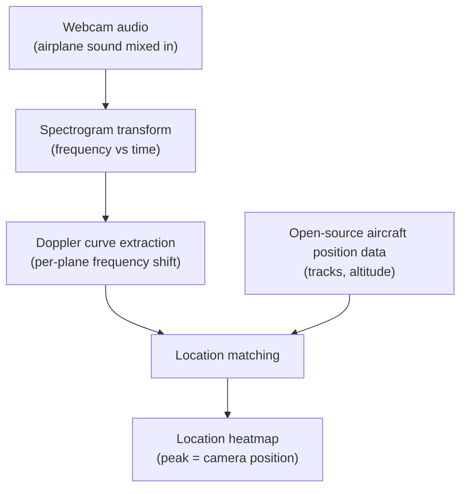

## Why this is worth reading

One-line warning for developers who handle video and audio, and for anyone operating AI agent environments. Sound carries far more location information than you would assume. This demo pinpointed the physical location of a camera using only the Doppler effect in airplane noise. The interesting part is not the method but the speed. Claude Code finished the replication in a few hours. If replication costs a few hours, the attack surface is much wider.

## In plain terms

An ambulance siren sounds high-pitched as it approaches and drops in pitch as it passes. The Doppler effect is exactly that phenomenon. We learned in school that the wavelength of sound stretches or compresses depending on the motion of the sender and the receiver. This demo uses airplanes instead of the ambulance. Each airplane in the sky has a distinctive sound, and the curve of how that sound's pitch changes is determined by the angle at which the plane passes overhead. Where you heard it is already written in that curve.

## Overview

On November 2, 2026, 0x45o introduced a technique by one user: "This guy figured out how to leak your exact location from any video with sound using the Doppler curves of nearby airplanes." A day later, paraschopra posted that he had replicated it with Claude Code. The post passed 260,000 views.

The replication is simple in outline. Take webcam audio, turn it into a spectrogram, extract the Doppler curves of the airplane sounds, and match them against open-source aircraft position data. The match becomes a location heatmap, and its peak lands on where the webcam actually was. paraschopra's webcam was 7 km south of Southampton, UK.

## What this technique is

The principle has three steps. First, represent the audio as a spectrogram, a table of how frequency changes over time. As an airplane approaches, the frequency of its sound climbs gradually; as it passes, it falls. That curve is the Doppler curve.

Second, match the curves against aircraft position data. Which plane flew which route at which time is public in open-source data. If the Doppler curve you observed matches the curve of "the person who saw that plane at that distance and angle," then you were at a specific position relative to that plane's track. With several planes, the candidate positions narrow down.

Third, score the remaining candidate positions and build a heatmap. The peak is the camera's location. It is not GPS. But in the demo, the peak pointed at the webcam's real position.

## The Claude Code replication angle

As paraschopra put it, the one that did this replication was Claude Code. "I replicated it with Claude Code, in a few hours" is the second core fact of this story.

Take the pipeline's parts one by one, and they are not work you finish in a day. Read the audio and build the spectrogram. Find the frequency band that corresponds to the airplane. Track that band's frequency over time and pull it out as a curve, DSP code. Bring in the aircraft position data and build a matching model that compares your curve against the tracks. Grid the candidate positions and score them for the heatmap. Each part has examples on the internet, but chaining them in this order into one working pipeline is days of human work.

Claude Code did that "chaining" in a few hours. Given only a description of the demo to replicate, it found the libraries, designed the stages, wrote the code, ran it, and when the result differed from expectation, fixed it and moved on. Telling an agent "replicate this demo" actually ended as pipeline development.

Two things matter here. First, the replication cost of a non-trivial scientific engineering pipeline has dropped to hours. Second, the replication happened through the agent's own chain of judgment. A human was not checking every step; the agent decided and progressed stage by stage.

## Privacy and security implications

paraschopra's follow-up post carries the generalization of this story in one line: "There are side-channels everywhere, and all such side-channels will get discovered and exploited for fun and profit."

The technical requirements of this demo are not high. Video with sound, an environment where airplanes cross the sky, open-source aircraft position data. Near an airport, in a city on a flight path, close to a military facility, outside a research site. The requirements can hold in any environment where sound is present.

The most intuitive threat is location exposure in sources you believed had no location metadata. Webcam recordings, CCTV, phone voice notes, live streams. Location leaks from material where you assumed "the time may leak, but the location does not." Conversely, in material where location is already stamped, the same technique can sharpen the accuracy of that location.

The defense side changes in one way too. Turning off the audio is not the only countermeasure. In an environment where airplane noise is mixed in, the noise itself is the signal. Knowing which frequency bands are exposed in which environments, and what matching those exposures lead to, is now basic hygiene.

## Limitations and counterarguments

The demo has limits. First, accuracy. The heatmap peak matched the real location, but the resolution of that match has not been established by the published material. The "7 km south" description may be the demo's target position, with the peak landing near it. No meter-level location evidence was published.

Second, conditions. The airplane sound must be clear enough to hear, and the aircraft position data must be current. At night, during hours without flight activity, or far from any flight path, it does not hold.

Third, scope. This post is based on paraschopra's Claude Code replication post. The original user's technique mentioned by 0x45o was not verified separately. What resolution and what data sources the original used are outside this post's scope.

A counterargument is possible. Services that request location already receive the user's exact position, so this side channel does not give "new" information. But the counterargument works in reverse. The content of this demo is that location emerges in a context where location was not requested. Location information leaks from material that never asked for location.

## Implications for ThakiCloud products

From Paxis's perspective, the meaning of this story is the agent's replication cost. Paxis is the Agent-Native Cloud that treats Skills, Tools, Policies, and Audit Logs as first-class resources. In an environment that runs agents capable of "replicating a non-trivial pipeline in hours," this demo shows why the audit trail and policy boundary of that replication must be first-class resources. If the process in which the agent autonomously finds data, writes code, and executes does not land in Audit Logs, the audit cost rises as the price of the falling replication cost.

From Metis's perspective, the security hygiene of customer workloads widens by a layer. Workloads that handle video and audio can carry location even when the source has no location metadata. When a customer assumes "there is no location in the source," checking that assumption is a service the platform can provide.

## Summary

Sound carries location. The Doppler curves of airplanes are the trace of that location, and open-source aircraft data is the key to reading the trace. This demo showed two things. The matching actually works. And Claude Code replicated the pipeline in a few hours.

Two questions remain for developers. What sound is exposed in your material? If an agent can replicate in hours, how far does your attack surface extend? Side channels are exploited as soon as they are discovered. Knowing how an exposure leads to a matching is a defensive advantage, not only reducing the exposure.

## Sources

- [0x45o's introduction post](https://x.com/0x45o/status/2117332304880169152): technique for leaking location via Doppler curves
- [paraschopra's replication post](https://x.com/paraschopra/status/2117561731065274562): Southampton webcam demo replicated with Claude Code
- [paraschopra's follow-up post](https://x.com/paraschopra/status/2117589464054894924): "There are side-channels everywhere"
