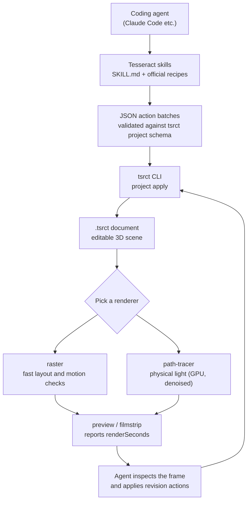
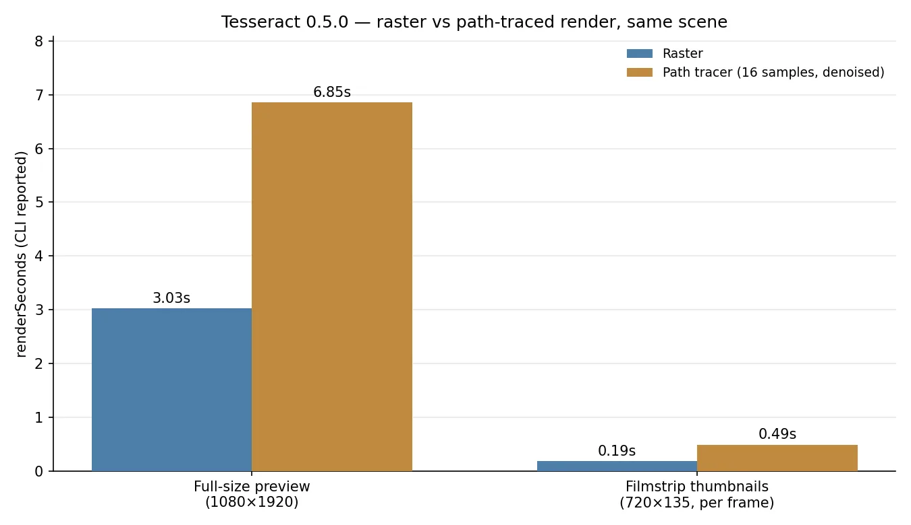
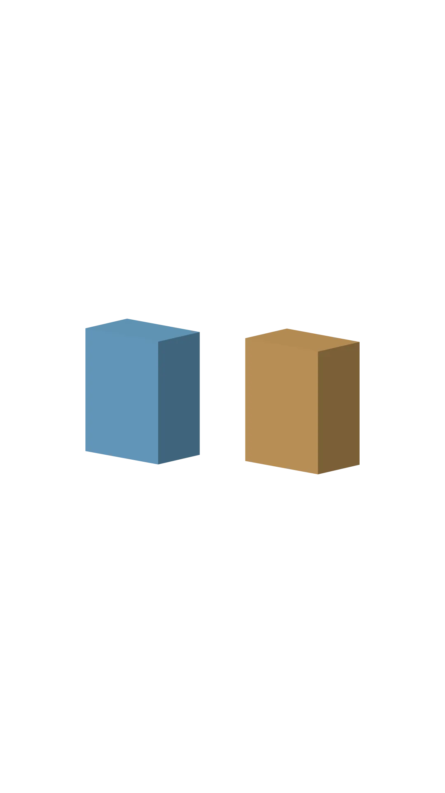
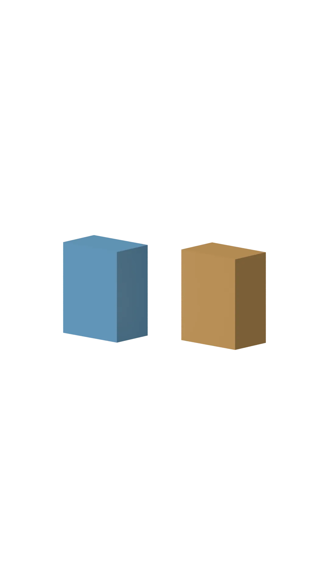

*A visual metaphor for the article's key idea.*

## Who should read this

This is for developers who build prototypes with coding agents and need to show the result to a customer or a team. The conclusion up front: you no longer need a separate rendering service or 3D software to produce a 3D scene. On a MacBook, a full-frame render measured 3.03s on raster and 6.85s on the GPU path tracer. This post records installing Mirage's Tesseract CLI 0.5.0 for real, rebuilding an official recipe scene from JSON actions, and timing both renderers.

## In plain terms

Picture a film set. The director does not rig the lights personally; they instruct a crew. Tesseract is a set that an agent can instruct. The set design lives in an editable document called `.tsrct`; camera position and light direction arrive as JSON batches. The crew (the CLI) builds the set and rolls the monitor (a preview). The director checks the monitor, and when the light looks physically right, they call the final shot with proper lighting (the path tracer). The key: the director never touches the rig. They instruct, watch the screen, and revise. That is the whole loop.

## Overview

On November 4, 2026, a [tweet from trymirage](https://x.com/trymirage/status/2118054387209925032) started circulating: "Opus 5.5 or Astra can now create professional-grade 3D outputs with path-traced rendering," with a video made without 3D software. [igus_ai](https://x.com/igus_ai/status/2118212218999472574) picked it up in Spanish, adding that Tesseract is completely free.

The tool behind the thread is [Mirage](https://mirage.app)'s Tesseract. The first line of the [mirage-hq/Tesseract](https://github.com/mirage-hq/Tesseract) repo (204 stars) reads "The creative suite built for your AI agent." It is a CLI plus a set of skills (SKILL.md files) that let an agent drive video editing, motion graphics, sound, and 3D scenes inside one local project. The 3D page shows a [reflective sphere and rotating ring rendered with native GPU path tracing](https://mirage.app/tesseract/3d), and emphasizes that geometry, materials, lighting, and camera all stay editable by the agent. The latest release, v0.5.0, shipped on November 3, 2026.

Mirage is a New York creative-tools company whose tagline is "one person to direct an entire creative production." Captions, the workspace where 250 million videos have been made, is the human side; Tesseract is the professional toolset that gives the agent itself the means of production. Video, motion graphics, sound, and 3D all enter one editable project, and the result stays a document the agent can revise. Note what this is not: it is not a cloud API that takes your video and hands back a rendered frame. The CLI runs locally, the project file lives on local disk, and the agent edits it through commands and file access. A ChatGPT/Codex plugin is already published; the Claude Code plugin is listed as "coming soon."

## What this tool is

Tesseract reads as three layers. The document layer: every project is a portable `.tsrct` document holding cameras, lights, meshes, animation, and sound. Hand that document to an agent and you can ask for one specific change. The action layer: documents are edited with JSON action batches. You group actions like `createFxScene3DLayer`, `addFxScene3DFragment`, `setFxScene3DActiveCamera` into an array and pass them to `tsrct project apply`; the CLI validates them against its schema and accepts or rejects the batch. The render layer: `preview`, `filmstrip`, and `export` turn the scene into images or video, and that is where you pick a renderer.



The difference between the two renderers is how light gets in. Raster fills in shadows and reflections with renderer helpers; it is fast and fine for stylized graphics or layout checks. The path tracer actually traces light paths through the scene; soft shadows, bounced light, and glass or metal reflections come from physics. In the official docs' words, it is "much slower, and far slower again without a hardware GPU." A path-traced preview downloads the denoiser weights on the first render. The renderer is a command flag, not part of the document: `--renderer path-tracer` or not, and that is the whole choice.

| Renderer | Use for | Character |
|---|---|---|
| raster | layout, motion checks, stylized graphics | fast; light approximated by helpers |
| path-tracer | realism, reflections and refraction, product shots | GPU ray tracing; time scales with samples |

Keep one fact in mind: browser and iOS playback render in raster even when the export used the path tracer. Render time and physical accuracy of the frame are separate questions.

The skill document (tesseract-3d SKILL.md) adds a second discipline, aimed at the agent. Before writing actions, look up the exact fields in `project schema`; do not guess property names or enum spellings. Apply in small batches, and stop at a rejected batch before rendering. Verify animation with filmstrip samples, not stored keyframes: the sampled frames must visibly differ or it is not proof. And at the end, run a "critic review": two independent critics, an art director and a specialist for the scene's purpose, score the rendered preview, and the agent revises between rounds until both rate it at least 8.5/10, for at most three rounds. The quality gate is not a human; it is an agent process that renders, scores, and repeats. Because the CLI reports renderSeconds as JSON, the loop carries a time budget.

## Installation and integration

On macOS (Apple Silicon), following the official installation guide. The release page provides the CLI ZIP and its SHA-256 file.

```sh
curl -fLO https://github.com/mirage-hq/Tesseract/releases/download/v0.5.0/tesseract-0.5.0-darwin-arm64.zip
curl -fLO https://github.com/mirage-hq/Tesseract/releases/download/v0.5.0/tesseract-0.5.0-darwin-arm64.zip.sha256
shasum -a 256 -c tesseract-0.5.0-darwin-arm64.zip.sha256
ditto -x -k tesseract-0.5.0-darwin-arm64.zip extracted
bash extracted/tesseract-0.5.0-darwin-arm64/install.sh
"$HOME/Library/Application Support/Tesseract/bin/tsrct" --version
```

Measured results. The ZIP was 116,615,086 bytes and the SHA-256 matched the release file (`151754b43aad17…`). All 450 files listed in the bundle's internal CHECKSUMS.sha256 passed, and `--version` printed `tsrct 0.5.0 (ac63ae146d90fad317cfc36ca39cf70797314da2)`. The install is sudo-free: it lays down a versioned directory under `~/Library/Application Support/Tesseract` and drops a symlink in `bin/`.

Agent skills are a separate package. With Node available, one line pulls them in:

```sh
npx skills add mirage-hq/Tesseract
```

The skills do not install the CLI; they are the documentation that tells the agent how to install and verify it. The CLI version is pinned by `cli-version.txt` next to the skill. To confirm a 3D-enabled build, dump the schema to a file and search for the marker:

```sh
tsrct project schema > schema.json
# a 3D build contains createFxScene3DLayer
```

Our schema came out to 1,453,539 bytes with `createFxScene3DLayer` present.

The official 3D page also ships a setup prompt you paste straight into your agent: "Set up Tesseract by Mirage so you can create editable designs and 3D scenes, edit videos, and make motion graphics in this agent's environment. Read https://github.com/mirage-hq/Tesseract and check the requirements for this local or hosted environment. If it is supported, follow the official plugin or skills installation guide, use its required runtime version, verify the download checksum, and confirm a short preview renders correctly. Then ask what I want to make and which brand references or source assets I have. Keep the editable project and source assets with the finished render." Note that "verify the download checksum" and "confirm a short preview renders correctly" are inside the prompt. The install gate and the first-render check are written down, not left to the agent's discretion.

## Measured results

We rebuilt the first example from the official Scene3D recipes. The scene stands up with four actions: an orthographic camera (scale 640) aimed at the world center via an aim constraint, and one parallel sun (irradiance 3, rotationX -45) shining from above-front. The recipe batch then adds two boxes. The left box rotates with an Euler angle (rotationY 25°); the right box with the same angle expressed as the quaternion `[0, 0.2164, 0, 0.9763]`. The recipe's point is to verify in the render that both rotations point the same way.

```sh
tsrct project create --project scene.tsrct
tsrct project apply --project scene.tsrct --actions base.json
tsrct project apply --project scene.tsrct --actions recipe.json
tsrct preview --project scene.tsrct --time 2 --output raster.png
tsrct preview --project scene.tsrct --time 2 --output path.png --renderer path-tracer --samples 16
tsrct filmstrip --project scene.tsrct --timestamps-ms 0,1250,2500 --frame-rate 30 --output check.png
```

Both applies were accepted with zero warnings. The preview renders at the document's authored size (1080×1920, portrait). The CLI reports render time as JSON.

| Render | Resolution | Settings | renderSeconds |
|---|---|---|---|
| preview | 1080×1920 | raster | 3.03s |
| preview | 1080×1920 | path-tracer, 16 samples, denoised | 6.85s |
| filmstrip (3 frames) | 720×135 | raster | 0.19s/frame |
| filmstrip (3 frames) | 720×135 | path-tracer, 16 samples, denoised | 0.49s/frame |


*Same scene, two renderers. 2.26x on the full preview, 2.63x on filmstrip thumbnails. Measured renderSeconds reported by the CLI.*


*Raster render. When both boxes point the same way, the Euler and quaternion placements are confirmed equivalent.*


*Path tracer (16 samples, denoised) render. Indirect light spreads more softly across the top faces.*

The camera in this scene is orthographic (scale 640): it does not zoom, and objects keep a fixed size. Because of the aim constraint, moving the camera does not move the subject out of frame. The parallel light (irradiance 3) sits at rotationX -45, so light arrives from above-front. Faces turned toward the upper front read bright; the opposite faces read dark. That is how you read the light direction, and why the official recipes check "is the lit face the right one" rather than "is the number right."

Put the two renders side by side and the difference is in the light. Raster gives each face a uniform shade; the path tracer adds a soft spread across the top faces. Sixteen samples is the recommended value for previews and drafts; before final delivery the guide suggests the default 128. Halving the noise takes four times the samples, and render time grows roughly in proportion. Expect the agent to compute the time budget for a final render before it commits, because the CLI hands it the numbers.

Here is the structure again. The agent does three things: it writes or revises JSON actions, it looks at the rendered image, and it decides the next action. The CLI renders, reports the time as JSON, and leaves the frame as a file. No 3D software to open, no render farm to queue. The director who built the set and now only watches the monitor.

## Implications for ThakiCloud products

From a Paxis standpoint, this tool is a signal that the agent's hands just got one tool longer. Paxis is the control plane of an agent-native cloud where Skills, Tools, Policies, and Audit Logs are first-class resources, and the Tesseract skills fit that category exactly. The loop here: a coding agent reads the SKILL.md, references the official recipe JSON, and validates its own output against the render result. That is the movement Paxis runs in isolated sandboxes and records through policy gates and audit logs. Even for teams that never build a 3D scene, the three-step pattern repeats: the tool arrives as a skill, the result stays as a file, and the agent reads that file again. The two-critics, 8.5-of-10 structure is also a scaled-down policy gate: one agent's output is scored by another judgment, and it goes to the next round until it passes. The design is already inside the tool's skill document.

From an ai-platform standpoint, the practicality of local GPU rendering stands out. The path tracer assumes a hardware GPU, and our measurement ran on the MacBook's built-in GPU (wgpu) at 6.85s for a full frame. As long as you do not round-trip an external rendering API, your data never leaves the machine. That applies directly to creative workflows on on-prem environments. ThakiCloud's ai-platform is built on the same on-prem and sovereign premise. The moment rendering becomes a GPU job, resource accounting like a Kueue queue attaches, and "how many frames in how many seconds" becomes an operational metric.

## Limits and counterarguments

A few things to separate out. First, the Tesseract CLI is free but not open source. The repo's license field reads NOASSERTION, and each ZIP carries a TERMS.md that governs the bundle. The skills (README, SKILL.md, recipes) are public, so you can read how it works, but the renderer code is closed. Second, platform support is macOS, Windows, and Linux x86_64 (glibc 2.35+). Apple Silicon Linux and ARM servers are not on the list; Linux needs a Vulkan driver, and the bundle lacks an H.264 encoder, so you must attach a separate FFmpeg. Third, path-tracer slowness is a documented limit. If 16 samples is 6.85s on a full frame, the default 128 goes past 30s by simple arithmetic, and complex scenes will pull further apart. Fourth, browser and iOS playback are raster-fixed. A path-traced export does not play that way on mobile. Fifth, some commands send basic usage telemetry, as the skill document states. It also says the CLI respects your telemetry opt-out and that an agent must never enable it on your behalf.

We did not verify the "+$10K/month" income claims in the tweet thread. That is outside this check's scope. A tool that makes video does not by itself make money. What the tool gives is a loop: the agent touches the 3D, reads the render time, and verifies the result as a file.

## Wrap-up

The coding agent just gained a set to direct. Tesseract 0.5.0 ends at the CLI from install to render, 3D scenes stand up from JSON actions, and when the light has to be physically right, the path tracer answers with 2.2 to 2.6 times the time. Next time you ask an agent for 3D, start by running the first official recipe scene and reading its `renderSeconds`. That number is your first measurement against the team's GPU and time budget. Two things to remember: the denoiser weights download on the first path-traced render, so the first one is always the slowest; and samples are the dial, 16 for drafts, 128 for final. Ask the agent to compute the final-render time before you export. The CLI returns the numbers as JSON, so it is arithmetic the agent can do.

*This experiment ran on 2026-11-05 on a MacBook (Apple Silicon) with Tesseract 0.5.0 (ac63ae1). All numbers are as reported by the CLI.*

## Sources

- [mirage-hq/Tesseract (GitHub)](https://github.com/mirage-hq/Tesseract)
- [Tesseract 3D (Mirage official)](https://mirage.app/tesseract/3d)
- [trymirage tweet (2026-11-04)](https://x.com/trymirage/status/2118054387209925032)
- [igus_ai tweet (2026-11-04)](https://x.com/igus_ai/status/2118212218999472574)
- [Tesseract-Projects (official examples)](https://github.com/mirage-hq/Tesseract-Projects)
